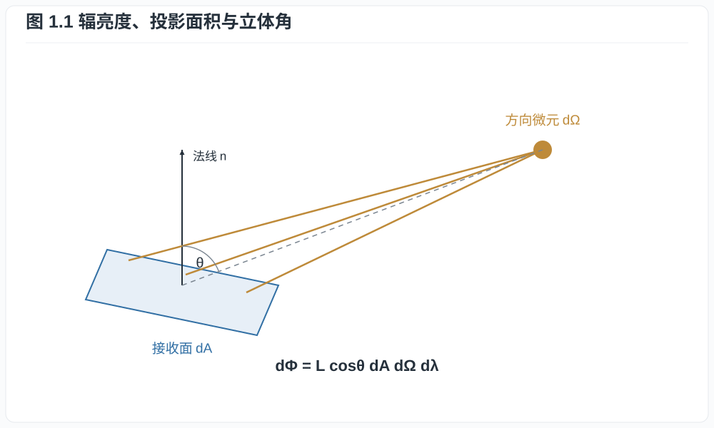
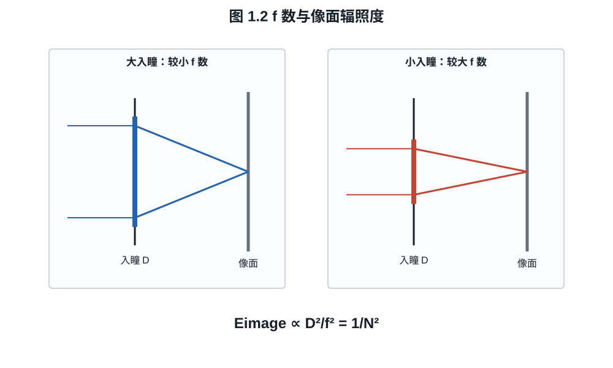
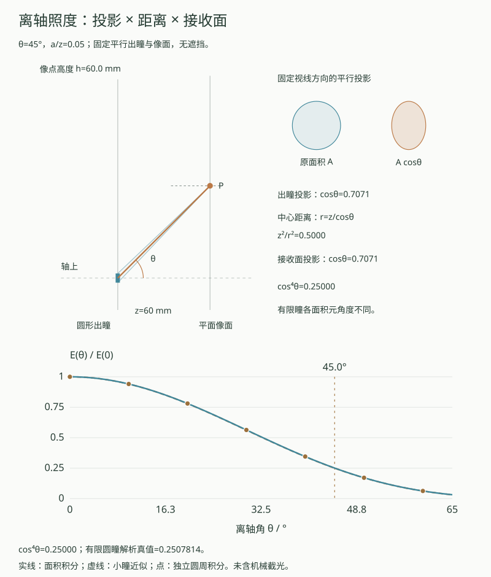

# 第一章：辐射度学、光圈与曝光量

同一场景下，快门从 $1/125$ s 改为 $1/250$ s，像素接收的平均光子数约减半；
光圈从 $f/4$ 开到 $f/2.8$，又能大致补回这部分光。若改为提高 ISO，照片也可能
变亮，但进入传感器的光没有因此增加。区分这几种操作，需要先描述镜头把多少光
送到单位面积，以及像素在曝光期间一共接收多少能量。

## 1.1 从功率到辐亮度

**定义 1.1（辐射通量）.** 辐射通量 $\Phi_e$ 是单位时间传输的辐射能，单位为
瓦特。单位面积接收的通量密度称为辐照度（irradiance）：

$$
E_e=\frac{d\Phi_e}{dA},\qquad [E_e]=\mathrm{W\,m^{-2}}.
$$

辐照度记录接收面的总收光，还没有区分来光方向。描述方向范围需要立体角
（solid angle）：以观察点为球心，在半径 $r$ 的球面上截取面积 $A_s$，对应的
立体角为 $\Omega=A_s/r^2$，单位为球面度sr。整球是 $4\pi$ sr，半球是 $2\pi$ sr；
同一束方向张成的范围不随所选球半径改变。

再把来光按波长分开。对与传播方向垂直的投影面积 $dA\cos\theta$、立体角
$d\Omega$ 和波长间隔 $d\lambda$，定义光谱辐亮度（spectral radiance）

$$
L_{e,\lambda}
=\frac{d^3\Phi_e}
{dA\cos\theta\,d\Omega\,d\lambda}.
$$

对一个接收面，把各方向的来光按投影因子相加，就得到光谱辐照度：

$$
E_{e,\lambda}
=\int_{\Omega_+}L_{e,\lambda}(\theta,\phi)
\cos\theta\,d\Omega.                                      \tag{1.1}
$$

*图 1.1　辐亮度的面积因子是与传播方向垂直的投影面积
$dA\cos\theta$；方向范围由立体角 $d\Omega$ 度量。图为微分几何示意，不按比例。*

**命题 1.2（均匀半球辐亮度）.** 若入射半球内
$L_{e,\lambda}=L_0$ 与方向无关，则 $E_{e,\lambda}=\pi L_0$。

**证明.** 在球坐标中 $d\Omega=\sin\theta\,d\theta\,d\phi$，故

$$
E_{e,\lambda}
=L_0\int_0^{2\pi}\int_0^{\pi/2}
\cos\theta\sin\theta\,d\theta\,d\phi
=2\pi L_0\left[\frac{\sin^2\theta}{2}\right]_0^{\pi/2}
=\pi L_0.
$$

半球立体角虽为 $2\pi$ sr，辐照度却是 $\pi L_0$，因为斜入射还要乘
$\cos\theta$。镜头收光也有同样的投影权重：不仅要知道开孔面积，还要知道像点
从多大的方向范围看见这个开孔。

## 1.2 曝光量与光子数

**定义 1.3（辐射曝光量）.** 曝光区间 $[0,t]$ 内的光谱辐射曝光量是

$$
H_{e,\lambda}(\lambda)=\int_0^t E_{e,\lambda}(\lambda,s)\,ds.
$$

若照明不随时间变化，则 $H_{e,\lambda}=tE_{e,\lambda}$。单个波长 $\lambda$ 的
光子能量为

$$
\varepsilon_\gamma(\lambda)=\frac{hc}{\lambda}.
$$

因此面积 $A_p$ 的像素接收的平均光子数为

$$
\mu_\gamma
=A_p\int_0^\infty
\frac{H_{e,\lambda}(\lambda)}{hc/\lambda}\,d\lambda
=\frac{A_p}{hc}\int_0^\infty
\lambda H_{e,\lambda}(\lambda)\,d\lambda.                 \tag{1.2}
$$

式 (1.2) 解释了为什么相同焦平面能量不必产生相同光子数：长波光子的单个能量更
低。不过传感器的量子效率也随波长变化，电子数还不能只由总光子数决定。

**例子 1.4（绿光下的光子预算）.** 一个 $4\ \mu\mathrm m\times4\ \mu\mathrm m$
像素在 $550\ \mathrm{nm}$ 窄带光下接收
$H_e=1.0\times10^{-4}\ \mathrm{J\,m^{-2}}$。像素上的能量为

$$
E_p=A_p H_e=16\times10^{-12}\times10^{-4}
=1.6\times10^{-15}\ \mathrm J.
$$

取 $h=6.626\times10^{-34}\ \mathrm{J\,s}$、
$c=2.998\times10^8\ \mathrm{m/s}$，单光子能量约为
$3.61\times10^{-19}\ \mathrm J$，故平均入射光子数约为

$$
\mu_\gamma\approx\frac{1.6\times10^{-15}}{3.61\times10^{-19}}
\approx4.43\times10^3.
$$

若量子效率为 $70\%$，平均信号电子约为 $3.10\times10^3$；这是下一章的起点。

## 1.3 为什么像面照度按 f 数平方变化

令镜头有效焦距为 $f$、入瞳直径为 $D$，相对孔径数定义为

$$
N=\frac fD.
$$

先用光阑位于透镜平面、入瞳与出瞳直径均为 $D$ 的理想薄透镜说明。物体位于远处，
取轴上一小块辐亮度近似均匀的扩展物面，首尾介质均为空气，忽略渐晕与像差。
像点看见的圆形出瞳半角 $\alpha$ 满足小角近似

$$
\sin\alpha\approx\tan\alpha\approx\frac{D}{2f}=\frac1{2N}.
$$

若镜头透射率为 $T$，由命题 1.2 对出瞳所张立体角积分，得到轴上像面辐照度

$$
E_\mathrm{img}
=T L_e\int_0^{2\pi}\int_0^\alpha
\cos\theta\sin\theta\,d\theta\,d\phi
=T L_e\pi\sin^2\alpha
\approx\frac{\pi T L_e}{4N^2}.                            \tag{1.3}
$$

*图 1.2　在焦距和物方辐亮度固定的近轴模型中，入瞳直径决定像点所见的出瞳
立体角，因而 $E_\mathrm{img}\propto D^2/f^2=N^{-2}$。图中光束仅表示边缘光线。*

演示另外保留有限圆锥角，便于检查近似误差。在同面光阑、瞳放大率为 1 的薄透镜
模型中，以 $m\ge0$ 表示横向放大率的绝对值，像距为 $f(1+m)$，于是
$\tan\alpha=1/[2N(1+m)]$。由前面的圆锥积分，

$$
E_\mathrm{img}
=\pi T L_e\sin^2\alpha
=\frac{\pi T L_e}{4N^2(1+m)^2+1}.
$$

近轴近似略去分母中的 $+1$。页面用角积分与解析值互核，等曝光预设也按这个
圆锥模型匹配时间。播放时，背景光子数与移动点的轨迹分别累积；两次曝光即使收集
相同的平均光子数，也可能因持续时间不同而留下不同长度的拖影。

**推论 1.5.** 采用式 (1.3) 的近轴近似，保持物方辐亮度和透射率不变，把f数乘以
$\sqrt2$，像面辐照度减半，即减少一档曝光。

**证明.** 式 (1.3) 中 $E_\mathrm{img}\propto N^{-2}$，所以

$$
\frac{E_\mathrm{img}(\sqrt2N)}{E_\mathrm{img}(N)}
=\frac{N^2}{(\sqrt2N)^2}=\frac12.
$$

按一档曝光的定义，这正是减少一档。$\square$

有限圆锥模型给出的比值为
$[4N^2(1+m)^2+1]/[8N^2(1+m)^2+1]$，略大于二分之一。
例如取 $N=1,m=0$，改为 $N=\sqrt2$ 后的比值是 $5/9$；保持曝光量所需的时间
倍率是 $9/5$。当 $N(1+m)$ 增大时，这两个比值分别趋近 $1/2$ 和 $2$。

镜头实际透射率不等于 $1$，电影摄影常用 T-stop 把透射损失并入。若记 T 数为
$N_T$，可用

$$
N_T\approx\frac{N}{\sqrt{T}}
$$

理解其一阶关系。相同 f 数的镜头可能因镀膜、镜片数量和遮挡而有不同透射。宽谱下
$T$ 实际随波长变化，测得的 T 数还依赖光源及接收端的光谱加权。

复合镜头的入瞳和出瞳可以大小不同，位置也不在主平面上。此时应先由出瞳直径与
出瞳到像面的距离求像方锥角；在空气、无穷远和近轴条件下，光学不变量仍给出
$\sin\alpha\approx1/(2N)$，所以保留式 (1.3) 的 $N^{-2}$ 关系。不能把入瞳直径
直接除以任意一个镜片到传感器的距离来代替锥角。瞳的定义与一阶追迹见第十一章。

## 1.4 离轴照度、放大率与有效光圈

考虑一块平面出瞳，面积为 $A$，它与平面像面的轴向距离为 $z$。轴上像点到出瞳
中心的距离为 $z$；离轴视线与光轴夹角为 $\theta$ 时，距离变成 $z/\cos\theta$。
小出瞳近似下，其立体角由轴上的 $A/z^2$ 变为
$A\cos\theta/(z/\cos\theta)^2$，相差 $\cos^3\theta$；接收面再贡献一个入射
投影因子 $\cos\theta$，于是得到 $\cos^4\theta$ 的照度比例。这里假定瞳面固定、
辐亮度和透射率不随方向改变。真实广角镜头的出瞳畸变、机械截光和像素角度响应会
使暗角偏离该规律。

有限出瞳上的不同位置有不同距离和入射角，不能共用中心视线的四个余弦因子。
下面逐面积元积分，比较有限瞳结果与小瞳近似；首读时也可先看图，再接着读§1.5。

### 出瞳有限大时，cos⁴θ 还有多准？

把出瞳半径记为 $a$，像点相对光轴的高度记为 $h=z\tan\theta$；本小节的 $h$
是长度，与光子能量中的 Planck 常数按上下文区分。这里的 $\theta$ 是像点到
**出瞳中心**的连线与光轴的夹角，未必等于真实镜头的物方视场角。
瞳面点 $(x,y)$ 到像点的距离为 $r=\sqrt{z^2+(x-h)^2+y^2}$。两平面平行，
面积元的立体角为 $z\,dA/r^3$，接收面投影再乘 $z/r$，所以

$$
\frac{E(h)}{TL}
=\iint_{x^2+y^2\le a^2}
\frac{z^2\,dx\,dy}{[z^2+(x-h)^2+y^2]^2}.                  \tag{1.3a}
$$

此处 $L$ 是均匀、方向无关的辐亮度，$T$ 是固定能量透射率；所有瞳面点均可见。
$a,z,h$ 用同一长度单位时，积分对应投影立体角，$E/(TL)$ 的单位为 sr。
不再把整个出瞳当作中心处的一个小面积，便可直接计算有限出瞳的照度。

另一路可以不用面网格。令 $\boldsymbol v=(x-h,y)$，由
$\nabla\cdot[\boldsymbol v/(z^2+|\boldsymbol v|^2)]
=2z^2/(z^2+|\boldsymbol v|^2)^2$，把面积分化为圆周积分。记
$A=z^2+h^2+a^2$、$B=2ah$、$C=z^2+h^2-a^2$，则

$$
\frac{E(h)}{TL}
=\frac12\int_0^{2\pi}\frac{a^2-ah\cos\varphi}{A-B\cos\varphi}\,d\varphi
=\frac\pi2\left(1-\frac{C}{\sqrt{A^2-B^2}}\right).       \tag{1.3b}
$$

第二步用到 $a^2-ah\cos\varphi=(A-B\cos\varphi-C)/2$，以及
$\int_0^{2\pi}(A-B\cos\varphi)^{-1}d\varphi=2\pi/\sqrt{A^2-B^2}$。
后者以半角代换 $t=\tan(\varphi/2)$ 即化为
$2\int_{-\infty}^{\infty}[(A-B)+(A+B)t^2]^{-1}dt$；$z>0$ 保证 $A>|B|$。
轴上结果与小出瞳极限分别为

$$
\frac{E(0)}{TL}=\frac{\pi a^2}{z^2+a^2},\qquad
\lim_{a/z\to0}\frac{E(z\tan\theta)}{E(0)}=\cos^4\theta.  \tag{1.3c}
$$

*互动示意：平行出瞳与接收面相距60 mm，$\theta=45^\circ$、$a/z=0.05$。
依次展开出瞳投影、距离反平方和接收面投影；cos⁴θ给出25%，有限圆瞳另由
面积分与圆周解析式核对。投影小图采用固定方向的平行投影。*

调大 $a/z$ 可以看出有限出瞳修正；趋近小瞳时，两条照度曲线靠拢。回放只展开
三个几何因子，不改变物理参数。页面分别报告积分误差和 cos⁴θ 的近似偏差；
它们都不包含瞳畸变、镜筒遮挡或像素角度响应。Gardner 的有限孔径分析也强调，
这些条件决定了简单余弦规律能否用于实际镜头。

近摄时，像距增大。对理想薄透镜，由成像公式有 $s'=f(1+m)$；本节以 $m\ge0$
表示放大率的绝对值，后文光线追迹中的有符号放大率会另行声明。像方光锥由 $D/s'$
决定，因此对近似对称、瞳孔放大率接近 $1$ 的镜头，
有效 f 数近似

$$
N_\mathrm{eff}\approx N(1+m).                             \tag{1.4}
$$

$1:1$ 放大率给出 $N_\mathrm{eff}\approx2N$，即像面照度约降为无穷远时的四分之一。
这也解释了微距镜头为什么有时在对焦近处时显示更大的工作 f 数。非对称镜头要用
出瞳几何求工作孔径，内对焦还会改变焦距与瞳的位置；相机是否显示这些变化取决于
具体系统。

## 1.5 曝光等价不等于图像等价

对静态均匀场景，光圈开大一档而曝光时间减半，可保持曝光量近似不变：

$$
H_e\propto\frac{t T}{N^2}.
$$

但两张图仍可能不同。光圈改变景深、像差和衍射；曝光时间改变运动模糊、闪烁采样和
暗电流积累。以运动物体为例，$f/4$、$1/250$ s 和 $f/5.6$、$1/125$ s 的像面
曝光量接近，后一张却积累约两倍的运动位移。曝光量相同只固定了光子预算中的一项，
还要分别检查空间模糊与时间平均。

### 用两个演示检查同一个曝光预算

先在曝光积累图中比较“开大光圈、缩短时间”和原曝光的结束光子数，再看运动轨迹。
等光子数并不要求轨迹长度相同。接着在离轴图中保持出瞳与接收面距离，逐渐减小瞳
半径：有限瞳积分应趋近cos⁴θ；这里趋近的是比值，绝对照度同时也在下降。

若换成实际广角镜头，除了照度曲线，还要取得瞳的位置与形变、机械截光和像素角度
响应。第十一章的截光与瞳成像会分别讨论这些因素。要把它们合成一条实际镜头的
暗角曲线，需先统一光线、透射与探测模型，再用测量核对。

## 练习

**练习 1.1.** 证明均匀辐亮度只占据半角 $\alpha$ 的圆锥时，接收面辐照度为
$\pi L\sin^2\alpha$。

**练习 1.2.** 同一镜头从 $f/2$ 收到 $f/5.6$，忽略透射变化，像面曝光量变为原来的
多少？写成比例和档数。

**练习 1.3.** 一个 $6\ \mu\mathrm m$ 方形像素在 $650\ \mathrm{nm}$ 单色光下接收
$2.0\times10^{-5}\ \mathrm{J\,m^{-2}}$ 的曝光量，量子效率为 $60\%$。计算平均
光子数和电子数。
