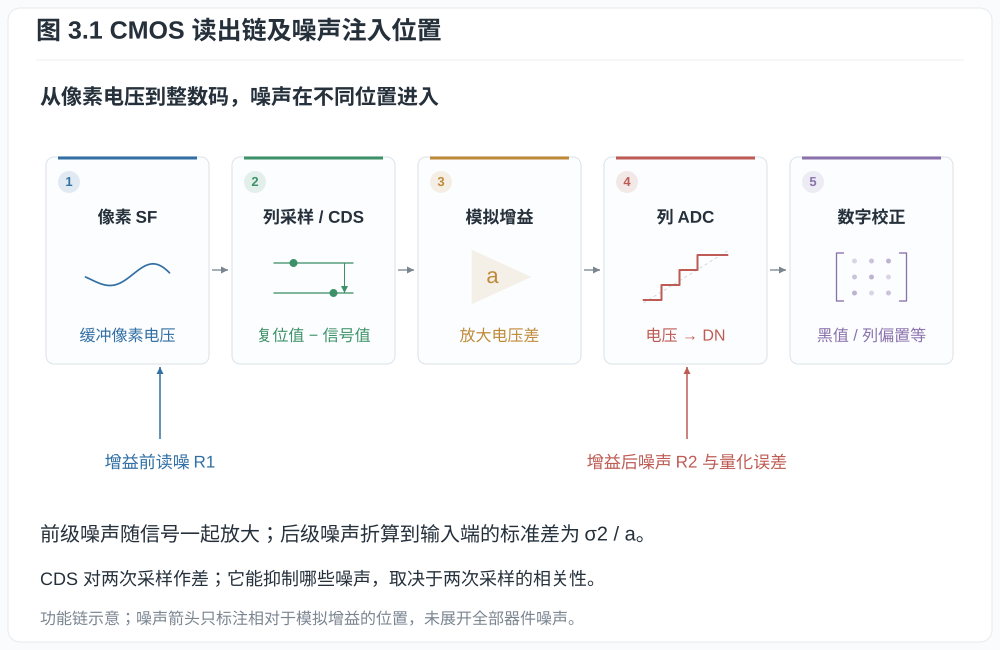
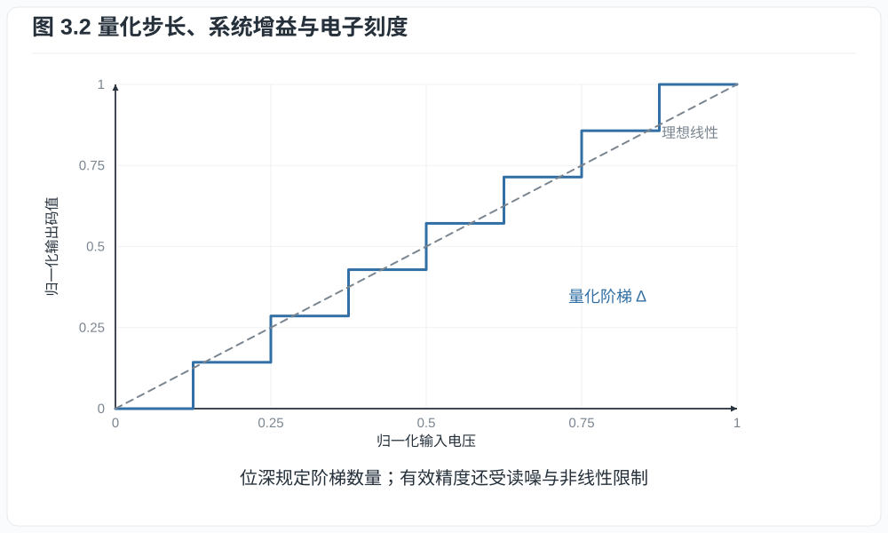
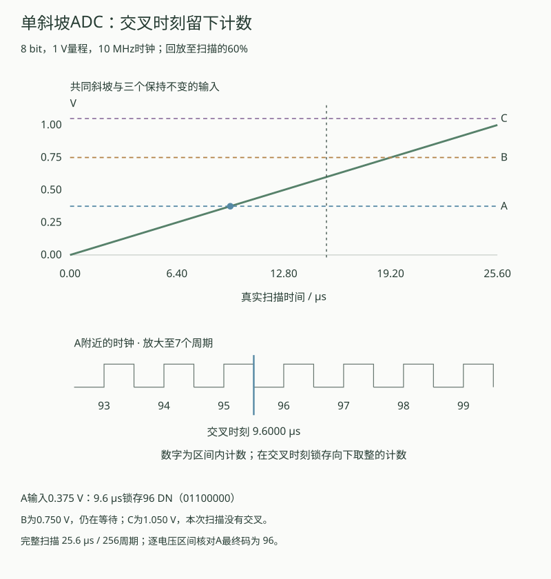
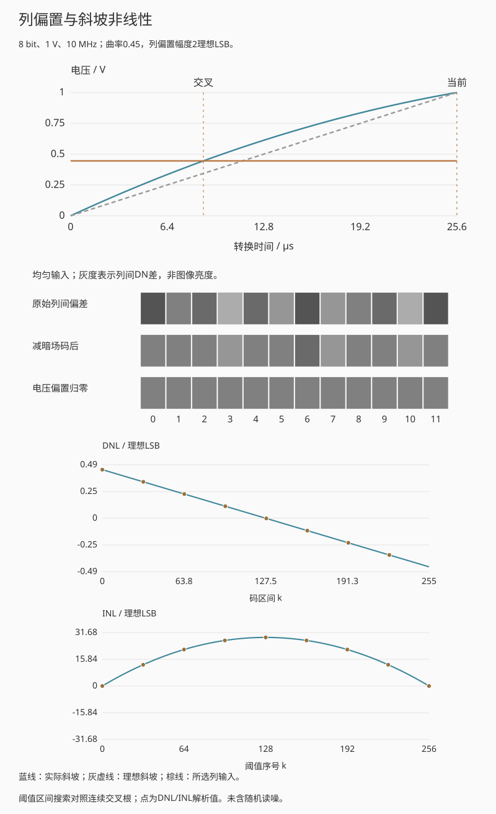
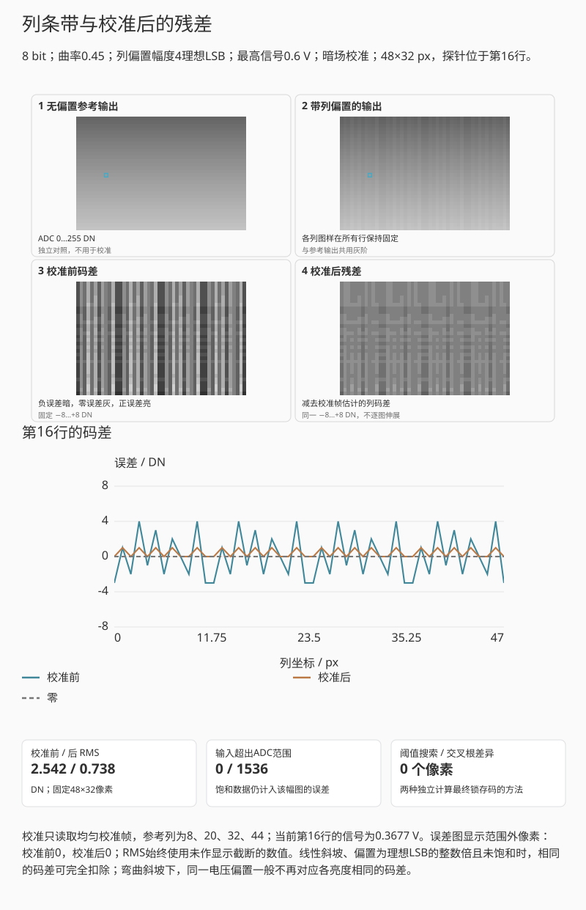
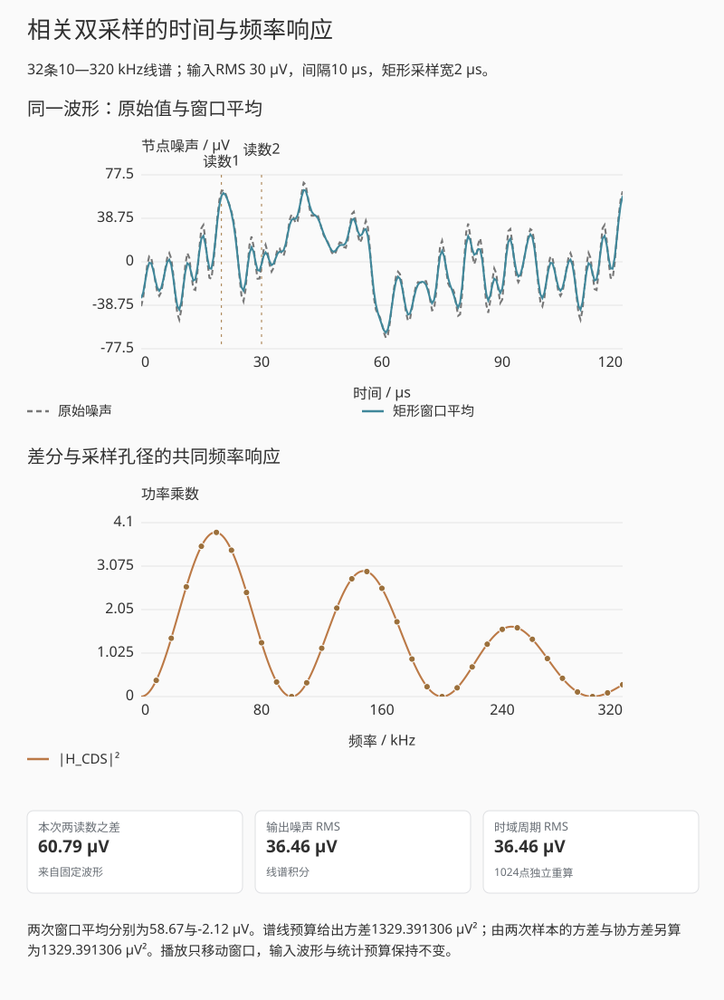

# 第三章：CMOS 像素、读出链与模数转换

上一章的像素把电子转成电压，RAW 文件却要保存整数。假设一个码值对应四个电子，
$100$ 个电子就会落在黑电平上方约 25 码处；提高模拟增益后，同一信号可以占据更多
码格，也会更早到达 ADC 上限。沿着浮动扩散节点、列电路和模数转换器逐步计算，
就能判断位深何时足够、增益何时有用，以及高光在哪一级先被剪切。

## 3.1 一个可计算的读出模型

模数转换器（analog-to-digital converter, ADC）把电压变成数字码值，常以DN
（digital number）记码值刻度。先采用线性、未饱和的单通道模型，黑电平校正前
数字输出写成

$$
Y=B+g_a g_c N_e+g_a R_1+R_2+Q.                            \tag{3.1}
$$

其中 $B$ 的单位为 DN，$g_c$ 是模拟增益取一时的电荷到码值转换系数，单位为
DN/e$^-$；$g_a>0$ 是 ADC 前的无量纲模拟增益。$R_1$ 表示增益前电压噪声按固定
ADC 电压刻度换算出的 DN 等效值，$R_2$ 表示增益后噪声的 DN 等效值，$Q$ 是 DN
单位的量化误差。因而右端各项单位相同。这里未再计入 ADC 后数字乘法。把所有
增益合并为 $g$，并折算到电子域，可写成

$$
\widetilde Y=\frac{Y-B}{g}=N_e+R_e.                       \tag{3.2}
$$

式 (3.2) 把各级读出与量化误差合并为输入等效噪声 $R_e$。改变模拟增益、读出速度、
温度或转换增益模式后，需要重新确定这一项。

*图 3.1　噪声必须按其注入位置折算回输入电子域。增益之前的噪声会随信号一起
放大；增益之后的固定电压噪声可被前置模拟增益压低其输入等效值。*

**定义 3.1（系统增益）.** 在线性区内，黑电平校正后的平均 DN 对平均信号电子数
的斜率称为系统增益：

$$
g=\frac{d\mathbb E[Y]}{d\mu_e},\qquad [g]=\mathrm{DN}/e^-.
$$

有些资料把其倒数 $1/g$ 称为 conversion gain，单位 $e^-/\mathrm{DN}$。阅读规格时
必须连单位一起读，不能只看“gain”名称。

FD 复位本身还受电容热噪声约束。若电容 $C$ 在温度 $T$ 下经电阻性开关达到热平衡，
以平衡电压为零点，电容储能为 $CV^2/2$。经典能量均分给每个二次型自由度平均能量
$k_{\mathrm B}T/2$，于是 $C\mathbb E[V^2]/2=k_{\mathrm B}T/2$，得到

$$
\operatorname{Var}(V_\mathrm{reset})=\frac{k_{\mathrm B}T}{C},
\qquad
\sigma_{N,\mathrm{reset}}=\frac{\sqrt{k_{\mathrm B}TC}}{q}. \tag{3.3}
$$

第二式把电压噪声通过 $N=CV/q$ 折算为电子。相关双采样能消去同一次复位在前后
样本中共有的随机偏置，但不能消去转移后新引入的源跟随器白噪声、列噪声和两次
采样之间不相关的噪声。式 (3.3) 因而是电容节点的起始模型，不是最终相机读噪公式。

## 3.2 列并行读出与 ADC

CMOS 像素通常按行选择，每列拥有采样和 ADC 资源。列并行结构允许许多列同时转换，
帧时间主要由行数、每行转换时间和附加消隐决定。常见单斜坡 ADC 把像素电压与线性
斜坡比较，并用计数器记录交叉时刻；其面积效率适合高列数，但转换时间随目标位数
增长。以理想单斜坡结构为例，令斜坡电压为 $V_\mathrm{lo}+st$，计数时钟频率为
$f_\mathrm{clk}$。输入电压 $V$ 与斜坡相等时，计数约为
$f_\mathrm{clk}(V-V_\mathrm{lo})/s$；一个计数对应电压 $s/f_\mathrm{clk}$。
若全量程逐码扫描，$b$ bit 转换最多需要约 $2^b$ 个时钟周期，因此在相同时钟下
增加两位会把最坏转换时间增到约四倍。实际电路可用粗细两段转换、更多并行资源或
其他 ADC 架构改变这项权衡。

**定义 3.2（理想量化步长）.** 满量程电压范围 $V_\mathrm{FS}$ 的 $b$ bit 均匀 ADC
具有步长

$$
\Delta=\frac{V_\mathrm{FS}}{2^b}.
$$

这里 $\Delta$ 使用电压单位。若输入相对于量化格足够平滑，舍入误差的电压表示可近似为
$Q_V\sim\operatorname{Uniform}(-\Delta/2,\Delta/2)$，于是

$$
\operatorname{Var}(Q_V)=\frac{\Delta^2}{12}.              \tag{3.4}
$$

**证明.** 均值为零，并且

$$
\mathbb E[Q_V^2]
=\frac1\Delta\int_{-\Delta/2}^{\Delta/2}q^2\,dq
=\frac1\Delta\left[\frac{q^3}{3}\right]_{-\Delta/2}^{\Delta/2}
=\frac{\Delta^2}{12}.
$$

式 (3.1) 中的 $Q$ 则以 DN 表示：若一个 DN 对应电压 $\Delta$，有 $Q=Q_V/\Delta$，
所以相应方差为 $1/12$ DN$^2$。电压误差与码值误差要先换到同一尺度才能合成。
均匀的单次误差分布也不保证不同样本互不相关；把量化进一步近似为独立白噪声，
需要信号或抖动使量化格内的相位充分变化。信号几乎不跨码或出现确定性条纹时，
这个近似会失效。真实 ADC 还存在微分非线性、积分非线性和列间偏置。

*图 3.2　位深给出码格数量，系统增益决定每一格对应多少电子。若模拟噪声远小于
一格且没有抖动，均匀独立的量化噪声模型并不成立。*

演示把同一电荷分别送入两条链路：一条在 ADC 前增加增益，另一条先量化再作等倍
数字乘法。暗部阶梯统一换回电子尺度，因而数字乘法不会使已合并的码格重新分开。
选取高光输入时，还能看到前增益通道更早到达 ADC 上限。增益改变前后的满阱保持
相同；噪声读数只计算声明的读出与量化模型，未把光子噪声混入其中。

### 单斜坡的扫描与锁存

把输入电压在转换期间保持不变，单斜坡ADC便可把电压差变成时间。令下端为零，
量程跨度为 $V_\mathrm{FS}>0$，计数时钟为 $f_\mathrm{clk}>0$，
$L=2^b$；用 $L$ 个周期扫完量程时，

$$
T_\mathrm{scan}=\frac{L}{f_\mathrm{clk}},\qquad
V_\mathrm{ramp}(t)=V_\mathrm{FS}\frac{t}{T_\mathrm{scan}},
\quad 0\le t\le T_\mathrm{scan}.                         \tag{3.4b}
$$

对 $0\le V<V_\mathrm{FS}$，比较器交叉时刻为
$t_\times=T_\mathrm{scan}V/V_\mathrm{FS}$。若约定在交叉时锁存已经过去的整周期数，
则输出码为 $c=\lfloor f_\mathrm{clk}t_\times\rfloor
=\lfloor V/\Delta\rfloor$，其中 $\Delta=V_\mathrm{FS}/L$。
恰在时钟边沿交叉时取新计数；计数到最大码后保持，完成最后一个码区间再结束扫描。
负输入输出零，达到或超过满量程则输出 $L-1$。这些是本例明确采用的理想锁存与
截顶约定；真实电路还需处理比较器延迟和时钟边沿附近的亚稳态。

取8 bit、1 V量程和10 MHz时钟，完整扫描用256周期，即25.6 µs。输入0.375 V
在9.6 µs交叉，锁存96 DN；另一列若为0.750 V，须等到19.2 µs。前一列完成后，
公共斜坡仍需继续服务其他列。只把位深增加到10 bit，完整扫描变为102.4 µs，
电压步长则从约3.906 mV缩为约0.977 mV。

*互动示意：斜坡扫到60%时，A已锁存，B仍等待，超过量程的C没有交叉。下图展开
交叉附近的7个时钟周期，标出交叉时刻与整数计数；扫描时间和动画回放速度分别显示。*

演示同时用交叉时间公式和逐个电压区间搜索核对最终码。未越界时，把码重建为
$(c+1/2)\Delta$，误差不超过半个步长；输入越界后，不再用这个界限描述截顶损失。
这项扫描时间比较只适用于声明的单斜坡结构，整帧速度还包括行数、采样、复位与
数据传输；粗细两段或其他ADC架构可以改变时间关系。

## 3.3 位深、有效位数与电子刻度

假设线性可用范围从黑电平后 $0$ 到 $16\,000$ DN，系统增益为
$0.25\ \mathrm{DN}/e^-$，则数字白点对应

$$
Q_\mathrm{digital}=\frac{16\,000}{0.25}=64\,000\ e^-.
$$

若像素线性满阱只有 $45\,000\ e^-$，则先发生电荷饱和；若满阱为
$80\,000\ e^-$，则当前增益下 ADC 先剪切。改变模拟增益会改变二者相对位置。

**例子 3.3（14 bit 不等于 14 档）.** 14 bit 提供 $16\,384$ 个码。若黑电平噪声
标准差为 $4$ DN，可分辨下端不可能按一个码计算；若可用白点为 $15\,000$ DN，按
一倍 rms 噪声作下端，数字域比值为 $3750$，即

$$
\log_2(3750)\approx11.87\ \text{档}.
$$

若改用 SNR $=2$ 或固定图样噪声也计入，下端还会提高。位深只给出编码容器的理论
上限。

**定义 3.4（有效位数）.** 对满量程正弦测试，工程上常用信噪失真比换算 ADC 的
有效位数（ENOB）。它是 ADC 测试指标，不等于相机可记录的摄影动态范围；后者还受
光子噪声、像素饱和和图像处理影响。

这个换算来自理想均匀量化器。峰峰值为 $V_\mathrm{FS}$ 的正弦波，其均方信号为
$V_\mathrm{FS}^2/8$；量化误差均方为
$V_\mathrm{FS}^2/(12\cdot2^{2b})$。两者功率比为
$(3/2)2^{2b}$，因此理想量化 SNR 为
$6.0206b+1.7609$ dB。实测时把噪声和谐波失真一起计入分母，得到 SINAD，工程上
用

$$
\mathrm{ENOB}=\frac{\mathrm{SINAD}_{\mathrm{dB}}-1.7609}{6.0206}. \tag{3.4a}
$$

例如 SINAD 为 74 dB 时，ENOB 约为 12.0，即使输出字长是 14 bit。这里比较的是
满量程交流正弦与噪声失真功率；第四章的摄影动态范围比较饱和信号和低端噪声，
信号形态与判据不同。

### 贯穿算例：电子数怎样落到码格

[固定参数](00_preface_scope_and_measurement.md)给出 32,000 e⁻ 对应 1 V，故每电子
信号跨度为 31.25 μV。3101.02 e⁻ 对应约 0.09691 V；在增益一、黑电平零的
14 bit 均值流程中，系统增益为 $g=16383/32000\approx0.51197$ DN/e⁻，取整码为
$\operatorname{round}(3101.02g)=1588$ DN。

本例采用两端点相配的 16,384 个量化级，码格间距为输入跨度除以 16,383；
这是序章演示的明确映射。实际 ADC 的区间宽度和过载阈值须按其传输函数确定。

这里与§3.2的单斜坡采用不同的量化约定。若把输入跨度归一化为1，2 bit区间
量化按 $\lfloor4x\rfloor$ 截到0…3，区间宽为 $1/4$；端点量化按
$\operatorname{round}(3x)$，重建值为0、1/3、2/3、1。例如 $x=0.20$ 在前者输出0，
在后者输出1。比较码宽和误差时，应先选定传输规则，再使用 $2^b$ 或 $2^b-1$。

一个码格约对应 $1/g=1.953$ e⁻。采用高分辨率、无过载的均匀量化误差近似时，
输入等效量化 rms 约为 $1/(g\sqrt{12})=0.564$ e⁻，比本例 4 e⁻ 的读噪小。
1588是平均输入经取整得到的码。实际曝光逐次波动，取整后的码均值一般不等于
平均输入的取整码，分析时需区分这两个量。

## 3.4 模拟增益为什么有时有用

把式 (3.1) 中信号归一化回输入端。若 $R_1,R_2$ 零均值、互不相关，并且它们在比较的
增益范围内具有不变的注入端方差，忽略量化误差后，读出噪声方差为

$$
\sigma_{r,e}^2
=\sigma_{R_1,e}^2+\frac{\sigma_{R_2}^2}{(g_a g_c)^2}.     \tag{3.5}
$$

其中 $\sigma_{R_1,e}=\sigma_{R_1}/g_c$，两项都已折算到电子数的平方。

若两级噪声相关，还要加上
$2\operatorname{Cov}(R_1,R_2)/(g_a g_c^2)$；切换电路模式后，原来的方差参数也需重测。

提高 ADC 前模拟增益 $g_a$ 不改变已经存在的光子散粒噪声，也不改变增益前噪声
$R_1$；它能压低增益后噪声折算到输入电子域的贡献，并让微弱信号跨越更多 ADC 码。
当第二项已经很小后，继续提高增益的读噪收益趋近于零，高光却仍可能更早剪切。

例如，固定 ADC 刻度为 $100\ \mu\mathrm V/\mathrm{DN}$，像素转换增益为
$25\ \mu\mathrm V/e^-$，则 $g_c=0.25\ \mathrm{DN}/e^-$。模拟增益为一时，
一个 DN 对应四个电子，理想量化 rms 为 $4/\sqrt{12}\approx1.15\ e^-$；增益为四
时，一个 DN 对应一个电子，量化 rms 降到约 $0.289\ e^-$。若可用跨度固定为
16,000 DN，电子域剪切点却从 64,000 降到 16,000。这两个变化来自同一次增益调整。

这正是“ISO 不增加光”和“提高 ISO 有时能降低 RAW 输入等效读噪”可以同时成立的
原因。前者说的是光子与电子计数，后者说的是读出链中增益的位置。

## 3.5 黑电平、坏点与固定图样

相机通常保留光学黑区或遮光像素来估计黑电平。RAW 中的零码不必表示零电子；
负噪声摆动也需要由正的黑电平容纳。处理器减去每通道黑电平后才得到近似线性信号。

像素响应非均匀性（PRNU）可用乘性模型表示：

$$
Y_i=B_i+g(1+\delta_i)N_{e,i}+R_i,
$$

$B_i$ 是像素/列偏置，$\delta_i$ 是响应偏差。暗场能估计加性固定图样，均匀平场能
估计乘性固定图样。相机可能在 RAW 写入前已经做坏点替换、列校正或黑电平跟踪，
所以 RAW 不应被定义为“未经任何处理”。

暗场校正通常先把固定偏置视为可直接相减的常数。若列ADC的响应随输入电平弯曲，
同一电压偏置就不再对应固定的码差，需要进一步检查整段响应。

### 列偏置遇到非线性斜坡

若各列比较器前都有固定电压偏置，同一均匀输入也会给出不同的码。这是加性的
列图样，不是每次转换重新抽取的随机读噪。在线性斜坡下，输入端加一段固定电压
大致对应固定码差；斜坡弯曲后，这个码差还会随信号电平改变。

取归一化扫描时间 $\tau=t/T_\mathrm{scan}\in[0,1]$，声明一条端点不变的教学斜坡

$$
V_\mathrm{ramp}(\tau)=V_\mathrm{FS}[\tau+a\tau(1-\tau)],
\qquad |a|\le0.8.                                      \tag{3.4c}
$$

其导数为 $V_\mathrm{FS}[1+a(1-2\tau)]\ge0.2V_\mathrm{FS}>0$，所以每个量程内
输入都只有一次交叉。$L=2^b$ 个等时间区间对应阈值
$v_k=V_\mathrm{FS}[k/L+a(k/L)(1-k/L)]$。以固定零点与满量程直线为参考，
理想步长仍为 $\Delta=V_\mathrm{FS}/L$，本例定义

$$
\mathrm{DNL}_k=\frac{v_{k+1}-v_k}{\Delta}-1
=a\left(1-\frac{2k+1}{L}\right),\qquad
\mathrm{INL}_k=\frac{v_k-k\Delta}{\Delta}
=ak\left(1-\frac{k}{L}\right).                          \tag{3.4d}
$$

第一式对相邻阈值作差，第二式直接减去理想阈值即可得到。这里的INL采用阈值与
固定端点参考，不是对码中心重新作最佳直线拟合；读实际规格时应核对参考约定。
所有码宽均为正，当前模型没有缺码。曲率为0.45、8 bit时，最大阈值INL为
$0.45\times256/4=28.8$ LSB。这里把曲率取得较大，便于观察码宽变化。

令 $F(v)$ 为这组阈值的量化输出，$P$ 为已知电压基座，$b_j$ 为列偏置。
对同一列精确减去无噪声暗场码，结果为
$F(P+V+b_j)-F(P+b_j)$。暂不量化、未截顶时，把连续码函数记为 $C(v)$，
小偏置造成的残差一阶为

$$
b_j[C'(P+V)-C'(P)],\qquad
C'(v)=\frac{L}{V_\mathrm{FS}[1+a(1-2\tau(v))]}.         \tag{3.4e}
$$

它来自两处的一阶Taylor展开，要求 $P$、$P+V$ 及其偏置邻域都在量程内部。
线性斜坡的两个导数相同；非线性时一般不同。实际整码相减还叠加量化，因而即使
线性斜坡，任意非整码偏置也可能留下不超过量化尺度的残差。

*互动示意：1 V量程、10 MHz时钟、8 bit，电压基座为16个理想LSB；固定12列
偏置图样的幅度为2 LSB。灰度表示列间DN差，不是均匀场景的真实亮度。
阈值搜索、交叉根和DNL/INL解析式分别核对；回放显示当前斜坡与锁存状态。*

“电压偏置归零”使用已知生成参数，提供理想对照；“减暗场码”只做码域相减。
两者都不是从有限噪声暗场拟合出的校准算法。随机校准误差见第四章；比较器延迟、
亚稳态和列增益差需另加模型。

### 把列码差放回二维画面

只有一行码差时，很难判断它在画面中形成什么结构。下面把同一组12列电压偏置
横向重复4次，每列沿32行保持固定；场景可选均匀平场或纵向渐变。无偏置输出为
$Y^0_{y,j}=F(P+V_y)$，带偏置输出为 $Y_{y,j}=F(P+V_y+b_j)$，两者共用斜坡、
电压基座和显示灰阶，行、列下标均从0起。它们之差是码域误差，不是场景中的明暗细节。

校准器只接收信号为 $V_\mathrm{cal}$ 的均匀校准帧 $D_{y,j}$，按列求均值，再减去
指定参考列的均值。本例的第8、20、32、44列定义为零偏置，因而得到

$$
\widehat d_j=\frac1{32}\sum_{y=0}^{31}D_{y,j}
-\frac1{4\times32}\sum_{k\in\{8,20,32,44\}}\sum_{y=0}^{31}D_{y,k}.
$$

校准后的误差为 $r_{y,j}=Y_{y,j}-Y^0_{y,j}-\widehat d_j$，单位DN。
无偏置图只用于评价，不进入上述估计。指定稳定参考列是本实验的条件；若所有列
都有未知偏置，单幅均匀图不能另外确定共同零点。

*互动示意：48×32像素共用固定列偏置。无偏置与带偏置输出并列，校准前后误差均用
−8…+8 DN线性灰阶；逐行回放只移动核对位置，不重新生成图像。默认弯曲斜坡下，
全图RMS由约2.542 DN降为0.738 DN，残差仍随信号电平变化。*

先选“线性斜坡 · 整码偏置”：未截顶时，各列的固定整码差可以完全扣除。再改为
弯曲斜坡，观察同一列在不同亮度处留下的残差；改用亮平场校准，只会改变适用的
信号电平，不能校正整条非线性响应。把输入设为均匀且等于校准信号时，当前无噪声
模型的残差应为零，这也是可直接核对的端点。

这里报告 $\sqrt{\sum_{y,j}r_{y,j}^2/(48\times32)}$，没有先减残差均值。
误差图超出显示范围的像素另计，RMS仍使用原始码差。输入剪切也单独计数，
减列码差无法恢复剪切数据。有限张、含噪声校准帧的随机误差留给第四章；改变位深
时，本实验仍以16个理想LSB指定电压基座，列偏置幅度也按LSB给定，并非保持绝对
电压偏置不变。

## 3.6 读出速度的代价

提高帧率通常要求更短的行时间、更高 ADC 并行度、更高接口带宽或降低位深。电路
带宽增加会使积分噪声上升，较短转换时间也限制多重采样。具体传感器可通过更多列
ADC、堆栈逻辑和片上缓存缓解这种权衡，但收益取决于电路实现。比较高速与慢速
模式时，应核对同一传感器的位深、增益、采样方式和实测噪声。

更精确地说，若某节点的双边电压噪声功率谱密度为 $S_v(f)$，从该节点到采样值的
等效线性传递函数为 $H(f)$，则该节点贡献的方差为

$$
\sigma_v^2=\int_{-\infty}^{\infty}|H(f)|^2S_v(f)\,df.      \tag{3.6}
$$

相关双采样是这一积分的具体例子。若两次采样间隔为 $\tau$，每次采样具有相同的
孔径滤波响应 $H_0(f)$，差分的响应为

$$
H_\mathrm{CDS}(f)=H_0(f)(1-e^{-2\pi i f\tau}),\qquad
|H_\mathrm{CDS}(f)|^2=4|H_0(f)|^2\sin^2(\pi f\tau).       \tag{3.6a}
$$

第二式由 $|1-e^{-i\phi}|^2=2-2\cos\phi$ 得到。在零频附近，差分因子趋于零，
解释了缓慢变化的共同偏置为何能被压低；较高频率的非相关噪声仍会进入结果。行时间
改变时，采样间隔和采样孔径也可能改变，读噪因此要结合整个频率响应计算。

### 采样间隔怎样选择噪声频率

把两次采样的波形叠在一起，能直接看出差分为何有时抵消、有时相加。每次采样取
宽度 $w>0$ 的矩形时间平均，则 $|H_0(f)|=|\operatorname{sinc}(\pi fw)|$，此处
$\operatorname{sinc}(x)=\sin x/x$。若输入由互相独立、初相位均匀分布的有限条正弦
组成，第 $k$ 条的时间方差为 $v_k$，式 (3.6a) 给出

$$
\sigma_\mathrm{CDS}^2
=\sum_k4v_k\operatorname{sinc}^2(\pi f_kw)\sin^2(\pi f_k\tau). \tag{3.6b}
$$

同一个结果也可从两次平均样本 $A,B$ 得到：
$\operatorname{Var}(A-B)=2[\operatorname{Var}(A)-\operatorname{Cov}(A,B)]$。
两次采样若相隔整周期，该频率抵消；相隔半周期则反相，差分振幅达到单次平均的
两倍。CDS 因而是频率选择性的滤波，不能把所有噪声都按固定比例压低。

*互动示意：32条10—320 kHz谱线、输入RMS 30 μV；采样间隔10 μs、孔径2 μs。
频率加权、样本协方差与一个公共周期内的时域方差并列核对。*

先选50 kHz单频，把间隔在10 μs和20 μs之间切换；再增加采样孔径，观察单次平均
本身的衰减。混合谱使用有限随机相位谱线，低频加权选项也有明确上下限；实际器件
需要测得的功率谱密度和电路带宽，再按式 (3.6) 积分。第2章的4T时序说明信号在
何时取样，这里补上两次取样之间的噪声相关性。

### 分开检验电荷、扫描阈值与列校准

读图时可按三个条件比较：先在读出链固定电子输入，只改变模拟或数字增益；再在
斜坡时序固定电压，观察交叉时刻与锁存边沿；最后保留固定列偏置，比较线性和弯曲
斜坡下的暗场码相减。三组实验分别检查电子到电压、时间到码、偏置到校准残差。

当前斜坡单调，因此码宽虽会变化，所有码仍能出现；列偏置则在各帧间保持固定。
比较器延迟、时钟抖动和亚稳态需要相应的时间分布及锁存规则，才能继续计算它们对
误差的影响。

## 练习

**练习 3.1.** 一个 12 bit ADC 满量程为 $1.2\ \mathrm V$。计算量化步长和白噪声
模型下的量化噪声 rms。

**练习 3.2.** 某 RAW 黑电平为 512 DN，白点为 15,360 DN，系统增益
$0.4\ \mathrm{DN}/e^-$。计算可用数字跨度对应的电子数。若满阱为
$30\,000\ e^-$，哪一端先限制？

**练习 3.3.** 式 (3.5) 中 $\sigma_{R_1,e}=2\ e^-$，
$\sigma_{R_2}/g_c=8\ e^-$。分别计算 $g_a=1,2,4,8$ 时输入等效读噪。

**练习 3.4.** 对 $T=300$ K、$C=10$ fF 的复位节点，按式 (3.3) 计算复位电压
噪声 rms 和等效电子噪声。说明为何该结果不能直接当作 CDS 后相机读噪。

**练习 3.5.** 单一50 kHz噪声的输入RMS为30 μV，每次采用2 μs矩形平均。
分别计算两次采样间隔10 μs、20 μs时的差分RMS，说明为何前者可以超过单次噪声。
