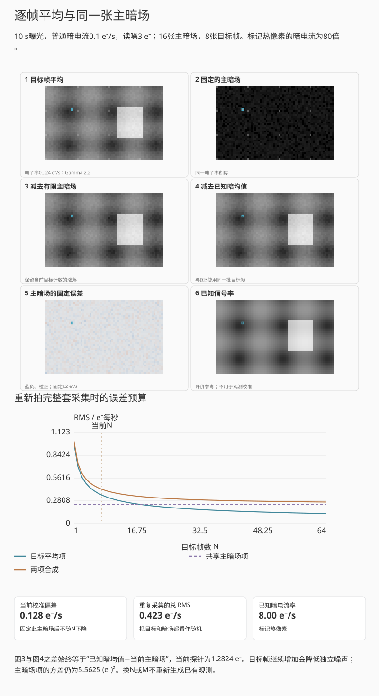
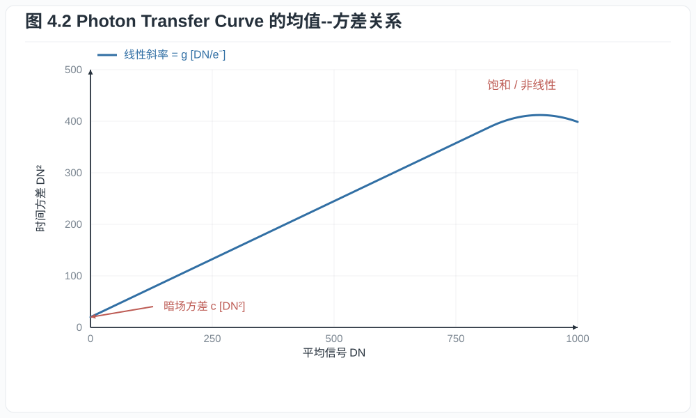
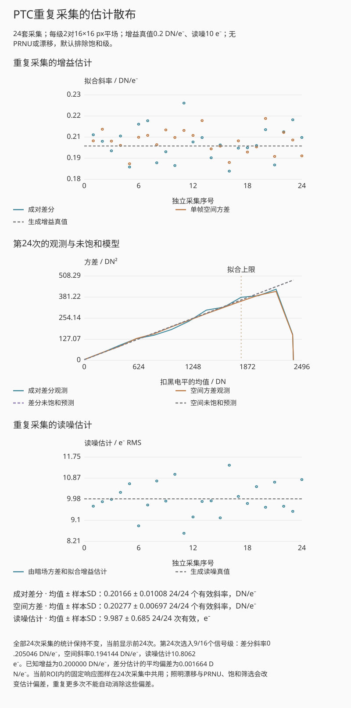
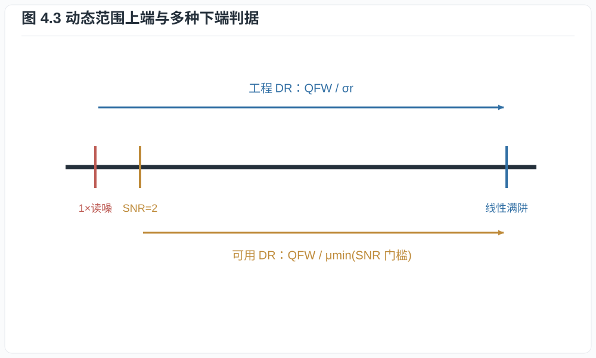
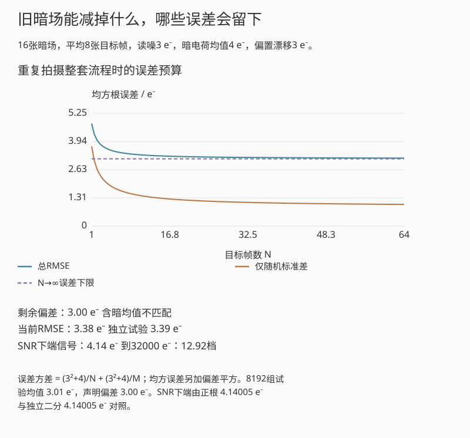

# 第四章：噪声、信噪比、满阱与动态范围

把相机对准均匀灰面，连续拍摄若干张 RAW：同一个像素的数值会随帧波动，某些像素
又会持续偏亮或偏暗。前者是时间噪声，后者包含固定的空间差异。延长曝光时，平均
信号增加，颗粒的绝对幅度也可能增加，但相对信号反而变小。用均值与方差分别计算
这些变化，才能解释阴影、中间调和长曝光为何表现不同。

## 4.1 单像素时间噪声模型

令一次曝光的信号电子
$S\sim\operatorname{Poisson}(\mu_s)$，暗电子
$D\sim\operatorname{Poisson}(\mu_d)$，读出噪声 $R$ 均值为零、方差
$\sigma_r^2$，三者独立。黑电平校正并折算到电子域后

$$
X=S+D-\mu_d+R.
$$

有

$$
\mathbb E[X]=\mu_s,\qquad
\operatorname{Var}(X)=\mu_s+\mu_d+\sigma_r^2.              \tag{4.1}
$$

**定义 4.1（单像素时间 SNR）.** 在上述模型中，对 $\mu_s>0$ 定义

$$
\mathrm{SNR}(\mu_s)
=\frac{\mu_s}{\sqrt{\mu_s+\mu_d+\sigma_r^2}}.             \tag{4.2}
$$

若报告 dB，取 $20\log_{10}\mathrm{SNR}$。式 (4.2) 不含 PRNU，因为它描述同一
像素重复曝光的时间涨落；若比较整幅均匀平场的像素总体，必须另加空间非均匀项。

*图 4.1　读噪在低信号区占主导，散粒噪声按信号平方根增长，PRNU的空间标准差
近似按信号线性增长。三条曲线按给定参数计算；读噪和PRNU改变时，交点随之移动。*

**命题 4.2（两种极限）.** 当 $\mu_s\ll\mu_d+\sigma_r^2$ 时，
$\mathrm{SNR}\approx\mu_s/\sqrt{\mu_d+\sigma_r^2}$；当
$\mu_s\gg\mu_d+\sigma_r^2$ 时，$\mathrm{SNR}\approx\sqrt{\mu_s}$。

**证明.** 分别在式 (4.2) 的分母中忽略相对于主导项渐近更小的量，即得两式。
$\square$

第一种极限中，信号随曝光线性增长而噪声近似不变；第二种极限中，信号与自身
Poisson 标准差同时增长，SNR 只按平方根增长。

### 贯穿算例：把读噪加进来

对[同一次曝光](00_preface_scope_and_measurement.md)，取 $\mu_s=3101.02$ e⁻、
$\mu_d=0$、$\sigma_r=4$ e⁻，式 (4.1)--(4.2) 给出

$$
\sigma_X=\sqrt{3101.02+16}\approx55.83\ e^-,\qquad
\mathrm{SNR}\approx3101.02/55.83\approx55.54.
$$

这里比较同一像素重复曝光的时间涨落，暂忽略量化；加入第三章的高分辨率量化
近似后，SNR 约为 55.541，变化很小。若实际曝光减半，电子均值变为 1550.51，
SNR 约为 39.17。随后把显示提亮一档，会同时放大信号和噪声，无法使该比值回到 55.54。

## 4.2 暗电流、温度与长曝光

暗电流是无光时热激发等过程产生的电子流。若平均暗电流率为
$i_d\ [e^-\mathrm{/s}]$，曝光时间为 $t$，则

$$
\mu_d=i_d t,\qquad \sigma_d=\sqrt{i_d t}.                \tag{4.3}
$$

减去一张平均暗场可以去除平均偏置和部分固定图样，却不能删除当前曝光中已经发生的
Poisson 暗电流涨落。传感器温度升高通常显著增加 $i_d$；具体倍增规律依器件而定，
不能把“每升若干度翻倍”当作所有相机的定律。

这里的式 (4.1) 减去的是已知平均暗信号。实际用 $M$ 张独立暗场的平均值作校准时，
校准值本身也有噪声。若暗场与目标图同温度、同曝光时长、同读出模式，则独立暗场
均值的方差为 $(\mu_d+\sigma_r^2)/M$。同时把目标曝光和暗场采集都看作随机试验，
校正结果相对于真实信号均值的总误差方差为

$$
\operatorname{Var}(X_\mathrm{cal})
=\mu_s+\mu_d+\sigma_r^2+\frac{\mu_d+\sigma_r^2}{M}.        \tag{4.3a}
$$

这是独立变量方差相加的直接结果。一张等时长暗场会再加入一次暗噪声和读噪；平均
很多张可减小这项校准代价。它仍可去除热像素的平均偏差和稳定图样，因此长曝光暗场
校正的效果要同时看固定误差的减少与随机噪声的增加。

同一张平均暗场反复使用时，校准误差是共享的。令这张暗场在当前像素上的误差为
$\epsilon_d$，则每张校正后的目标图都含有 $-\epsilon_d$。固定这张暗场后，
它只给同一像素留下一个固定偏差，不增加逐帧波动；若把重新采集暗场的随机性也
计入，总误差中便出现图与图之间的协方差 $(\mu_d+\sigma_r^2)/M$。对 $L$ 张独立
目标曝光取平均，误差方差因此是

$$
\operatorname{Var}(\bar X_\mathrm{cal})
=\frac{\mu_s+\mu_d+\sigma_r^2}{L}
+\frac{\mu_d+\sigma_r^2}{M}.                             \tag{4.3b}
$$

它来自“目标图先平均，再减去同一暗场”的方差合成。第二项不会随目标图张数下降。
这也解释了为何成对目标图相减能消去共享暗场误差，而更多目标帧平均仍可能留下
校准残差。

平场互动的“相关噪声与暗场”页签保留同一组目标帧，只改变用于校准的暗场张数，
也可保持暗场不动而重拍目标帧。界面把第一组实验中的误差图与多组独立采集的方差
分开：固定一次暗场后，残差是一张随目标帧共用的图样；重新采集暗场时，它又成为
跨实验的随机误差。知道生成时的平均暗图，才可以画出理想校准对照；实际拍摄不能
把这个对照当成可直接取得的数据。

**例子 4.3（短曝光与长曝光）.** 设 $\sigma_r=2\ e^-$，暗电流率
$0.1\ e^-\mathrm{/s}$，信号率 $20\ e^-\mathrm{/s}$。

曝光 $1$ s 时，$\mu_s=20$、$\mu_d=0.1$，

$$
\mathrm{SNR}=\frac{20}{\sqrt{20+0.1+4}}\approx4.07.
$$

曝光 $100$ s 时，$\mu_s=2000$、$\mu_d=10$，

$$
\mathrm{SNR}=\frac{2000}{\sqrt{2000+10+4}}\approx44.6.
$$

时间延长百倍，SNR 接近提高十倍，说明长曝光已进入散粒噪声主导区；暗电流虽然
增加，却不是本例主导项。

### 把热像素和主暗场放回连续拍摄

热像素首先表现为较大的暗电子产生率。减去匹配的主暗场后，它的平均亮点可以
消失，当前曝光中的暗电流散粒噪声仍会留下。下面固定一张64×40像素的电子率图，
每个像素按 Poisson 分布采集电子，再加独立读噪。标出的热像素暗电流率为普通像素
的80倍；曝光时间改变信号与暗电荷的均值，读噪仍按每次读出加入。

*互动示意：每帧10 s、普通暗电流0.1 e⁻/s、读噪3 e⁻ rms；目标8张、主暗场16张。
各图换回e⁻/s，使用共同白点；蓝橙误差图采用固定的正负刻度。*

增加目标张数时，演示取同一采集序列更长的前缀，主暗场保持不动。与“减去已知
平均暗图”的对照相减，得到的恰好是主暗场误差的相反数；它会留在所有目标平均中。
增加暗场张数则取同一暗场序列更长的前缀，改变的是校准。两种操作的随机样本不会
因滑块移动而全部重抽。

图上以电子率显示，式 (4.3b) 仍以每帧电子数计算，换成率的方差还须除以 $t^2$。
固定一张主暗场时，蓝橙图是一张已确定的误差；重复采集整套主暗场时，它才具有
式中的校准方差。可先观察普通像素，再切换到热像素，比较长曝光带来的信号收益与
暗噪声代价。温度失配、暗电流漂移和随机电报噪声需另行测量。

## 4.3 空间噪声与 PRNU

若均匀平场下第 $i$ 个像素的响应为 $(1+\delta_i)\mu_s$，并设
$\mathbb E[\delta_i]=0$、
$\operatorname{Var}(\delta_i)=\sigma_\mathrm{PRNU}^2$，跨像素总体方差近似为

$$
\sigma_\mathrm{total}^2
=\mu_s+\mu_d+\sigma_r^2
+\sigma_\mathrm{PRNU}^2\mu_s^2.                           \tag{4.4}
$$

最后一项按信号平方增长，因此在高曝光区可能主导。平场校正可估计并除去稳定的响应
差异，但校准噪声、温漂、镜头暗角和非线性会限制校正精度。

式 (4.4) 在这里把响应差异放在光电子收集率上：给定像素响应后，信号电子服从均值
为 $(1+\delta_i)\mu_s$ 的Poisson分布。先对每个像素求时间方差，再对像素总体平均，
得到 $\mu_s$；各像素均值的空间方差则为
$\operatorname{Var}[(1+\delta_i)\mu_s]=\sigma_\mathrm{PRNU}^2\mu_s^2$。
两项相加，就是散粒噪声与固定响应差异的贡献。若差异来自各像素的转换增益，
还需把该增益带入局部方差，不能只用这一个收集率模型。

这也解释了为什么单张均匀图的像素标准差不能直接当成读出噪声：它混入散粒噪声和
固定图样。应使用成对平场的差分来消除稳定空间结构。

暗信号非均匀性（dark signal non-uniformity, DSNU）是遮光、固定温度和固定曝光
时间下，各像素平均暗输出的空间标准差；PRNU 则通常报告平场响应的相对空间标准差。
二者都必须先用多帧平均压低时间噪声。设 $M$ 帧校准图的像素平均为 $\bar Y_i$，则
观测空间方差包含真实固定差异和约 $\sigma_t^2/M$ 的残余时间方差。直接用一帧图
报告 DSNU 或 PRNU 会系统性高估固定图样。

## 4.4 Photon Transfer Curve

设已减去同条件平均暗输出的数字值满足

$$
Y=gS+R_Y,\qquad [g]=\mathrm{DN}/e^-.
$$

$R_Y$ 均值为零，包含读噪、量化和未被均值相减消去的暗电流涨落。

当响应线性、附加噪声与信号独立、其方差在所测区间保持不变时，

$$
\mathbb E[Y]=g\mu_s,\qquad
\operatorname{Var}(Y)=g^2\mu_s+\sigma_{R_Y}^2
=g\mathbb E[Y]+\sigma_{R_Y}^2.                            \tag{4.5}
$$

因此方差对均值图的线性段斜率就是 $g$。这就是光子转移法的核心。

*图 4.2　只有去除黑电平、避开低端量化区和高端非线性区后的线性段用于估计
$g$。图中截距是 DN$^2$ 单位的暗输出方差，包含当前条件的暗噪声和量化贡献。
接近饱和时方差回落不表示噪声突然改善，而是剪切压缩了分布。*

**命题 4.4（成对平场差分）.** 两张独立、同曝光平场为
$Y_1=F+N_1$、$Y_2=F+N_2$，其中固定图样 $F$ 相同，随机噪声方差均为
$\sigma^2$，则

$$
\frac12\operatorname{Var}(Y_1-Y_2)=\sigma^2.
$$

**证明.** 差分消去 $F$。由独立性，
$\operatorname{Var}(N_1-N_2)=\sigma^2+\sigma^2=2\sigma^2$；除以 $2$ 即得。
$\square$

例如，ROI 中各像素有固定偏差，但两张图的照明一致，差分就能消去这些偏差。若灯
的亮度在两帧间改变，差分中会重新留下与像素响应有关的结构；若行列噪声在空间上
相关，ROI 也不能提供与像素数相同的独立样本数。残差图因此和拟合斜率同样值得保留。
下面的流程采用 [EMVA 1288 Release 4.0 Linear](https://www.emva.org/wp-content/uploads/EMVA1288Linear_4.0Release.pdf)
的线性均值--方差模型，不涉及标准的完整合格性测试。

一套可复核的 PTC 流程如下。这里 $\langle\cdot\rangle_R$ 表示在固定 ROI 内取空间
平均，$\operatorname{Var}_R$ 表示同一 ROI 内的样本方差。

1. 固定温度、读出模式、位深、增益、黑电平处理和照明光谱；关闭会随帧变化的
   降噪与自动曝光。
2. 优先固定曝光时长，改变均匀光源的辐照度，对每个信号级 $k$ 拍至少一对独立
   平场 $F_{k,1},F_{k,2}$，并拍摄同条件暗场。照明必须在两帧间稳定；缓慢空间梯度
   可在差分中抵消，但会污染 PRNU 测量。彩色 RAW 分别选择同一种 CFA 通道，避免
   把 R、G、B 的响应差异作为空间噪声混入。
3. 以暗场均值 $b_k$ 校正信号均值

   $$
   m_k=\left\langle\frac{F_{k,1}+F_{k,2}}2\right\rangle_R-b_k,             \tag{4.5a}
   $$

   并由成对差分估计单帧时间方差

   $$
   v_k=\frac12\operatorname{Var}_R(F_{k,1}-F_{k,2}).                       \tag{4.5b}
   $$

4. 在线性、未饱和且量化不主导的区间拟合 $v_k=a m_k+c$。若 $m,v$ 的单位分别为
   DN 与 DN$^2$，则 $g=a\ [\mathrm{DN}/e^-]$。固定曝光时长使暗电流方差保持
   不变，截距 $c$ 包含读噪、暗电流散粒噪声及量化的贡献。只有暗电流可忽略时，
   $\sqrt c/g$ 才可作为含量化贡献的输入等效读噪。纯模拟读噪还需在模型有效时
   扣除量化方差。负截距提示拟合区间、相关性或模型有问题，不能直接开平方。
5. 由 $m_k/g$ 换算电子数，寻找均值偏离低曝光线性外推达到预先规定阈值（例如
   $1\%$）的位置，报告“线性满阱”；另行报告数字剪切白点，不能把二者混称。
6. 更换 ROI、重复采集并保留残差图。斜率置信区间、照明漂移、温度漂移、空间相关
   和坏点剔除规则都应进入不确定度说明。

如果靠延长曝光来改变信号级，暗电流也随之增加。此时仅从均值中扣掉暗场，仍会留下
暗电流散粒噪声，方差拟合便可能把它误当成光子响应。可对每个曝光时长再拍一对暗场
$D_{k,1},D_{k,2}$，令

$$
v_{d,k}=\tfrac12\operatorname{Var}_R(D_{k,1}-D_{k,2}),\qquad
v_k-v_{d,k}\approx g m_k.                                \tag{4.5c}
$$

光、暗图的方差分别估计后相减，去除在同条件下相同的暗噪声与读噪贡献；这与逐图
相减再求方差不同，后者会加入暗图噪声。差值的统计不确定度仍需由重复采集估计。
读噪则另从短曝光暗场估计，或从暗场方差随时间的拟合中取零曝光截距。

以暗电流可忽略的一组数据为例，若得到 $v=0.20m+4.0$，系统增益就是
$0.20\ \mathrm{DN}/e^-$，读噪约为 $\sqrt4/0.20=10\ e^-$。平均信号
1000 DN 对应 $1000/0.20=5000$ 个电子。散粒方差5000乘以增益的平方，变为
$5000\times0.20^2=200$ DN$^2$；再加截距4，得到单帧方差204 DN$^2$。
均值乘一次增益，方差乘增益的平方，两者相除后留下一个 $g$，这也解释了PTC
斜率为什么是DN/e⁻，而非它的倒数。

互动为每个信号级生成多对平场，分别计算单帧空间方差与成对差分方差，再从观测
在线性区间拟合增益。生成模型的增益和噪声只用于对照；调整查看级与拟合范围会
复用同一批图像，重新采样则保留固定响应图样，只改变计数和读出噪声。可先加入
PRNU，观察单帧空间方差偏离直线，再让两帧照明不同，或把饱和段纳入拟合。

照明漂移留下的固定项可以直接计算。设两帧照明相对平均值分别为
$1-\epsilon/2$ 与 $1+\epsilon/2$，像素响应仍为 $1+\delta_i$。
在未饱和、两帧平均信号为 $\mu_s$ 的模型中，差分去掉 ROI 均值后仍留下
$-g\mu_s\epsilon(\delta_i-\bar\delta_R)$，其中 $\bar\delta_R$ 是 ROI 内响应误差的均值。
由常数倍的方差公式，它对成对方差估计的贡献为
$\tfrac12(g\mu_s\epsilon)^2\operatorname{Var}_R(\delta)$，单位 DN$^2$。
互动把 ROI 内响应误差归一化到样本方差 $\sigma_\mathrm{PRNU}^2$，该项便为
$\tfrac12(g\mu_s\epsilon\sigma_\mathrm{PRNU})^2$。
因此去掉两帧的整体均值差，仍不足以保证照明漂移下的差分只含时间噪声。

若要估计 PRNU，可用许多平场的平均图先移除照明渐变和暗信号，再从剩余空间方差中
扣除平均后仍残留的时间方差；结果除以平均信号得到相对 PRNU。该步骤对去趋势模型
敏感，因此必须同时展示校正前后残差图，而不能只给一个百分数。

### 重复采集得到的不是同一个斜率

一次PTC拟合给出一个增益估计，有限ROI和有限平场对数会使它随采集而变。下面固定
增益真值 $g=0.2\ \mathrm{DN}/e^-$、读噪 $10\ e^-$ 和满阱 $12\,000\ e^-$，
重复采集 $K=24$ 套完整PTC。每套有16个信号级，每级默认拍2对16×16像素平场，
均按前面的观测定义求均值与方差。固定响应图样在24套采集中共用；光子计数和读噪
分别重新抽取。因此这里显示的是条件于这片ROI的重复采集散布，不包含更换器件或
换一片ROI的固定图样差异。

令 $\widehat g_k$ 为第 $k$ 次有效拟合的斜率，展示其均值与样本标准差

$$
\overline g=\frac1K\sum_{k=1}^{K}\widehat g_k,\qquad
s_g=\sqrt{\frac1{K-1}\sum_{k=1}^{K}(\widehat g_k-\overline g)^2}.
$$

两者单位都是 $\mathrm{DN}/e^-$。$s_g$ 描述参数估计的散布，不能当作单帧时间
噪声，更不是单次拟合的置信区间；若有无效拟合，另报有效次数，并以该次数代入。
读噪由同套暗场的差分方差和拟合增益换算，近似扣去 $1/12\ \mathrm{DN}^2$ 量化
方差；条件不足时不强行给值。生成真值只画作参考，拟合器只读取观测矩和已知白点。

*互动示意：同一批观测分别用成对差分与单帧空间方差拟合。默认差分增益估计的
24次均值约0.20166 DN/e⁻，样本标准差约0.01008 DN/e⁻；读噪估计为
9.987±0.685 e⁻。回放逐次显露估计点，坐标范围与完整24次的汇总保持不变。*

可先增大ROI与每级平场对数，再切换几个随机批次，比较散布；单个有限样本的散布
不保证每次都缩小。随后加入稳定PRNU：空间方差拟合会明显偏离增益真值，而成对
差分仍可消去固定项。再加两帧照明差，或把饱和段纳入拟合，检查前面预测的系统
偏差。重复采集能让估计均值更集中，但照明差和饱和造成的斜率偏差仍会保留。

改变拟合上限或查看第几次采集时，原观测不变；改变ROI会重新生成对应大小的
采集，不是裁切同一幅大图。这里使用普通最小二乘，横轴均值本身也有估计误差，
斜率可能有偏。真实测量还需记录光源、温度和读出模式的稳定性，并按实际相关性
估计不确定度。

## 4.5 动态范围必须指定下端

若上端取线性满阱 $Q_\mathrm{FW}$，下端取一次读出噪声 rms $\sigma_r$，常见工程
定义是（要求 $Q_\mathrm{FW}>0$、$\sigma_r>0$）

$$
\mathrm{DR}_{\mathrm{stop}}
=\log_2\frac{Q_\mathrm{FW}}{\sigma_r},
\qquad
\mathrm{DR}_{\mathrm{dB}}
=20\log_{10}\frac{Q_\mathrm{FW}}{\sigma_r}.               \tag{4.6}
$$

*图 4.3　上端可取线性满阱、指定非线性点或数字剪切；下端可取一倍读噪、指定
SNR 或视觉可用阈值。未同时声明两端，单个“档数”不可严格比较。*

二者满足一档约为 $6.0206$ dB。

**例子 4.5.** $Q_\mathrm{FW}=50\,000\ e^-$、
$\sigma_r=2.5\ e^-$ 时，

$$
\mathrm{DR}=\log_2(20\,000)\approx14.29\ \text{档}
$$

或 $86.0$ dB。若最低可用信号要求 $\mathrm{SNR}=2$，且忽略暗电流，由

$$
\frac\mu{\sqrt{\mu+\sigma_r^2}}=2
$$

得到 $\mu^2-4\mu-4\sigma_r^2=0$，正根为

$$
\mu_{\min}=2+2\sqrt{1+\sigma_r^2}\approx7.39\ e^-.
$$

此时可用动态范围变成
$\log_2(50\,000/7.39)\approx12.72$ 档。相同传感器因下端判据不同，数值相差
超过一档半。一般要求 SNR 至少为 $k>0$ 时，令
$b=\mu_d+\sigma_r^2$，由 $\mu^2=k^2(\mu+b)$ 得

$$
\mu_{\min}(k)=\frac{k^2+\sqrt{k^4+4k^2b}}2.                \tag{4.6a}
$$

特别地，SNR 为一的下端也并不严格等于读噪 rms，因为信号本身还有散粒噪声。式
(4.6) 是常用容量/噪声比，式 (4.6a) 则回答指定 SNR 的最低信号，两者应分别标注。
若 ADC 先剪切，上端还应改为满阱与当前数字剪切电子数中较小者。

### 校准之后发生漂移，继续平均还有多大帮助

设主暗场由 $M$ 张独立暗场平均而成，每张方差 $v_c$；科学帧单张方差为 $v_s$，
平均 $N$ 张，并复用同一主暗场。若拍摄时相对校准时的均值变化为 $\delta$，则误差可写为
$e=\delta+\bar\epsilon_s-\bar\epsilon_c$。在重复拍摄整套校准与科学帧的总体中，独立性给出

$$
\mathbb E[e]=\delta,\qquad
\operatorname{Var}(e)=\frac{v_s}{N}+\frac{v_c}{M},\qquad
\mathbb E[e^2]=\delta^2+\frac{v_s}{N}+\frac{v_c}{M}.
$$

误差均方根（root mean squared error, RMSE）定义为 $\sqrt{\mathbb E[e^2]}$，
它同时包含固定偏差和随机波动。最后一步来自
$\mathbb E[e^2]=\operatorname{Var}(e)+(\mathbb E[e])^2$。增大 $N$
只降低 $v_s/N$；主暗场误差与漂移不会作为独立帧噪声一起降到零。若固定已经拍好的
某一张主暗场，它的误差应并入条件偏置；不能把跨校准重复试验的方差称为这一张
固定主暗场的逐帧随机波动。

*互动示意：16张暗场、8张零光信号目标帧、读噪3 e⁻，暗电荷均值4 e⁻，偏置另漂移3 e⁻。
误差预算与8192次独立整套观测对照；偏差和随机标准差分别列出。*

校准残差演示固定场景光信号为零，只加入暗电荷与读噪；若目标有光信号，
它的散粒噪声也须计入 $v_s$。动态范围页签直接使用式 (4.6a) 的目标 SNR $k$
与背景项 $b$；当 $b=0$ 时，最低信号退化为 $\mu_{\min}=k^2$。这里的背景项
是噪声方差，漂移 $\delta$ 则是偏置，两者在误差预算中分别保留。
若下端已超过指定上端，便没有满足该判据的有效区间，不能继续
报告一个负的“可用动态范围”。实际温漂还可能改变暗电流、坏点和空间响应，需在
各自模型中加入，不能只平移均值就概括温度影响。

## 4.6 多像素与缩图 SNR

若 $n$ 个像素观察相同均匀信号，每个均值 $\mu$、独立噪声方差 $\sigma^2$，求和后
信号 $n\mu$、噪声 $\sqrt n\sigma$，故 SNR 提高 $\sqrt n$。取平均后信号仍为
$\mu$、噪声变为 $\sigma/\sqrt n$，结论相同。

相关噪声不会按此速度下降。若任意两像素噪声协方差为 $\rho\sigma^2$，则平均值
方差为（$n\ge2$，可实现的共同相关系数满足 $-1/(n-1)\le\rho\le1$）

$$
\operatorname{Var}(\bar X)
=\frac{\sigma^2}{n}[1+(n-1)\rho].                         \tag{4.7}
$$

当 $\rho>0$ 时，增加像素的收益受限。固定图样、行列条纹、去马赛克和降噪都会引入
空间相关。$\sqrt n$ 的改善要求噪声独立且方差相同；存在相关项时，应按上述
协方差求和计算缩图收益。

一个更具体的模型可以把行列噪声与像素独立噪声分开。下面以 $h$ 表示方形 ROI 的
边长，总像素数为 $h^2$；对第 $t$ 帧、第 $r$ 行、第 $c$ 列，写噪声为
$N_{t,rc}=P_{t,rc}+A_{t,r}+B_{t,c}$。三类分量均值为零、彼此独立，各自在不同
像素、行、列及帧间独立，方差分别为 $v_p,v_r,v_c$。同一行的像素共用 $A_{t,r}$，
同一列共用 $B_{t,c}$。直接把 ROI 均值展开，便有

$$
V_{\rm ROI}=\frac{v_p}{h^2}+\frac{v_r}{h}+\frac{v_c}{h},
\qquad V_{\rm pixel}=v_p+v_r+v_c.                       \tag{4.7a}
$$

方差单位均为 $(e^-)^2$。第一项平均了 $h^2$ 个独立量，后两项各只平均 $h$ 个独立偏移。这里的行列条纹
每帧重新产生，与固定不变的图样不同。若目标帧和暗帧的相应 ROI 均值方差分别为
$V_T,V_D$，式 (4.3b) 就变为 $V_T/L+V_D/M$；两张使用同一平均暗场的校正目标帧，
跨独立重复采集的协方差为 $V_D/M$。目标帧差分会消去共享暗场，因而不能靠 PTC
差分量出这项校准误差。

在上述模型成立时，还能由观测平场对估计分量。令
$q_{rc}=(F_{1,rc}-F_{2,rc})/\sqrt2$，行、列和全 ROI 均值分别为
$\bar q_{r\cdot},\bar q_{\cdot c},\bar q$，则独立像素分量的估计为

$$
\widehat v_p=\frac{\sum_{r,c}(q_{rc}-\bar q_{r\cdot}-\bar q_{\cdot c}+\bar q)^2}
{(h-1)^2},\qquad
\widehat v_r=s^2(\bar q_{r\cdot})-\frac{\widehat v_p}{h},\quad
\widehat v_c=s^2(\bar q_{\cdot c})-\frac{\widehat v_p}{h}.             \tag{4.7b}
$$

这里 $s^2$ 采用 $h-1$ 分母。双向去均值后的独立残差有 $(h-1)^2$ 个自由度；
行均值的样本方差期望为 $v_r+v_p/h$，列均值同理，故得到式 (4.7b)。有限数据
可能给出负的行列分量估计，需要结合估计不确定度判断；不能解释为负的物理方差，
也不应直接改成零后再报告精度。

互动在电子域用 Gaussian 近似演示这组关系，目标帧的 $v_p=\mu_s+\mu_d+\sigma_p^2$，
暗帧为 $\mu_d+\sigma_p^2$；此处 $\sigma_p$ 只指独立像素读噪。这一页保持线性，
不做量化与剪切；低计数时应改用Poisson分布。每个观测点来自
64 组独立的目标与暗场采集；同一组内部共用暗场，所以跨组方差与固定一次暗场后
的逐帧时间方差具有不同含义。增益拟合页仍使用原先的 Poisson、PRNU 与量化模型。

## 练习

**练习 4.1.** 设 $\mu_s=100\ e^-$、$\mu_d=4\ e^-$、
$\sigma_r=3\ e^-$，计算式 (4.2) 的 SNR 和 dB 值。

**练习 4.2.** 一组固定曝光时长、暗电流可忽略的平场数据满足方差--均值拟合
$s_Y^2=0.5\bar Y+9$，均值单位为 DN，方差单位为 DN$^2$。求系统增益 DN/e$^-$
和包含量化贡献的输入等效读噪。

**练习 4.3.** 传感器满阱为 $32\,000\ e^-$，读噪为 $1.6\ e^-$。分别按
SNR 下端为 $1$ 和 $2$ 计算动态范围，忽略暗电流。

**练习 4.4.** 某组固定曝光时长、暗电流可忽略的成对平场按式 (4.5a)--(4.5b) 得到拟合
$v=0.20m+4.0$，$m$ 的单位为 DN、$v$ 的单位为 DN$^2$。求系统增益和输入等效
读噪。若线性偏离点为 12,000 DN，估计线性满阱。

**练习 4.5.** 在“旧暗场”实验中，设零光信号目标与校准暗场的单帧方差均为
13 e⁻²，主暗场由 $M=16$ 张平均，目标由 $N=8$ 张平均，校准后固定偏置漂移为
$\delta=3$ e⁻。先算重复拍摄整套流程时的偏差、随机标准差和 RMSE，再只把
$N$ 改为 32。预测 $N\to\infty$ 的 RMSE 下限，并用演示或公式核对。
最后说明：固定已经拍好的同一张主暗场时，为什么不能把该下限全称作逐帧随机噪声？

**练习 4.6.** 某热像素每帧平均信号40 e⁻、暗电子80 e⁻，读噪3 e⁻ rms。
目标平均4张，主暗场平均8张。计算校正误差方差、重复采集两组目标但共用同一
主暗场时的协方差，以及只增加目标张数时的标准差下限。区分固定主暗场的一次残差。
