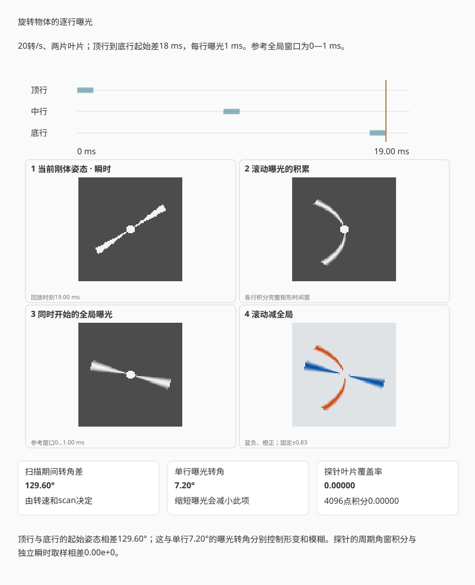
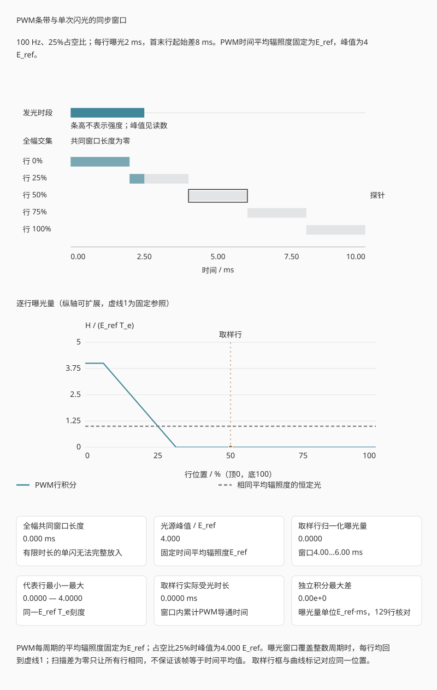

# 第六章：滚动/全局快门、背照、堆栈与曲面传感器

用 $1/4000$ s 的电子快门拍摄快速横移的竖杆，杆可能边缘清楚，整体却向一侧倾斜。
每一行的曝光很短，整幅画面仍用了更长时间逐行采集。前几章计算一个像素在曝光
窗口内的信号；移动场景还要知道各行窗口是否同时出现。全局快门通过同步各像素的
曝光窗口减少这种变形；背照和堆栈则为像素收光与读出电路提供不同的结构选择。
各行积分的起止时刻决定曝光同步性，入光侧和晶圆分工则决定器件的结构分类。

## 6.1 曝光窗口与读出窗口

设像面的辐照度为 $E(x,y,t)$，单位W/m²，第 $j$ 行在 $t_j$ 开始曝光，持续
$T_e>0$。其累计曝光量为

$$
H_j(x)=\int_{t_j}^{t_j+T_e}E(x,y_j,t)\,dt.                \tag{6.1}
$$

所得 $H_j$ 的单位为J/m²。

**定义 6.1（滚动快门）.** 若不同行的 $t_j$ 系统性不同，通常近似
$t_j=t_0+j\Delta t$，称为滚动快门（rolling shutter）。从第一行到最后一行的开始
时间差称为扫描时间或 readout time，不能与单行曝光时间 $T_e$ 混为一谈。

**定义 6.2（全局快门）.** 若所有像素的有效曝光窗口在规定容差内同时开始和结束，
随后存储电荷或电压并依次读出，称为全局快门（global shutter）。有效曝光同步结束，
后续数据仍可逐行输出。

起始选中R3，当前时刻接近滚动曝光的中段。
先选“短曝光”，移动当前时刻，看选中行何时开始和结束；
再选“长曝光”，比较窗口宽度。
最后选“两边同时曝光”，确认行间错开消失，而曝光持续时间仍由另一个控件决定。

*图 6.1　浅色条表示完整积分窗口，深色表示当前时刻之前已经过的部分。滚动快门的
窗口沿行号错开；全局快门可以在积分结束后继续逐行搬运数据，输出带宽与采样同步性
是不同问题。静态图取每行曝光 4 ms，橙线对应 8 ms。*

两侧使用同一个时间刻度。选中一行并移动当前时刻，可以逐项核对它的起点、终点及
其他行的状态。全局快门一侧只同步曝光窗口；窗口结束后的输出过程仍需另行计算。
图中深色部分表示已经经过的积分时间，只有照明恒定时才与累积电荷比例相同。

## 6.2 滚动快门的几何畸变

考虑一根竖直直杆以像面速度 $v$ 水平移动。其在时刻 $t$ 的位置为
$x(t)=x_0+vt$。每行从 $t_j=t_0+j\Delta t$ 开始作均匀矩形曝光，记录的杆影中心为

$$
\begin{aligned}
x_j&=\frac1{T_e}\int_{t_j}^{t_j+T_e}(x_0+vt)\,dt\\
&=x_0+v(t_0+j\Delta t+T_e/2).
\end{aligned}                                             \tag{6.2}
$$

相邻行的中心相差 $v\Delta t$，于是竖杆在图像中倾斜。$T_e/2$只使所有行的中心
一起平移；缩短曝光时间可减小每行内的模糊，却不改变行间倾斜。后者需要缩短扫描
时间或改用全局采样。

先比较“1/500 秒”和“1/4000 秒”：单行拖影减小，首末行倾斜量不变。
再选“全局曝光”看倾斜消失。
照明条带用右侧静止表面单独比较100 Hz的10 ms与15 ms窗口，不要把它与左侧物体运动混作同一原因。

*图 6.2　左图是同一竖杆在0、6、12 ms的位置，右图将七行各自的曝光结果排成一帧。
条带明暗由竖杆宽度与曝光期间的位移共同决定，白点标出每行的记录中心。
缩短单行曝光会减小拖影；只要各行中心时刻不同，竖杆仍按式 (6.2) 倾斜。*

演示中的竖杆有有限宽度，每行记录的是整个曝光窗口内的平均，因此会同时出现行内
模糊和行间倾斜。播放时，完成曝光的行依次出现；把扫描时间差调到零，各行便同时
形成图像。右侧另用静止均匀表面显示周期照明的条带，计算式在下面给出。

**例子 6.3（扫描时间与倾斜量）.** 一幅 2160 行图像的相邻行起始时间差为
$8\ \mu\mathrm s$。首行与末行的起始时刻差为

$$
T_\mathrm{scan}=(2160-1)\times8\ \mu\mathrm s
=17.272\ \mathrm{ms}.
$$

若物体在传感器采样网格上的水平速度为 $12\,000$ pixel/s，则首末行记录位置相差
$12\,000\times0.017272\approx207.3$ pixel。把单行曝光从 $1/500$ s 缩到
$1/4000$ s 会减少杆在每一行内的模糊长度，却不会改变这约 207 pixel 的首末行
位移；只有行周期或有效读出行数改变时，扫描畸变才随之改变。

周期照明也会与 $t_j$ 相互作用。设灯光为
$E(t)=E_0[1+\beta\cos(2\pi f_m t)]$，$0\le\beta\le1$、$f_m>0$。对一行的窗口积分
并除以 $T_e$，使用正弦差公式，可得该行平均辐照度

$$
\bar E_j=E_0\left[1+\beta\,
\frac{\sin(\pi f_mT_e)}{\pi f_mT_e}
\cos\bigl(2\pi f_m(t_j+T_e/2)\bigr)\right].              \tag{6.2a}
$$

行号改变余弦的相位，形成条带；曝光时间则通过 sinc 因子改变条带幅度。若曝光
恰好覆盖整数个调制周期，理想正弦调制项平均为零。例如 100 Hz 调制下，10 ms
覆盖一整周期；1 ms 只覆盖十分之一周期，幅度仍约为原来的 98.4%。这解释了短快门
为何常让频闪更明显。真实 LED 可能有多个频率、PWM 和亮度依赖波形，需测量光强
随时间的变化，再代入积分式 (6.1)。

sinc因子也可能为负，此时余弦调制项相对于曝光中心的瞬时照明反相。例如100 Hz、
15 ms时，该因子约为−0.212；演示的“调制幅度保留率”报告其绝对值21.2%，图像则保留
相位反转后的明暗位置。

### 旋转叶片的滚动快门畸变

旋转物体的像面速度随位置改变，不能再把每一行看成同一条直杆的平移。
取角速度 $\omega$、初始相位 $\phi_0$ 的刚性转子，静止形状为 $F(x,y)$。第 $j$ 行
记录的是反向旋转取样后的时间平均：

$$
I_j(x)=\frac1{T_e}\int_{t_j}^{t_j+T_e}
F\!\left(R_{-(\phi_0+\omega t)}(x,y_j)\right)dt.        \tag{6.2b}
$$

$R_\alpha$ 为平面旋转矩阵。积分中的形状始终刚性，各行却截取了不同的角度区间。
图中弯曲来自这些区间拼接，并不意味着叶片真的弯了。

起始为20转/秒、18 ms扫描差。
先只选“缩短至0.25 ms”，看叶片拖影变窄而弯曲仍在；
再选“全局同时曝光”，比较两幅图的差。
反向旋转用于检查弯曲方向；
“静止作对照”则让所有时间窗口看到同一个物体位置。

*互动示意：80×80像素的转子；各行按已知窗口精确积分。瞬时姿态、滚动曝光、
从首行起点开始的全局曝光及二者差值同时显示；所有信号图共用白点。*

先暂停在一帧曝光完成的位置，缩短单行曝光：叶片会变窄，但逐行拼接的形状仍然
弯曲。再把首末行的起点差调为零，两条曝光路径应逐像素相同。以20转/秒、首末行
差20 ms为例，行间角度跨度为144°；0.5 ms曝光只平均3.6°。多片等距叶片还有旋转
对称性，单凭一幅畸变图通常不能唯一反推转速。

### PWM照明与单次闪光的同步窗口

正弦模型说明了时间平均如何压低调制，但LED也常按脉宽调制（pulse-width
modulation, PWM）交替导通和关断。换成矩形脉冲后，仍从式 (6.1) 积分；
不能只按曝光中心时刻判断这一行看见灯亮还是灯灭。

设周期为 $P>0$，占空比为 $0<d\le1$，第 $k$ 次导通区间为
$[\phi+kP,\phi+(k+d)P)$，$k\in\mathbb Z$。本节固定时间平均辐照度为
$\bar E>0$，所以导通时的辐照度取 $\bar E/d$，关断时取零。这样改变占空比时，
每周期的总光量不变；若改为固定峰值，平均照明就会随 $d$ 改变，是另一种比较。
令

$$
\begin{aligned}
n(t)&=\left\lfloor\frac{t-\phi}{P}\right\rfloor,\qquad
r(t)=t-\phi-Pn(t)\in[0,P),\\
A(t)&=dP\,n(t)+\min\{r(t),dP\}.
\end{aligned}                                               \tag{6.2c}
$$

$A$ 的单位是时间。它在导通段的斜率为一、关断段为零，因此一行收到的曝光量是

$$
H_{j,\mathrm{PWM}}
=\frac{\bar E}{d}\,[A(t_j+T_e)-A(t_j)].                    \tag{6.2d}
$$

这个计数完整周期和剩余导通时间的公式，也适用于窗口跨过周期边界或 $\phi$ 为负
的情形。若 $T_e=nP$，$n$ 为正整数，则差值恒为 $ndP$，故每行得到
$H_j=\bar E T_e$，与行起点和相位无关。全局曝光则只保证各行取同一个区间；
短窗口仍可能恰好落在关断段，使整帧偏暗。

单次闪光没有无限重复的周期。取首行起点为零，最后一行起点为
$T_\mathrm{scan}\ge0$，各行曝光长度均为 $T_e$。所有行同时积分的窗口是各行
窗口的交集：最晚起点是 $T_\mathrm{scan}$，最早终点是 $T_e$，其长度为

$$
T_\mathrm{common}=\max(T_e-T_\mathrm{scan},0).             \tag{6.2e}
$$

这对应Basler文档中从末行开始曝光到首行结束曝光的
[Flash Window](https://docs.baslerweb.com/line-source#flash-window)。
$T_e=T_\mathrm{scan}$ 时交集只有一个瞬间，长度仍为零，放不下有限时长的闪光。

设闪光从 $t_f$ 开始，持续 $\delta>0$，在此期间均匀发光；它在像面提供的总辐射
曝光量为 $H_f$，所以峰值辐照度为 $H_f/\delta$。第 $j$ 行接收到的闪光部分为

$$
\begin{aligned}
\ell_j&=\max\{0,\min(t_j+T_e,t_f+\delta)-\max(t_j,t_f)\},\\
H_{j,\mathrm{flash}}&=\frac{H_f}{\delta}\ell_j.
\end{aligned}                                               \tag{6.2f}
$$

这是两个矩形区间的重叠长度乘以辐照度。所有行收齐同一次闪光，要求
$T_\mathrm{scan}\le t_f$ 且 $t_f+\delta\le T_e$；只有共同窗口存在还不够，
还要把整段闪光放进去。若另有恒定环境辐照度 $E_a$，总曝光量为
$E_aT_e+H_{j,\mathrm{flash}}$。保持闪光输出并始终满足上述条件时，缩短快门才会
只减少环境光项；一旦窗口切掉闪光尾部，闪光曝光也会下降。

默认的PWM为100 Hz、25%占空比，每行曝光2 ms，首末行起始差8 ms。
先选“PWM只减占空比至10%”，核对峰值升高而时间平均值不变；
再选“PWM只延长至整周期”，观察各行归一化曝光量都回到一。
“PWM只令扫描差为零”与基准只相差扫描时间：条带消失，但整帧取到的值未必为一。

*互动示意：上图条高只标发光时段，彩色区段是光源与各行窗口的交集；下图纵轴为
$H_j/(\bar E T_e)$，虚线一提供固定照明参照。单闪模式把参考辐照度记作
$E_\mathrm{ref}$，固定闪光总量为 $8E_\mathrm{ref}\,\mathrm{ms}$，环境光另行相加。*

再选“单闪完整放入共同窗口”：$T_\mathrm{scan}=8$ ms、$T_e=12$ ms，共同窗口
为8—12 ms；8.5—9.5 ms的闪光能被每行收齐。取
$E_a=0.2E_\mathrm{ref}$，每行环境光为 $2.4E_\mathrm{ref}\,\mathrm{ms}$，
总量为 $10.4E_\mathrm{ref}\,\mathrm{ms}$。只把闪光移到11.5—12.5 ms，
首行仅接收一半，末行仍接收完整闪光，首末行总量分别变为6.4和
$10.4E_\mathrm{ref}\,\mathrm{ms}$。取样行框、曲线标记和读数指向同一行，
可以逐项用式 (6.2f) 核对。再把曝光缩短至2 ms，共同窗口消失，同一次短闪只能
照亮部分行。移动闪光时刻与缩短曝光是两组分别从完整同步预设出发的对照。

机械焦平面快门在两帘形成狭缝时也有同样的时序问题：狭缝扫过焦面，各位置的
短窗口依次出现，短单闪只能落进其中一部分窗口。高速同步（high-speed sync,
HSS／FP）让发光持续覆盖帘幕行程，常以快速脉冲列完成；
[Nikon的技术说明](https://www.nikonusa.com/learn-and-explore/c/tips-and-techniques/high-speed-sync-a-flash-technique-to-add-a-pro-touch-to-your-photographs)
描述了这种脉冲列。若把脉冲理想化为严格周期、等幅矩形，并让脉冲列的包络覆盖
所有行窗口，便可用式 (6.2d) 研究每行平均。它在曝光窗口包含很多周期时接近连续
照明，有限周期和包络边缘仍须逐窗积分。实际闪光脉冲的形状、输出和触发容差需由
器材资料确定；[Canon的高速同步说明](https://cam.start.canon/en/A014/manual/html/UG-02_Advanced_Flash_0050.html)
还提示其有效闪光输出随快门设置改变。因此这里固定平均辐照度的PWM比较用于隔离
时序作用，不能直接拿来估算某支闪光灯的照明距离或能量效率。

## 6.3 全局快门的像素结构与画质权衡

全局快门像素需要在曝光结束后临时存储所有像素的信号，并在读出期间遮光。额外
存储节点、转移门和遮光结构占面积，也可能引入寄生电容、暗电流、漏光和额外转移
噪声。在前照小像素中，这会挤压光电二极管的填充因子。全局转移后，最后读出的
像素可能在存储节点上等待接近一帧时间；若该节点仍对光敏感，这段等待会额外积累
信号，形成寄生光响应。设计中既要让曝光期间的 PPD 有效收光，也要让读出等待期间
的存储节点充分遮光。

背照与堆栈能缓解面积冲突：感光层从背面接收光，晶体管和存储可在另一侧或另一
晶圆上获得空间。Sony Pregius S 是背照、堆栈与全局快门结合的具体工业实现。但
动态范围仍需由满阱、读噪和寄生光响应等实测值确定。

机械焦平面快门也可产生类似滚动的时间差：狭缝扫过画面时，不同位置曝光不同步。
所谓全局快门的优势是无需机械狭缝也能在整个焦面同时结束积分，并允许高速闪光同步；
实际同步仍受触发延迟、闪光持续时间和相机接口约束。

## 6.4 前照、背照、微透镜与 DTI

**定义 6.4（前照与背照）.** 前照式（front-side illuminated, FSI）传感器中，
入射光先经过布线与晶体管所在表面再到光敏硅；背照式（back-side illuminated,
BSI）把晶圆减薄，从硅背面入光，使光路避开前侧金属层。

BSI 通常提高小像素的填充效率和斜入射接受能力，但不是无条件提高所有波长 QE。
晶圆减薄、背面钝化、反射、吸收深度和串扰仍需设计。微透镜把像素上方较大区域的
光集中到有效感光区；它改变的是光学收集效率与角度响应，不扩大几何像素节距。

深沟槽隔离（deep trench isolation, DTI）在像素之间形成光学/电学边界，减少光子
或载流子横向进入相邻像素。其收益可表现为较低串扰和较高高频 MTF，但沟槽本身也
占据面积并影响满阱和工艺应力。Hamamatsu 的 BSI qCMOS 资料给出了 BSI、DTI 和
微透镜共同工作的具体截面案例。

## 6.5 像素层与逻辑层的堆栈

**定义 6.5（堆栈 CMOS）.** 若像素/光电二极管层与逻辑处理层分别制造，并通过
晶圆键合、硅通孔或高密度互连连接，称为堆栈式 CMOS。互连粒度可以是外围、列级，
也可以接近像素级。

*图 6.3　以带微透镜和CFA的彩色像素为例。FSI的光先经过布线所在层再进入感光硅，
BSI从硅背面入光；右图另有独立的逻辑晶圆。橙色虚线表示入光，蓝色实线表示
光电转换后的电子信号，右侧括号标出像素晶圆的范围。层距用于辨认结构，读噪、
动态范围和扫描时间需另作测量。*

把逻辑移到独立晶圆可以提供：

- 更多或更快的列 ADC；
- 片上缓存，先高速捕获再较慢输出；
- 相位检测、HDR 或神经网络等处理逻辑；
- 为像素层选择不同制造工艺。

代价包括键合良率、功耗、热密度、成本和互连复杂度。部分堆栈只分离一部分高速
电路；“部分堆栈”与“全堆栈”不是统一标准术语，必须查看芯片截面和读出数据。

先选“展开看结构”，沿同一条入光路径辨认布线层与感光硅的先后，再跟随电子信号到逻辑层。
合拢／展开只改变观看间距；
本页没有把结构图直接换算成QE或读噪。
要检验这两个性能量，仍需回到第二、四章的器件参数。

*互动示意：FSI、BSI与逻辑堆栈的功能层序和结构核对。橙色路径到感光硅为止，
蓝色路径表示光电转换之后的电子信号。图中常见堆栈例有像素、逻辑两个功能晶圆；
支撑、彩色滤光层和键合界面不计入此数。层距用于展示，不是工艺厚度。*

展开层片后，核对两个位置：光进入硅之前是否经过前侧布线所在层，
信号处理是否另占一个功能晶圆。前一个问题区分FSI与BSI，后一个问题区分本图的
同片电路与逻辑堆栈。两者是独立的分类维度；展示的三种常见组合不是全部可能组合。
FSI的布线有开口，不能把它理解成一整面金属挡住所有光；BSI的前侧电路也没有消失，
只是入光改从另一侧进行。

回放先显示入光和感光节点，再显示像素电路与逻辑互连。电荷转移、电压转换、ADC
及数字传输在这里合并为功能路径，不逐个模拟。层序和连接关系分别与独立参照核对；
Sony的2012年堆栈发布资料和Pregius S截面说明提供结构依据；量子效率、满阱、
读噪和扫描速度则需要各器件自己的参数与测量。

## 6.6 曲面传感器与场曲

拍摄同一物平面上的细小光点，沿光轴移动接收面，记录各像高处点像最清楚的位置。
这些位置组成的最佳像面若为曲面，就存在场曲。两个方向的细线若分别在不同位置
最清楚，还要区分两个方向的焦面；第十三章会进一步讨论像散。

Petzval和用各折射面的参数描述场曲贡献。对折射面 $j$，一个常见符号约定下为

$$
\mathcal P=\sum_j
\frac{n_{j+1}-n_j}{n_j n_{j+1}R_j}.                      \tag{6.3}
$$

*图 6.4　平面传感器位于轴上焦点处。本例的离轴光束在到达平面前已越过焦点，
因此在平面上留下有限截宽；匹配最佳焦点轨迹的曲面可在会聚处接收光束。右侧以
相同纵向尺度比较光束截宽，颜色区分像高。焦点轨迹作抛物线示意；实际曲率须与
镜头的场曲、像散两主截面共同匹配。*

其符号依半径和传播方向约定，实际最佳像面还受像散影响。平面传感器迫使镜头用额外
镜片和像差平衡去压平焦面。

若传感器弯成接近最佳像面的球面，可释放一部分场曲校正自由度，并改善边缘清晰度、
相对照度或镜头体积。Guenter 等人的 2017 年原型证明减薄商用 CMOS 可被气压成形为
高精度曲面并保持功能；这证明工艺可行性，不表示所有镜头只需弯传感器就会更好。

曲率必须与具体镜头设计匹配。可换镜头系统中，不同镜头有不同场曲和像散；固定曲率
可能帮助一支镜头却损害另一支。晶圆应力、封装、热循环、产率和标定也比平面芯片
复杂。曲面本身不增加光子能量，只通过允许更合适的光学设计间接改变收集和成像。

**例子 6.6（不能由结构名推出性能）.** 设传感器 A 为 BSI 滚动快门，实测扫描时间
8 ms、读噪 $2.0\ e^-$；传感器 B 为堆栈式 BSI 全局快门，扫描采样同步，但读噪
$3.2\ e^-$。由结构定义只能断定 B 的有效曝光窗口更同步以及它具有独立逻辑层，
不能断定 B 的读噪更低。反过来，A 的较低读噪也不能消除其 8 ms 行间时间差。
这类比较必须把时序、噪声、满阱和量子效率拆成独立测量列。

### 两方向焦面与传感器曲率的匹配

下面用显式合成焦面作比较。令像场坐标 $x,y\in[-1,1]$，
$u=(x^2+y^2)/2$，两方向最佳焦面为
$z_\pm=(C\pm A)u+t_xx+t_yy$，传感器表面为 $z_0+Ku$，长度统一用μm。
$C$ 控制角点平均场曲，$2A$ 是角点两方向焦面分离，$t_x,t_y$ 表示倾斜。
改变 $K$ 可以匹配平均曲率，却不能让 $z_+$ 与 $z_-$ 自动重合。

起始不含额外倾斜和观测噪声，角点两方向焦面在45与75 μm。
先选“匹配平均曲率”，只把传感器弯曲量由0改为60 μm，看两方向离焦变为一正一负；
再把分离半值调到0，判断匹配曲率何时能让两方向一起合焦。

*互动示意：角点平均焦面+60 μm、两方向±15 μm，传感器起初为平面。局部MTF来自
声明的Gaussian模糊，5 μm步长的观测对焦包围另保留已知焦点，未使用真实镜头处方。*

取局部离焦 $\Delta z=z_0+Ku-z_\pm$，以
$\sigma^2=(1.8\ \mu\mathrm m)^2+(0.08\Delta z)^2$
定义两方向Gaussian宽度，再按其Fourier变换计算MTF。传感器表面与两条焦面的
距离决定各点读数；将 $K$ 调到 $C$ 可以减小平均场曲离焦，$2A$ 对应的方向分离
仍然保留。第十七章用同一实验区分共同焦点、各点最佳焦点与重新装夹。

## 练习

**练习 6.1.** 一台相机有 3000 行，行时间差 $10\ \mu\mathrm s$。计算首末行开始
曝光的时间差。物体像面速度为 $5000$ pixel/s 时，首末行位置相差多少像素？

**练习 6.2.** 说明为什么电子快门可以是滚动快门，机械快门也可能产生焦面扫描
畸变。

**练习 6.3.** 分别写出 BSI、堆栈和全局快门直接规定的结构或时序，以及它们不能
单独推出的一个性能指标。

**练习 6.4.** 在曲面焦面实验中取 $C=60$ μm、$A=15$ μm、无倾斜、整体焦位
$z_0=0$，关闭观测噪声并固定装夹序号一。先预测角点 $u=1$ 的两方向焦位，
以及平面传感器 $K=0$ 的两项有符号离焦；再只把传感器弯曲量改为 $K=60$ μm。
用焦面图核对，并解释为什么“匹配平均曲率”仍未让两方向同时合焦。静态阅读时
直接使用正文的 $z_\pm$ 与 $\Delta z$ 公式即可。

**练习 6.5.** 转子以20转/秒转动，首末行起点差20 ms、单行曝光0.5 ms。
计算行间角度跨度与单行平均的角度；把曝光缩短到0.125 ms后，哪一个量改变？

**练习 6.6.** 静止均匀表面用100 Hz、25%占空比的矩形PWM照明，时间平均
辐照度固定为 $\bar E$，第一个导通区间为0—2.5 ms；每行曝光2 ms、首末行起点差
8 ms。计算首行与末行的曝光量，以及只把曝光改为10 ms后的结果。
另取单闪模式：首末行起点差8 ms、每行曝光12 ms，环境光为
$0.2E_\mathrm{ref}$，总闪光曝光量为 $8E_\mathrm{ref}\,\mathrm{ms}$、持续1 ms。
求全幅共同窗口，并分别计算闪光位于8.5—9.5 ms和11.5—12.5 ms时首末行的
总曝光量。用对应预设或式 (6.2d)—(6.2f) 核对，并解释两种照明为何要采用不同的
归一化条件。

