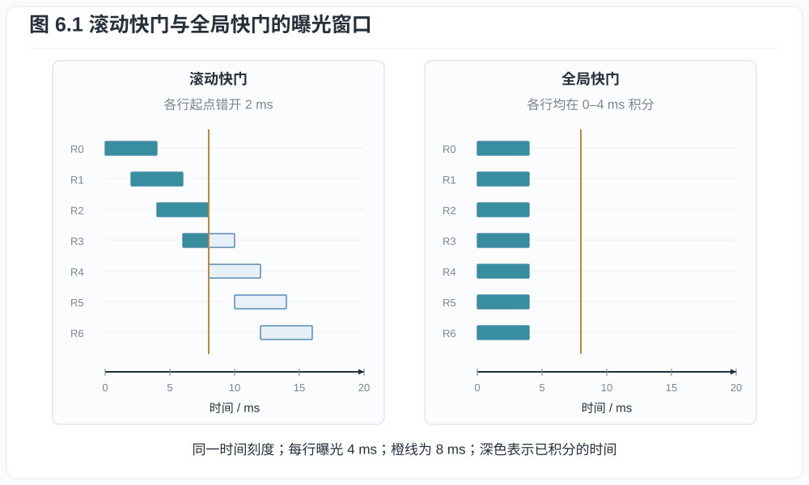
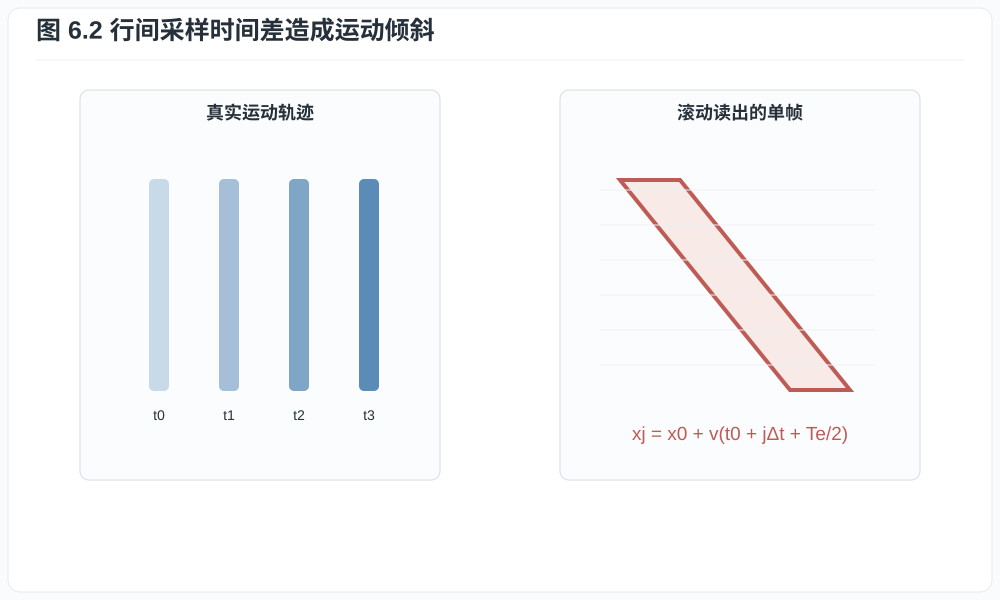
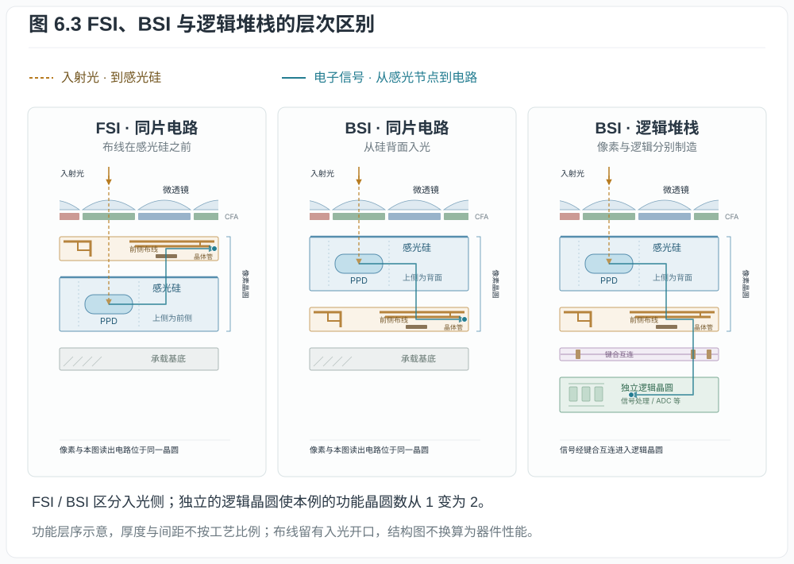
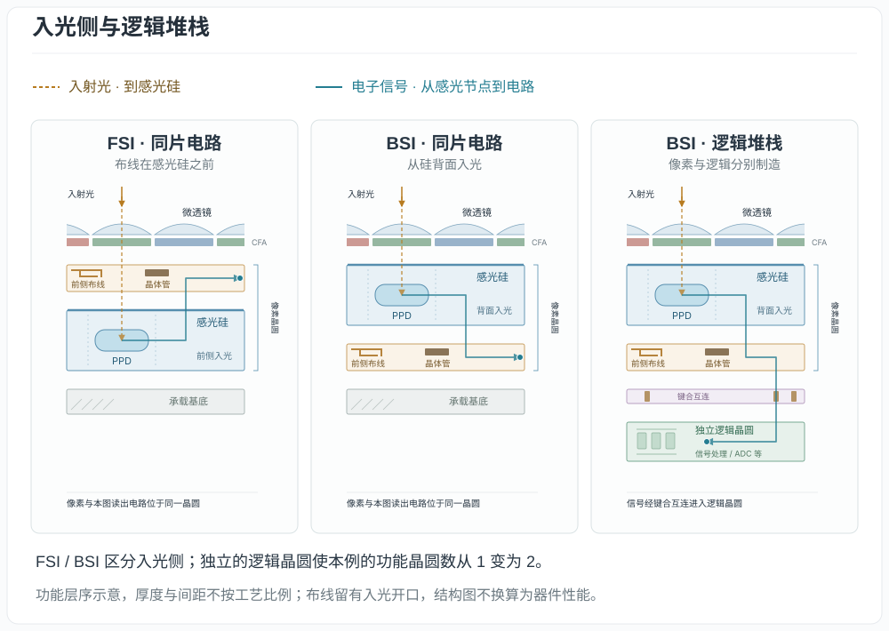
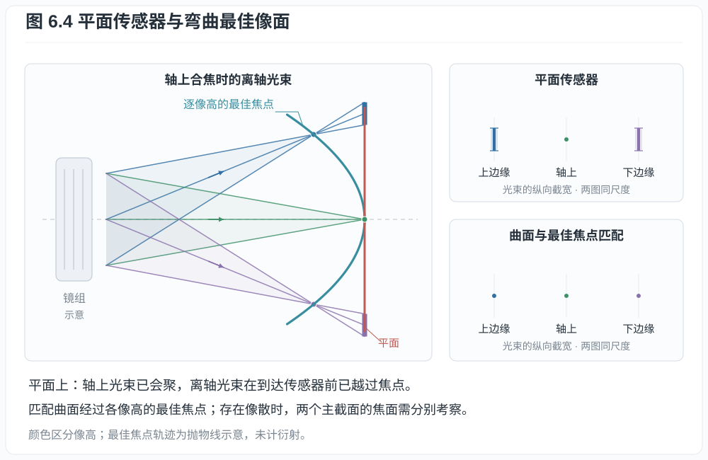
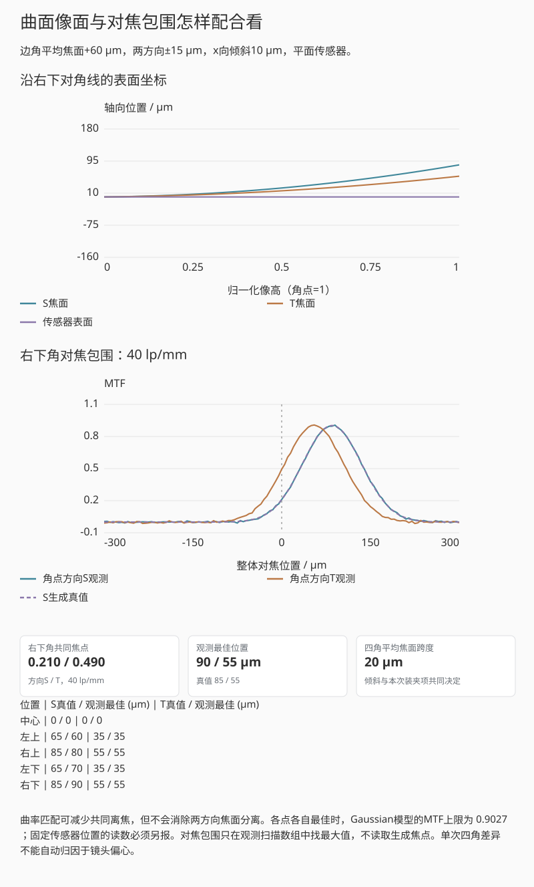

# 第六章：滚动/全局快门、背照、堆栈与曲面传感器

用 $1/4000$ s 的电子快门拍摄快速横移的竖杆，杆可能边缘清楚，整体却向一侧倾斜。
每一行的曝光很短，整幅画面仍用了更长时间逐行采集。前几章计算一个像素在曝光
窗口内的信号；移动场景还要知道各行窗口是否同时出现。全局快门通过同步各像素的
曝光窗口减少这种变形；背照和堆栈则为像素收光与读出电路提供不同的结构选择。
理解这些技术，可以先从各行何时开始、何时结束积分画起。

## 6.1 曝光窗口与读出窗口

设像面的辐照度为 $E(x,y,t)$，单位W/m²，第 $j$ 行在 $t_j$ 开始曝光，持续
$T_e>0$。其累计曝光量为

$$
H_j(x)=\int_{t_j}^{t_j+T_e}E(x,y_j,t)\,dt.                \tag{6.1}
$$

所得 $H_j$ 的单位为J/m²。

**定义 6.1（滚动快门）.** 若不同行的 $t_j$ 系统性不同，通常近似
$t_j=t_0+j\Delta t$，称为滚动快门（rolling shutter）。从第一行到最后一行的开始
时间差称为扫描时间或 readout time，不能与单行曝光时间 $T_e$ 混为一谈。

**定义 6.2（全局快门）.** 若所有像素的有效曝光窗口在规定容差内同时开始和结束，
随后存储电荷或电压并依次读出，称为全局快门（global shutter）。有效曝光同步结束，
后续数据仍可逐行输出。

*图 6.1　浅色条表示完整积分窗口，深色表示当前时刻之前已经过的部分。滚动快门的
窗口沿行号错开；全局快门可以在积分结束后继续逐行搬运数据，输出带宽与采样同步性
是不同问题。静态图取每行曝光 4 ms，橙线对应 8 ms。*

两侧使用同一个时间刻度。选中一行并移动当前时刻，可以逐项核对它的起点、终点及
其他行的状态。全局快门一侧只同步曝光窗口；窗口结束后的输出过程仍需另行计算。
图中深色部分表示已经经过的积分时间，只有照明恒定时才与累积电荷比例相同。

## 6.2 滚动快门的几何畸变

考虑一根竖直直杆以像面速度 $v$ 水平移动。其在时刻 $t$ 的位置为
$x(t)=x_0+vt$。每行从 $t_j=t_0+j\Delta t$ 开始作均匀矩形曝光，记录的杆影中心为

$$
\begin{aligned}
x_j&=\frac1{T_e}\int_{t_j}^{t_j+T_e}(x_0+vt)\,dt\\
&=x_0+v(t_0+j\Delta t+T_e/2).
\end{aligned}                                             \tag{6.2}
$$

相邻行的中心相差 $v\Delta t$，于是竖杆在图像中倾斜。$T_e/2$只使所有行的中心
一起平移；缩短曝光时间可减小每行内的模糊，却不改变行间倾斜。后者需要缩短扫描
时间或改用全局采样。

*图 6.2　短曝光只缩短每一行自身的时间平均窗口；只要各行中心时刻不同，匀速
运动仍按式 (6.2) 形成几何剪切。*

演示中的竖杆有有限宽度，每行记录的是整个曝光窗口内的平均，因此会同时出现行内
模糊和行间倾斜。播放时，完成曝光的行依次出现；把扫描时间差调到零，各行便同时
形成图像。右侧另用静止均匀表面显示周期照明的条带，计算式在下面给出。

**例子 6.3（扫描时间与倾斜量）.** 一幅 2160 行图像的相邻行起始时间差为
$8\ \mu\mathrm s$。首行与末行的起始时刻差为

$$
T_\mathrm{scan}=(2160-1)\times8\ \mu\mathrm s
=17.272\ \mathrm{ms}.
$$

若物体在传感器采样网格上的水平速度为 $12\,000$ pixel/s，则首末行记录位置相差
$12\,000\times0.017272\approx207.3$ pixel。把单行曝光从 $1/500$ s 缩到
$1/4000$ s 会减少杆在每一行内的模糊长度，却不会改变这约 207 pixel 的首末行
位移；只有行周期或有效读出行数改变时，扫描畸变才随之改变。

周期照明也会与 $t_j$ 相互作用。设灯光为
$E(t)=E_0[1+\beta\cos(2\pi f_m t)]$，$0\le\beta\le1$、$f_m>0$。对一行的窗口积分
并除以 $T_e$，使用正弦差公式，可得该行平均辐照度

$$
\bar E_j=E_0\left[1+\beta\,
\frac{\sin(\pi f_mT_e)}{\pi f_mT_e}
\cos\bigl(2\pi f_m(t_j+T_e/2)\bigr)\right].              \tag{6.2a}
$$

行号改变余弦的相位，形成条带；曝光时间则通过 sinc 因子改变条带幅度。若曝光
恰好覆盖整数个调制周期，理想正弦调制项平均为零。例如 100 Hz 调制下，10 ms
覆盖一整周期；1 ms 只覆盖十分之一周期，幅度仍约为原来的 98.4%。这解释了短快门
为何常让频闪更明显。真实 LED 可能有多个频率、PWM 和亮度依赖波形，需测量光强
随时间的变化，再代入积分式 (6.1)。

sinc因子也可能为负，此时余弦调制项相对于曝光中心的瞬时照明反相。例如100 Hz、
15 ms时，该因子约为−0.212；演示的“调制幅度保留率”报告其绝对值21.2%，图像则保留
相位反转后的明暗位置。

## 6.3 全局快门为何曾经付出画质代价

全局快门像素需要在曝光结束后临时存储所有像素的信号，并在读出期间遮光。额外
存储节点、转移门和遮光结构占面积，也可能引入寄生电容、暗电流、漏光和额外转移
噪声。在前照小像素中，这会挤压光电二极管的填充因子。全局转移后，最后读出的
像素可能在存储节点上等待接近一帧时间；若该节点仍对光敏感，这段等待会额外积累
信号，形成寄生光响应。设计中既要让曝光期间的 PPD 有效收光，也要让读出等待期间
的存储节点充分遮光。

背照与堆栈能缓解面积冲突：感光层从背面接收光，晶体管和存储可在另一侧或另一
晶圆上获得空间。Sony Pregius S 是背照、堆栈与全局快门结合的具体工业实现。但
动态范围仍需由满阱、读噪和寄生光响应等实测值确定。

机械焦平面快门也可产生类似滚动的时间差：狭缝扫过画面时，不同位置曝光不同步。
所谓全局快门的优势是无需机械狭缝也能在整个焦面同时结束积分，并允许高速闪光同步；
实际同步仍受触发延迟、闪光持续时间和相机接口约束。

## 6.4 前照、背照、微透镜与 DTI

**定义 6.4（前照与背照）.** 前照式（front-side illuminated, FSI）传感器中，
入射光先经过布线与晶体管所在表面再到光敏硅；背照式（back-side illuminated,
BSI）把晶圆减薄，从硅背面入光，使光路避开前侧金属层。

BSI 通常提高小像素的填充效率和斜入射接受能力，但不是无条件提高所有波长 QE。
晶圆减薄、背面钝化、反射、吸收深度和串扰仍需设计。微透镜把像素上方较大区域的
光集中到有效感光区；它改变的是光学收集效率与角度响应，不扩大几何像素节距。

深沟槽隔离（deep trench isolation, DTI）在像素之间形成光学/电学边界，减少光子
或载流子横向进入相邻像素。其收益可表现为较低串扰和较高高频 MTF，但沟槽本身也
占据面积并影响满阱和工艺应力。Hamamatsu 的 BSI qCMOS 资料给出了 BSI、DTI 和
微透镜共同工作的具体截面案例。

## 6.5 “堆栈”到底堆了什么

**定义 6.5（堆栈 CMOS）.** 若像素/光电二极管层与逻辑处理层分别制造，并通过
晶圆键合、硅通孔或高密度互连连接，称为堆栈式 CMOS。互连粒度可以是外围、列级，
也可以接近像素级。

*图 6.3　FSI的光先经过布线所在层再进入感光硅，BSI从硅的背面入光；堆栈例另有
独立的逻辑晶圆。橙色箭头表示入射光，蓝色路径表示转换后的电子信号。层距仅用于
辨认结构，读噪、动态范围和扫描时间需另作测量。*

把逻辑移到独立晶圆可以提供：

- 更多或更快的列 ADC；
- 片上缓存，先高速捕获再较慢输出；
- 相位检测、HDR 或神经网络等处理逻辑；
- 为像素层选择不同制造工艺。

代价包括键合良率、功耗、热密度、成本和互连复杂度。部分堆栈只分离一部分高速
电路；“部分堆栈”与“全堆栈”不是统一标准术语，必须查看芯片截面和读出数据。

*互动示意：FSI、BSI与逻辑堆栈的功能层序和结构核对。橙色路径到感光硅为止，
蓝色路径表示光电转换之后的电子信号。图中常见堆栈例有像素、逻辑两个功能晶圆；
支撑、彩色滤光层和键合界面不计入此数。层距用于展示，不是工艺厚度。*

展开层片后，核对两个位置：光进入硅之前是否经过前侧布线所在层，
信号处理是否另占一个功能晶圆。前一个问题区分FSI与BSI，后一个问题区分本图的
同片电路与逻辑堆栈。两者是独立的分类维度；展示的三种常见组合不是全部可能组合。
FSI的布线有开口，不能把它理解成一整面金属挡住所有光；BSI的前侧电路也没有消失，
只是入光改从另一侧进行。

回放先显示入光和感光节点，再显示像素电路与逻辑互连。电荷转移、电压转换、ADC
及数字传输在这里合并为功能路径，不逐个模拟。层序和连接关系分别与独立参照核对；
Sony的2012年堆栈发布资料和Pregius S截面说明提供结构依据；量子效率、满阱、
读噪和扫描速度则需要各器件自己的参数与测量。

## 6.6 曲面传感器与场曲

拍摄同一物平面上的细小光点，沿光轴移动接收面，记录各像高处点像最清楚的位置。把这些
位置连起来，得到的最佳像面可能是弯曲的，这就是场曲的直观含义。若两个方向的
细线分别在不同位置最清楚，还要区分两个方向的焦面；第十三章会进一步讨论像散。

Petzval和用各折射面的参数描述场曲贡献。对折射面 $j$，一个常见符号约定下为

$$
\mathcal P=\sum_j
\frac{n_{j+1}-n_j}{n_j n_{j+1}R_j}.                      \tag{6.3}
$$

*图 6.4　弯曲传感器只有在曲率、像散两主截面和具体镜头的离轴最佳焦面匹配时才
可能减少场曲校正负担。蓝色曲线不代表所有镜头共有的固定球面。*

其符号依半径和传播方向约定，实际最佳像面还受像散影响。平面传感器迫使镜头用额外
镜片和像差平衡去压平焦面。

若传感器弯成接近最佳像面的球面，可释放一部分场曲校正自由度，并改善边缘清晰度、
相对照度或镜头体积。Guenter 等人的 2017 年原型证明减薄商用 CMOS 可被气压成形为
高精度曲面并保持功能；这证明工艺可行性，不表示所有镜头只需弯传感器就会更好。

曲率必须与具体镜头设计匹配。可换镜头系统中，不同镜头有不同场曲和像散；固定曲率
可能帮助一支镜头却损害另一支。晶圆应力、封装、热循环、产率和标定也比平面芯片
复杂。曲面本身不增加光子能量，只通过允许更合适的光学设计间接改变收集和成像。

**例子 6.6（不能由结构名推出性能）.** 设传感器 A 为 BSI 滚动快门，实测扫描时间
8 ms、读噪 $2.0\ e^-$；传感器 B 为堆栈式 BSI 全局快门，扫描采样同步，但读噪
$3.2\ e^-$。由结构定义只能断定 B 的有效曝光窗口更同步以及它具有独立逻辑层，
不能断定 B 的读噪更低。反过来，A 的较低读噪也不能消除其 8 ms 行间时间差。
这类比较必须把时序、噪声、满阱和量子效率拆成独立测量列。

### 给定两条焦面以后，怎样判断曲率是否匹配

下面用显式合成焦面作比较。令像场坐标 $x,y\in[-1,1]$，
$u=(x^2+y^2)/2$，两方向最佳焦面为
$z_\pm=(C\pm A)u+t_xx+t_yy$，传感器表面为 $z_0+Ku$，长度统一用μm。
$C$ 控制角点平均场曲，$2A$ 是角点两方向焦面分离，$t_x,t_y$ 表示倾斜。
改变 $K$ 可以匹配平均曲率，却不能让 $z_+$ 与 $z_-$ 自动重合。

*互动示意：角点平均焦面+60 μm、两方向±15 μm，传感器起初为平面。局部MTF来自
声明的Gaussian模糊，5 μm步长的观测对焦包围另保留已知焦点，未使用真实镜头处方。*

取局部离焦 $\Delta z=z_0+Ku-z_\pm$，以
$\sigma^2=(1.8\ \mu\mathrm m)^2+(0.08\Delta z)^2$
定义两方向Gaussian宽度，再按其Fourier变换计算MTF。传感器表面与两条焦面的
距离决定各点读数；将 $K$ 调到 $C$ 可以减小平均场曲离焦，$2A$ 对应的方向分离
仍然保留。第十七章用同一实验区分共同焦点、各点最佳焦点与重新装夹。

## 练习

**练习 6.1.** 一台相机有 3000 行，行时间差 $10\ \mu\mathrm s$。计算首末行开始
曝光的时间差。物体像面速度为 $5000$ pixel/s 时，首末行位置相差多少像素？

**练习 6.2.** 说明为什么电子快门可以是滚动快门，机械快门也可能产生焦面扫描
畸变。

**练习 6.3.** 分别写出 BSI、堆栈和全局快门直接规定的结构或时序，以及它们不能
单独推出的一个性能指标。

**练习 6.4.** 在曲面焦面实验中取 $C=60$ μm、$A=15$ μm、无倾斜、整体焦位
$z_0=0$，关闭观测噪声并固定装夹序号一。先预测角点 $u=1$ 的两方向焦位，
以及平面传感器 $K=0$ 的两项有符号离焦；再只把传感器弯曲量改为 $K=60$ μm。
用焦面图核对，并解释为什么“匹配平均曲率”仍未让两方向同时合焦。静态阅读时
直接使用正文的 $z_\pm$ 与 $\Delta z$ 公式即可。
