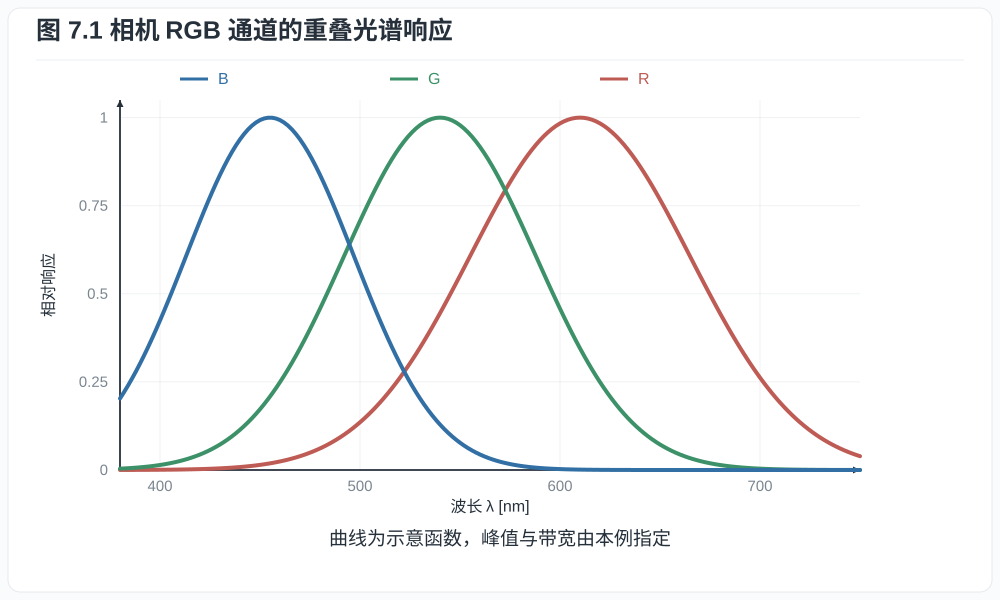
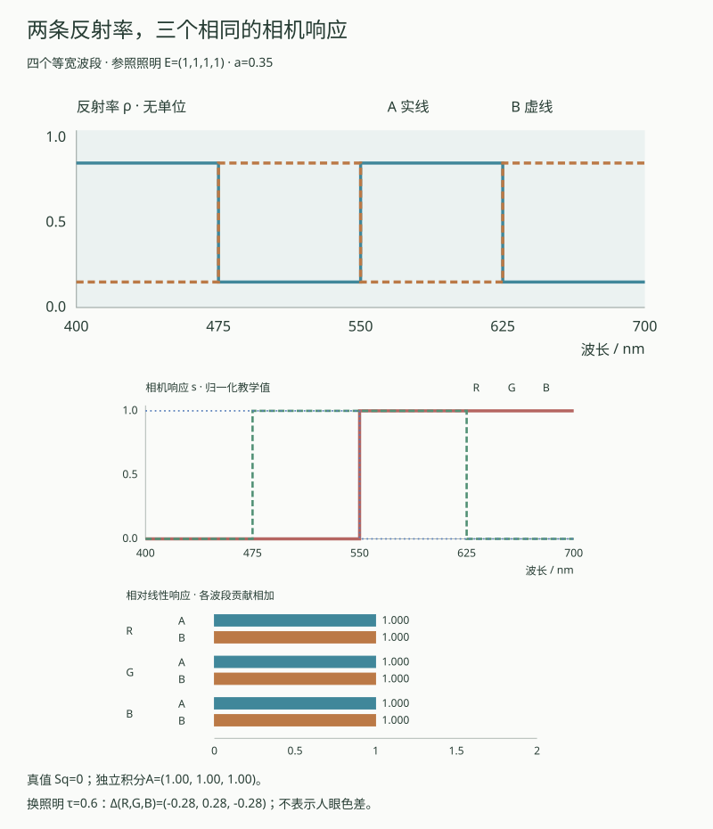
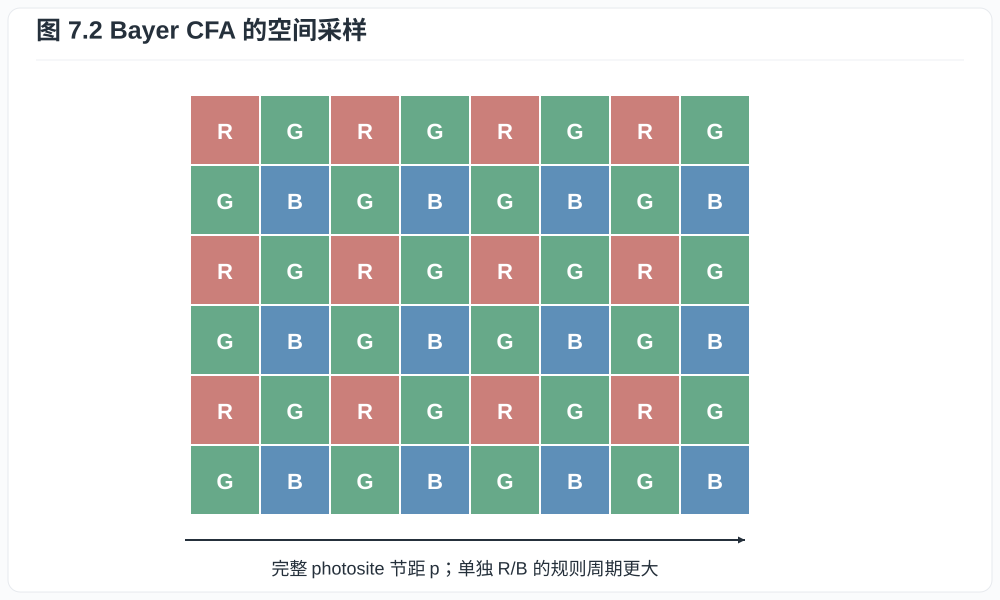
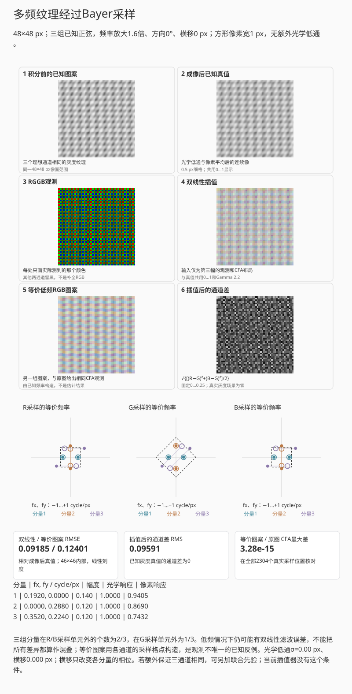
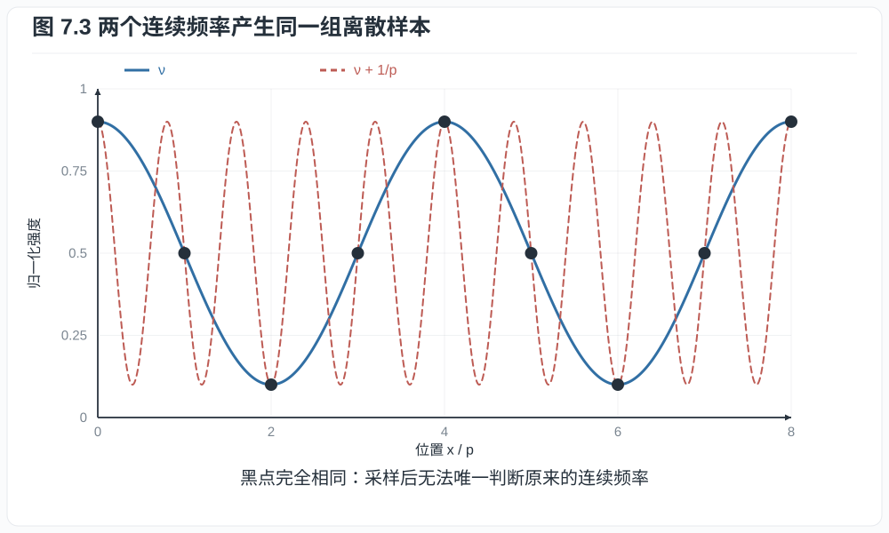
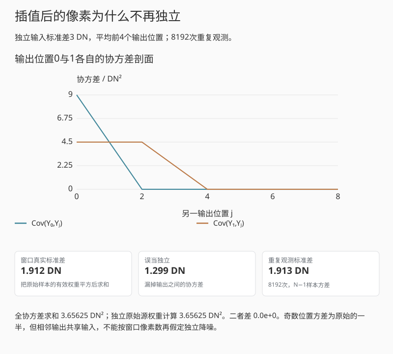
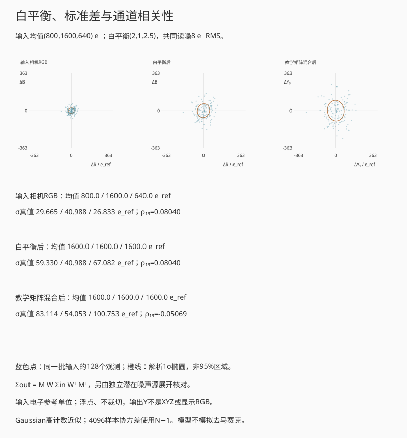

# 第七章：色彩滤阵、采样、去马赛克与色彩矩阵

一块灰布在日光下拍起来接近中性，移到暖灯下，未经白平衡的 RAW 往往红通道较强、
蓝通道较弱。把蓝通道提亮可以恢复中性外观，也会让它的噪声更显眼。若布料上还有
细条纹，照片中又可能出现原物没有的彩色波纹。这两个现象分别涉及像素对光谱的
加权和不同颜色样本的空间排列，处理时需要两套相互配合的模型。

## 7.1 相机通道是光谱积分

设落到像点的光谱曝光为 $H_\lambda(\lambda)$，第 $k$ 类滤色单元的总光谱响应为
$s_k(\lambda)$，则其平均电子数可抽象为

$$
c_k=\int_0^\infty H_\lambda(\lambda)s_k(\lambda)\,d\lambda. \tag{7.1}
$$

$s_k$ 包含像素面积、光子能量换算、滤色片与收集效率；本节的 $H_\lambda$ 已是
到达像面参考面的光谱曝光，所以镜头透射不再重复乘入。若从镜头前的场景光谱算起，
才需额外加入镜头的光谱透射。以下把波长限制在工作区间
$\Lambda=[\lambda_{\min},\lambda_{\max}]$，其中 $0<\lambda_{\min}<\lambda_{\max}<\infty$，响应函数
取为有界可测实函数，光谱曝光为非负可积函数；区间外的响应设为零。

**命题 7.1（相机同色异谱的存在）.** 对任意三个线性独立响应函数
$s_R,s_G,s_B$，存在非零光谱扰动 $q(\lambda)$，使

$$
\int q(\lambda)s_k(\lambda)\,d\lambda=0,
\qquad k\in\{R,G,B\}.
$$

**证明.** 在 $\Lambda$ 内取四个互不相交、长度为正的子区间，用它们的指示函数张成
空间 $V$。按几乎处处相等识别函数时，它们仍线性独立，故 $\dim V=4$。线性映射

$$
T:V\longrightarrow\mathbb R^3,\qquad
T(q)=(\langle q,s_R\rangle,\langle q,s_G\rangle,\langle q,s_B\rangle)
$$

的秩至多为 $3$。秩--零化度定理给出 $\dim\ker T\ge1$，故存在有界紧支的
$q\ne0$ 使三个积分均为零，而且 $q$ 在正测度的集合上不为零。取 $\varepsilon>0$，
设 $K$ 包含 $q$ 的支集，取
$H_0=M\mathbf1_K$，其中 $M>\varepsilon\lVert q\rVert_\infty$。则
$H_0$ 与 $H_0+\varepsilon q$ 是两个不同的非负光谱，且它们的三个相机通道积分
相同。$\square$

这证明相机 RGB 不能唯一决定光谱。两条相机同色异谱的光谱在人眼下是否仍相同，还
取决于相机响应与人眼配色函数的关系；仅凭“只有三个通道”并不能判定色度转换一定
有误差。第 7.5 节会给出精确转换成立的条件。



*图 7.1　通道曲线是机制示意，并非某一传感器的标定数据。每个 RAW 通道是入射
光谱与相应响应函数的积分。有限个积分会保留光谱歧义；曲线是否重叠本身不决定
能否准确匹配人眼色度。*

把命题7.1中的零方向写成四个波段的数字，光谱歧义会更具体。以下取
400–700 nm内四个等宽的75 nm波段，区间外响应为零，声明一个教学相机的响应矩阵

$$
S_0=\begin{pmatrix}0&0&1&1\\0&1&1&0\\1&1&0&0\end{pmatrix},
\qquad \boldsymbol q=(1,-1,1,-1)^{\mathsf T},\qquad S_0\boldsymbol q=0.
                                                               \tag{7.1a}
$$

行依次为R、G、B，列从短波到长波。这些理想方窗不是实测CFA响应，也不是人眼
配色函数。取两块不发光、不荧光的材料，其分段反射率为
$\boldsymbol\varrho_A=\tfrac12\boldsymbol1+a\boldsymbol q$、
$\boldsymbol\varrho_B=\tfrac12\boldsymbol1-a\boldsymbol q$，$0\le a\le\tfrac12$，
因此每项都在 $[0,1]$ 内。照明和几何比例固定时，像面相对谱曝光密度与反射率成正比。
把照明四波段的相对谱曝光密度记为 $\boldsymbol e$，每通道积分再除以75 nm，则

$$
\boldsymbol c_A=S_0\operatorname{diag}(\boldsymbol e)\boldsymbol\varrho_A,
\qquad
\boldsymbol c_A-\boldsymbol c_B
=2aS_0\operatorname{diag}(\boldsymbol e)\boldsymbol q.             \tag{7.1b}
$$

等宽、分段常值的积分直接给出这个矩阵乘法。当 $\boldsymbol e=\boldsymbol1$ 时，
两块材料的相对线性响应均为 $(1,1,1)^{\mathsf T}$，尽管 $a>0$ 时反射率不同。
改用非均匀照明，$S_0\boldsymbol q=0$ 一般不能保证
$S_0\operatorname{diag}(\boldsymbol e)\boldsymbol q=0$。换相机响应也可能打破这对
材料原有的匹配。白平衡或固定色彩矩阵对相同输入只能给出相同输出，不能从已丢失
的光谱信息中区分它们。

<div data-mb-component="metamerism">



*互动示意：四波段相机同色异谱及换照明后的响应差。参照照明下，两条反射率在
三个相机通道内分别积分到相同值；改变照明形状或R通道的短波响应，原有匹配可能
消失。图中响应是相对值，不作为显示RGB，也未计算人眼色差。*

</div>

回放按波长累加积分，条形轮廓始终保留完整结果；这只是把求和过程展开，并不表示
相机依次曝光各个波段。独立波长积分与矩阵点积核对读数，三阶子式则核对零方向。
例如 $a=0.35$，把照明改为 $(0.4,0.8,1.2,1.6)$，总和仍为4，
两块材料的相机响应差成为 $(-0.28,0.28,-0.28)$。差别来自光谱形状，不是照明总和。
本例没有人眼配色函数，因而不能把这些差值称为感知色差。

## 7.2 Bayer 阵列与空间采样

常见 Bayer 单元为

```text
R G
G B
```

绿色采样密度较高，与人类亮度感知和常见自然光谱的工程权衡有关。每个位置仍只测
一个通道。若像素节距为 $p$，完整感光格的一维采样频率为 $1/p$，Nyquist 频率为
$1/(2p)$；但红、蓝各自沿行列每隔 $2p$ 才有一个样本，一维轴向 Nyquist 只有
$1/(4p)$。两个绿色位置合起来形成交错格点，频率支持随方向变化，不能用一个较小
的方形像素格替代。灰色纹理中三个通道常有相关结构，算法可借此估计较高频的亮度
细节；彩色细纹则可能破坏这项假设，形成伪色。

<div data-mb-component="bayer">



*图 7.2　每个格子只保存一个滤色通道的样本。去马赛克后的每像素 RGB 是邻域估计，
不能把输出 RGB 像素数直接解释为每通道独立测量数。*

</div>

采样前连续像首先经过镜头 PSF、像素孔径积分和可能的光学低通滤镜（OLPF）。用
$I(x,y)$ 表示连续像、$a(x,y)$ 表示像素孔径，理想采样为

$$
y[m,n]=\iint I(x,y)a(x-mp,y-np)\,dx\,dy.                 \tag{7.2}
$$

像素不是几何点，而是对面积积分；其矩形孔径 MTF 含 sinc 因子。微透镜与电荷扩散
会进一步改变有效孔径。

把原始像素节距取作长度单位，令 $(f_x,f_y)$ 的单位为 cycles/pixel。
若分别对每个颜色通道采用中心带限假设，红蓝的中心频率单元为

$$
|f_x|<\tfrac14,\quad |f_y|<\tfrac14;
\qquad
\text{绿色为}\quad |f_x+f_y|<\tfrac12,\quad |f_x-f_y|<\tfrac12.       \tag{7.2a}
$$

因此沿坐标轴，红蓝的边界为 $0.25$，绿色为 $0.50$；沿 $45^\circ$，三者的频率
模长边界都为 $1/(2\sqrt2)\approx0.354$。绿色的两个位置在此假定响应相同，其
交错格以 $(1,1)$、$(1,-1)$ 为基向量，倒格以 $(1/2,1/2)$、$(1/2,-1/2)$ 为基向量；
红蓝倒格则分别沿两轴以 $1/2$ 为间隔。这给出式 (7.2a) 的菱形与方形，不能由
“绿色有两倍像素”推出各方向都多一倍分辨率。边界采用严格不等式，仍需防范特定
相位使调制度消失。

互动旋转的是频率向量，即条纹的法向。设一个通道的位置为 $r=r_0+\ell$，
其中 $\ell$ 属于该通道的采样格，$k$ 为倒格向量，则 $k\cdot\ell$ 为整数。
连续正弦的频率由 $f$ 改为 $f-k$、相位由 $\phi$ 改为 $\phi+k\cdot r_0$ 后，
该通道的所有样点不变。R、G、B 可分别取起点 $(0,0)$、$(1,0)$、$(1,1)$；
忘掉起点的相位修正，会把绿色或蓝色的等效条纹画错。图中的基带正弦由已知输入
构造，不是从 RAW 估计出的真实频率。双线性插值则只读取 CFA 样本，不使用输入
频率或“三通道完全相同”这个生成条件。实际算法可以另用通道相关性作为先验；
这里的逐通道边界不是对所有去马赛克算法的统一分辨率判决。

### 多个频率叠在同一幅纹理中

单频正弦便于核对混叠的频率和相位；实际纹理往往同时含有多个方向。下面保留
同一RGGB格点，用三个已知分量构造三通道相等的灰度图案

$$
I(x,y)=0.5+\sum_{\ell=1}^{3}a_\ell
\cos[2\pi(f_{x,\ell}x+f_{y,\ell}y+\phi_\ell)].
$$

坐标用px，频率用cycle/px，相位 $\phi_\ell$ 用周期数。基础频率向量为
$(0.12,0)$、$(0,0.18)$、$(0.22,0.14)$，幅度为0.14、0.12、0.12，初相位为
0、0.17、−0.13；叠加后的线性强度始终在0.12至0.88之间。频率倍率和整组旋转
作用于这些向量；纹理横移 $d$ 后，每项相位变为 $\phi_\ell-f_{x,\ell}d$，
采样位置保持不动。

光学Gaussian低通的标准差为 $\sigma_o$ px，方形像素积分宽度为 $w$ px。
在本例的线性平移不变模型中，第 $\ell$ 项振幅乘数为

$$
H_\ell=\exp[-2\pi^2\sigma_o^2(f_{x,\ell}^2+f_{y,\ell}^2)]
\operatorname{sinc}(w f_{x,\ell})\operatorname{sinc}(w f_{y,\ell}),
\qquad \operatorname{sinc}(u)=\frac{\sin(\pi u)}{\pi u}.
$$

$w=0$ 取点采样极限。先应用这些响应，再取CFA样本。图中的“成像后已知真值”
就是该有效连续图像；双线性插值只读取马赛克和CFA布局。把每个分量按各颜色的
倒格折返，另构造一幅成像后、离散采样前的等价RGB图像。由前面的样点恒等式和
线性叠加，它与原有效图像在全部CFA位置给出相同观测，未观测的颜色却可以不同。
这个已知反例不是插值器估出的结果，也没有额外要求等价图像保持灰度。

<div data-mb-component="bayer-texture">



*互动示意：积分前图案、成像后真值、RGGB观测、双线性结果和等价RGB图像并列；
颜色仅用于屏幕比较，没有真实相机色度标定。第六图单独显示通道差，频率图标出
三个分量及其折返位置。缓慢平移纹理时，伪色随相位变化，采样格点与频率边界不变。*

</div>

先用低频预设：所有分量都在各颜色的中心频率单元内，构造的等价图像与真值重合，
但双线性插值仍有滤波误差，甚至出现小幅通道差。再提高频率、旋转方向，并逐个
比较频率位置、插值图和等价图；不能仅凭一处彩边就判定其全部来自混叠。加入
光学低通会减弱高频幅度，像素积分也会衰减某些频率，但二者都没有移动采样边界。

所有线性误差均在同一46×46内部区域计算，排除一圈边界；显示Gamma不进入RMSE。
默认状态的等价图与原图在2304个CFA位置的最大差仅为浮点舍入尺度，而内部RGB
RMSE约0.124。它说明这套逐通道观测并不唯一；若另给“三通道相同”的联合先验，
允许的图像集合会改变，不能用当前反例否定所有利用通道相关性的算法。

## 7.3 去马赛克不是“恢复原值”

去马赛克（demosaicing）根据邻域样本估计每个位置缺失的两个通道。最简单的双线性
方法在红像素位置用周围绿色平均估计绿，用对角蓝平均估计蓝。例如

$$
\widehat G_{m,n}
=\frac14(G_{m-1,n}+G_{m+1,n}+G_{m,n-1}+G_{m,n+1}).        \tag{7.3}
$$

若局部颜色平滑，式 (7.3) 可用；若穿过高对比边缘，它会跨边缘混合，产生彩边和
拉链伪影。现代算法会估计边缘方向、通道相关性或利用学习先验，但没有算法能从发生
混叠的单个样本唯一恢复所有可能原图。

**例子 7.2（超过 Nyquist 的条纹）.** 一维正弦
$I(x)=1+\cos(2\pi\nu x)$ 在点 $x=np$ 采样。对任意整数 $k$，频率
$\nu'=\nu+k/p$ 给出

$$
\cos(2\pi\nu'np)
=\cos(2\pi\nu np+2\pi kn)
=\cos(2\pi\nu np).
$$

所以多个连续频率产生完全相同样本。摩尔纹不是“分辨率不够导致模糊”，而是高频被
错误折回低频。OLPF 通过采样前衰减高频降低混叠，代价是原始锐度下降。

<div data-mb-component="sampling">



*图 7.3　采样点相同意味着仅由样本无法判定原连续频率。锐化不能区分真实高频与
已折叠的伪低频；防混叠必须发生在采样前或依靠额外观测。*

</div>

把像素节距取作长度单位，频率便可写成 cycles/pixel。上面的实验初始频率为
0.80 cycles/pixel，此时的采样值与一条 0.20 cycles/pixel 的低频条纹相同。
将频率设为 0.50，再把相位调到四分之一周期，全部采样点便落在平均光强处。
因此，“每周期恰有两个样点”不能保证在任意相位下保留调制度。

实验中的积分宽度为 $a$ 个像素节距，$0<a\le1$。对均值为 $0.5$、调制度为 $0.8$
的连续正弦作归一化盒积分，令 $\eta=\nu p$ 为每像素节距的周期数，其振幅乘数为
$\sin(\pi a\eta)/(\pi a\eta)$；$a=0$ 用连续极限表示点采样。这个有符号乘数来自直接积分
余弦，负号表示相位反转。积分衰减了某些高频，但不会改变采样网格的 0.50
cycles/pixel Nyquist。这里只演示单色一维采样；Bayer 的各颜色网格还需按原坐标分析。

### 插值同时改变空间噪声

只看一行间隔为两个像素的同色样本。令原始噪声 $X_j$ 独立，均值零、方差
$\sigma^2$，固定线性插值得到 $Y_{2j}=X_j$、
$Y_{2j+1}=(X_j+X_{j+1})/2$。于是奇数位置方差减半，但
$\operatorname{Cov}(Y_{2j},Y_{2j+1})=\sigma^2/2$，相邻两个奇数位置的协方差为
$\sigma^2/4$。这些式子直接展开乘积并用独立零均值计算即可。

对任意窗口平均 $\bar Y=N^{-1}\sum_iY_i$，应保留

$$
\operatorname{Var}(\bar Y)=\frac1{N^2}\sum_{i,j}
\operatorname{Cov}(Y_i,Y_j).
$$

另一条核对路径是先把 $\bar Y$ 写成原始独立 $X_j$ 的加权和，再将有效权重平方求和。
例如平均 $Y_0,Y_1,Y_2,Y_3$ 时，原始样本的权重为 $3/8,1/2,1/8$，方差为
$13\sigma^2/32$；若把四个输出误当独立，只会得到 $3\sigma^2/16$。

<div data-mb-component="demosaic-noise">



*互动示意：原始标准差3 DN，8192次独立重复，平均前四个输出。全协方差、有效原始
权重和样本方差三路对照；本例是一维同色行，不冒充完整自适应去马赛克。*

</div>

因此“去马赛克后单个像素的噪声较小”与“区域平均获得多少降噪”是两个问题。
真实算法还会根据边缘选择方向，权重可能依赖含噪观测；那时不能直接沿用这组
固定线性权重的协方差公式，必须连同算法的选择过程一起分析。

## 7.4 白平衡放大了什么

在某照明下，中性物体的相机通道均值可能为下列比例。这里使用已经线性化、减去
各通道黑电平的 RAW 信号，各通道采用相同的归一化尺度：

$$
(R,G,B)=(0.45,1.00,0.30).
$$

若以绿色为基准，白平衡增益为

$$
(w_R,w_G,w_B)=(2.22,1,3.33).
$$

乘法使中性物体变为 $(1,1,1)$，同时把蓝通道信号噪声标准差也乘 $3.33$。白平衡
不改变单个未剪切通道的 SNR，因为均值和标准差同乘一个数；但显示为中性后，原本
较弱的蓝通道对画面噪声的贡献更明显。以蓝通道 100 个电子、总噪声 12 个电子为例，
乘三后是 300 与 36，SNR 仍为 8.33。若白平衡之后又把通道裁切到有限范围，高光
信息还可能丢失。因此显影中通常保留浮点中间值，把显示裁切留到后续处理。

## 7.5 从相机 RGB 到标准颜色空间

白平衡后相机 RGB 仍是设备相关坐标。给定照明与标定条件，可用 $3\times3$ 矩阵
近似映射到 CIE XYZ：

$$
\boldsymbol X
=M\operatorname{diag}(w_R,w_G,w_B)\boldsymbol c_\mathrm{cam}. \tag{7.4}
$$

这里的 $\boldsymbol X$ 是按声明尺度归一化的 CIE XYZ 三刺激值，白平衡矩阵记为
$W_b=\operatorname{diag}(w_R,w_G,w_B)$。将 CIE 配色函数写成向量
$\boldsymbol t(\lambda)$，相机响应写成 $\boldsymbol s(\lambda)$，就可以明确说明
何时存在精确的颜色矩阵。把共同的曝光与归一化常数吸收入 $\boldsymbol t$，则
$\boldsymbol X=\int_\Lambda H_\lambda(\lambda)\boldsymbol t(\lambda)\,d\lambda$；
以下 $\boldsymbol t$ 也满足本节的有界可测约定。

**命题 7.3（对所有光谱成立的线性色度映射）.** 在本节的可积性约定下，给定矩阵
$M_0\in\mathbb R^{3\times3}$。它对每个非负可积光谱 $H_\lambda$ 都满足
$\boldsymbol X=M_0\boldsymbol c_\mathrm{cam}$，当且仅当

$$
\boldsymbol t(\lambda)=M_0\boldsymbol s(\lambda)
\quad\text{对几乎处处的 }\lambda\in\Lambda.              \tag{7.5}
$$

**证明.** 若式 (7.5) 成立，将它乘以 $H_\lambda$ 并积分即得充分性。反之，对矩阵
某一行，设配色函数与该行响应组合之差为 $d(\lambda)$。假设所有非负可积光谱都满足
$\int H_\lambda d=0$。若 $d>0$ 的集合有正测度，则某个集合
$\{d\ge1/n\}$ 也有正测度；取其指示函数为 $H_\lambda$，积分严格为正，矛盾。
对 $-d$ 重复此论证，得到 $d=0$ 几乎处处。逐行应用便得必要性。$\square$

三通道响应线性独立时，这对应常说的 Luther 条件：相机响应与 CIE 配色函数张成
同一个三维空间。相关背景见 Zhu 与 Finlayson 的
[色度相机研究](https://arxiv.org/abs/2005.06421)。人眼同样无法从三个三刺激值恢复
完整光谱，色度匹配因此并不要求光谱重建。实际相机若不满足式 (7.5)，就只能在
给定色样和照明集合上拟合近似矩阵。

设标定色样的白平衡相机值组成矩阵 $C\in\mathbb R^{3\times n}$，参考 XYZ 组成
$X\in\mathbb R^{3\times n}$。最小化 $\|X-MC\|_F^2$，令对 $M$ 的导数为零，得
$MCC^T=XC^T$；若 $CC^T$ 可逆，

$$
M=XC^T(CC^T)^{-1}.                                      \tag{7.6}
$$

它最小化的是所选样本的 XYZ 平方误差；改用感知权重、不同光源或不同色样会得到
另一拟合。双光源配置文件在标定间插值，也仍需检验窄谱 LED 等未被样本覆盖的照明。

颜色混合还会传播噪声。若相机 RGB 的噪声协方差为 $\Sigma_\mathrm{cam}$，线性变换
后由 $\operatorname{Cov}(AZ)=A\operatorname{Cov}(Z)A^T$ 得

$$
\Sigma_{XYZ}=MW_b\Sigma_\mathrm{cam}W_b^TM^T.              \tag{7.7}
$$

即使输入通道噪声互不相关，输出 XYZ 通道也通常相关；较大的矩阵系数还会放大某些
噪声分量。评价颜色处理时，色差与噪声需要一起看。

### 把均值、标准差与相关性分开看

对一块空间均匀区域，声明输入三通道均值为
$\boldsymbol\mu=e(800,1600,640)$ e$^-$，其中 $e>0$ 是实际曝光倍率。
为单独观察噪声传播，采用高计数、未饱和的Gaussian近似

$$
X_j=\mu_j+\sqrt{\mu_j+4^2}\,Z_j+\sigma_cZ_c,\qquad
\Sigma_{ij}=\mathbf1_{i=j}(\mu_j+16)+\sigma_c^2.        \tag{7.7a}
$$

四个 $Z_R,Z_G,Z_B,Z_c$ 相互独立，均服从标准正态分布；$4$和$\sigma_c$用
e$^-$ RMS。独立项把高计数散粒方差与4电子读噪合并，共同项给三个通道相同的
加性扰动。这里省略CFA与去马赛克的空间相关，Gaussian变量也不是实际整数光子。

白平衡取 $W=\operatorname{diag}(w_R,1,w_B)$。正增益下，第$j$通道的均值和
标准差都乘 $w_j$，SNR相除后不变；两通道的相关系数中，分子和分母同乘
$w_iw_j$，也不变。颜色混合则会改变交叉协方差。演示声明

$$
K=\begin{pmatrix}1.4&-0.3&-0.1\\-0.15&1.3&-0.15\\-0.1&-0.4&1.5\end{pmatrix},
\qquad M_\beta=(1-\beta)I+\beta K,\quad0\le\beta\le1.   \tag{7.7b}
$$

$K$每行和为1，故保持白平衡后 $(v,v,v)$ 的中性轴；它只是教学矩阵，输出记为
$Y_1,Y_2,Y_3$，不称为标定XYZ或显示RGB。令 $A=M_\beta W$，式 (7.7) 的矩阵
乘积还可按独立噪声源另算：输出第$i,j$项为
$\sum_k A_{ik}A_{jk}(\mu_k+16)+\sigma_c^2(\sum_kA_{ik})(\sum_kA_{jk})$。
这由式 (7.7a) 代入后展开、消去独立零均值项的交叉期望得到。

<div data-mb-component="white-balance">



*互动示意：基准曝光、白平衡增益 $(2,1,2.5)$、共同噪声8 e$^-$ RMS，混合比例为1。
三面板共用偏差坐标，画同批输入中的128个样本与解析1σ椭圆；完整统计使用4096个
样本和 $N-1$ 协方差。白平衡后采用输入电子参考刻度e_ref，不表示产生了新电子。*

</div>

关闭共同输入项后，矩阵混合仍可使输出相关；关闭矩阵混合后，白平衡只改变尺度。
回放依次突出这两步，不重拍观测。所有中间值保持浮点且不裁切，所以线性协方差
公式在模型内精确成立。图中的1σ椭圆不是均值置信区间；二维Gaussian在该椭圆内
的概率为 $1-e^{-1/2}\approx39.3\%$，因为标准化后的半径平方服从二自由度
$\chi^2$ 分布，径向密度 $r e^{-r^2/2}$ 从0积分到1即得此值。

颜色变换之后还需选择工作色域、色调曲线和显示变换。S-Gamut3、ACEScg、Rec.2020
等“色域”与 S-Log3、LogC4 等“传递曲线”是不同维度：前者规定基色/坐标，后者
规定数值如何编码明暗。

## 练习

**练习 7.1.** 像素节距为 $3.76\ \mu\mathrm m$，计算传感器平面的一维 Nyquist
频率，单位 lp/mm。

**练习 7.2.** 中性灰的线性、已减黑 RAW 均值为 $(800,1600,640)$ DN，三通道采用
相同码值尺度。以绿色为基准求白平衡增益。若减黑后各通道噪声 rms 为
$(20,30,18)$ DN，求白平衡后噪声；把所求增益视为固定常数，忽略其估计误差。

**练习 7.3.** 用频率等价式说明采样频率为 $100$ cycles/mm 时，$70$ cycles/mm
正弦会混叠成哪个 $[0,50]$ cycles/mm 内的频率。

**练习 7.4.** 原始独立同色噪声标准差为 3 DN，按 §7.3 固定线性插值后，平均
$Y_0,Y_1,Y_2,Y_3$。先从原始 $X_j$ 写出三个有效权重，计算平均值的方差；
再算把四个插值输出误当独立时的结果。预测二者哪一个更接近演示的重复试验，
再用 8192 次观测对照。若把输入标准差改成 6 DN，两个方差分别怎样改变？
