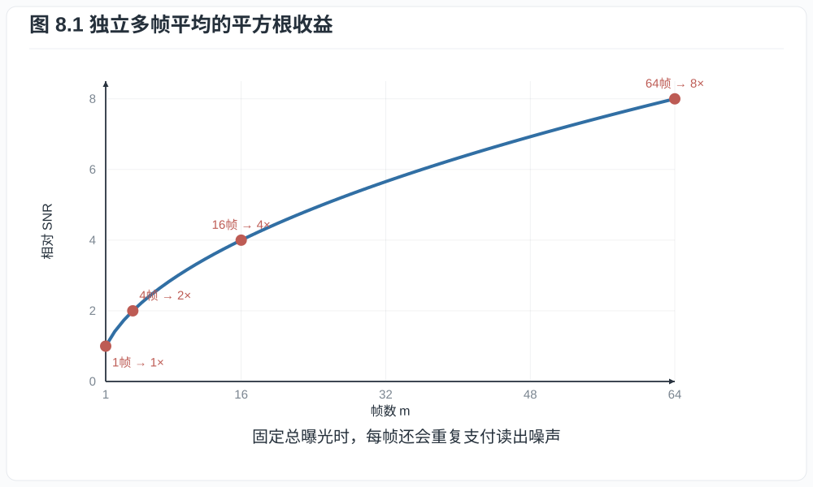
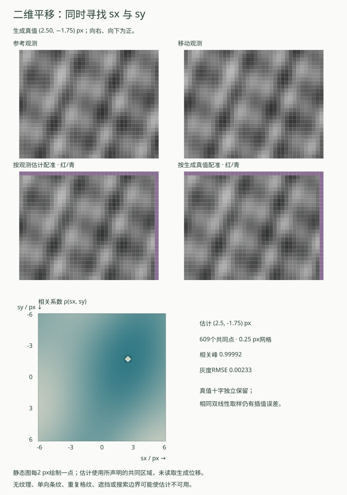
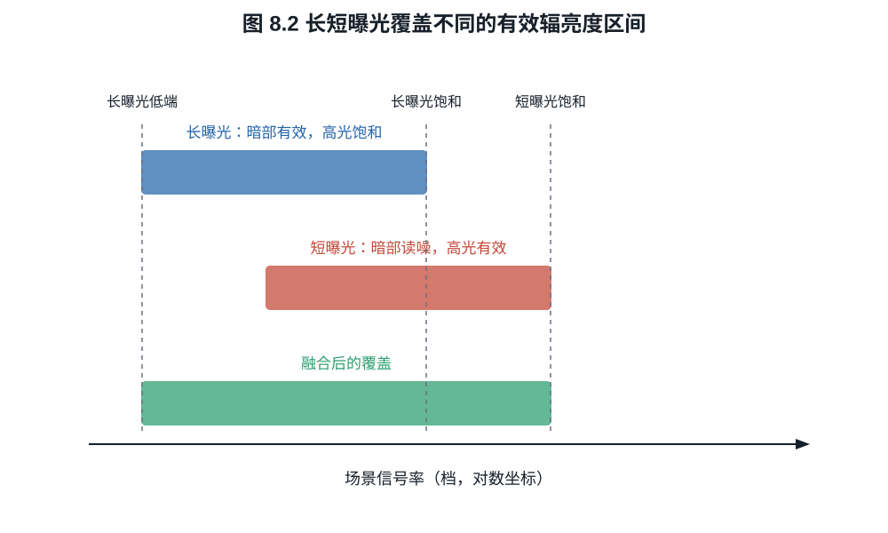
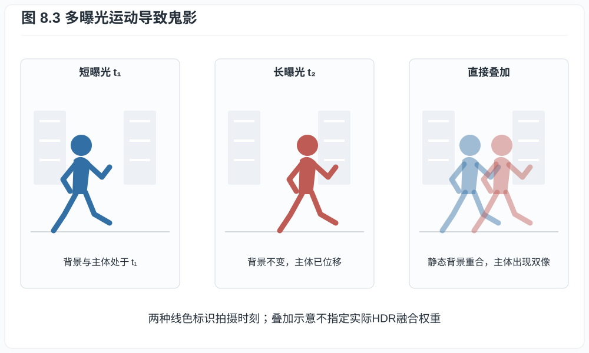
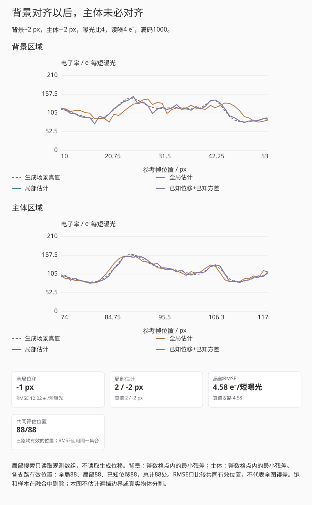

# 第八章：包围曝光、多帧降噪与现代 HDR 合成

窗边的人像常让单次曝光为难：照顾室内人脸，窗外可能变白；保住窗外，人脸又落进
阴影。长短曝光可以分别测量这两部分，同曝光连拍则可通过平均减小噪声。相机需要
先把各帧放到共同的位置和曝光尺度上，再决定每个区域采用哪些读数。人物移动、
高光剪切和读出噪声，都会影响这一步的收益。

## 8.1 同曝光堆栈怎样降低噪声

设静态场景中第 $i$ 帧线性观测为

$$
X_i=\mu+N_i,\qquad \mathbb E[N_i]=0,\qquad
\operatorname{Var}(N_i)=\sigma^2,
$$

且噪声独立。平均 $m$ 帧

$$
\bar X=\frac1m\sum_{i=1}^mX_i
$$

满足

$$
\mathbb E[\bar X]=\mu,\qquad
\operatorname{Var}(\bar X)=\frac{\sigma^2}{m}.             \tag{8.1}
$$

故 SNR 提高 $\sqrt m$，四帧提高一倍，十六帧提高四倍。若总曝光时间也增加了
$m$ 倍，这与一次长曝光的散粒噪声收益接近；区别在于短帧可对齐、剔除运动或避免
单帧高光饱和，但每帧都支付一次读出噪声。

这里的独立性还包括校准误差。多帧若减去同一张有限精度暗场，暗场残差是共享的，
平均误差应使用式 (4.3b)，不能把每帧总误差都除以帧数。

*图 8.1　$\sqrt m$ 只适用于对齐正确且相关性可忽略的随机噪声。固定图样、压缩
误差和共同照明波动不会按同一曲线下降。*

**命题 8.1（固定总曝光时间的读噪代价）.** 总信号电子数固定为 $\mu_T$。一次曝光
的方差为 $\mu_T+\sigma_r^2$；分成 $m$ 帧后求和，方差为

$\mu_T+m\sigma_r^2$。

**证明.** 第 $i$ 帧平均信号 $\mu_T/m$，Poisson 方差同为 $\mu_T/m$，另有读噪
$\sigma_r^2$。独立求和得到
$m(\mu_T/m+\sigma_r^2)=\mu_T+m\sigma_r^2$。$\square$

因此低读噪、高速传感器使 burst 更实用，但多帧不会违反光子统计。

## 8.2 配准是融合的前提

若第 $i$ 帧相对于参考帧有几何变换 $W_i$，融合前需估计
$X_i(W_i\boldsymbol r)$。亚像素配准误差会把边缘变成双影或模糊；动态主体又使一个
全局变换不够。实际算法在局部块、光流或频域中估计运动，并根据一致性降低异常帧
权重。

可写成加权估计

$$
\widehat\mu(\boldsymbol r)
=\frac{\sum_i w_i(\boldsymbol r)X_i(W_i\boldsymbol r)}
{\sum_i w_i(\boldsymbol r)}.                              \tag{8.2}
$$

若噪声独立、无偏且方差为 $\sigma_i^2$，最小方差线性无偏权重满足
$w_i\propto 1/\sigma_i^2$。但运动不一致、饱和和遮挡会引入偏差，权重还必须依据内容
可靠性，而不只是噪声。设归一化权重为 $\alpha_i=w_i/\sum_jw_j$，当权重固定且
噪声独立时，融合方差为 $\sum_i\alpha_i^2\sigma_i^2$，附录 A.3 给出其最小值的
推导。若根据观测值本身选权重或剔除帧，权重就与噪声相关，结果可能带偏；实际算法
需要在降噪、细节保留和去鬼影之间选择。

第8.3节的HDR互动把配准限制为全局水平平移。它先把观测换算到共同曝光尺度，对压缩灰度
求平滑水平梯度，再在选定条带中按列平均。令参考列序列为 $a_j$，候选位移 $s$ 下
的对应列序列为 $b_j(s)$，共同有效列上的均值分别为 $\bar a$、$\bar b(s)$，则用

$$
\rho(s)=\frac{\sum_j(a_j-\bar a)(b_j(s)-\bar b(s))}
{\sqrt{\sum_j(a_j-\bar a)^2\sum_j(b_j(s)-\bar b(s))^2}}                 \tag{8.2a}
$$

比较候选。所有候选使用同一组有效位置，避免只剩少数像素的位移因重叠区变小而
占优。分母为零表示没有可用于定位的灰度变化；搜索边界上的峰、弱峰或多个相近
峰也会被标为不可用。0.25 px 的搜索步长只是数值网格，不能当成位移精度保证。
整幅画面若包含不同运动的主体，一个全局位移也可能无法解释观测。

二维平移还需要保留纵向信息，不能先把所有行平均。下面另用两幅相对线性灰度观测
$R,M$ 展示这个问题，暂不叠加HDR融合。图像坐标向右、向下为正；无噪声且无遮挡时，
生成约定为 $R(x,y)=F(x,y)$、$M(x,y)=F(x-d_x,y-d_y)$。候选
$\boldsymbol s=(s_x,s_y)$ 通过双线性插值取 $B_{\boldsymbol s}(\boldsymbol r)
=M(\boldsymbol r+\boldsymbol s)$，在固定共同点集 $\Omega$ 上比较

$$
\rho(\boldsymbol s)=
\frac{\sum_{\boldsymbol r\in\Omega}
(R(\boldsymbol r)-\bar R)(B_{\boldsymbol s}(\boldsymbol r)-\bar B_{\boldsymbol s})}
{\sqrt{\sum_{\boldsymbol r\in\Omega}(R(\boldsymbol r)-\bar R)^2
\sum_{\boldsymbol r\in\Omega}(B_{\boldsymbol s}(\boldsymbol r)-\bar B_{\boldsymbol s})^2}}.
                                                               \tag{8.2b}
$$

两项均值都只在 $\Omega$ 上取。它是两个去均值向量的归一化内积，由Cauchy–Schwarz
不等式，分母非零时 $|\rho|\le1$。共同点必须让每个候选的插值邻域均有效，不能随
候选移动而改变。注意取样对应偏移与生成位移同号：当估计为
$(s_x,s_y)=(d_x,d_y)$，$M(x+d_x,y+d_y)$ 才回到参考位置；把整幅移动帧画回参考坐标
时，图像的校正方向相反。整数位移可以在本例中逐点复原；亚像素位移仍受插值误差影响。

*互动示意：已知二维位移、相关面、观测估计与真值配准。估计只读两幅观测，真值
单独用于对照图与误差。红、青叠加用于定位残差，紫色表示超出图像；相同显示范围
不改变参与配准的线性灰度。静态图为 $(2.50,-1.75)$ px，无观测噪声。*

搜索在横纵 $[-6,6]$ px的范围取0.25 px网格。独立对照保留生成位移、观测RMSE和
相同插值方法的真值配准图。回放从未配准逐渐移动到采用的估计，只演示重采样，
相关面始终是完整搜索结果。观测噪声采用声明标准差的独立加性Gaussian模型，
不从这个例子推导不同曝光的散粒噪声收益。

只有竖向条纹时，纵向移动可能完全不改变图案；重复格纹会产生多个同样好的位置。
本例因此保留均匀、单向和周期图案，并把低相关、相近竞争峰及唯一边界峰标为不可用。
这些筛选只能排除部分失败，不能证明留下的结果必然正确。新增遮挡破坏同一平移模型，
即使按真值移动也无法恢复被遮住的内容；改取上方区域，只在该区域仍符合共同运动时
才有意义。旋转、视差、局部形变和滚动快门需要更一般的模型。

## 8.3 不同曝光的 HDR 辐亮度估计

对静态场景线性响应，曝光 $t_i$ 的像素在未饱和时可写为

$$
Y_i=B+gEt_i+N_i,                                           \tag{8.3}
$$

$B$ 是黑电平，$g$ 为相同读出模式下的 DN/e$^-$ 增益，$E$ 是待估计的信号电子率，
单位 e$^-$/s；固定镜头、光谱和像素后，它与对应场景辐亮度成比例。$N_i$ 是零均值
噪声。这里先忽略暗电流与校准误差，未饱和时
$\operatorname{Var}(N_i)=g^2(Et_i+\sigma_r^2)$。于是

$$
\widehat E_i=\frac{Y_i-B}{gt_i},\qquad
\operatorname{Var}(\widehat E_i)
=\frac{E}{t_i}+\frac{\sigma_r^2}{t_i^2}.                  \tag{8.3a}
$$

方差中第一项来自散粒噪声，第二项来自读出。长曝光在低信号区尤其有利，因为它使
输入率估计中的读噪项按 $t_i^{-2}$ 下降；它的上端却更容易饱和。融合可写成

$$
\widehat E
=\frac{\sum_i w(Y_i)\,(Y_i-B)/(g t_i)}{\sum_i w(Y_i)},   \tag{8.4}
$$

对于未剪切且观测同一场景点的独立估计，理想固定权重与式 (8.3a) 的方差倒数成正比，
而非与原始 DN 方差的倒数成正比。它依赖未知 $E$，实现时可用初步估计迭代更新。
式 (8.4) 中直接按观测值选择的 $w(Y_i)$ 则是实用的可靠性权重：饱和样本置零，
接近黑端或不一致的样本降权。这类估计一般不再严格无偏。若所有权重为零，应标记
该点无有效观测，不能继续做除法。相机响应非线性时，Debevec--Malik 方法还会估计
响应函数，再建立共同曝光尺度。

*图 8.2　短曝光把饱和端推向更高场景辐亮度，长曝光把暗部抬离读噪底。未知的
相对响应可用可靠重叠区标定；若增益和曝光比例已独立校准，尺度也可由校准给出。*

**例子 8.2（两帧覆盖）.** 长曝光 $t_L=16t_S$。某高光在长曝光中饱和为白点，短
曝光读得线性值 $2000$ DN；该像素只能由短曝光估计。某阴影在短曝光中只有
$4\ e^-$、读噪 $3\ e^-$，长曝光则有 $64\ e^-$，其 SNR 从

$$
\frac4{\sqrt{4+9}}=1.11
$$

提高到

$$
\frac{64}{\sqrt{64+9}}=7.49.
$$

两帧各自提供另一帧缺失的有效观测。若物体在两次曝光间移动，融合边界就可能出现
鬼影。常见去鬼影策略会在移动区域退回某张参考帧，因此该处可能保住人物形状，
却得不到静态背景同样的降噪收益。

还可以计算两帧覆盖的理想范围。设每帧最低可用信号为 $q_{\min}$，上端为
$q_{\max}$，则曝光 $t$ 对应的电子率区间是 $[q_{\min}/t,q_{\max}/t]$。长短曝光的
有效区间若相交，且尺度已知，联合范围从 $q_{\min}/t_L$ 延伸到 $q_{\max}/t_S$，
比单帧多 $\log_2(t_L/t_S)$ 档。曝光比 16 对应多四档；运动、饱和过渡、暗电流和
融合误差会使实际可用收益低于这个理想覆盖数。

*图 8.3　长短曝光若观察了不同物体位置，就不存在同时满足两帧的单一辐亮度值。
去鬼影实质上是在局部选择时刻、降低权重或用模型重建，而不是无损平均。*

演示并列显示未配准、按观测估计位移配准、按已知真值配准的融合结果。生成时设定
的位移只用于第三幅图和误差读数，不参与相关搜索；估计不可用时，第二幅图停止
生成。长帧中的主体相对背景另有位移，因此背景对齐不保证主体也对齐。去鬼影按钮使用
一个简单的一致性阈值，在差异过大的位置退回短曝光；这会选择短帧的时刻，也会失去
长帧在该处的降噪收益。紫色斜纹表示所有候选样本都无效，不能继续用显示变换补出高光。

界面可分别固定长曝光或固定两帧的总积分时间。阴影 SNR 读数来自未饱和、静态且
独立噪声的模型；合成图像的方差使用已知场景电子率作为教学输入，实际流程需要估计
这个未知量。按观测差异选择样本的去鬼影结果，不再继承固定权重的无偏保证。

### 全局位移之外：局部运动与估计权重

将场景分成两个固定、不跨界的区域，一个表示背景，另一个表示主体。两者在长帧中
可以有不同整数位移。每块分别在 $[-5,5]$ px 搜索均方残差；所有候选使用相同参考
位置，并预先剔除任一候选会遇到的缺失或饱和样本。这样较小残差不会仅仅来自换了
一批更有利的比较位置。平坦或同残差的多峰输入停止报告唯一位移，边界峰另提示
扩大搜索范围。

若 $Y_i\sim\operatorname{Poisson}(t_iL)+R_i$，独立读噪方差为 $\sigma_r^2$，则
$Y_i/t_i$ 的方差为 $v_i=L/t_i+\sigma_r^2/t_i^2$。已知 $L$ 时，两帧固定最优权重
为 $w_1=v_2/(v_1+v_2)$；代入可得融合方差 $v_1v_2/(v_1+v_2)$。实际未知 $L$，
此例先以两帧归一化观测的平均估计，再限制为非负，得到观测依赖的权重。
这条支路保留为实用估计，不继续声称固定权重下的严格无偏性。

*互动示意：背景+2 px、主体−2 px，长短曝光比4。全局与局部支路都从观测估计，
真值支路另用已知位移和方差；RMSE在三支路共同有效的位置计算。*

关闭观测噪声后，局部整数搜索应复现已知位移；一个全局平移通常不能同时匹配两块。
打开噪声，再比较位移误差、权重和融合误差。分块在这里是预先给定的，未解决真实
运动分割、遮挡边界、形变或视差；区域越细也越可能缺少可辨识纹理。

## 8.4 单传感器 HDR 的几种物理路线

“单次按键 HDR”不等于“单次同时曝光”。常见路线包括：

- **包围曝光/帧 HDR**：不同时刻取长短曝光，范围大，易有运动伪影；
- **staggered/DOL HDR**：同一帧周期内交错长短积分，时间间隔较小但仍非完全同步；
- **DCG HDR**：同一电荷以高、低转换增益读出，改善读出范围，但电荷若已饱和不能
  由另一增益恢复；
- **双增益输出**：同一信号走两条增益链并融合；
- **分裂像素/不同曝光子像素**：空间分辨率、颜色采样与曝光范围互换；
- **LOFIC**：强光下把溢出电荷导入额外积分电容，扩大单次曝光可记录电荷；
- **多帧 burst**：大量短帧对齐合成，兼顾手持稳定、降噪和高光保护。

Sony Hybrid Frame-HDR 是把长曝光帧的高/低转换增益读出与额外短曝光帧结合的具体
例子。名称中的“混合”指观测机制组合，不是一个通用 HDR 算法标准。

同一电荷的两次增益读数与两次独立曝光有一个统计差别。若归一化后
$X_H=S+R_H$、$X_L=S+R_L$，同一个光电子计数 $S$ 被两次读取；即使两路读噪独立，
也有 $\operatorname{Cov}(X_H,X_L)=\operatorname{Var}(S)=\mu$。权重和为一时，
融合的信号仍含这同一份散粒噪声，只有读噪部分可能降低。若直接把它们当作两张
独立图套用 $\sqrt2$ 收益，就会重复计算同一批光子。真实两路读噪还可能相关。

## 8.5 为什么计算合成也会“造细节”

多帧超分辨率利用手抖带来的亚像素位移，在多张欠采样图中获得不同采样相位。若
光学像稳定、位移提供足够不同的采样相位，并且前向模型在待恢复频带内可辨识，
可以估计更密的图像。仅有相同位置的重复帧只能降噪；镜头截止频率外或像素孔径
响应为零的频率，也不会因增加帧数而重新出现。实际超分辨率还依赖正则化与图像
先验，配准失败时可能生成错误纹理。

局部色调映射又会改变对比度：它能把 HDR 辐亮度图压进显示范围，却可能产生光晕、
局部反差不自然和时间闪烁。因此应分开报告“捕获动态范围”“融合辐亮度范围”和
“显示图像的局部对比”。

## 练习

**练习 8.1.** 八帧独立同曝光图平均后，噪声标准差和 SNR 各变为单帧的多少？写成
数值与以 SNR 比例的 $\log_2$ 表示的档数，并说明它与新增曝光档数的区别。

**练习 8.2.** 总信号为 $160\ e^-$、单次读噪 $4\ e^-$。比较一次长曝光与分成
十六帧求和的总噪声和 SNR。

**练习 8.3.** 说明 DCG 的低增益读出为什么不能恢复光电二极管已经溢出的高光，
而 LOFIC 在理想情况下可以扩展这一端。
