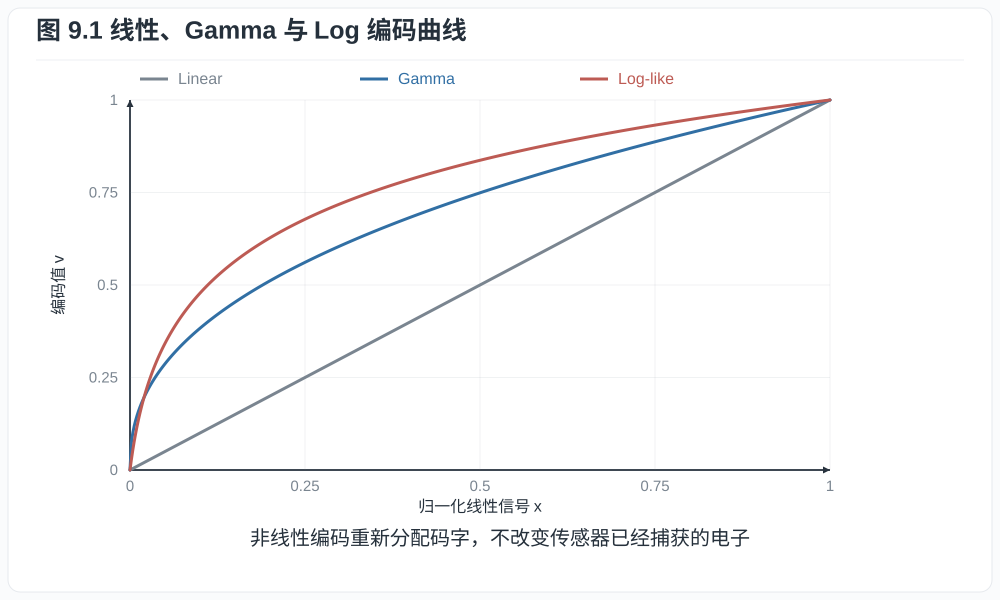
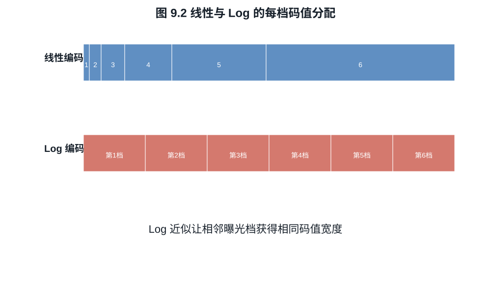
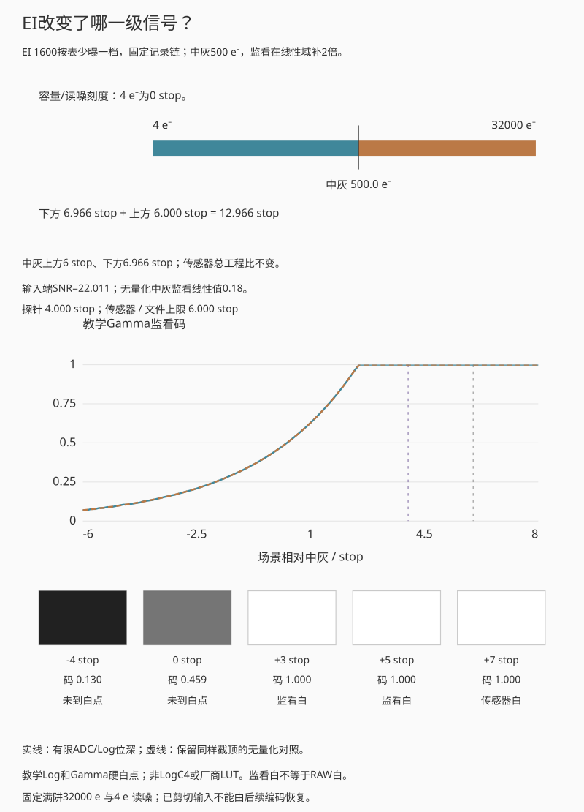
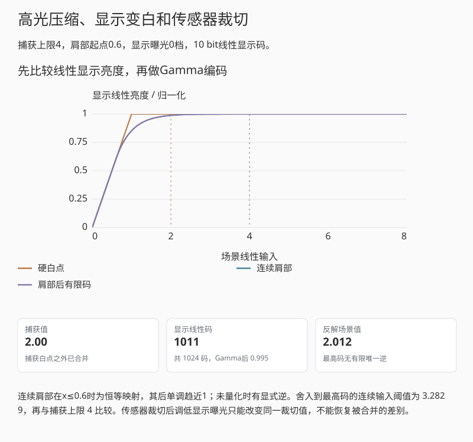
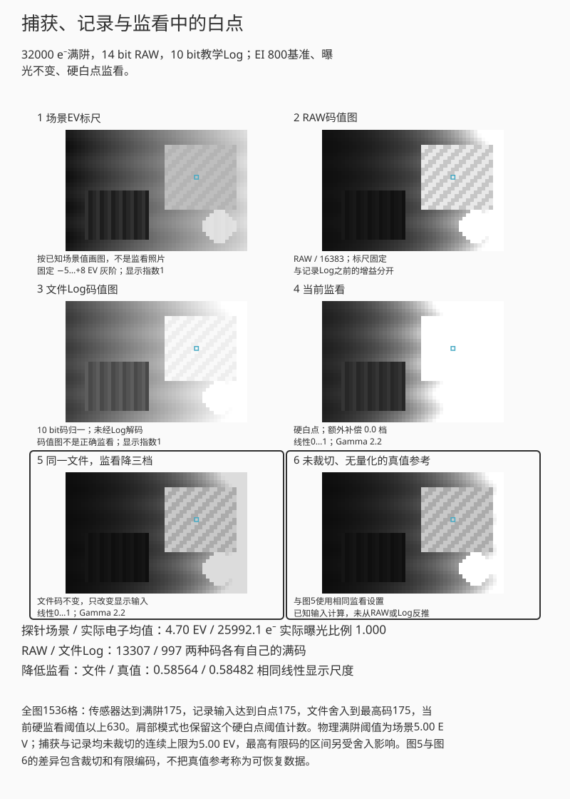

# 第九章：Gamma、Log、曝光指数与显示变换

一张曝光正常的 Log 画面直接显示时，黑位偏高，中间调反差很低。应用正确显示变换
后，明暗关系才恢复到适合观看的状态。这种外观来自码值分配：Log 用有限位深容纳
较宽的线性输入范围，再由解码和显示变换决定如何呈现。比较不同编码时，需要同时
考虑每档的码值数量、量化误差，以及中灰到剪切点的档数。

## 9.1 线性编码的暗部精度

设线性信号 $x\in[0,1]$，均匀 $b$ bit 量化步长约为
$\Delta_x=1/(2^b-1)$。相同绝对步长在高光相对误差小，在暗部相对误差大：

$$
\frac{\Delta_x}{x}.
$$

若要同时编码许多档曝光，最暗有效信号可能只占几个线性码。增加 bit 是一种办法，
非线性编码则按感知或后期需求重新分配码字。不过线性编码在足够位深下也能很好地
保存 RAW；关键是量化步长与传感器噪声相比有多大。例如满量程 64,000 个电子用
14 bit 线性编码，一个码约 3.91 个电子，均匀误差模型下量化 rms 约 1.13 个电子。
它对读噪 10 个电子的系统影响较小，对读噪 1 个电子的系统就值得计入预算。

Gamma 型幂函数可写为

$$
v=x^{1/\gamma},\qquad \gamma>1.                            \tag{9.1}
$$

其导数在暗部较大，给低线性信号更多码字。标准视频 OETF 往往是分段函数，在零点
附近用线性段避免无穷斜率。

## 9.2 对数编码让“档”近似线性

理想化 Log 函数写成

$$
v=a\log_2 x+b,\qquad x>0.                                 \tag{9.2}
$$

曝光增加一档，即 $x\mapsto2x$，则

$$
v(2x)-v(x)=a.
$$

每一档获得相同码值宽度。真实曲线需处理零和负的黑电平校正值，通常在暗部加入线性
toe，并在高端按容器裁切。ARRI LogC4 的硬件公式就是带偏置的 $\log_2$ 形式，并针对
12 bit 编码和 ALEV4 信号范围规定常数。

先用一条分段函数分析零点附近的编码：

$$
f(x)=
\begin{cases}
mx+c, & x\le x_t,\\
a\log_2(x+s)+b, & x>x_t,
\end{cases}
\qquad a>0,\ s>0,\ x_t+s>0.                               \tag{9.3}
$$

若要求连接点处函数值与一阶导数都连续，则参数必须满足

$$
m=\frac{a}{(x_t+s)\ln2},
\qquad
c=a\log_2(x_t+s)+b-mx_t.                                  \tag{9.4}
$$

**证明.** 对数支的导数为
$a/[(x+s)\ln2]$，在 $x_t$ 处与线性支导数 $m$ 相等即得第一式；再令两支函数值
相等即得第二式。$\square$

toe用有限斜率连接零点附近及减黑后的小负值，避开理想对数在零点的发散。
式 (9.3) 中 $x,s,x_t$ 使用同一个参考信号归一化，因此对数自变量无量纲。
实际曲线的参数、允许输入区间和有效码域应按厂商规范读取；线性段也受有限码域限制。

先比较“8 bit 暗部”和“12 bit 暗部”，看相同输入的码值间隔与反解误差；
移动探针时，图中的标记跟随，编码曲线本身不变。
最后选“输入超出白点”，核对三种编码都合并了超白输入，这与每档分配多少码是两类限制。

*图 9.1　三类曲线改变码字分配，不改变曲线之前的电子计数。斜率越大，输入端同一
微小变化占用的码字越多；斜率也同时放大该处已有的噪声。*

演示采用式 (9.3) 的教学 Log，令 $x_t=s=2^{-12}$，并使零输入映射到零、白点映射到
编码上限。暗部渐变先编码、量化，再反解回线性值，最后统一提升六档并作显示
变换。这样比较的是有限位深造成的误差。把探针调到白点以上时，三个通道都只能
保存裁切后的值；编码函数无法恢复此前丢失的高光。

**例子 9.1（十档分配）.** 若把从 $2^{-10}$ 到 $1$ 的十档信号映射到 10 bit 中
约900码宽的有效区间，理想Log每档约占 $900/10=90$ 码宽。若线性编码也用同样
900码宽覆盖这段输入，最暗一档是 $[2^{-10},2^{-9}]$，宽度为 $2^{-10}$，因此只占
$900\times2^{-10}/(1-2^{-10})=900/1023\approx0.88$ 码宽；最高一档
$[1/2,1]$ 却占约450.44码宽。图9.2用六档显示同一分配规律。码宽是连续尺度上的
跨度，取整后的整数码数量还取决于端点。Log改善有限位深下的相对精度，
传感器噪声仍需另外计算。

*图 9.2　六个相邻档位在线性编码下占据的码宽比例为1:2:4:8:16:32；理想对数支上
各档等宽。条长表示相对码宽，实际码数还取决于黑码、白码和保留码。*

更定量地，在理想对数支上若量化步长为 $\Delta_v$，由
$x=2^{(v-b)/a}$ 得

$$
\frac{dx}{x}=\frac{\ln2}{a}\,dv.
$$

把量化误差近似为宽度 $\Delta_v$ 的均匀分布，则一阶相对量化噪声为

$$
\frac{\sigma_{q,x}}x
\approx\frac{\ln2}{a}\frac{\Delta_v}{\sqrt{12}}.          \tag{9.5}
$$

它在理想 Log 区近似与曝光电平无关。例 9.1 的 90 码/档对应档位量化 rms
$1/(90\sqrt{12})\approx0.00321$ 档，折成相对线性信号约为 $0.222\%$。这只计算
编码量化，不包含传感器散粒噪声、读噪、压缩误差或色彩变换。若编码前已经用较粗
的线性 ADC 丢掉暗部差异，后面的 Log 不能补回；它能减少的是后续文件量化产生的
额外损失。相机内部线性处理精度和最终 Log 文件位深因此需要分开看。

## 9.3 Log 不增加捕获动态范围

设传感器线性有效输入区间为 $[x_{\min},x_{\max}]$。单调编码 $v=f(x)$ 只能把这个区间
映射为 $[f(x_{\min}),f(x_{\max})]$。若 $x>x_{\max}$ 已在传感器或 ADC 饱和，所有这类输入
都成为同一剪切值；任何后续单调函数都不能区分它们。

**命题 9.2（编码不能逆转剪切）.** 若捕获映射 $c$ 满足
$c(x_1)=c(x_2)$ 且 $x_1\ne x_2$，则对任意后处理函数 $f$，
$f(c(x_1))=f(c(x_2))$。

**证明.** 等式两边应用同一函数 $f$ 即得。$\square$

Log 相比某些显示准备输出保留更多高光，通常是因为它给高线性信号留有编码空间，
而后者可能在色调处理中压缩或剪切这些信号。文件的高光余量还取决于相机的具体
处理，仅凭“709”名称无法确定文件保留的曝光范围。

## 9.4 Log 模式与最低 ISO

这里至少有四种机制，必须查看具体相机：

1. 厂商把基础 EI 定在能把完整传感器范围映射进 Log 的位置；
2. Log 模式切换到低噪声转换增益或另一读出模式；
3. 为给中灰上方预留更多编码/高光空间，相机要求按较高 EI 测光，即实际少曝光；
4. 菜单 ISO 只是在固定模拟捕获上改变元数据和监看增益。

因此“Log 抬高 ISO”不是一般数学性质。假设相机从 EI 400 改为 EI 800，摄影者按表
收小一档光圈，使中灰监看保持一致。像素电子数减半；在散粒噪声主导时，阴影 SNR
下降为 $1/\sqrt2$。交换得到的是相对于中灰多一档物理高光余量，因为原先会达到
满阱的场景亮度现在少收一档光。

若摄影者保持光圈和快门不变，只改变EI元数据，电子数与物理高光余量都不变；
监看和解码中灰可能变化。若同时切换HCG，则还需重算读噪和剪切点。

## 9.5 中灰、曝光归一化与高低端分配

令传感器从噪声下端到饱和共可用 $D$ 档。把中灰放在距离饱和 $H$ 档处，则中灰下方
剩 $D-H$ 档。改变 EI 可在固定总范围内改变 $H$，但不必改变 $D$。

以固定传感器模式为例，若中灰产生 1000 个电子，剪切点为 32,000 个电子，中灰上方
就是 $\log_2(32000/1000)=5$ 档。按高一档 EI 测光并减少一档曝光，中灰降到
500 个电子，上方变成六档。传感器容量未变，场景中相对中灰更亮的一部分现在落入
容量以内；中灰与阴影的 SNR 则要按减少后的电子数计算。

[ARRI LogC4 2023 年规范](https://www.arri.com/resource/blob/278790/db65b86066de1f74852edb8f15acf082/2023-05-arri-logc4-specification-data.pdf)
区分了带 EI 增益的相机硬件编码和与 EI 无关的场景线性解码曲线。解释文件时，应按
对应的曲线定义处理，不能用“所有 Log 都是同一对数”代替。
固定总范围 $D$ 的分配模型还要求编码容器没有提前剪切；ARRI 的
[2022 年动态范围白皮书](https://www.arri.com/resource/blob/295460/e10ff8a5b3abf26c33f8754379b57442/2022-09-28-arri-dynamic-range-whitepaper-data.pdf)
就记录了 ALEXA 35 在 EI 高于 3200 时出现 LogC4 编码上限的情况。这是该文档所述
实现的限制，不能把固定范围的平移模型外推到所有 EI 和所有相机模式。

*图 9.3　总传感器范围固定时，中灰位置决定其上方和下方各有多少档。若 EI 改变还
触发读出模式切换，则必须另画一条满阱--读噪曲线，不能只沿本图平移中灰。图中
左侧是低信号，按较高 EI 少曝光时，中灰向左移动，右侧高光余量增加。*

### EI增益放在记录之前，还是监看之前

沿用第五章的固定传感器：满阱 $Q=32000$ e$^-$，中灰基准1000 e$^-$。
设某场景点的期望电子数为 $\mu$，先以均值流程说明裁切位置，不生成噪声图。
捕获与14 bit线性RAW重建为

$$
q=\min(\mu,Q),\qquad
c_R=\operatorname{round}\left(16383\frac qQ\right),\qquad
\widehat q=Q\frac{c_R}{16383}.                          \tag{9.5a}
$$

这些输入均非负；黑电平和负噪声摆动另见第三、十章。令 $f$ 为第9.2节教学Log的
归一化版本：$x_t=s=2^{-12}$、$f(0)=0,f(1)=1$，编码输入先限制到 $[0,1]$。
用 $r>0$ 表示编码前的EI增益，$g=2^{s_E}$ 表示相对EI 800的总倍率，$s_E$为EI档位。文件与监看流程为

$$
c_L=\operatorname{round}\bigl[(2^b-1)f(r\widehat q/Q)\bigr],\qquad
x_D=f^{-1}\left(\frac{c_L}{2^b-1}\right),\qquad
d=\left[\operatorname{clamp}\left(0.18\frac{Qx_D}{1000}\frac gr,0,1\right)\right]^{1/2.2}.
                                                               \tag{9.5b}
$$

固定记录链取 $r=1$，EI只用于解码后监看；编码前增益链取 $r=g$，监看不再重复
乘EI。无量化且未截顶时，两条链都给出监看线性输入 $0.18gq/1000$。
但第二条链在 $g>1$ 时，会把 $q\ge Q/g$ 的输入合并到文件白码；第一条链仍可
保留到传感器白点。忽略有限码宽时，文件的标称电子上限与上方余量为

$$
Q_\mathrm{file}=\min(Q,Q/r),\qquad
H_\mathrm{file}=\log_2\frac{Q_\mathrm{file}}{\mu_G}.     \tag{9.5c}
$$

这是由 $q\le Q$ 与 $r q/Q\le1$ 两个条件直接求交所得；有限ADC和Log的最后半个
码区间会提前舍入到白码，不能把连续边界当成逐电子阈值。演示因此另列当前文件码
的半码区间，再用 $f^{-1}$ 反解端点，保留有限位深的误差。

先比较“EI 6400 · 固定记录链”和“EI 6400 · 编码前增益”：曝光规则、EI与场景探针相同，只有增益位置不同。
看文件白点、Log码和反解值，再向前查看RAW环节。
两条路径在未量化、未截顶时可等价，文件中保存的上限却可能不同。

*互动示意：与第五章复用同一实验和静态输入。固定记录链、EI 1600按表少曝一档；
曲线比较有限ADC/Log位深与保留相同裁切的无量化输出，灰阶块分别标出监看、文件
或传感器达到白点。回放突出处理步骤，不改变曝光。*

例如EI 6400相对800为 $g=8$。固定实际曝光时，中灰电子数和物理高光余量不变；
若在编码前乘8，文件标称上限降为4000 e$^-$。若按表少曝三档，中灰为125 e$^-$，
物理上方余量8档，编码前增益链在文件中只保留其中5档。这里使用本节定义的
教学Log。ARRI LogC4另有硬件EI增益与固定场景线性解码的规定，不能直接代入本例。

这里的显示端用教学Gamma和硬白点，没有色调肩部或真实显示器标定。监看变白
而文件仍有细节是可能的，降低显示增益可再看到这些码；传感器或文件已合并的输入
则不能由监看找回。容量/4电子读噪所得总工程比固定，也不等于含散粒噪声的
SNR $=1$ 动态范围。

### 贯穿算例：记录未剪切，监看仍可变白

回到[增益一的记录](00_preface_scope_and_measurement.md)：均值流程 RAW 码 1588
归一化为 $x=1588/16383\approx0.09693$。教学显示信号
$x^{1/2.2}\approx0.3462$；这是显示链的输入信号，不是已标定的屏幕亮度。

若只在解码后监看中乘以 16，再裁切至 $[0,1]$，因 $16x\approx1.551>1$，
预览会变白，RAW 仍保留 1588。若把同样的十六倍模拟增益放在 ADC 之前，
ADC 的电子上限变成 2000，本例信号便已在记录时剪切。两张白色预览可以相同，
文件可恢复的内容不同。因此，比较增益时需要注明它在处理链中的位置。

## 9.6 LUT、显示变换与“还原”

把Log码值直接当作显示器输入，通常会得到错误的明暗与颜色。显示变换可分为：

$$
\text{Log 解码}
\rightarrow\text{工作色域变换}
\rightarrow\text{色调/外观映射}
\rightarrow\text{显示编码}.
$$

一维 LUT 只能分别改变通道值；三维 LUT 可表示通道耦合的颜色变换。技术 LUT 旨在
从已知相机编码变到工作/显示空间，创意 LUT 还加入审美外观。把任意 LUT 称为“官方
还原”会掩盖曝光、白平衡、目标显示和观看环境的选择。

BT.2100 分别规定 PQ 和 HLG 两种 HDR 体系。PQ 的电光传递函数把信号值映射到
绝对显示亮度，单位为 cd/m²；HLG 从相对场景光编码，最终显示亮度还取决于系统
变换和目标显示峰值。相机 Log 主要用于采集和调色中间态，转成这些 HDR 输出时
需要相应的解码、色域与显示变换，仅修改文件标签并不能完成转换。

### 用明确的肩部函数比较高光压缩与裁切

为把较大线性值装入显示范围，取 $0<k<1$，定义教学肩部

$$
T_k(x)=\begin{cases}
x,&0\le x\le k,\\
k+(1-k)\left[1-e^{-(x-k)/(1-k)}\right],&x>k.
\end{cases}
$$

两支在 $k$ 处的值和导数分别同为 $k$ 与1，故一阶连续；高段导数始终为正，函数值渐近于1。
对 $k<y<1$，解指数方程得到
$T_k^{-1}(y)=k-(1-k)\ln[1-(y-k)/(1-k)]$。未量化时，这段高光压缩仍可逆；
但有限显示码会把一段输入舍入到同一码，最高码更没有有限唯一逆。

先选“保留高光层次”，固定捕获上限，只拖动“显示曝光”，看硬白点与肩部怎样映射同一输入。
再选“捕获已经裁切”，比较探针处两个输入是否早已相同；
“有限码合并高光”同时给出强增益和低位深，需再单独改位深才能判断量化贡献。

*互动示意：捕获上限4，显示曝光0档，肩部起点0.6。此例先量化线性显示亮度再作
Gamma 2.2；同时保留连续肩部、有限码和硬白点，不代表某一显示标准的完整链条。*

捕获端先取 $q=\min(x,Q)$，显示端再对 $gq$ 作肩部；改变显示增益 $g$ 不改变
已经保存的 $q$。因此显示肩部可以保留尚在文件里的高光差别，却不能重新分开
捕获端已合并的输入。第八章的融合范围、第九章的文件编码范围与显示映射应分别记录。

### 同一场景中的高光肩部与白点

把曲线上的高光值放进同一幅场景，可以直接观察窗外枝叶和帘褶的明暗是否还在。
下面与第五、十章采用同一组窗边静物：当前监看与降低三档的监看共用同一份文件，
图6另用已知输入绕过捕获裁切、记录裁切和量化，按同样的降低监看规则画出参考。

先选“亮窗只在监看变白”，只调低额外监看补偿，看窗外枝叶怎样重新分开，RAW和Log码应不动。
恢复起点后选“用肩部保留层次”，比较图4；
再用“亮窗在记录时合并”核对肩部无法重新分开的文件码。

*互动示意：默认硬白点显示。切换肩部后，文件码仍保持原值；图5与图6采用相同
监看补偿和显示映射。参考图来自已知场景，不是从已裁切文件还原出的细节。*

当前监看变白，可能只是值超过了所选显示白点。降低三档也不保证每个位置立即
进入显示范围，因此还可以继续调低额外监看补偿。比较文件数值与真值参考时，应
在两者都未被显示端再次截平的区间检查差别。肩部只改变已有输入的映射；若两个
场景值早已变成相同的文件码，任何确定的后续显示函数都会给出相同结果。

## 练习

**练习 9.1.** 对式 (9.2) 证明曝光相差 $n$ 档的两个信号码值相差 $na$。

**练习 9.2.** 一传感器总可用范围为 14 档，中灰上方分配 6 档。若通过曝光指数
调整把中灰上方改为 8 档，且总范围不变，中灰下方还剩几档？若通过实际少曝光两档
完成，散粒噪声区中灰 SNR 变为原来的多少？

**练习 9.3.** 分别说明 Log、广色域和 10 bit 解决的是哪三个不同问题。

**练习 9.4.** 对式 (9.3) 取
$a=0.18,s=0.01,x_t=0.01,b=1.20$。求使曲线一阶连续的 $m,c$，并验证两支在
$x_t$ 的函数值相同。
