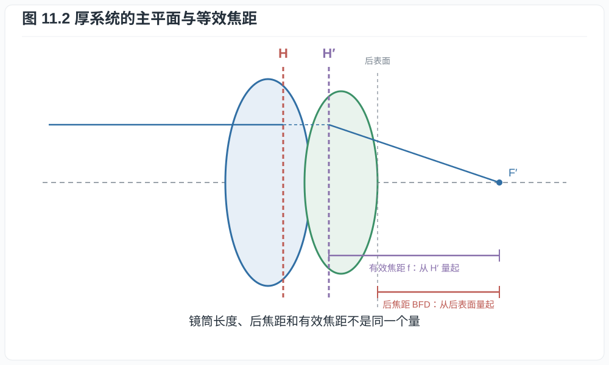
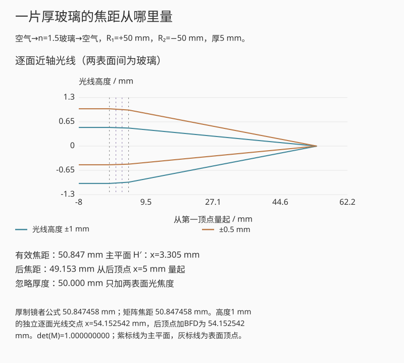
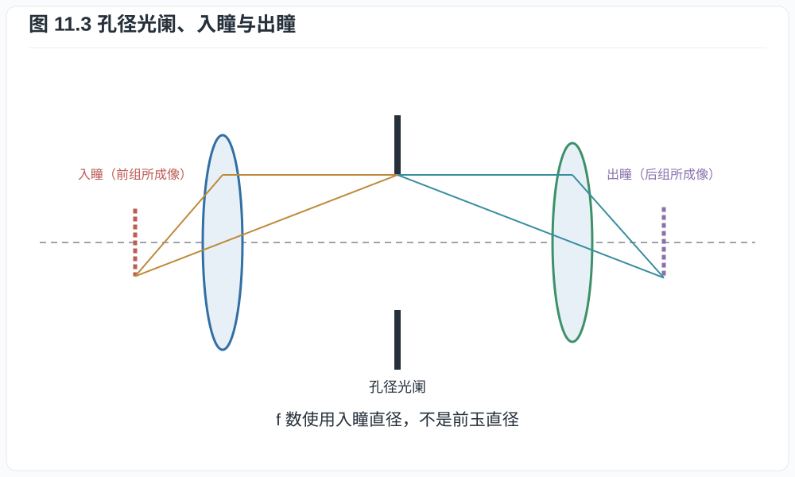
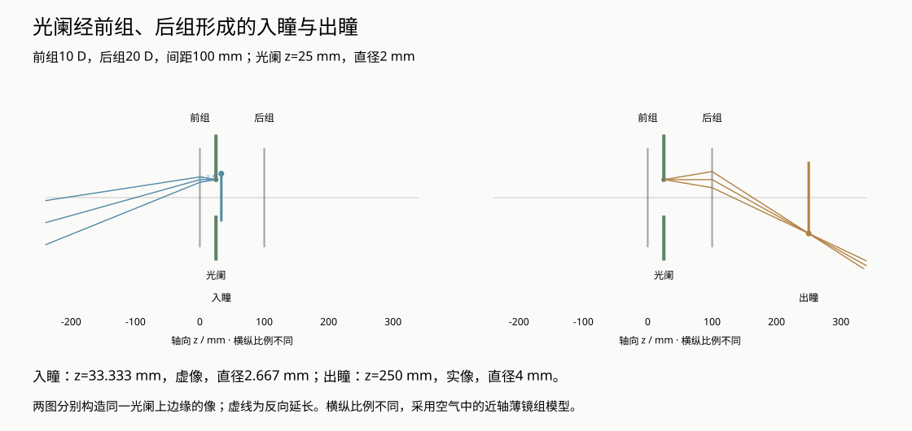
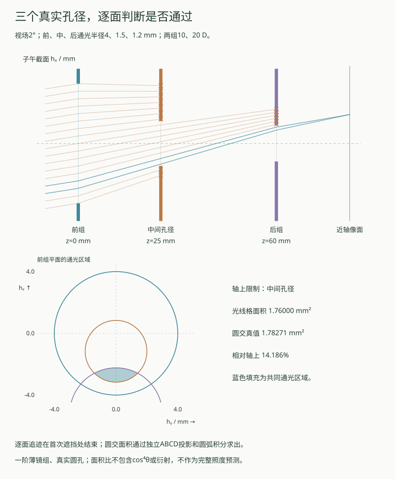

# 第十一章：几何光学、近轴矩阵与镜头基本量

前面各章把到达传感器的光学像作为输入；现在回到镜头，计算这个像形成在哪里。
在 50 mm 薄透镜模型中，对焦两米时，像距约比无穷远时增加 1.28 mm。真实内对焦
镜头则可能只移动某个内部镜组。长焦镜头的镜筒也可以短于标称焦距。这些看似不同
的问题，都涉及焦距从哪里量起，以及光线经过各组后怎样改变方向。先从单次折射
建立近轴矩阵，再组合成整个镜头，就能把焦距、主平面和机械长度分开计算。

## 11.1 Snell 定律与近轴近似

在各向同性介质界面，入射角 $\theta_1$、折射角 $\theta_2$ 均相对法线测量，Snell
定律为

$$
n_1\sin\theta_1=n_2\sin\theta_2.                         \tag{11.1}
$$

它可由 Fermat 原理对光程
$\int n\,ds$ 取驻值得到。近轴光线满足角度和光线高度相对曲率半径都小，于是
$\sin\theta\approx\tan\theta\approx\theta$，折射关系线性化。

本章采用光线向量

$$
\boldsymbol r=\begin{pmatrix}y\\u\end{pmatrix},
\qquad u=n\theta,
$$

$y$ 是相对光轴高度，$u$ 是约化角。光在折射率 $n$ 的均匀介质中传播距离 $d$：

$$
\begin{pmatrix}y_2\\u_2\end{pmatrix}
=\begin{pmatrix}1&d/n\\0&1\end{pmatrix}
\begin{pmatrix}y_1\\u_1\end{pmatrix}.                   \tag{11.2}
$$

这个矩阵只是两条关系的简写：$y_2=y_1+(d/n)u_1$、$u_2=u_1$。均匀介质中
方向不变，高度按倾角随距离改变。例如空气中 $y_1=1$ mm、$u_1=0.01$ rad，
再传播20 mm后，$y_2=1.20$ mm。后面的矩阵连乘，就是把这样的更新依次执行。

对半径 $R$ 的球面折射，规定曲率中心在右侧时 $R>0$，界面光焦度

$$
\Phi=\frac{n_2-n_1}{R},
$$

近轴折射矩阵为

$$
\begin{pmatrix}y_2\\u_2\end{pmatrix}
=\begin{pmatrix}1&0\\-\Phi&1\end{pmatrix}
\begin{pmatrix}y_1\\u_1\end{pmatrix}.                   \tag{11.3}
$$

**推导 11.1.** 界面法线近轴倾角约为 $-y/R$。将相对于光轴的入、出射角转换成相对
法线的角度并代入线性化 Snell 定律，整理得
$n_2\theta_2=n_1\theta_1-(n_2-n_1)y/R$，即式 (11.3)。符号依曲率约定；改变
约定须同时改变公式。

## 11.2 薄透镜与制镜者公式

折射率为 $n$ 的薄透镜置于空气中，两个表面半径为 $R_1,R_2$。忽略厚度，把两个
折射矩阵相乘，透镜总光焦度为

$$
\Phi=(n-1)\left(\frac1{R_1}-\frac1{R_2}\right),
\qquad f=\frac1\Phi.                                      \tag{11.4}
$$

这是一阶薄透镜制镜者公式。厚透镜还需加入玻璃内部的传播矩阵，才能求出等效焦距
和主平面。忽略厚度的误差取决于厚度、折射率和两面的光焦度，§11.3 将给出一例。
大口径光线偏离近轴近似所产生的像差，则需在一阶矩阵之外另行计算。

物距 $s>0$ 在物方、像距 $s'>0$ 在像方时，薄透镜成像公式为

$$
\frac1s+\frac1{s'}=\frac1f,
\qquad m=-\frac{s'}s.                                    \tag{11.5}
$$

*图 11.1　平行光线、过光心近似不偏折光线和物方焦点光线是薄透镜模型中的构图
工具。图取物距与像距均为两倍焦距，因此放大率为 $-1$；红线过光心不改变方向，
绿线经物方焦点后平行出射。厚系统应使用主平面作等效构图。*

**证明.** 从物点高度 $y_o$ 发出的近轴光线传播 $s$、经薄透镜矩阵
$L=\left(\begin{smallmatrix}1&0\\-1/f&1\end{smallmatrix}\right)$，再传播 $s'$。
总矩阵的右上元为

$$
B=s+s'-\frac{ss'}f.
$$

同一物点不同入射角要在像面会聚，输出高度不能依赖初始角，因此 $B=0$，给出
式 (11.5)。此时总矩阵左上元 $A=1-s'/f=-s'/s=m$。$\square$

**例子 11.2（50 mm 镜头对焦 2 m）.** 取 $f=50$ mm、$s=2000$ mm，

$$
s'=\frac{fs}{s-f}
=\frac{50\times2000}{1950}
\approx51.282\ \mathrm{mm},
$$

比无穷远位置多伸出 $1.282$ mm，放大率 $m\approx-0.02564$。真实内对焦镜头移动
内部组时，等效焦距和主平面也可能改变，需按各组位置重新计算。

## 11.3 厚系统、主平面与焦距

多个表面和间隔按光的先后顺序作用，矩阵则从右向左读取：先经过 $M_1$，
再经过 $M_2$，总作用为 $M_2M_1$。对任意近轴轴对称系统，将这些作用合并后，
可用四个系数概括整段光路：

$$
M=\begin{pmatrix}A&B\\C&D\end{pmatrix},
\qquad AD-BC=1
$$

这里的行列式关系来自传播和折射矩阵各自的行列式均为一；采用约化角时，首尾折射率
不相同也成立。$A,D$ 无量纲，$B$ 有长度单位，$C$ 有长度倒数单位。若 $C\ne0$，
系统有效光焦度为 $\Phi=-C$，有效焦距
$f=-1/C$；这里进一步限定首尾介质为空气。若共同折射率为 $n\ne1$，物理焦距为
$f=-n/C$。矩阵可分解为物方主平面平移、理想薄透镜和像方主平面平移；这定义两主
平面。镜头物理长度可以小于或大于焦距，因为焦距从主平面量起，不从前玉或卡口量起。

若 $C=0$，平行入射光仍以平行光出射，系统为无焦系统，不能套用有限焦距的主平面
分解；望远镜的物镜与目镜组合就是常见例子。

前焦点、后焦点、节点和主点合称基点。空气中前后节点分别与主点重合；首尾介质不同时
不再重合。厂商标称焦距通常是无穷远近轴有效焦距，近距离内对焦可能产生 focus
breathing，使视角随对焦变化。

若输入、输出参考面都在空气中，可把任意 $C\ne0$ 的系统分解为

$$
M=T(\ell_2)L(f)T(\ell_1),\qquad
f=-\frac1C,\quad
\ell_1=f(1-D),\quad \ell_2=f(1-A),                        \tag{11.6}
$$

其中 $\ell_1$ 是输入参考面到物方主平面的有向距离，$\ell_2$ 是像方主平面到输出参考面的
有向距离。直接相乘得到

$$
T(\ell_2)L(f)T(\ell_1)=
\begin{pmatrix}
1-\ell_2/f & \ell_1+\ell_2-\ell_1\ell_2/f\\
-1/f & 1-\ell_1/f
\end{pmatrix};
$$

其左下、左上和右下元分别给出式 (11.6)，右上元由 $AD-BC=1$ 自动一致。

**例子 11.3（厚双凸镜的焦距、主平面与后焦距）.** 一片玻璃折射率 $1.5$、中心
厚度 5 mm，置于空气中，$R_1=+50$ mm、$R_2=-50$ mm。采用约化角坐标，其矩阵为

$$
\begin{aligned}
M&=
\begin{pmatrix}1&0\\-0.01&1\end{pmatrix}
\begin{pmatrix}1&5/1.5\\0&1\end{pmatrix}
\begin{pmatrix}1&0\\-0.01&1\end{pmatrix}\\
&=
\begin{pmatrix}
29/30&10/3\\
-59/3000&29/30
\end{pmatrix}.
\end{aligned}
$$

故有效焦距
$f=3000/59\approx50.847$ mm，且
$\ell_1=\ell_2=f/30=100/59\approx1.695$ mm：两主平面分别位于两顶点向玻璃内部约
1.695 mm。平行入射光从第二顶点量起的后焦距为

$$
\mathrm{BFD}=-\frac AC=\frac{2900}{59}\approx49.153\ \mathrm{mm},
$$

并不等于有效焦距。若直接把厚度删去，薄透镜公式会给 50 mm，且完全看不见主平面
位移。

*图 11.2　有效焦距从主平面量起，后焦距从最后光学表面的顶点量起。二者相差主平面
位置。图中紫色标尺从 $H'$ 到 $F'$，红色标尺从后表面到 $F'$；内部虚线仅连接
等效主平面，不表示真实玻璃内部光路。*

互动另取两个空气中的薄镜组，逐组改变光线倾角并传播，同时用总矩阵计算主平面
和交点。两薄组与上面的厚玻璃有不同处方，光路分别计算。
选择望远型与反望远型，可以直接比较有效焦距、从后组量起的后焦距，以及从前组
量起的主平面坐标；选择无焦组合时，不再报告有限焦距和主平面。

有限物距也可以从同一个矩阵计算。若物点在输入参考面左侧 $s>0$，从输出参考面
到像面的有向距离为 $q$，则 $T(q)MT(s)$ 的右上元为
$As+B+q(Cs+D)$。令它为零，得到

$$
q=-\frac{As+B}{Cs+D},\qquad m=A+qC,\quad Cs+D\ne0.       \tag{11.6a}
$$

这里的 $s$ 从输入参考面量起，不是从主平面量起。$q<0$ 时，出射光线的反向
延长线相交，图中用虚线表示；$Cs+D=0$ 时，该物点发出的光在输出侧平行，没有
有限像距。系统无焦 $C=0$ 与这一物点的出射光束平行是两个条件：无焦系统仍可对
有限物点形成有限共轭。互动将矩阵像距与逐面追迹的交点并列，保留两条计算路径。

### 厚透镜中的折射与传播

前一个互动用两个空气中的薄组说明等效系统。下面另按例子11.3放入一片厚玻璃：
第一面光焦度 $\Phi_1=(n-1)/R_1$，第二面 $\Phi_2=(1-n)/R_2$，玻璃内传播矩阵为
$T_g=\left(\begin{smallmatrix}1&d/n\\0&1\end{smallmatrix}\right)$。
按传播顺序相乘，$M=S_2T_gS_1$ 的左下元给出

$$
\Phi=-C=\Phi_1+\Phi_2-\frac d n\Phi_1\Phi_2
=(n-1)\left[\frac1{R_1}-\frac1{R_2}
+\frac{(n-1)d}{nR_1R_2}\right].
$$

这条厚制镜者公式来自同一矩阵乘法；互动又用独立逐面角度更新来查光线交点。
玻璃内倾角为约化角除以 $n$，不能继续按空气中的倾角传播厚度 $d$。

*互动示意：n=1.5、厚5 mm、R₁=+50 mm、R₂=−50 mm。顶点之间按玻璃内传播计算；
蓝线定位表面顶点，紫色虚线定位主平面；蓝色填充表示两个顶点之间的玻璃区间。*

删去厚度时，有效焦距回到50 mm，两主平面重合；保留厚度则得到例子11.3的
50.847 mm有效焦距与49.153 mm后焦距。近轴模型给出一阶焦距与主平面；大口径
球差还需要球面求交与精确Snell追迹。

## 11.4 光阑、瞳与 f 数

孔径光阑是限制轴上光束锥角的实际元件。它经前组向物方所成的像称入瞳，经后组向
像方所成的像称出瞳。入瞳直径 $D_\mathrm{EP}$ 决定无穷远 f 数

$$
N=\frac f{D_\mathrm{EP}}.                                \tag{11.7}
$$

*图 11.3　入瞳和出瞳分别是孔径光阑经前、后镜组所成的像。图中两组各以薄透镜
表示，黑色挡板之间留出光阑开口。橙色与青色光线分别把开口上边缘成像到两侧；
入瞳构图从光阑向物方追迹，光线在透镜处转折。*

前玉直径不等于入瞳直径；前组可能把光阑放大或缩小。离轴光束还可能被镜筒和镜片
边缘截去，形成机械渐晕和“猫眼”散景。

像方数值孔径为

$$
\mathrm{NA}'=n'\sin\alpha',
$$

在空气、无穷远、近轴条件下 $\mathrm{NA}'\approx1/(2N)$。大数值孔径时不能用小角
近似；微距还需工作 f 数和瞳孔放大率。

### 光阑的两个共轭像

沿光轴建立向右为正的 $z$ 坐标。前、后薄镜组分别位于 $0,d$，光阑位于
$s\in(0,d)$。两组在空气中的光焦度记为 $\phi_1,\phi_2$，以 mm$^{-1}$ 代入；
实际光阑直径为 $D_s>0$。把光阑当作物，经前组向左成像；经后组向右成像。
由薄透镜共轭条件，有限瞳像的位置与带符号横向放大率为

$$
z_\mathrm{EP}=\frac{s}{1-s\phi_1},\qquad
m_\mathrm{EP}=\frac{1}{1-s\phi_1},\qquad
z_\mathrm{XP}=d-\frac{d-s}{1-(d-s)\phi_2},\qquad
m_\mathrm{XP}=\frac{1}{1-(d-s)\phi_2}.                 \tag{11.9a}
$$

例如前组构图中，沿向左的局部传播坐标写出
$T(q)L(\phi_1)T(s)$。其 $B=s+q(1-s\phi_1)$；令 $B=0$ 得
$q=-s/(1-s\phi_1)$，再换回公共坐标 $z=-q$。此时矩阵的 $A$ 元素即上式的
$m_\mathrm{EP}$。后组用距离 $d-s$ 作相同计算，最后换回 $z=d+q$。
因此瞳直径分别为 $|m_\mathrm{EP}|D_s$、$|m_\mathrm{XP}|D_s$；负放大率表示
光阑边缘所成的像倒立，不表示直径为负。

前侧瞳像若位于 $z<0$，向左出射的构图光线实际相交，形成实像；若交点在
$z>0$，则由反向延长线确定虚像。后侧以 $z>d$ 为实像，$z<d$ 为虚像。
分母为零时，对应构图光束平行，瞳位于无穷远；不把它画成一个任意远的有限圆。
无相应光焦度时，瞳就是原来的光阑。这里声明中间元件为孔径光阑，其他组不截光。

*互动示意：两组间距100 mm，前组10 D、后组20 D，直径2 mm的光阑位于
$z=25$ mm。入瞳为 $z=33.333$ mm的虚像，直径2.667 mm；出瞳为
$z=250$ mm的实像，直径4 mm。虚线表示反向延长，横纵比例不同。*

演示并列保留矩阵共轭与独立逐面光线求交。回放只展开构图步骤；切到无穷远预设时，
改为显示平行束和无有限瞳直径。正总光焦度且入瞳有限时，才报告无穷远 f 数。
要判断实际截光，还须给出每个开孔的位置和半径。下面另设一个有限孔径例子；
前面的瞳共轭演示仍保持“其他组不截光”的条件。

### 光线在哪一面被挡住？

取空气中的两薄镜组，位于 $z=0,60$ mm，光焦度分别为0.01、0.02 mm$^{-1}$。
三个圆孔位于 $z=0,25,60$ mm，半径依次为 $R_1,R_m,R_2$。无穷远物点的
入射近轴倾角为 $\boldsymbol u=(u,0)$，其中 $u=\theta$ 用弧度代入；入口面
坐标为 $\boldsymbol h=(h_x,h_y)$。逐面传播给出三个孔面上的光线高度，通光条件为

$$
|\boldsymbol h|^2\le R_1^2,\qquad
|0.75\boldsymbol h+25\boldsymbol u|^2\le R_m^2,\qquad
|0.4\boldsymbol h+60\boldsymbol u|^2\le R_2^2.            \tag{11.9b}
$$

长度均用mm，倾角用rad。第一组先使倾角变为 $\boldsymbol u-0.01\boldsymbol h$；
传播25或60 mm即得到后两项。到达后组孔径时尚未施加后组折射，孔径判断因此不含
第二组光焦度。若通光，再经后组折射，轴向无穷远焦面在 $z=60+200/9$ mm。
遇到第一个不满足不等式的孔径，光线就终止在那里。

还可从独立的矩阵路径求通光面积。到第 $i$ 个孔面的高度为
$A_i\boldsymbol h+B_i\boldsymbol u$，本例 $(A_i,B_i)$ 依次为
$(1,0),(0.75,25\ \mathrm{mm}),(0.4,60\ \mathrm{mm})$。把条件移回入口面，得到圆盘

$$
\left(h_x+\frac{B_i}{A_i}u\right)^2+h_y^2
\le\left(\frac{R_i}{|A_i|}\right)^2.                   \tag{11.9c}
$$

三个圆盘的交集就是当前方向的入口通光区域。轴上圆心重合，最小的
$R_i/|A_i|$ 决定孔径光阑；最小值并列时，共同限制通光。调节孔径后，限制面可能
转移，不能事先把中间孔命名为永久的孔径光阑。离轴时圆心沿 $h_x$ 方向错开，
即使各孔都没有缩小，交集也可能变小。

本例的圆心共线，面积可解析计算。令每个圆的圆心和半径为 $c_i,r_i$，共同的
$h_x$ 区间为 $[\max_i(c_i-r_i),\min_i(c_i+r_i)]$；区间为空则面积为零。
非空时，交集的全宽为 $2\min_i\sqrt{r_i^2-(h_x-c_i)^2}$。在两条圆弧等高的
位置分段，每段积分最小圆弧；其原函数为
$(h_x-c_i)\sqrt{r_i^2-(h_x-c_i)^2}+r_i^2\arcsin[(h_x-c_i)/r_i]$。
这条解析路径不用逐面光线格点的通光计数。

*互动示意：两薄组间距60 mm，入射近轴倾角2°，三孔半径为4、1.5、1.2 mm。
上图光线在首次遮挡处终止；下图将三孔映回入口面，蓝色区域为交集。
光路横纵比例不同；圆盘图的两个横向坐标使用相同比例。*

演示用二维均匀光线格统计通光面积，再与三圆交集的解析面积比较。回放沿传播
方向展开既有光路，保留每条线的首次遮挡位置。报告的是几何面积及其相对轴上值，
没有叠加第一章的照度投影、衍射或像素响应；入口面积图也不等于散焦像的亮度图。
这里仍是薄组的一阶几何，厚玻璃内传播和真实镜头的瞳像畸变需要另设处方。

## 11.5 视角、画幅与“等效”

传感器某一方向尺寸为 $d$，无穷远、无明显畸变时视角近似

$$
\Theta=2\arctan\frac{d}{2f}.                              \tag{11.8}
$$

同一拍摄位置要在较小传感器上保持视角，焦距按画幅线性缩短。若还要保持相同景深
和快门，f 数也需按裁切倍率缩放；这同时使入瞳直径和总收光接近。若只固定 f 数，
单位面积像面曝光相同，但传感器总面积不同，总光子数不同。

**例子 11.4.** 36 mm 宽全画幅配 50 mm 镜头，水平视角
$2\arctan(36/100)\approx39.6^\circ$。24 mm 宽 APS-C 要获得同视角需约
$33.3$ mm。全画幅 50 mm $f/4$ 的入瞳为 12.5 mm；APS-C 33.3 mm 若用约
$f/2.67$ 也得到 12.5 mm 入瞳，景深与总收光比较才接近。

## 练习

**练习 11.1.** 用式 (11.4) 计算 $n=1.5$、$R_1=100$ mm、$R_2=-100$ mm 的双凸
薄透镜焦距。

**练习 11.2.** 85 mm 薄透镜对焦 1 m 时，求像距、伸长量和横向放大率。

**练习 11.3.** 证明两段均匀传播矩阵满足 $T(d_2)T(d_1)=T(d_1+d_2)$。

**练习 11.4.** 空气中某厚系统从前表面顶点到后表面顶点的矩阵为
$M=\left(\begin{smallmatrix}0.9&20\\-0.005&1.0\end{smallmatrix}\right)$，
长度单位为 mm。验证行列式，求有效焦距、式 (11.6) 的 $\ell_1,\ell_2$，并求从后表面顶点
量起的后焦距。
