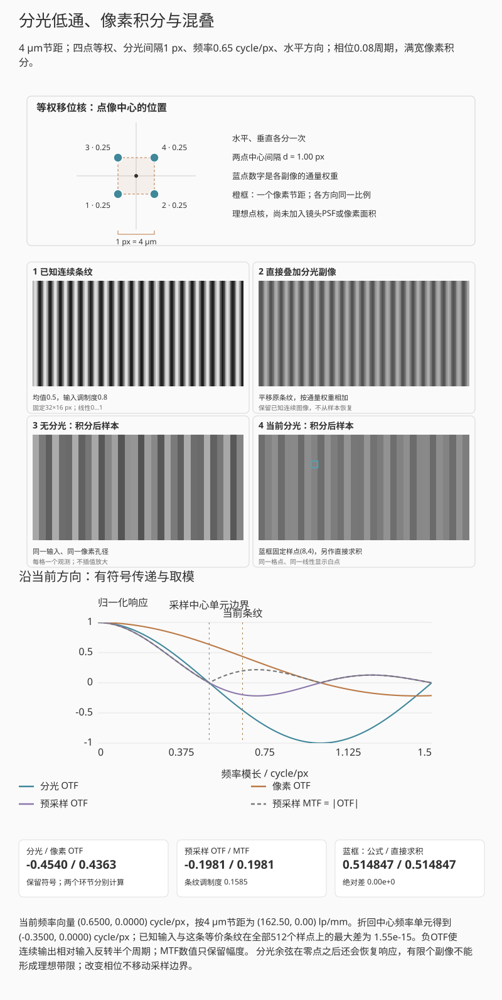

# 第十二章：衍射、PSF、OTF、MTF 与采样

把光圈逐渐收小，画面边缘可能先变清楚，随后连中央的细纹也开始变软。前一阶段常
来自像差减小，后一阶段则要计入衍射。即使理想镜头没有像差，点光源也会形成有限
大小的光斑。PSF描述点光源在像面上的强度分布，OTF与MTF描述不同空间频率的
传递。像素面积积分与离散采样还会进一步改变相机记录的细节。
第十一章的理想近轴交点给出名义像面，这里进一步计算该面上的点像强度分布。

## 12.1 从瞳函数到点扩散函数

来自同一单色物点的光，经瞳上各处到达同一像点时，相位决定它们相长还是相消。
用复数把振幅和相位合写，先加复振幅 $U$，再取模平方 $|U|^2$ 得强度。
瞳函数记录光波在瞳面各处的振幅与相位；像面复振幅由整个瞳面的传播贡献积分得到。

采用标量、单色、近轴模型，先考虑空气中理想薄透镜的后焦面成像，瞳平面与透镜
平面重合。瞳上的物理坐标记为 $\boldsymbol\xi$，与 $f,\lambda$ 使用同一长度单位。
去除理想聚焦的参考相位后，Fraunhofer 形式的复瞳函数写成

$$
P(\boldsymbol\xi)
=A(\boldsymbol\xi)
\exp\left(\frac{2\pi i}{\lambda}W(\boldsymbol\xi)\right), \tag{12.1}
$$

$A$ 表示振幅透射，$W$ 是相对于理想参考波面的光程差。理想无像差圆瞳内
$A=1,W=0$，瞳外为零。例如某处 $A=0.5$，该处透过强度是 $A=1$ 时的四分之一；
若只把 $W$ 改为 $\lambda/2$，则振幅大小不变，相位增加 $\pi$。
这里不用无量纲瞳坐标直接代入传播公式；若改用
$\boldsymbol\rho=\boldsymbol\xi/a_p$，其中 $a_p$ 为瞳半径，Fourier 自变量也
必须相应乘以 $a_p$。

像面复振幅与 $P$ 的 Fourier 变换成比例，用于非相干成像的强度点扩散函数（PSF）为

$$
h(\boldsymbol r)
=\frac{|\widehat P(\boldsymbol r/(\lambda f))|^2}
{\displaystyle\int_{\mathbb R^2}
|\widehat P(\boldsymbol r'/(\lambda f))|^2
\,d^2\boldsymbol r'}.                                   \tag{12.2}
$$

非零、有限面积且平方可积的瞳保证归一化分母有限且为正。
$\int h(\boldsymbol r)d^2\boldsymbol r=1$，所以 $h$ 的单位是像面面积的倒数。
式 (12.2) 的 Fourier 自变量 $\boldsymbol r/(\lambda f)$ 有长度倒数单位，正好与
物理瞳坐标配对。复合镜头需使用相应出瞳与传播尺度；近摄时后文的衍射尺度也要换成
工作 f 数。

普通摄影中不同物点通常按非相干强度相加。先把理想物像按几何放大率映射到像面
坐标，得到理想强度像 $o$；在局部空间不变条件下，实际强度像为卷积

$$
i=o*h.                                                     \tag{12.3}
$$

离轴像差使 $h$ 随像高变化，整个画面不再由一个全局卷积描述；镜头 MTF 图因此要沿
像高给曲线。

这里的“非相干”指不同物点之间没有稳定的互相干项；来自同一个物点的各瞳区仍需
先加振幅。若物面由相干复振幅 $u$ 描述，局部模型应先算像面场 $u*g$，再取
$|u*g|^2$，其中 $g$ 是振幅点响应；一般不能把它写成 $|u|^2*h$。同一均匀圆瞳、
同一像面长度坐标下，相干振幅传递函数是缩放后的瞳函数，轴向截止为
$1/(2\lambda N)$；非相干强度OTF由瞳自相关得到，截止才是式 (12.8) 的
$1/(\lambda N)$。两种截止针对不同输入对象，不能直接比较为两倍细节收益。

若尚不熟悉 Fourier 变换，可先把 PSF 理解为点光源的强度像，阅读下面的 OTF/MTF
定义和式 (12.6) 的条纹计算，再看 §12.3--12.4 的尺度算例。复瞳自相关的证明与
双波长积分可在第二遍结合附录 A 复算；它们仍决定模型的适用条件。

## 12.2 OTF 与 MTF

**定义 12.1.** 光学传递函数（OTF）是 PSF 的 Fourier 变换：

$$
H(\boldsymbol\nu)=\widehat h(\boldsymbol\nu).
$$

其模为调制传递函数
$\mathrm{MTF}=|H|$，相位为相位传递函数。若 PSF 归一化，则 $H(0)=1$。

归一化把总通量除掉，只比较光在像面上怎样分布。因此 $H(0)=1$ 表示归一化后的
零频响应为一，并不表示镜头透过了全部入射光；透射损失仍按第一章的能量预算计算。

**命题 12.2（非相干 OTF 是复瞳的归一化自相关）.** 用物理瞳坐标
$\boldsymbol\xi$ 表示瞳函数，在 Fraunhofer 条件下

$$
H(\boldsymbol\nu)=
\frac{\int P(\boldsymbol\xi)
P^*(\boldsymbol\xi+\lambda f\boldsymbol\nu)\,d^2\boldsymbol\xi}
{\int|P(\boldsymbol\xi)|^2\,d^2\boldsymbol\xi}.            \tag{12.4}
$$

**证明.** 令 $\boldsymbol a=\lambda f\boldsymbol\nu$，并将瞳函数平移为
$P_{\boldsymbol a}(\boldsymbol\xi)=P(\boldsymbol\xi+\boldsymbol a)$。
由 Fourier 定义中的变量替换，

$$
\widehat{P_{\boldsymbol a}}(\boldsymbol q)
=e^{2\pi i\boldsymbol q\cdot\boldsymbol a}\widehat P(\boldsymbol q).
$$

对式 (12.2) 作 Fourier 变换，再令 $\boldsymbol r=\lambda f\boldsymbol q$。
分子、分母中的面积因子 $(\lambda f)^2$ 抵消，故

$$
\begin{aligned}
H(\boldsymbol\nu)
&=\frac{\int |\widehat P(\boldsymbol q)|^2
e^{-2\pi i\boldsymbol q\cdot\boldsymbol a}\,d^2\boldsymbol q}
{\int |\widehat P(\boldsymbol q)|^2\,d^2\boldsymbol q}\\
&=\frac{\int\widehat P(\boldsymbol q)
\widehat{P_{\boldsymbol a}}^{\,*}(\boldsymbol q)\,d^2\boldsymbol q}
{\int |\widehat P(\boldsymbol q)|^2\,d^2\boldsymbol q}.
\end{aligned}
$$

用附录 A 的 Plancherel 恒等式把分子、分母分别换回瞳面，便得到式 (12.4)。
平方可积保证这些内积存在，也给出 $H(0)=1$。$\square$

无像差圆瞳中 $P$ 是圆盘指示函数，式 (12.4) 的分子就是两个平移圆盘的重叠面积；
有波像差时相位因子也进入相关积分，因而不能只看几何孔径面积。

由卷积定理，式 (12.3) 变成

$$
\widehat i(\boldsymbol\nu)
=H(\boldsymbol\nu)\widehat o(\boldsymbol\nu).            \tag{12.5}
$$

取 $\bar o>0$、$0<m_o\le1$ 和正频率 $\nu>0$。非负正弦条纹
$o(x)=\bar o[1+m_o\cos(2\pi\nu x)]$ 经过本节归一化线性系统后，调制度变为
$m_i=|H(\nu)|m_o$。因此

$$
\mathrm{MTF}(\nu)=\frac{m_i}{m_o},
\qquad
m=\frac{I_{\max}-I_{\min}}{I_{\max}+I_{\min}}.                  \tag{12.6}
$$

MTF 衡量某频率的对比传递，不是单一“锐度”。低频影响大结构反差，高频影响细节与
边缘；相位反转、彩色通道差异和非线性锐化不能只由 MTF 模长完整描述。

## 12.3 理想圆孔的衍射极限

理想圆瞳产生 Airy 图样。第一暗环半径为

$$
r_1\approx1.22\lambda N,
$$

更完整的径向强度为

$$
\frac{I(r)}{I(0)}
=\left[
\frac{2J_1\!\left(\pi r/(\lambda N)\right)}
{\pi r/(\lambda N)}
\right]^2,                                                \tag{12.7}
$$

其中 $J_1$ 是一阶第一类 Bessel 函数。其第一个正零点为
$3.8317\ldots$，所以
$r_1=(3.8317/\pi)\lambda N=1.2197\ldots\lambda N$。

*图 12.1　中心斑之外仍有环带能量；“Airy 直径”通常指第一暗环直径，不等于包含
全部能量的硬边圆盘。右图横轴为 $u=\pi r/(\lambda N)$，第一零点约为 3.8317；
左图将峰值归一化强度作平方根映射以增强弱环，右图按线性强度绘制；能量需对
线性强度积分。两图使用同一Airy函数，橙圈、橙虚线标出同一第一暗环。*

第一暗环直径约为 $2.44\lambda N$。非相干圆孔 OTF 的截止频率为

$$
\nu_c=\frac1{\lambda N}.                                 \tag{12.8}
$$

令 $\rho=\nu/\nu_c$。对 $0\le\rho\le1$，理想圆孔 MTF 为

$$
\mathrm{MTF}_\mathrm{diff}(\rho)
=\frac2\pi\left[\cos^{-1}\rho-\rho\sqrt{1-\rho^2}\right], \tag{12.9}
$$

$\rho>1$ 时为零。式 (12.9) 可由两个单位圆盘平移 $2\rho$ 后的重叠面积除以圆盘
面积得到；这等价于瞳函数自相关。

具体地，单位圆的重叠区由两个圆弓形组成。每个扇形半角为 $\cos^{-1}\rho$，
两个扇形面积和为 $2\cos^{-1}\rho$；扣除两个三角形的总面积
$2\rho\sqrt{1-\rho^2}$，再除以圆面积 $\pi$，即得式 (12.9)。这里使用非相干
强度传递；相干照明的振幅传递模型及截止频率不同。

*图 12.2　横轴使用传感器平面 lp/mm；波长固定时，f 数越大，截止频率越低。曲线
不含几何像差、遮挡、光谱加权或传感器采样。*

**例子 12.3（f/8 与 6 µm 像素）.** 取
$\lambda=0.55\ \mu\mathrm m$、$N=8$。Airy 第一
暗环直径

$$
2.44\lambda N\approx10.74\ \mu\mathrm m,
$$

约为 $6\ \mu\mathrm m$ 像素的 $1.79$ 倍。衍射截止频率

$1/(0.00055\times8)\approx227$ lp/mm，传感器 Nyquist 频率为
$1/(2\times0.006)=83.3$ lp/mm。截止频率高于 Nyquist 不表示采样处 MTF 仍为 $1$；
代入 $\rho=83.3/227=0.367$，衍射 MTF 约 $0.54$。再乘以满填充矩形像素在该频率
的 $2/\pi$，预采样响应约为 $0.54\times0.637\approx0.35$。因此 Airy 直径跨过
一个或两个像素，都没有形成突然失效的界线；各频率的对比度是连续下降的。

宽谱下还要先合成 OTF。若物体空间结构与光谱可分离，$w(\lambda)\ge0$ 汇总光源、
透射和通道响应，且 $\int w>0$，非相干各波长强度相加给出

$$
H_\mathrm{poly}(\boldsymbol\nu)
=\frac{\int w(\lambda)H_\lambda(\boldsymbol\nu)\,d\lambda}
{\int w(\lambda)\,d\lambda},\qquad
\mathrm{MTF}_\mathrm{poly}=|H_\mathrm{poly}|.               \tag{12.9a}
$$

这由加权 PSF 之和取 Fourier 变换得到。不同波长可能有不同离焦和横向偏移，OTF
因此带有不同相位；一般不能把各波长 MTF 的模直接平均。彩色物体的光谱随位置变化
时，还需按通道与局部光谱建模。

### 两条谱线的点像与传递函数

先把式 (12.9a) 限制为两条谱线。设 $a\in[0,1]$ 是 B 谱线占探测信号的份额，
A 谱线占 $1-a$；这已包括光源、透射和探测通道的响应。两谱线具有相同的物体
空间结构，彼此按非相干强度相加。在同一像面坐标与空间频率上，

$$
h_\mathrm{mix}=(1-a)h_A+a h_B,\qquad
H_\mathrm{mix}=(1-a)H_A+aH_B,\qquad
\mathrm{MTF}_\mathrm{mix}=|H_\mathrm{mix}|.            \tag{12.9b}
$$

为单独看清空间相位，让 B 的归一化点像沿 $x$ 平移 $\delta$，不改变形状。
将 $x'=x-\delta$ 代入其 Fourier 积分，得到
$H_B(\nu_x,\nu_y)=H_{B,0}(\nu_x,\nu_y)\exp(-2\pi i\nu_x\delta)$。
若 $\nu_x$ 用 lp/mm，$\delta$ 就必须换成 mm。

为核对取模与求和的顺序，先令两个非相干分量都取550 nm、圆瞳f/8，并赋予相同权重；
在100 lp/mm处令 $\delta=5$ µm。
此时 $\nu_x\delta=1/2$，两个 OTF 符号相反，正确合成值为零；分别取模后平均却
保持单色 MTF。这里的相位是空间图样位移在 OTF 中的相位，不是两种颜色光场的
相干干涉。PSF 强度仍是两个非负点像的和。

起始两条谱线等权，B点像偏移5 μm。
先选“只看 A”“只看 B”辨认两条复OTF，再回等权；
随后选“同波长 · 相位抵消”，在100 lp/mm处看复向量相反。
最后只把偏移归零，比较强度叠加与复OTF相加的关系。

*互动示意：f/8，A为500 nm、B为650 nm，各占一半探测信号，B像点横移5 µm。
两条单色 PSF 各自按完整二维像面归一化，绿色表示加权结果；OTF图另保留实部、
虚部及“先取模再平均”的错误对照。PSF图仅画 $y=0$ 截面，横坐标固定±40 μm，
OTF横坐标固定0–400 lp/mm；PSF纵轴按当前峰值适配，比较密度需读取其μm$^{-2}$刻度。*

本例每条谱线使用均匀无像差圆瞳的 Airy 密度和圆盘重叠 OTF；横向位移以明确的
线性瞳相位表示。独立连续瞳积分检验点像读数，直接瞳重叠积分检验复 OTF。
不同波长必须先换到同一像面尺度；不能直接相加两张横坐标不同的采样数组。
合成式适用于本例声明的可分离光谱，不代替彩色场景、轴向色差或真实镜头处方。

### 复瞳、复振幅与传递函数

在 $\lambda=550\ \mathrm{nm}$、$N=8$ 时，$\lambda N=4.4\ \mu\mathrm m$，
第一暗环半径约为 $5.37\ \mu\mathrm m$，截止频率约为 $227.27$ lp/mm。
在半截止频率处，两个圆瞳的重叠面积占比为 $0.3910$，因而 OTF 与 MTF 都为
$0.3910$。这组读数可同时检验像面长度、频率尺度和强度归一化。

先选f/4与f/16，在固定窗口里比较孔径直径和点像展开范围；
再选“中心：同相相加”与“第一暗环：相互抵消”。
条带播放只展开当前像点的振幅和，黄色十字对应这个点；
整幅PSF和OTF始终是完整结果。

*互动示意：550 nm、f/8，孔径示例的焦距固定50 mm；圆孔图宽30 mm，点像图宽48 μm。
黄色十字、复振幅取样点与剖面竖线对应，纹理频率另用lp/mm选择。灰度图共用参考
白点，暗环增强只用于显示。*

先在f/4与f/16间切换：固定50 mm焦距，孔径直径从12.50 mm变成3.125 mm；
同在550 nm下，第一暗环半径却从2.68 μm增至10.73 μm。图幅不随参数缩放，因而
孔径缩小与点像展开可以直接比较。波长改变时孔径不动，衍射尺度仍按 $\lambda N$ 改变。
这里的PSF按单位总通量比较分布；固定照明下实际收到多少光，仍需另按孔径面积计算。

随后选择“中心：同相相加”或“第一暗环：相互抵消”，再播放条带相加。瞳面被分成
32条，每条为同一像点贡献一个复数；蓝色折线连接累计过程，橙线给出当前总和。
橙色瞳带与局部滑块标出已经加到哪里，完整孔径本身没有变化。在中心，各条带同相
增长；第一暗环附近，完整和接近零。强度要对完整振幅取模平方，不能先把各条带的
强度相加。点像与OTF始终显示完整孔径，条带回放只解释一个像点的振幅形成。

拖动像面取样位置，只移动黄色十字、剖面竖线与该点相量，不改变孔径或整幅PSF。
纹理频率滑块则控制OTF探针；选择“f/8半截止”，可核对113.64 lp/mm处约0.3910
的响应。频率超过截止后，两圆瞳不再重叠，传递为零。

圆孔点像按连续Airy积分显示，归一化剖面保留独立FFT样点；界面将单位通量灰度图
的共同白点与用于比较宽度的归一化剖面分别注明。FFT对照采用128格瞳、4倍补零至
$512\times512$，像面间隔为 $\Delta x=\lambda N/4$，OTF频率间隔为
$\Delta\nu=\nu_c/128$。连续轮廓与数值网格分开绘制，面积误差、离散Parseval检验、
$\sum h\Delta x^2$、直接瞳自相关和连续圆盘参考仍在“独立真值与数值精度”中列出。
补零只能细化像面间隔，不能消除孔径边界的离散误差。

### 从点像到二维图案

点像向右拖尾时，图案中的细线和点阵也会受到同方向的模糊。在局部空间不变、非相干模型中，
每个输入位置都贡献一幅平移后的强度PSF，各贡献相加就是卷积。下面把同一组已知
点阵或细线放进这个模型，并在最后加入像素面积积分。

起始点阵经过无像差PSF和像素积分。
先选“无像差细线”，再选“彗差与细线”，只改变彗差，看拖尾方向怎样进入图3、4。
要研究像素大小，先固定同一PSF和图案，再单独改变像素边长；
“离焦与大像素”是两项同时变化的综合状态。

*互动示意：550 nm、f/8、无像差点阵。输入和卷积图固定在线性0…1范围，最后作
Gamma 2.2显示；PSF单独按峰值显示。图案覆盖52.8×52.8 μm，默认像素节距2.2 μm。*

横向坐标向右、纵向向下；细格间距固定为 $\Delta=1.1\ \mu\mathrm m$。从直径32格、
4倍补零的圆瞳传播结果中截取中心 $33\times33$ 格。令原离散PSF为 $h_{ab}$，
截取区为 $\mathcal W$，定义无量纲权重

$$
c=\sum_{(a,b)\in\mathcal W}h_{ab}\Delta^2,\qquad
K_{ab}=\frac{h_{ab}\Delta^2}{c},\qquad
J_{ij}=\sum_{(a,b)\in\mathcal W}K_{ab}I_{i-a,j-b}.       \tag{12.9c}
$$

$I$ 是归一化线性强度数组，图外延拓为零。界面单列截取前能量比例 $c$；重新归一
后 $\sum K_{ab}=1$，所以完整卷积满足 $\sum J=\sum I$。这由交换两个有限求和并平移
输入指标得到。只显示中心窗口时，窗口外的卷积能量仍会被裁掉，不能把显示窗口的
总和也强行归一回来。这里的 $c$ 是相对于离散全场的比例，不是连续圆瞳尾部的精确界。

FFT算法先把两数组补零到 $128\times128$，足以容纳 $48+33-1=80$ 格的完整线性
卷积，再裁取中心区域。蓝框处另以式 (12.9c) 逐项相乘求和，与FFT结果比较。
没有足够补零的周期卷积会把一侧越界内容绕回另一侧，本例不采用这种边界。

像素边长取 $b\Delta$，$b=1,2,3,4$。把细格内的强度视为常量，对每个 $b\times b$
区域求平均，再取一个像素读数；画面仍按原来的像面范围显示。该积分对声明的细格
模型精确，对连续光学图像仍有离散误差。回放只移动检查卷积值的探针，完整图案
和PSF保持不变。

### 加入轴向色差以后，谱线应在同一像面比较

令三条谱线的焦面为 $z_j$，共同观察面为 $z$，离焦量 $\Delta_j=z-z_j$，长度用μm。
在均匀圆瞳、近轴标量模型中，忽略与强度无关的活塞相位，可定义
$P_j(\rho)=\exp(i\beta_j\rho^2)$，其中
$\beta_j=-\pi\Delta_j/(4N^2\lambda_j)$，$\lambda_j$ 此处也换算为μm。
这个符号由近轴传播相位随像面后移而减小得到，推导见§13.7。
圆瞳上等面积径向变量 $s=\rho^2$ 均匀分布，因此归一化轴上振幅为

$$
A_j(0)=\int_0^1e^{i\beta_js}\,ds
=e^{i\beta_j/2}\frac{\sin(\beta_j/2)}{\beta_j/2}.
$$

零离焦按连续极限取1。本节均匀圆瞳只含纯离焦，反转离焦量会使复瞳共轭；圆对称性
又使PSF和实OTF保持不变。第十三章加入固定符号的球差后，焦点两侧则可能不同。
归一化为全平面单位能量后，轴上PSF密度为
$\pi|A_j(0)|^2/[4(\lambda_jN)^2]$，单位μm$^{-2}$。离轴剖面另用
$\int_0^1e^{i\beta_js}J_0(\pi r\sqrt{s}/(\lambda_jN))\,ds$ 的复振幅积分，
再取模平方；这与轴上闭式独立核对。

先比较“单绿合焦”和“三线 · 绿光焦面”，同一像面和f数下只增加另外两条谱线。
再只拖动“所选像面”，找合成点像与MTF各自较好的位置。
下方报告的最佳焦位属于指定目标，不意味着所有频率都在同一位置达到最大值。

*互动示意：450、550、650 nm三线检测权重1:2:1，焦面为−40、0、+40 μm，f/8。
PSF使用相同物理坐标并按强度合成；各谱线有符号OTF先加权，最后才取模。*

OTF从移位圆瞳交集独立积分：若瞳的水平平移为 $a$，相位差为
$\beta_j[\rho_x^2+\rho_y^2-(\rho_x+a)^2-\rho_y^2]
=-\beta_j(2a\rho_x+a^2)$，可先沿纵向积出交集高度，再对横向作一维求积。
实部可能为负，不能用每线MTF直接平均。本模型还用独立二维Cartesian交集求积
检验这条化简，并在零离焦时回到圆盘重叠解析式。

各谱线焦点在参数中直接给定；从玻璃材料推算焦点还需完整的镜片处方。观察面改变时，
最大轴上值与固定频率最大MTF可以落在不同位置；第十三章用同一实验说明对焦目标。

### 孔径直边与点光源的星芒

合焦点光源也会出现带方向的细长光芒。它们可由光阑边缘的衍射形成，与第15章沿
双反射路径形成的鬼影不同。沿一条较长直边的切向，复振幅积分会快速相消；沿法向
变化较慢，因此远离中心的衍射结构常沿边的法线展开。正 $n$ 边形每条边给出一对
相反方向：偶数边的对边平行，方向重合，通常数到 $n$ 条；奇数边没有这样的对边，
通常数到 $2n$ 条。有限强度阈值、波长与圆弧边缘会影响实际可见程度。

先在“七边形直边”与“八边形直边”间比较，把左图蓝边与右图标出的法向相连，再让孔径旋转15°。
随后从直边逐渐圆化，观察集中的芒线怎样减弱。
f数改变的是像面尺度，弱光显示数量级只改变显示范围，不会增加实际能量。

*互动示意：550 nm、七边直边孔径、圆孔参考f/8；图像窗口固定177.1 μm。
连续轮廓和衍射场使用同一孔径；蓝边与蓝虚线分别标出一条直边及其两侧法线。
共同白点和对数显示用于看弱光芒，几何面积、有限图窗能量分别报告。*

演示从规则多边形的径向边界连续过渡到圆形，边缘弯曲后，集中在几个法向的弱光
逐渐分散。孔径旋转会带着衍射图一起旋转；改变f数则在同一个μm坐标上改变尺度。
这里 $N=f/(2a)$ 以外接圆半径 $a$ 定义，形状变化时实际面积另列，不能把所有多边形
都当作相同通光面积。

第12章的归一化PSF积分为一，本面板沿用这一约定比较等总通量的形状。固定入射
照明时还需乘各孔径的通光量；第13章离轴猫眼面板则直接保留截光后的能量减少。
对数显示只改变弱结构的可见性，不能据其亮度读取相对曝光量。

左图按连续边界绘制。直边孔径的衍射由逐边积分求得，圆弧过渡用细线段逼近，
完全圆孔回到Bessel积分；因此孔径旋转不会被粗笛卡尔网格改成阶梯形。原FFT和
独立极坐标面积积分继续用于数值对照，边界公式与收敛方法见
[来源注释](CHAPTER_SOURCE_NOTES.md#连续孔径与固定物理尺度)。

## 12.4 像素孔径与采样 MTF

宽度等于节距 $p$ 的理想矩形像素先对光强作盒积分。沿一维的归一化孔径 MTF 为

$$
\mathrm{MTF}_\mathrm{pixel}(\nu)
=\left|\frac{\sin(\pi p\nu)}{\pi p\nu}\right|.           \tag{12.10}
$$

在 Nyquist 频率 $\nu_N=1/(2p)$，该值为 $2/\pi\approx0.637$。若有效感光宽度小于
节距，孔径 MTF 下降较慢，却会增加高于 Nyquist 的能量和混叠风险；微透镜和电荷
扩散改变实际响应。

在线性、空间不变且各环节可依次用卷积表示的模型中，预采样系统 OTF 相乘：

$$
H_\mathrm{sys}=H_\mathrm{lens}H_\mathrm{OLPF}H_\mathrm{pixel}H_\mathrm{motion}. \tag{12.11}
$$

起始f/8、6 μm像素、40 lp/mm。
先只比较f/4与f/16，看光学曲线与像素曲线谁改变；
再按“设为 Nyquist 频率”，移动像素节距检查竖线的位置。
Nyquist是采样边界，不能把它与圆瞳的光学截止频率看成同一条线。

*图 12.3　在线性空间不变模型中，各卷积环节的 OTF 相乘。图中系统曲线是机制
计算，不包含 CFA 去马赛克、混叠回折、内容自适应降噪或锐化。*

这里的像素项描述采样之前的面积积分，离散取样本身不等同于再乘一个低通 MTF。
一维中，若取样前像的频谱为 $F_\mathrm{pre}$，间距 $p$ 的理想点采样给出重复频谱

$$
F_s(\nu)=\frac1p\sum_{k\in\mathbb Z}
F_\mathrm{pre}(\nu-k/p).                                 \tag{12.12}
$$

该式由把连续像乘以间隔为 $p$ 的 Dirac 梳、再作 Fourier 变换得到。相邻频谱副本
重叠时就出现混叠；测得的某一低频成分可能同时包含原低频和折回的高频。式 (12.11)
因此止于预采样阶段。

去马赛克、空间变化降噪和锐化往往是非线性的，不能简单塞进同一个固定乘积。实测
JPEG MTF 甚至可能因过冲在某频率大于 $1$，这表示数字锐化，不表示镜头传递了超过
输入的光学调制度。

在上面的演示中，将频率固定为 40 lp/mm，只改变光圈，可观察理想无像差模型中
衍射 MTF 随收光圈而降低的过程。固定光圈后改变像素节距，像素孔径曲线和
Nyquist 标线也会变化。将光圈设为 $f/8$、像素节距设为 $6\ \mu$m，再点击
“设为 Nyquist 频率”，可复核例子 12.3 中约 $0.35$ 的预采样响应。

MTF 表示条纹调制度的传递比例。例如，在某个频率处系统 MTF 为 $0.40$，
输入调制度为 $0.80$，在线性条件下输出就是 $0.32$。实验中的条纹
使用同一像面物理宽度，并保留像素 OTF 的符号；MTF 数值本身仍只取模。高于
Nyquist 的连续条纹可以存在，但其离散样点要用第七章的频谱折返来解释。

真实镜头收光圈还会减轻某些像差，因而成像可能先改善，随后才受衍射限制。
本演示假设圆瞳无像差，只计算衍射与像素孔径的影响。比较真实镜头的不同光圈时，
还需考虑第十三章讨论的像场和对焦条件。

### 贯穿算例：在同一像面尺度上比较

对[参数表](00_preface_scope_and_measurement.md)的 550 nm、$f/8$、4 μm 满填充
像素，Airy 第一暗环直径约为 $2.44\lambda N=10.736$ μm，衍射截止频率约为
227.27 lp/mm，Nyquist 频率为 125 lp/mm。

在 40 lp/mm 处，式 (12.9) 的圆瞳衍射 MTF 约为 0.7771，式 (12.10) 的像素孔径
MTF 约为 0.9584，乘积为 0.7448。因而该频率处输入调制度 0.20 的小信号条纹，
预采样输出调制度约为 0.1490。可把上方演示设置为这组数值，检查两个因子及乘积。

125 lp/mm 处同样计算得约 $0.3368\times0.6366=0.2144$。这并未证明采样后的
图像有“21.44%的分辨率”：此处只给预采样响应，超过 Nyquist 的连续光学频谱
仍有一部分未被滤除，取样时必须另查混叠。

### 双折射低通滤镜把点像分成数份

第七章用Gaussian核观察平滑对混叠的影响。双折射型OLPF采用另一种机制：晶体将光分成
寻常光与非寻常光，使同一物点的像在像面上错开；元件的这项作用见
[NDK的光学元件说明](https://www.ndk.com/en/products/optics/products/)。
[Nikon的D800/D800E说明，第3页](https://cdn-4.nikon-cdn.com/en_CA/o/CBTZ8ZQ3AzZ4Pm9E2GAU8EKdTa4/PDF/Moire_and_False_Colour.pdf)
画出两个方向的分光与中间波片，说明四点分离，以及另一种组合怎样抵消分离。
这里把这种结构简化为等权、按非相干强度相加的副像；波片、偏振态、入射角和色散
对实际分光量的影响需用具体处方计算。

令 $I_0(x,y)$ 是分光前已形成的连续强度像，坐标使用同一像面长度单位。
先沿水平方向分成两个中心间隔为 $d\ge0$ 的副像，归一化平移核为

$$
k_x(x,y)=\frac12[\delta(x-d/2)+\delta(x+d/2)]\delta(y),
\qquad I_1(x,y)=\frac{I_0(x-d/2,y)+I_0(x+d/2,y)}2.       \tag{12.12a}
$$

$\delta$ 是Dirac点质量；二维核的总质量为1，故它分配通量而不额外增加通量。
再沿垂直方向作相同分离，得到四点核

$$
k_4(x,y)=\frac14\sum_{s_x,s_y\in\{-1,1\}}
\delta(x-s_xd/2)\delta(y-s_yd/2),\qquad I_2=I_0*k_4.    \tag{12.12b}
$$

对每个平移项作Fourier变换，因子为
$\exp[-2\pi i(s_xd\nu_x+s_yd\nu_y)/2]$。分别把正、负偏移配对，直接得到

$$
H_2(\nu_x,\nu_y)=\cos(\pi d\nu_x),\qquad
H_4(\nu_x,\nu_y)=\cos(\pi d\nu_x)\cos(\pi d\nu_y).       \tag{12.12c}
$$

频率 $\nu_x,\nu_y$ 使用长度倒数单位，$d\nu_x,d\nu_y$ 无量纲。$d=0$ 时所有副像
重合，响应为1。余弦可以为负，表示强度条纹明暗反转半个周期；这是强度图像的
空间相位，不是把两束光的电场作相干干涉。MTF最后才对式 (12.12c) 取模。

**例子 12.4（4 μm节距与一个节距的分离）.** 取像素节距 $p=4$ μm、$d=p$，
满宽方形像素。沿水平方向，分光的第一个零点为
$\nu_x=1/(2d)=125$ lp/mm，恰落在该方向的Nyquist处。像素自身此时的OTF仍为
$2/\pi$，消去条纹的零点来自分光。沿对角线、保持频率模长也为125 lp/mm时，
两个频率分量各为 $125/\sqrt2$ lp/mm，四点分光OTF却约为0.1972，
乘像素OTF约0.6508后仍为0.1283；轴向的零点不是所有方向共同的截止圆。

再取水平频率162.5 lp/mm，即 $f_x=p\nu_x=0.65$ cycle/px。
分光OTF为 $\cos(0.65\pi)\approx-0.4540$，像素OTF为
$\operatorname{sinc}(0.65)\approx0.4363$，其中
$\operatorname{sinc}(u)=\sin(\pi u)/(\pi u)$、$\operatorname{sinc}(0)=1$。
预采样乘积为−0.1981：调制度0.8的输入变为约0.1585，并反转明暗。
取样后，这个高频与水平分量−0.35 cycle/px的另一条纹给出同样的样点，
因为两频率相差1 cycle/px；分光衰减了混叠幅度，却没有改变采样间距。

先比较“同一条纹 · 无分光”与“同一条纹 · 四点分光”，只改变副像排列，看连续条纹
和积分后样本的差别。再从“轴向Nyquist零点”切到“转向对角仍有响应”，只转动频率
向量。最后选“更高频仍可透过”，分别检查分光和像素两个因子的符号。

*互动示意：4 μm节距，四点等权分离，间隔为1 px；默认条纹0.65 cycle/px，输入调制度0.8。
连续图、样点与曲线使用同一输入；蓝框在固定样点(8,4)，直接平移图像后作二维面积求积，
与cos、sinc公式独立核对。图中分光间隔是教学输入，不是D800的标定参数。*

面板把长度写成像素节距的倍数。若像素积分宽度为 $wp$、$0\le w\le1$，
孔径因子为 $\operatorname{sinc}(wf_x)\operatorname{sinc}(wf_y)$，$w=0$ 取点采样极限。
它在分光之后相乘，离散采样最后发生；改变相位只平移条纹，不改变这两个响应函数。
图中的连续真值由已知条纹直接生成，等价低频条纹只核对样点歧义，并未从这些样点
恢复原连续图像。

有限分光核的余弦在零点之后会再次变大，因此它没有理想带限。第七章的Gaussian响应
则平滑衰减，形状与式 (12.12c) 不同。实际防混叠效果取决于分光方向和距离、镜头
PSF、光谱、像素孔径以及CFA各颜色格点；在轴向Nyquist设一个零点，仍不足以
消除所有方向和所有高频的混叠。更完整的偏振模型还需Jones或Stokes描述和材料色散；
这里的强度平移模型用于计算分光几何与采样的关系。

## 12.5 分辨率没有唯一阈值

Rayleigh 判据把两个等亮 Airy 点的间距取为一个斑点中心落在另一个第一暗环处，适合
特定点源辨别问题。摄影测试还会使用 MTF50、MTF20、极限分辨线对或视觉判断。它们
回答不同问题。

“镜头能解析 50 MP”没有说明画幅、空间频率、对比阈值和传感器处理，因而不是完整
规格。对 36 mm 宽、约 8256 像素的 45 MP 全画幅，横向 Nyquist 约
$8256/(2\times36)=114.7$ lp/mm；同样 45 MP 若在更小画幅，所需传感器平面频率更
高。镜头 MTF 必须以 lp/mm 和像高读取。

## 12.6 S/M 曲线与方向

离轴点处，可以沿画面中心到该点的径向，或沿与之垂直的切向描述纹理。厂商常用
S/M 或 S/T 标记两组方向，但图例有时描述条纹线条，有时描述对比度变化的方向：
一组线条若沿径向延伸，其空间频率向量便沿切向。读图时应先看厂商示意，把线条
朝向、扫描方向与频率方向对应起来。像散、彗差等会让两方向的响应分离，曲线接近
表示该条件下方向差异较小。

*图 12.4　先从画面中心连到离轴点，确定该处的径向与切向；右侧两块纹理沿用相同
方向。条纹沿径向延伸时，明暗沿切向交替，频率向量也沿切向；另一块则相反。
箭头表示频率方向，短黑线标出条纹延伸方向。图中颜色只用于区分方向。*

厂商 MTF 还可能是设计计算、白光加权计算或样本实测平均。频率 10 lp/mm 的高值
主要说明低频反差，不能替代 40、50 或更高 lp/mm 的细节传递。比较曲线前必须统一
这些口径。

## 练习

**练习 12.1.** 计算 $\lambda=550$ nm 时 $f/4,f/8,f/16$ 的 Airy 第一暗环直径和
衍射截止频率。

**练习 12.2.** 像素节距 $4\ \mu$m，求 Nyquist 频率和矩形满填充像素在 Nyquist
处的 MTF。

**练习 12.3.** 某频率处镜头、OLPF、像素 MTF 分别为 $0.60,0.85,0.64$。假设各
环节线性、空间不变且可依次用卷积表示，求系统 MTF；说明为什么不能用该乘积
预测锐化 JPEG 的最终 MTF。

**练习 12.4.** 一维无像差矩形瞳宽度为 $D$，瞳函数在
$[-D/2,D/2]$ 内为 1，外部为 0。用式 (12.4) 证明归一化 OTF 为
$H(\nu)=\max(1-|\lambda f\nu|/D,0)$，并给出截止频率。

**练习 12.5.** 正五边形与正六边形直边孔径，各有多少个不同的边法向射线方向？
孔径旋转15°后点像怎样变化？固定波长和相同归一化形状，从圆孔参考f/8改为f/16，
预测衍射结构的物理尺度与单位通量峰值怎样变化。

**练习 12.6.** 在式 (12.12c) 的等权四点模型中取 $p=d=4$ μm、满宽方形像素，
输入条纹沿水平方向明暗交替，$f_x=1.25$ cycle/px、$f_y=0$，调制度0.8。
分别计算分光OTF、像素OTF、
预采样MTF和输出调制度，写出中心频率单元内与它产生同一样点的有符号频率。
解释两个负响应为何能给出正的预采样OTF，以及轴向Nyquist零点为何没有消除这条高频。

