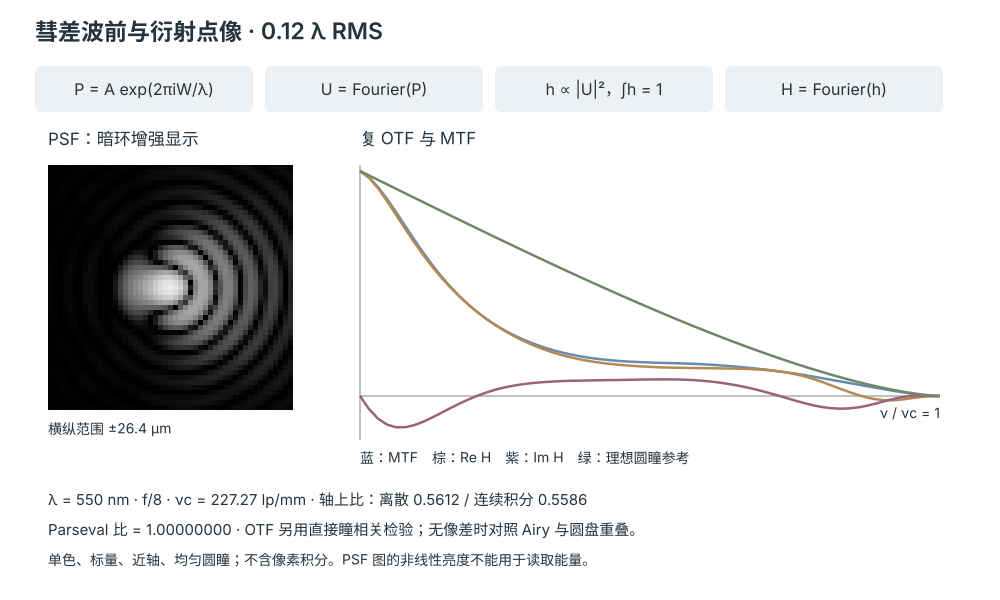
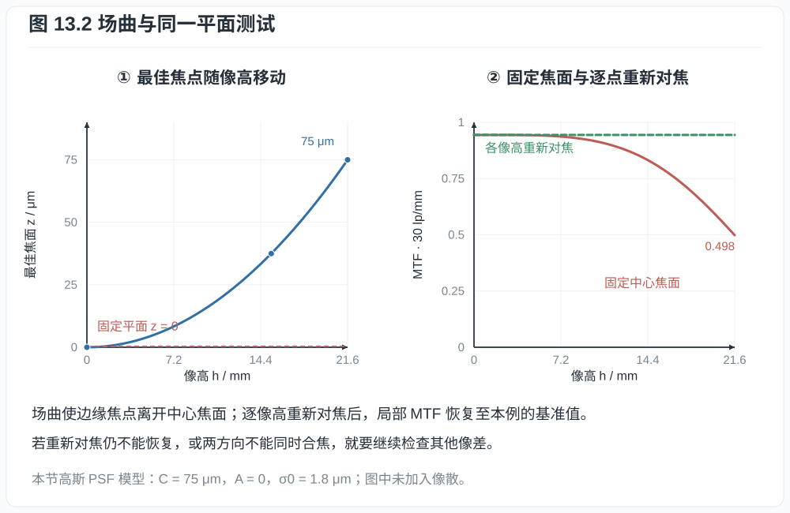
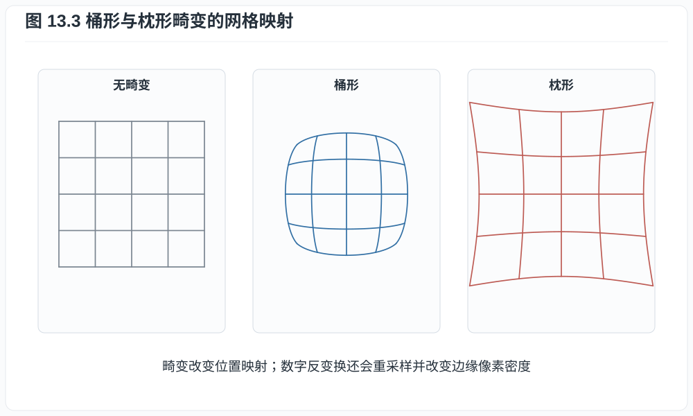
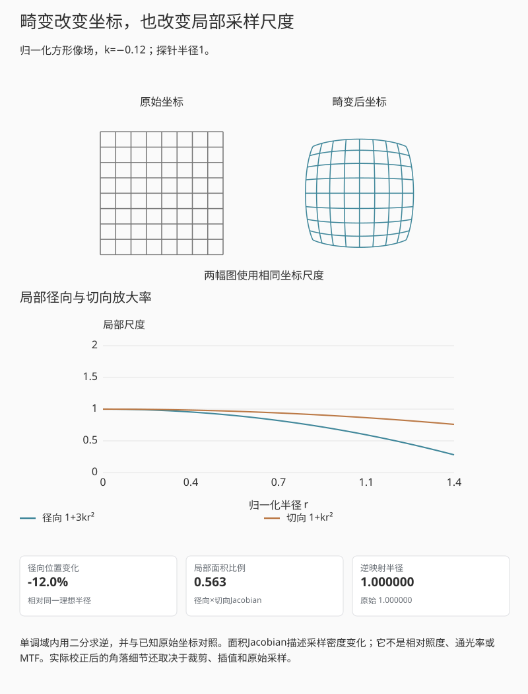
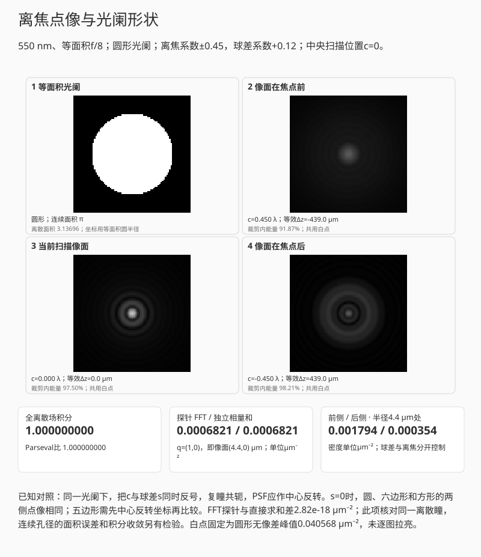
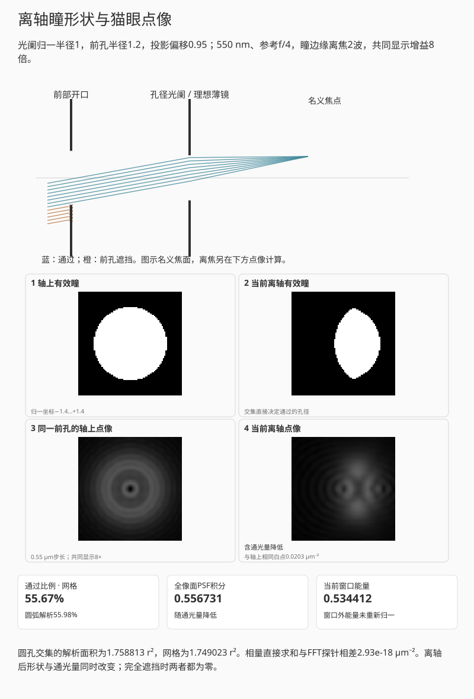

# 第十三章：球差、彗差、像散、场曲、畸变与色差

拍摄星空时，中央星点近圆，角落却可能出现拖尾或短线；拍平面图案时，角落重新
对焦后又可能明显变清楚。两种现象都表现为边缘细节较弱，原因却可以不同：前者
涉及离轴点扩散的形状，后者可能主要来自最佳焦面弯曲。球差、彗差、像散和场曲对光程差的影响各不相同，可由波像差及其形成的PSF加以描述。

## 13.1 波像差的组织方式

令归一化瞳坐标为 $(\rho,\phi)$，像高为 $h$。轴对称系统的第三阶光线像差，对应
波像差在瞳与视场变量中的第四阶项；常用 Seidel 项的变量依赖可写为

$$
\begin{aligned}
W_\mathrm{sph}&\propto \rho^4,\\
W_\mathrm{coma}&\propto h\rho^3\cos\phi,\\
W_\mathrm{ast}&\propto h^2\rho^2\cos^2\phi,\\
W_\mathrm{field}&\propto h^2\rho^2,\\
W_\mathrm{dist}&\propto h^3\rho\cos\phi.
\end{aligned}                                             \tag{13.1}
$$

例如球差波像差含 $\rho^4$，对瞳坐标求导后才出现第三次的光线偏差。“三阶像差”
与“波像差三次多项式”因此不能等同。相关系数约定见
[OpticStudio 的 Seidel 说明](https://ansyshelp.ansys.com/public/Views/Secured/Zemax/v252/en/OpticStudio_User_Guide/OpticStudio_Help/topics/Seidel_Coefficients.html)。
系数依镜头结构、光阑位置和符号约定。式 (13.1) 的价值不是精确预测现代大口径镜头，
而是显示各像差怎样随孔径半径和像高增长。高阶像差需要更高次项或数值光线追迹。

在单位圆瞳上定义内积

$$
\langle F,G\rangle
=\frac1\pi\int_0^1\int_0^{2\pi}
F(\rho,\phi)G^*(\rho,\phi)\,\rho\,d\phi\,d\rho.
$$

将波前拆成不同形状，有助于区分几种很容易混在一起的变化。活塞项（piston）
是整片瞳上的同一光程偏移，只改变整体相位；两项倾斜（tilt）描述两个方向的线性
光程坡度，使点像平移。离焦（defocus）则是二次形状，在近轴模型中对应焦位变化。
因此，报告波前误差时，应说明是在指定像面上保留离焦，还是先减去离焦再比较
剩余误差。

取一组按该内积正交归一的 Zernike 模式 $Z_j$，可写
$W=\sum_j a_j Z_j$。若已经移除活塞、两项倾斜，并按测量目的决定是否移除
离焦，则 Parseval 等式给出

$$
\sigma_W^2=\langle W,W\rangle=\sum_j|a_j|^2              \tag{13.2}
$$

（求和只含保留模式）。所以“波前 RMS”必须同时报告去除了哪些模式、瞳形、波长和
归一化；把最佳对焦时的 RMS 与固定像面 RMS 直接比较会把 defocus 口径混在一起。

上述内积对应均匀透射的完整圆瞳；遮挡或振幅加权改变时，应使用匹配的权重，不能
直接沿用同一组 RMS 系数。

比较点像时，还要先确定比较的位置。令 $h$ 为固定像面上的强度 PSF，$h_{\rm ref}$
为相同瞳振幅、相同总通量下的无像差参考 PSF，参考峰值位于原点。本书把
$\mathcal S=\max_{\boldsymbol r}h(\boldsymbol r)/h_{\rm ref}(0)$ 称为 Strehl
ratio（峰值比），另记固定参考原点的轴上比 $S_0=h(0)/h_{\rm ref}(0)$。
这里的最大值只在该像面内取，不包含重新对焦；比较时应一并声明焦位和去倾斜规则。
仅当原点也是被比较 PSF 的峰值位置时，$S_0$ 与 $\mathcal S$ 才相同。
例如彗差会使峰值偏离原点；[Mahajan（1985）](https://opg.optica.org/josaa/abstract.cfm?uri=josaa-2-6-833)
的表 1 分别报告了峰值、质心处和原点处的强度。

若实相位误差 $\varphi=2\pi W/\lambda$ 已去均值且足够小，
像面中心的归一化复振幅为
$\langle e^{i\varphi}\rangle$。展开指数得

$$
\langle e^{i\varphi}\rangle
\approx1-\frac12\langle\varphi^2\rangle,
$$

故轴上比 $S_0$ 的二阶展开可写成常用的 Maréchal 指数近似：

$$
S_0\approx
\exp\left[-\left(\frac{2\pi\sigma_W}{\lambda}\right)^2\right]. \tag{13.3}
$$

这里还要求与参考系统使用相同瞳振幅、相同总通量，并在声明的对焦和去倾斜条件下
比较。若 $|\varphi|\le\varepsilon\ll1$，指数展开的平均余项为
$O(\varepsilon^3)$，所以强度比的二阶式是 $1-\langle\varphi^2\rangle$；
式 (13.3) 的指数形式在该阶与之相同，是常用近似而非精确等式。
$\sigma_W=\lambda/14$ 时得到 $S_0\approx0.818$，在 550 nm 下对应约
39 nm 的波前 RMS。相同 RMS 的不同模式组合仍可形成不同 PSF，也可具有不同的
高频 MTF。轴上比和峰值比各自都只概括点像的一个强度特征；若要把式 (13.3) 用于
峰值比，还需峰值位于所用参考原点。小相位近似与具体像差平衡的关系另见
[Mahajan（1982）](https://opg.optica.org/josa/abstract.cfm?uri=josa-72-9-1258)。

### 同样的 RMS，可以有不同的点像

为了把波前误差与点像直接对应，取单位圆瞳上的四个实模式：

$$
\begin{aligned}
Z_\mathrm d&=\sqrt3(2\rho^2-1),\\
Z_\mathrm a&=\sqrt6\rho^2\cos2\phi,\\
Z_\mathrm c&=\sqrt8(3\rho^3-2\rho)\cos\phi,\\
Z_\mathrm s&=\sqrt5(6\rho^4-6\rho^2+1).
\end{aligned}                                             \tag{13.3a}
$$

这里分别称为离焦、像散、彗差和球差模式。它们是经过平衡的 Zernike 模式，不等同于
只保留 $\rho^4$ 或 $\rho^3\cos\phi$ 的单个 Seidel 单项式；归一化由上面的圆瞳内积
固定，不依赖软件的编号约定。角向积分先把不同角频率的项分开。
对相同角频率的径向积分，令 $u=\rho^2$：离焦与球差的零均值分别来自
$\int_0^1(2u-1)\,du=0$、$\int_0^1(6u^2-6u+1)\,du=0$，二者乘积积分也为零。
彗差与 $x$ 倾斜项的正交来自 $\int_0^1(3u-2)u\,du=0$。四个模式的归一化则分别为
$3\int_0^1(2u-1)^2\,du=1$、$3\int_0^1u^2\,du=1$、
$4\int_0^1(3u-2)^2u\,du=1$、$5\int_0^1(6u^2-6u+1)^2\,du=1$。
所以 $\langle Z_j,Z_k\rangle=\delta_{jk}$，四项均与 piston、两项 tilt 正交。令
$W/\lambda=\sum_j c_jZ_j$ 后，保留离焦的 RMS 是
$\sigma_W/\lambda=\sqrt{\sum_jc_j^2}$。

起始为0.12 λ RMS彗差。
先切到相同RMS的像散与球差，比较点像和两个方向的MTF；
再比较“彗差 0.12 λ”与“彗差反号”，看点像镜像和OTF虚部反号。
仅看MTF模长会漏掉这次方向变化。

*互动示意：固定像面的 0.12 λ RMS 彗差；复 OTF 的虚部不为零。
零波像差的圆盘重叠曲线仅为参考，当前像差的独立对照来自直接瞳自相关与连续圆瞳积分。*

相同RMS的像散、彗差与球差仍有不同点像和方向MTF，因为一个RMS数值没有
保留波前的空间分布。彗差反号时点像镜像翻转，沿 $x$ 方向的 OTF 取共轭：MTF
不变，虚部与相位却改变。纯离焦达到一定程度后，部分频率的 OTF 实部会为负；
只显示模长便会漏掉这个相位反转。离焦扫描保留其余三项系数，像散的两方向响应
因此可在扫描中分别比较。

界面把原点强度与无像差原点强度之比记为 $S_0$，另用连续圆瞳积分独立计算它。
$S_0$ 始终在同一像面原点读取；彗差造成的峰值偏移另行观察。去掉 piston、tilt
并保留离焦的 RMS 用于式 (13.3) 的小误差近似，较大的
误差仍以传播计算为准。

纯离焦还可作精确对照。令 $W/\lambda=c\sqrt3(2\rho^2-1)$，轴上复振幅除以瞳面积后为

$$
\frac1\pi\int_0^{2\pi}\int_0^1
 e^{2\pi i c\sqrt3(2\rho^2-1)}\rho\,d\rho\,d\phi
=\frac{\sin(2\pi\sqrt3c)}{2\pi\sqrt3c},
$$

其中 $c=0$ 按连续极限取 $1$。等式由 $u=\rho^2$ 后对 $[0,1]$ 上的指数函数积分得到。
所以 $c=0.12$ 时精确 $S_0\approx0.54617$，而式 (13.3) 给出约 $0.56638$。
二者的差别是近似误差；有限圆瞳网格与连续积分的差别则是数值误差。这两项在演示
中分别显示。该模型描述给定波前在一个局部像点的衍射，不由四个系数反推真实镜头
处方，也不代替下面的全像场测试。

### 像差作用于细线时的方向差别

把点像换成一幅图案，可以检查PSF的方向与卷积的方向是否一致。下面复用
[第十二章的有限卷积模型](12_diffraction_psf_otf_mtf_and_sampling.md)，选择“彗差与细线”，
再改变彗差符号。图案在固定像面尺度上，PSF的不对称与细线一侧的扩散可以直接比较。
只有一个局部PSF参与运算，不能从这块52.8 μm宽的图案推断整个画面的像场表现。

先用“无像差细线”与“彗差与细线”作单参数比较，再只把彗差从正值改为负值，看细线拖尾是否随之翻转。
探针应落在一条线及其拖尾附近，比较光学卷积与像素平均后的值；
若探针落在均匀背景，差异自然不明显。

*互动示意：与第十二章采用相同静态输入；切换预设可比较离焦、彗差及像素面积。
蓝框的空间求和保留为独立对照，PSF截取比例与画面裁剪分开报告。*

这里相加的是各物点形成的强度，不是先把不同物点的复振幅相加。像面强度数组也
不先做Gamma变换再卷积。若把彗差PSF取镜像或把卷积误写成相关，拖尾方向就可能
反过来；点输入、符号翻转和逐项求和因此都保留作检验。

## 13.2 球差与彗差

球差是轴上像差：球面透镜边缘光线与近轴光线焦点不同。对均匀照明的圆瞳，等宽
环带越靠外，面积越大；球差波前项又随 $\rho^4$ 增长。因此收小光圈、遮去外圈会
快速减少球差，同时也增加衍射。设计者可用弯月形分配、非球面或
多片正负光焦度平衡球差。

球差还会使最佳对焦位置随光圈改变，产生 focus shift。对焦于全开最佳位置后收光圈，
若剩余球差不对称，最大 MTF 平面可能前后移动；这不是自动对焦误差。

彗差随像高一次增长，离轴点形成带尾巴的彗形斑。夜景星点对彗差很敏感，但“角落
星芒”还可能混入像散、传感器微透镜和去马赛克。只凭单张过曝星点不能分离这些来源。

*图 13.1　参数化点列分别展示旋转对称、拖尾和方向性展宽，各图保持相同坐标比例，
颜色区分像差类型。由具体镜头得到的点列图还需逐面追迹，并注明比例尺、瞳采样、
波长和对焦条件；衍射PSF则由复瞳传播计算。*

光学设计软件中常见的三类诊断不能互换：点列图给二维几何落点；横向光线像差图把
瞳坐标映射为像面交点误差，可看出高阶形状和非对称；波前图给光程差，经过 Fourier
传播才得到含衍射 PSF。只有在相同像高、波长、焦面和瞳采样下，它们才描述同一
工作点。

## 13.3 像散与场曲

离轴窄光束在切向与弧矢方向有不同焦面。位于两个焦面之间时，点斑可从一方向线状
经过近圆形最小弥散斑再转为另一方向线状。厂商 MTF 图中的 S/T 曲线分离常反映这种
方向差异，但彗差等也会影响它们。

场曲表示最佳平均焦面弯曲。若传感器是平面，对焦中心后边缘可能离开最佳焦面；稍微
改变对焦可让边缘变好而中心变差。测试镜头时若只在中心对焦平面测全场，会把场曲和
局部像质混在一起。应分别报告：

- 同一平面上的成像一致性；
- 每个像高重新对焦后的最佳性能；
- 最佳焦面随像高的位置。

起始在角点、中心像面，只有场曲。
先按“在当前位置重新对焦”，看角点MTF恢复而中心可能变差；
再选“加入像散”并重复对焦，看两个方向为何不能同时达到各自最佳值。
比较时先保留30 lp/mm，最后再换细节频率。

*图 13.2　按本节高斯PSF模型计算：仅有场曲时，角落最佳焦面比中心偏移75 μm。
固定中心焦面，30 lp/mm的MTF从中心约0.944降至角落约0.498；逐像高重新对焦后，
各处都恢复至约0.944。若加入像散，还须分别检查两个方向，不能用一条平均焦面代替。*

上面的演示采用简化的局部椭圆高斯 PSF，同时给出固定像面的 MTF、重新对焦后的
MTF，以及最佳焦面的位置。令
$u=(h/21.6\ \mathrm{mm})^2$，两个方向的最佳面为
$z_R=(C+A)u$、$z_T=(C-A)u$。这里 $C$ 是角落平均焦面相对轴上的位移，$2A$ 是
角落两方向的焦面间距；两者单位均为 $\mu$m。固定当前像面 $z$ 后，假设

$$
\sigma_q^2=(1.8\ \mu\mathrm m)^2+[0.08(z-z_q)]^2,
\qquad q\in\{R,T\}.
$$

这里选取系数 $0.08$ 展示像高对模糊量的影响。以像面 mm 为单位，
归一化高斯函数的 Fourier 变换给出
$\mathrm{MTF}_q(\nu)=\exp(-2\pi^2\sigma_q^2\nu^2)$。模型用解析 PSF 与 MTF 保持
两幅图一致，并明确以频率向量的径向、切向定义 R/T；不能把这里的线型直接搬到
任意厂商 S/M 图上。

选择“仅场曲”并在角落重新对焦，两方向的 PSF 宽度都可恢复至模型的基准值，
但中心会离开最佳焦面。点击“加入像散”后，两个最佳焦面分开；在两者中间对焦，
两方向可能具有相同的 MTF，却都达不到各自的最佳值。一个像面位置无法同时满足
$z=z_R$ 与 $z=z_T$，因此 S/T 接近本身不能证明没有像散，单张 MTF 图也不能
唯一反推出像差组成。

曲面传感器主要针对这一问题提供额外自由度，但像散产生两个焦面，单一球面不能自动
同时消除它们。

## 13.4 畸变不等于模糊

畸变改变像高映射而不必扩大局部点斑。理想无畸变映射在给定投影下为 $r_0$，实际
像高可展开为

$$
r=r_0(1+k_1r_0^2+k_2r_0^4+\cdots).                       \tag{13.4}
$$

*图 13.3　畸变改变位置映射，理想情况下不扩大局部 PSF。数字反映射会重新采样并
改变边缘的有效像素密度，因此“可校正”不等于没有分辨率和视角代价。*

$k_1<0$ 常对应桶形，$k_1>0$ 常对应枕形，复杂广角可呈波浪形。数字校正用反映射把
像素重采样到目标几何；边缘被拉伸时，单位输出角度可用的原始像素密度下降，插值也
改变 MTF。校正后的“24 mm 视角”与未校正 RAW 边界可能不同。

畸变曲线单独不能说明清晰度；反之，MTF 也不能说明直线是否弯曲。两者必须分项读。

### 网格位置与局部面积尺度

取归一化坐标中的单项径向模型
$F(x,y)=(1+kr^2)(x,y)$，$r^2=x^2+y^2$。沿切向的局部放大率为 $1+kr^2$；
对径向映射 $r'=r(1+kr^2)$ 求导，径向放大率为 $1+3kr^2$。所以面积Jacobian为
$(1+kr^2)(1+3kr^2)$。它说明局部采样密度怎样变化，不是相对照度或通光率。

从“桶形”切到“无畸变”，看同一网格交点的位置；
再选“枕形”看弯曲反向。
随后只移动半径探针，比较径向、切向与面积尺度。
探针改变测量位置，不会重新改变整幅网格，坐标校正也不等于恢复已经损失的细节。

*互动示意：方形像场[-1,1]²，k=−0.12，原始与畸变网格采用相同坐标尺度。
系数范围限制在全域单调区；二分反解半径，与生成坐标逐点核对。*

在 $|k|\le0.15$、$r\le\sqrt2$ 的展示范围内，两局部尺度始终为正，径向映射
严格单调，因而逆半径唯一。反映射可恢复几何坐标，却不会反转拍摄时的积分与混叠；
图中也没有把网格弯曲自动变成PSF模糊。

## 13.5 轴向与倍率色差

折射率 $n(\lambda)$ 随波长变化，使透镜光焦度也随波长变化。轴向色差使不同颜色的
最佳焦点沿光轴分离，常在焦前焦后呈不同色边；收光圈可减小模糊斑，却不改变材料
色散本身。

倍率色差使不同波长的横向放大率不同，离中心越远色边越明显。它可在去马赛克后按
通道做径向缩放校正，只要通道信息未严重混叠；轴向色差涉及每个通道真实离焦，简单
缩放不能恢复丢失的高频。

**例子 13.1（位置色差与离焦色差）.** 若红、蓝图像相对绿通道在边缘分别偏移
$+0.5$ 与 $-0.5$ 像素，合成白黑边会出现彩边。通道对齐可修正位置，但若蓝通道还
因轴向离焦具有宽 PSF，对齐后蓝细节仍低。把所有彩边都归因于“倍率色差可一键修”
会漏掉第二部分。

### 不同评价指标下的最佳焦面

对单色小像差，最大轴上强度、最小RMS波前和某条MTF的最佳焦面常常接近，但它们
不是同一个定义。宽谱带有轴向色差时，蓝、绿、红各自最佳的位置不同；把三条谱线
放在同一个像面比较，才能确定所选指标的最优位置。

先比较“f/6 · 20 lp/mm目标”与“f/6 · 120 lp/mm目标”，谱线间隔、像面和光圈保持一致。
看MTF最佳焦位怎样随频率改变，而轴上值最佳位置不动；
随后拖动所选像面，确认两种目标各自如何变化。

*互动示意：与第十二章共用三谱线圆瞳模型和同一静态输入。下图在2 μm网格上分别
寻找最大轴上值与指定频率最大MTF；两者可以相同，也可以不同。*

选择f/6、焦面间隔60 μm时，可比较20与120 lp/mm两个目标：轴上值最大的位置
不随探针频率改变，MTF最佳位置却会变化。这里报告给定范围内的网格最大值，
连续最优点可能位于网格之间。轴上比按共同合焦参考计算，峰值Strehl则沿用前面
给出的定义。实测对焦若按中心高频选择，随后报告全场低频曲线时，应保留这个
选择条件；逐像高重新对焦的结果应另作一组报告。

## 13.6 收光圈的平衡

设某项波像差随实际瞳半径四次增长。保持镜头及像高不变，把孔径半径缩为原来的
$k<1$，其边缘波像差项
降为 $k^4$；与此同时 Airy 尺度按 f 数，即约按 $1/k$ 增长。最佳光圈是像差下降与
衍射上升的系统平衡，还依像高、对焦、波长、传感器采样和输出尺寸。

因此“镜头最佳光圈是最大光圈收两档”不是定律。高质量小口径镜头可能全开已接近
衍射限制；超大光圈镜头可能需收多档；高像素密度传感器会更早看见衍射 MTF 下降，
却仍可能因景深增加而让实际场景更多区域清楚。

## 13.7 散景的形状、强度分布与像差

离焦 PSF 的边缘亮度、洋葱圈、猫眼、口径蚀和轴向色差共同影响散景。球差符号会使
焦前与焦后散景不同；非球面加工纹理可能产生环纹；光阑叶片决定收光圈后的多边形。
这些特征不能从合焦平面的一条 30 lp/mm MTF 曲线推出。镜头评价至少要分开合焦传递、
离焦 PSF、眩光、几何和机械行为。

### 在同一尺度上比较焦点两侧

把等面积圆的瞳半径记为 $r_0$，以 $(u,v)$ 表示除以 $r_0$ 后的瞳坐标，
$\rho^2=u^2+v^2$。下图比较圆、正六边形、正五边形和正方形孔径；它们的连续面积
均为 $\pi r_0^2$。正 $n$ 边形的外接半径取
$r_0\sqrt{2\pi/[n\sin(2\pi/n)]}$，由 $n$ 个等腰三角形的面积之和即可核对。
因此比较形状时没有同时改变几何通光面积，但实际光阑在不同方向上的宽度仍不同。

统一使用

$$
P(u,v)=A(u,v)\exp\!\left\{i2\pi\left[
c\sqrt3(2\rho^2-1)+s\sqrt5(6\rho^4-6\rho^2+1)
\right]\right\}.
$$

$A$ 是孔径内为1、外为0的振幅透过率。$c$ 控制离焦，$s$ 控制球差；二者在完整
圆盘上是以波长为单位的RMS系数。换成多边形后仍使用同一多项式和长度单位，
不再把系数称为该多边形孔径上的RMS。PSF由复振幅的负号Fourier变换取模平方得到，
采用第12章的单位积分归一。

本例把物点固定，只移动像面。若无像差的名义焦距为 $f$，像面移到 $f+\Delta z$，
近轴Fresnel传播中多出的二次相位为
$\tfrac{k}{2}[1/(f+\Delta z)-1/f]r^2$。在 $|\Delta z|/f\ll1$ 下展开，
与上式的 $2\sqrt3c\rho^2$ 比较，并忽略不影响强度的常相位，可得

$$
\Delta z\simeq-16\sqrt3\,\lambda N^2c,
\qquad N=\frac{f}{2r_0}.
$$

这里 $\Delta z>0$ 表示像面远离瞳，所以图中的 $c>0$ 对应像面位于名义焦点前侧。
例如 $\lambda=550$ nm、$N=8$、$c=0.45$ 时，等效位移约为 $-439.0$ μm。
演示固定名义 $\lambda N$ 坐标，省略实际传播距离改变带来的尺度变化；用 $f=50$ mm
作尺度参照，允许范围的位移绝对值不超过0.586 mm。这是小离焦模型，不是把像面移动
与物距改变完全等同。

先比较“纯离焦 · 两侧对称”与“正球差”，只有球差改变，看前后点像怎样失去对称；
再改成“负球差”核对关系。
中央扫描只移动中间一张图的像面。
比较孔径形状时请固定离焦量，六边形预设另外用了较大离焦。

*互动示意：550 nm、等面积f/8；圆形孔径、离焦系数±0.45、球差系数+0.12。
点像采用共同尺度及白点，裁剪能量单列；中央图可扫描焦点两侧。*

三幅点像都用1.1 μm步长、89.1 μm宽的视场和同一个白点，白点取等面积圆形孔径的
无像差峰值。裁剪窗口外的能量另列，没有把每幅离焦图分别拉到同样亮。
离散瞳对连续边界的面积近似也会留下误差：默认128格圆直径下，四种孔径的面积
相对误差均低于1.2%；直接相量求和核对FFT，连续极坐标积分和更细网格另作检验。

清零球差后，圆、六边形和方形的正负离焦PSF相同。更一般地，实孔径下同时反转
$c,s$ 会把复瞳共轭，因此 $h_{-c,-s}(x,y)=h_{c,s}(-x,-y)$。五边形没有中心对称性，
不能跳过坐标反转，直接说前后点像相同。球差保持非零而只反转离焦时，这个共轭
条件不再成立；两侧的亮环和能量分布可以不同。

可先用圆形孔径的纯离焦预设检查前后对称，再比较正、负球差。最后切到五边形，
检查中心反转关系，并播放中央像面扫描。图中的形状来自已声明的孔径与波前；
加工环纹、离轴猫眼和真实镜头的散景仍需要额外模型或测量，不能由这里的规则图形
推定。Fourier框架及与外部讲义的符号边界见
[逐章来源注释](CHAPTER_SOURCE_NOTES.md#亚像素鬼影与离焦展示的补充)。

### 离轴截光与猫眼散景

画面边缘的离焦亮点常呈猫眼形。第11章已从逐孔截光求通光区域，这里将该区域
作为复瞳，继续计算点像。把光阑半径归一为一，另一个圆孔映回同一瞳面后的半径为
$r$、横向偏移为 $d$；等效瞳为两圆的交集：

$$
P_d(u,v)=\boldsymbol1_{u^2+v^2<1}
\boldsymbol1_{(u-d)^2+v^2<r^2}
\exp[2\pi i c(u^2+v^2)].                              \tag{13.5}
$$

$c$ 是边缘相对中心的离焦波数。孔径截掉哪一侧，离焦光束便少掉那部分路径；
同时还会叠加衍射。像面沿用第12章的标量Fourier传播，固定入射照明，以完整单位
圆孔的通量为一，则全像面点像积分等于交集面积除以 $\pi$。这个能量关系由
Plancherel定理得到，不能在截光后重新把每幅点像都归一为同样明亮。

先选“轴上”，再选“移到边缘”，看有效孔径缺口、通光能量和离焦点像共同变化；
接着只把离焦从+2改为−2，看点像翻转。
共同显示增益用于看清弱结构，亮暗比较仍读能量比；
完全被挡时没有可归一化的点像。

*互动示意：前孔与光阑的几何关系、两圆交集和离焦点像对应显示；550 nm、f/4，
截光前后共用白点。前孔偏移0.95个光阑半径、半径比1.2，离焦系数c=2。*

有效孔径的缺口改变总能量和离焦点像。切换正负离焦时，实振幅孔径与二次相位的共轭关系使点像中心反转；图形本身不必
保持原位相同。几何截光图显示名义焦点，离焦只加在复瞳相位上，二者在图注中分别
标明。实际镜头的瞳像差、机械轮廓和波前可依照完整处方继续计算；这里先把截光与
离焦两个机制分开。

## 练习

**练习 13.1.** 根据式 (13.1)，把孔径半径减半时球差项与彗差项分别变为原来的
多少？保持像高不变。

**练习 13.2.** 畸变校正把边缘一个方向拉伸 $1.2$ 倍。若原始该方向局部 Nyquist
为 100 lp/mm，以校正后坐标计的等效上限约为多少？

**练习 13.3.** 设计一个区分场曲和边缘固有像差的拍摄测试，说明需改变哪个变量。

**练习 13.4.** 用式 (13.3) 分别估计
$\sigma_W=\lambda/20$ 与 $\lambda/10$ 的轴上比 $S_0$。说明近似条件与 RMS
口径，并指出还需什么位置条件，才能把它们解释为本书约定的 Strehl 峰值比。

**练习 13.5.** 先只保留纯离焦 $W/\lambda=c\sqrt3(2\rho^2-1)$，取 $c=0.12$，
用正文精确式计算 $S_0$，再与式 (13.3) 比较。随后清零离焦，只在纯彗差系数
$+0.12$ 与 $-0.12$ 之间切换；切换前预测 $S_0$、固定方向 MTF、OTF 实部和虚部
各怎样变化，再观察点像与读数核对。为什么这些比较仍没有执行峰值位置搜索？

**练习 13.6.** 两个单位半径圆孔的中心相距1，求交集面积占完整圆孔的比例。
固定入射照明时，全像面点像积分应是多少？为何逐图拉到相同峰值会掩盖这个比较？
