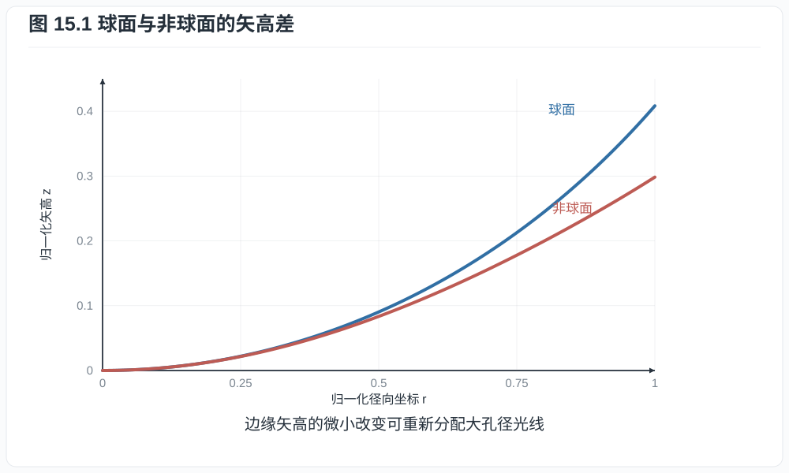
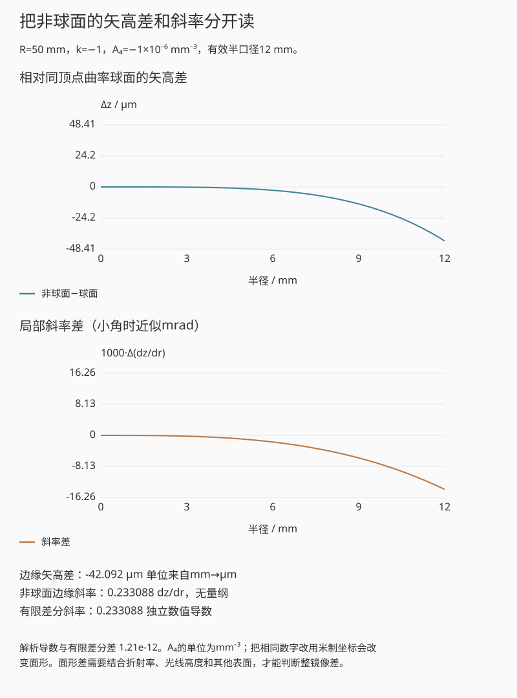
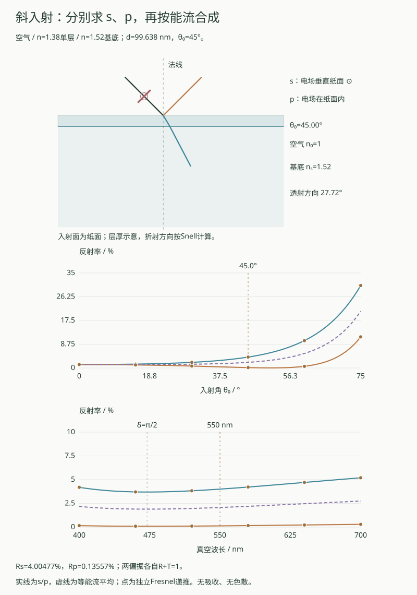
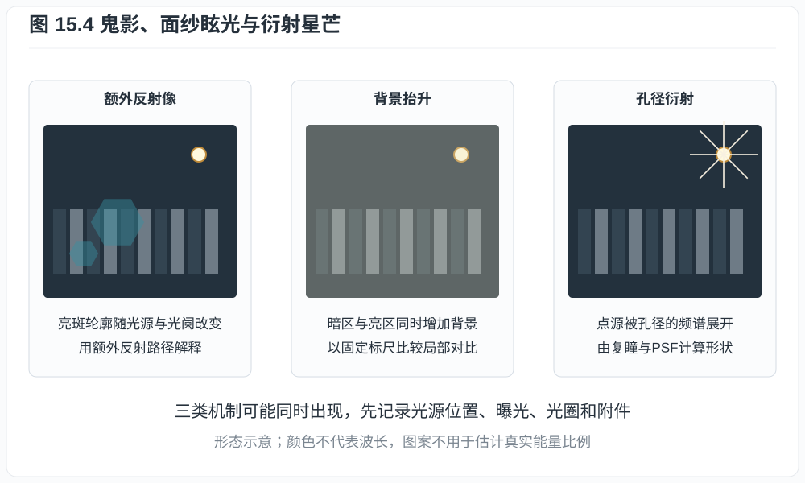
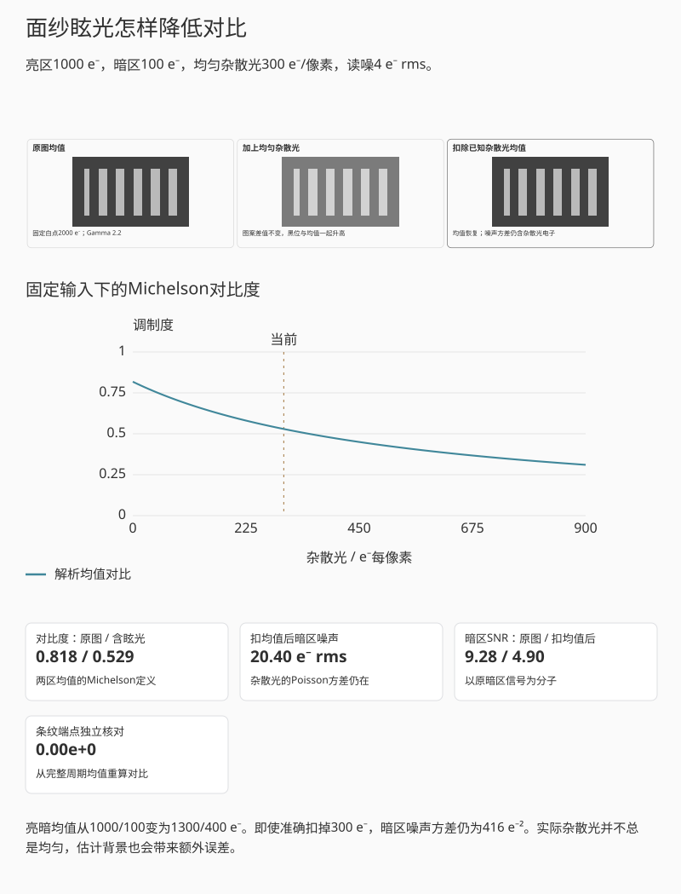

# 第十五章：非球面、Fresnel、PF/DO 与镀膜

大型正透镜的边缘光线可能与近轴光线聚焦在不同位置，改变表面高阶形状可以改善
这种球差。若希望减轻长焦镜头重量，还可用衍射元件提供与普通玻璃相反的色散。
它们解决的问题不同：前者改变连续面形，后者利用相位结构分配衍射级次。透射和
逆光表现又与界面反射有关，需要进一步讨论镀膜。

## 15.1 非球面的面形与设计自由度

从镜片顶点作一个垂直于光轴的平面。离轴距离为 $r$ 的位置，曲面到这个平面的
轴向距离 $z(r)$ 称为矢高。旋转对称非球面的矢高可写成

$$
z(r)=\frac{cr^2}{1+\sqrt{1-(1+k)c^2r^2}}
+A_4r^4+A_6r^6+A_8r^8+\cdots,                            \tag{15.1}
$$

*图 15.1　非球面与基准球面的实际矢高差可能远小于图示；图中特意放大差异以说明
高阶系数如何改变边缘斜率。归一化坐标下，蓝线按式 (15.1) 取 $c=0.7,k=0$、
高阶项为零；红线在同一球面上增加 $A_4=-0.11$ 的项。面形作用还需结合光线高度。*

$c=1/R$ 是顶点曲率，$k$ 是圆锥常数，$A_{2m}$ 是高阶系数。$k=0$ 且高阶系数为零
时为球面；其他 $k$ 可表示椭球、抛物或双曲母线的一部分。

取 $r,z,R$ 为相同长度单位时，$c$ 的单位为长度倒数，$A_{2m}$ 的单位为
长度$^{1-2m}$，才能保证每项都是矢高。面形使用范围还要求根号内
$1-(1+k)c^2r^2\ge0$，并由镜片有效口径限制。把毫米处方的高阶系数直接用于米制
坐标，会产生很大的面形错误。

球面只给一个曲率参数，非球面可独立调整边缘光线的折射，因而校正球差、彗差、畸变
并减少镜片数量。它不保证所有像差同时变小；系数选择仍由整套镜头优化决定。

制造方法包括研磨抛光、精密玻璃模压、树脂注塑和玻璃基底复制树脂层。模具纹理或
加工刀痕可在离焦高光中形成同心“洋葱圈”，即使合焦 MTF 很高。

### 实际差值有多大，边缘斜率又变了多少

对式 (15.1) 保留圆锥项和 $A_4r^4$，直接求导得

$$
\frac{dz}{dr}=\frac{cr}{\sqrt{1-(1+k)c^2r^2}}+4A_4r^3.
$$

可以先把圆锥项有理化为
$[1-\sqrt{1-(1+k)c^2r^2}]/[(1+k)c]$ 后求导；$k=-1$ 时用连续极限
$z=cr^2/2$，导数同为 $cr$。根号为零时矢高尚可能有限，导数却奇异，因此本页
只接受根号严格为正的有效口径。基准球面的矢高还可由圆方程
$z=R-\sqrt{R^2-r^2}$ 独立核对。

先比较“基准球面”和“抛物面”，看边缘矢高差与斜率差；
再选“加入四阶项”，只改变A₄。
最后只缩小有效半口径，看实际使用区域的差异怎样减小。
这里比较面形；整镜像差还取决于具体光路。

*互动示意：R=50 mm，k=−1，A₄=−10⁻⁶ mm⁻³，有效半口径12 mm。
直接显示相对同顶点曲率球面的μm差值；解析斜率与独立有限差分互核。*

面形差改变光程，斜率差改变局部法线方向；作用还取决于光线经过该面的高度。
各像高的像差改善量需由完整处方的光线追迹确定。

## 15.2 Fresnel 的相位折叠

传统 Fresnel 折射透镜把厚透镜表面分成同心环，并移除不影响局部斜率的材料，从而
减薄重量。环带台阶会带来散射和衍射，因此照明 Fresnel 与高像质成像元件的要求不同。

相位 Fresnel（phase Fresnel, PF）或衍射光学元件按 $2\pi$ 周期折叠光程。若目标相位
$\varphi(r)$ 超过 $2\pi$，可制造

$$
\varphi_\mathrm{wrap}(r)=\varphi(r)\bmod2\pi.             \tag{15.2}
$$

在设计波长，差一个整数 $2\pi$ 的区域复振幅相同；表面高度因此可大幅降低。真实
宽带光中相位延迟随波长变化，能量会分入不同衍射级次。

## 15.3 衍射元件的色差补偿

区板半径近似满足

$$
r_m^2\approx m\lambda_0f_0.
$$

固定结构在波长 $\lambda$ 的一级焦距为

$$
f(\lambda)\approx\frac{\lambda_0}{\lambda}f_0.            \tag{15.3}
$$

因此衍射光焦度 $1/f$ 随波长增加而增加：红光焦距更短。普通正折射透镜通常因蓝光
折射率更高而让蓝光焦距更短，两者色散方向相反。把 PF 与折射镜片组合，可以用较少、
较轻元件校正长焦色差。

先在550 nm、深度倍率1下比较两级、四级与八级，看主级次能量和其他级次如何分配。
保持八级结构再选“同一结构看蓝光”，此时只有波长改变；
“零相位对照”中能量应回到零级，可与八级结构的主级次能量比较。

*图 15.2　组合设计让折射与衍射的轴向色差部分抵消。PF 不会消灭色散；它提供一个
符号相反、大小可设计的色散自由度。*

**例子 15.1.** 某 PF 在 $\lambda_0=550$ nm 的焦距为 500 mm。按式 (15.3)，
486 nm 时焦距约 $566$ mm，656 nm 时约 $419$ mm。变化方向与普通正玻璃透镜相反，
数值也说明单个理想衍射元件在宽谱下具有很强的轴向色差，需要与其他元件配合。

衍射效率还取决于相位面被量化为多少级。考虑周期 $\Lambda$ 内把理想
$2\pi x/\Lambda$ blaze 相位量化为 $N$ 个等宽台阶：

$$
t_N(x)=e^{2\pi i k/N},
\qquad \frac{k\Lambda}{N}\le x<\frac{(k+1)\Lambda}{N}.
$$

其目标一级 Fourier 系数为

$$
\begin{aligned}
c_1
&=\frac1\Lambda\int_0^\Lambda
t_N(x)e^{-2\pi ix/\Lambda}\,dx\\
&=e^{-i\pi/N}\frac{\sin(\pi/N)}{\pi/N},
\end{aligned}
$$

故标量、无损、设计波长、局部光栅近似下的一级效率上限为

$$
\eta_1=|c_1|^2
=\left[\frac{\sin(\pi/N)}{\pi/N}\right]^2.               \tag{15.3a}
$$

$N=2,4,8$ 时分别约为 $40.5\%,81.1\%,95.0\%$，连续 blaze 的极限为 $100\%$。
实际 PF 是径向变周期结构，还受材料色散、表面反射、台阶误差、入射角和非设计
波长影响，所以式 (15.3a) 是机制上限，不是镜片透射规格。

互动固定设计波长 $\lambda_0=550$ nm，再改变级数、波长与浮雕深度倍率 $a$。
若材料与周围介质的折射率差暂取常数，相位深度倍率为
$\alpha=a\lambda_0/\lambda$；第 $k$ 级的透射相位变为 $2\pi\alpha k/N$。
逐段积分给出任意整数级次 $m$ 的复系数

$$
c_m=\operatorname{sinc}\!\left(\frac mN\right)e^{-i\pi m/N}
\frac1N\sum_{k=0}^{N-1}e^{2\pi i(\alpha-m)k/N},
\qquad \operatorname{sinc}(v)=\frac{\sin\pi v}{\pi v}.     \tag{15.3b}
$$

$\operatorname{sinc}(0)=1$ 按极限取值。$\alpha=1$ 时，求和只在 $m=1+qN$
的级次上非零，取 $m=1$ 恢复式 (15.3a)。不量化的连续 blaze 在相同深度下则有
$\eta_m=\operatorname{sinc}^2(\alpha-m)$，它在非设计波长也未必把全部能量放入
一级。互动另以每级 128 个中点数值积分核对一级复系数；改变波长后，设计条件
真值仍保留，但明确标为参考。

无损单位振幅相位屏满足 $\sum_{m\in\mathbb Z}|c_m|^2=1$。图中只画 $-8$ 到 $8$
级，图外余量单列，不把可见柱图重新归一化，也不把遗漏的高阶当成吸收。这个
局部周期模型说明量化与相位失配的作用，不生成真实径向 PF 的焦斑或 flare 图。

PF 的环形微结构会使强点光源产生环状 flare，衍射效率随波长和入射角变化。Nikon
公开资料也把 PF flare 作为需软件控制的特性。多层衍射光学（Canon DO 等）可通过
多个结构改善宽带衍射效率，但仍需处理制造精度和鬼影。

## 15.4 单界面的 Fresnel 反射

这里的 Fresnel 是界面反射公式，与 Fresnel 透镜同名但概念不同。正入射、非吸收
介质折射率为 $n_1,n_2$ 时，强度反射率

$$
R=\left(\frac{n_1-n_2}{n_1+n_2}\right)^2.                \tag{15.4}
$$

空气到 $n=1.52$ 玻璃，

$$
R=\left(\frac{1-1.52}{1+1.52}\right)^2\approx0.0426,
$$

每个未镀膜表面约反射 $4.3\%$。一支 20 片镜头有许多空气--玻璃界面，若不镀膜，
透射和鬼影都会严重恶化；胶合面因折射率接近而反射较小。

## 15.5 四分之一波长增透膜

在空气 $n_0$ 与玻璃 $n_s$ 之间放折射率 $n_c$、光学厚度四分之一波长的薄膜：

$$
n_c d=\frac{\lambda_0}{4}.                               \tag{15.5}
$$

从膜上下表面反射的两束光多出半波相位差。若

$$
n_c=\sqrt{n_0n_s},                                       \tag{15.6}
$$

计入界面透射和膜内多次反射后，总反射振幅在设计波长和正入射时为零。现实材料
未必有精确 $n_c$，且摄影
要求宽波段、大入射角，因此使用多层膜在多个界面权衡反射。

多层膜可用特征矩阵严格计算。在正入射、无吸收模型中，第 $j$ 层的相位厚度和矩阵为

$$
\delta_j=\frac{2\pi n_j d_j}{\lambda},\qquad
M_j=
\begin{pmatrix}
\cos\delta_j&i\sin\delta_j/n_j\\
i n_j\sin\delta_j&\cos\delta_j
\end{pmatrix}.                                           \tag{15.7}
$$

将膜层从入射侧到基底依次编号，令总矩阵 $M=M_1M_2\cdots M_J$，并定义
$B=M_{11}+n_s M_{12}$、$C=M_{21}+n_s M_{22}$，则入射侧振幅反射系数为

$$
r=\frac{n_0B-C}{n_0B+C},\qquad R=|r|^2.                  \tag{15.8}
$$

对单层膜，令 $r_{ab}=(n_a-n_b)/(n_a+n_b)$、$\delta=2\pi n_cd/\lambda$。
将式 (15.7) 的单层矩阵代入式 (15.8)，用
$\cos\delta=(e^{i\delta}+e^{-i\delta})/2$ 与
$i\sin\delta=(e^{i\delta}-e^{-i\delta})/2$ 展开并约去共同因子，得到

$$
r=\frac{r_{0c}+r_{cs}e^{-2i\delta}}
        {1+r_{0c}r_{cs}e^{-2i\delta}}.                  \tag{15.8a}
$$

这里的相位符号与式 (15.7) 一致。图15.3右侧比较分子中的两项：在设计波长下，
$e^{-2i\delta}=-1$；折射率匹配时又有 $r_{0c}=r_{cs}$，所以两项相消。
分母已汇总膜内多次反射，右侧两条波形表示这两个等效项的相对相位。

单层四分之一波条件代入式 (15.7)--(15.8) 即恢复式 (15.6) 的零反射条件。斜入射
时 s、p 偏振的光学导纳不同，必须分别计算；这也是宽角镜头镀膜不能由一个正入射
反射率完全描述的原因。

也可把这一步直接算出。四分之一波层有 $\cos\delta=0$、$\sin\delta=1$，所以
$B=i n_s/n_c$、$C=i n_c$。代入式 (15.8)，

$$
r=\frac{n_0n_s-n_c^2}{n_0n_s+n_c^2}.                     \tag{15.9}
$$

分子为零就得到式 (15.6)。对空气与 $n_s=1.52$ 的玻璃，理想膜折射率约为
1.233；若可用膜材为 $n_c=1.38$，设计波长的反射率仍约为 1.26%，低于未镀膜的
4.26%，但没有完全消除。膜厚在 550 nm 设计波长下约为 99.6 nm。偏离550 nm后的
反射率还需逐波长计算。

单层页先选“n꜀ = 1.38 示例”，再把膜厚调到0，比较裸界面与镀膜；
恢复膜厚后选“理想匹配”，看相位相反之外为何还要振幅相等。
改变波长时先固定膜厚，避免自动重新配厚把谱线差异抵消。

多层页从“双层 L → H”开始，只倒转层序，看两种计算的反射谱是否一致变化；
回到原层序后，再用“末层加厚 25%”比较厚度误差。
“重复成六层”用于观察层数增加后的完整谱形，不预设反射一定更低。

*图 15.3　左侧为膜面反射与膜底返回的代表路径，颜色区分反射位置；右侧为
式 (15.8a) 分子中的两个等效项，按共同幅值归一化以比较相位。设计波长及理想
折射率匹配时，两项等幅反相。层厚为示意。*

互动把上界面反射与膜内返回的光各合成一个复振幅，再作首尾相接的矢量相加；膜内
返回项包含完整的多次反射级数，总反射强度取合成振幅的模平方。先按当前波长配
四分之一波膜厚，再调整膜材折射率，可分别观察相位条件与振幅匹配；固定膜厚后
改变波长，则可看到抵消为何只能在部分光谱成立。这里假定折射率无色散、介质无
吸收，并用 $R+T=1$ 检查该无损层系的能量守恒；基底背面的反射不在模型内。

切换到“多层膜”页签后，可比较两层、四层和六层交替膜，改变层序、全部膜厚和
末层厚度偏差。特征矩阵计算整段反射谱，另一条路径从基底逐层递推 Fresnel 反射
和透射振幅；图上的点来自递推，曲线来自矩阵。两条路径均计入各层的多次往返，
透射率独立由振幅计算，不预设为 $1-R$。

对理想四分之一波 $L,H$ 层，式 (15.7) 给出
$M_LM_H=\operatorname{diag}(-n_H/n_L,-n_L/n_H)$。从空气侧依次放置 $p$ 对
$L,H$ 层，设计波长的入射侧导纳与反射率为

$$
Y=n_s\left(\frac{n_L}{n_H}\right)^{2p},\qquad
R=\left(\frac{n_0-Y}{n_0+Y}\right)^2.                  \tag{15.9a}
$$

取 $n_0=1,n_s=1.52,n_L=1.38,n_H=1.70$，一对层在 550 nm 的反射率约为
0.000066%；把层序倒转为 $H,L$，反射率约为 15.6%；重复原层对到六层时也升到
约 15.5%。增加层数改变了导纳匹配，并不会自动改善增透。界面递推始终按当前
厚度计算；式 (15.9a) 则保留作理想四分之一波条件的解析真值，偏离条件时不混用。

多层设计还需同时优化膜厚容差、角度、偏振、环境耐久和色彩平衡。
纳米多孔或亚波长结构可形成低有效折射率层，改善传统材料难以达到的折射率匹配；
整镜头抗眩光还涉及后面讨论的反射路径与机械遮光。

### 斜入射时分别计算 s 与 p

令入射面由光轴 $z$ 和入射光线确定。s偏振的电场垂直入射面，p偏振的电场在
入射面内。平行、各向同性、非磁、无吸收层系中，切向波矢守恒；各层折射角由
Snell 定律确定。若所有层均为传播波，取正的 $\cos\theta_j$，有

$$
\kappa=n_0\sin\theta_0=n_j\sin\theta_j,\qquad
Y_j^{(s)}=n_j\cos\theta_j,\qquad
Y_j^{(p)}=\frac{n_j}{\cos\theta_j},\qquad
\delta_j=\frac{2\pi n_jd_j\cos\theta_j}{\lambda}.        \tag{15.9b}
$$

这里 $Y$ 是以真空导纳归一化的切向场导纳。对沿 $+z$ 的前行波，Maxwell 场关系
给出切向磁场与切向电场之比：s波为 $n\cos\theta/Z_0$，p波为
$n/(Z_0\cos\theta)$，其中 $Z_0$ 是真空波阻抗。p波采用切向电场作为振幅，
因此其导纳与采用完整电场的 Fresnel 写法不同。法向相位由
$k_zd=(2\pi/\lambda)nd\cos\theta$ 决定，不能用光线几何路程 $nd/\cos\theta$
代替。

保持式 (15.7) 的 $e^{+i\omega t}$ 时间约定和前行相位 $e^{-ik_zz}$，对
$\sigma=s,p$ 分别写

$$
M_j^{(\sigma)}=
\begin{pmatrix}
\cos\delta_j&i\sin\delta_j/Y_j^{(\sigma)}\\
iY_j^{(\sigma)}\sin\delta_j&\cos\delta_j
\end{pmatrix},\qquad
T_\sigma=\frac{Y_s^{(\sigma)}}{Y_0^{(\sigma)}}|t_\sigma|^2. \tag{15.9c}
$$

下标 $s$ 在 $Y_s$ 中表示基底，与括号内的s偏振区分。式 (15.8) 的 $n_0,n_s$
相应换为两侧导纳，仍令 $B=M_{11}+Y_sM_{12}$、$C=M_{21}+Y_sM_{22}$，
便有 $r=(Y_0B-C)/(Y_0B+C)$、$t=2Y_0/(Y_0B+C)$。透射率的导纳因子来自
法向平均能流 $Y|E_{\mathrm{tan}}|^2/(2Z_0)$；直接把 $|t|^2$ 当作透射率会漏掉
两侧介质与角度差。分别算出 $R_\sigma=|r_\sigma|^2$ 和 $T_\sigma$ 后，才用
$R_\sigma+T_\sigma=1$ 检验无损能量守恒。

没有后置偏振分析器时，正交的s/p能流相加。设入射能流中p分量占比为 $w_p$，则

$$
R=(1-w_p)R_s+w_pR_p,\qquad
T=(1-w_p)T_s+w_pT_p.                                    \tag{15.9d}
$$

$w_p=1/2$ 表示两种偏振等能流，包括非偏振输入；不是把两个复振幅取平均。
裸介质界面的 Brewster 角满足 $\theta_B=\arctan(n_s/n_0)$，此时 $R_p=0$，
但加膜后一般不再为零。单层膜厚若固定为 $d=550\ \mathrm{nm}/(4n_c)$，倾斜后
$\delta=\pi/2$ 对应波长变为 $550\cos\theta_c$ nm；它只标记相位条件，
是否为反射最小还要结合当前s/p界面振幅判断。

起始单层、45°入射、s/p各半。
先只改变入射角，看两条反射率曲线怎样分开；
再固定角度调p偏振比例，只有混合能流改变，Rs与Rp本身不变。
最后用“裸界面 · Brewster角”核对p反射的零点，再回镀膜条件比较。

*互动示意：空气入射、基底折射率1.52，单层折射率1.38、膜厚按550 nm的
正入射四分之一波条件固定。入射角45°时分别绘出s/p角度曲线与反射谱；
矩阵曲线上的离散点来自独立Fresnel递推。膜厚示意不按比例。*

回放从正入射扫到设定角度，每一步重新计算 Snell 角度、相位和能流。预设还保留
理想正入射匹配、裸界面 Brewster 角、零膜厚和倒转层序。另一条算法从基底出发，
用完整电场的界面 Fresnel 系数累加多次返回；按反射p波的基矢方向转换符号，
再把透射p波乘以 $\cos\theta_s/\cos\theta_0$，与矩阵的切向电场振幅比较。
符号与时间约定可参见 Byrnes §§2--4及附录A；约定不同会改变复振幅表达，不能
直接据此认定反射功率不同。

本例折射率为实常数，基底半无限，空气入射且所有层都保持传播波。全反射、
倏逝波、吸收、材料色散和基底背面均未包含；这些情形需要复角度、复导纳及相应
能流分支，不能把本例的实数平方根直接外推。

## 15.6 鬼影与 veiling flare

两个界面的二次反射可形成有结构的鬼影；镜筒散射、表面粗糙和多次微弱反射会抬高
局部或大范围的背景，形成面纱眩光（veiling glare）。它会降低场景调制度，却未必
明显改变归一化斜边曲线的MTF50。逆光测试需固定光源角度、亮度、遮光罩和曝光，不能用不同构图比较“通透”。

镀膜、镜片边缘消光、内部光阑和机械遮光共同控制杂散光。前玉镀膜颜色只是某角度
反射谱的视觉结果，不能据此数层数或判断透射率。

### 鬼影、面纱眩光与星芒的不同成因

照片里的亮斑、泛白和星芒可能同时出现，处理办法却不同：

| 画面现象 | 主要机制 | 有帮助的检查 |
|---|---|---|
| 有轮廓的光斑、多边形或光圈状鬼影 | 界面反射形成额外成像路径，形状随焦位、光阑和光源位置变化 | 移动光源、改变光圈，对照反射路径和光阑遮挡 |
| 暗部被抬高的一层灰雾 | 场外强光、表面或镜筒散射、多次弱反射形成背景 | 保持构图与曝光，改变遮光罩或遮挡场外光源，比较暗区与局部对比 |
| 点光源的星芒 | 光阑边缘与遮挡的衍射 | 用第十二章的复瞳/PSF方法检查孔径形状，另排除饱和与传感器串扰 |
| 红紫色边、拖尾或光晕 | 色差、球差、彗差、离焦、散射或饱和均可能参与 | 先检查曝光是否剪切，再按波长、像高和焦位分开比较 |

*图 15.4　三种形态分别示意额外反射像、均匀背景抬升和光阑衍射。示意不用于估计
真实镜头的能量比例；表面反射追迹、散射模型与波动传播各有不同的计算对象。*

对一小块可近似均匀的杂散光背景，计算尤其直接。设原亮、暗区电子均值为
$\mu_H>\mu_L\ge0$，每像素另收到独立杂散光均值 $b\ge0$，则Michelson对比度为

$$
C_0=\frac{\mu_H-\mu_L}{\mu_H+\mu_L},\qquad
C_b=\frac{\mu_H-\mu_L}{\mu_H+\mu_L+2b}.                  \tag{15.10}
$$

分子不变，分母增大，故对比降低。取1000/100 e⁻与300 e⁻背景，$C$从约0.818
降到0.529。即使知道并准确扣除这300 e⁻的均值，杂散光的散粒方差仍在：暗区
加4 e⁻读噪后方差为 $100+300+4^2=416$ e⁻²，而原来为116 e⁻²。调低黑位可以
恢复均值关系，不能同时消除这些额外光子的计数涨落。

先比较“无眩光”和“加入300 e⁻”，亮区和暗区原信号不变。
看Michelson对比度、暗区总电子数和信号差；
理想减去平均光幕后，再看杂散光自身的散粒噪声为何仍在。
这与下一项双反射形成的局部鬼影是不同机制。

*互动示意：原图、增加均匀背景、理想扣除背景均值三者共用2000 e⁻显示白点。
图像画期望值，噪声单独按Poisson和读噪方差报告；扣均值后的参考图不代表噪声也
回到了原水平。*

遮光罩阻止一部分场外光进入，消光和植绒抑制镜筒内反射，镀膜降低特定波长、
角度的界面反射。它们的作用互相补充；在后期估计一层背景，不能替代拍摄时少让
杂散光到达传感器。滤镜也增加额外界面，逆光比较时应记录是否安装。

### 沿一条双反射路径追到像面

鬼影在像面上的位置取决于整条光路，包括两次反射之间和之后的折射。
下面用两片球面镜片计算：**镜片1由S1、S2围成，折射率取1.52；镜片2由S3、S4
围成，折射率取1.60**。两片轴上厚度分别为4 mm、3 mm，中间留8 mm空气间隔。
按单色光计算，忽略材料吸收，表面均无镀膜。

坐标 $(z,y)$ 以mm计，光从左向右入射；$R>0$ 表示曲率中心在该面顶点右侧。
四个表面的净半口径均为7 mm。表中的S1–S4与图中曲面一一对应，淡色填充标出玻璃。

| 表面归属 | 顶点 $z$/mm | $R$/mm | 左侧折射率 | 右侧折射率 |
| --- | --- | --- | --- | --- |
| S1 · 镜片1前表面 | 0 | +40 | 1 | 1.52 |
| S2 · 镜片1后表面 | 4 | −40 | 1.52 | 1 |
| S3 · 镜片2前表面 | 12 | −60 | 1 | 1.60 |
| S4 · 镜片2后表面 | 15 | +60 | 1.60 | 1 |

空气光阑位于 $z=8$ mm，半径可调。入射光线从 $z=-8$ mm的一段等间距高度出发，
方向相同，共41条，赋予相同输入功率。落点图按入射高度记录这41条子午光线，
功率也以它们的输入总和归一。二维PSF或像面辐照度还需要瞳面积采样与传播计算。

球面满足 $(z-z_s-R)^2+y^2=R^2$；每次取沿当前方向的正距离交点，并检查它是否属于
靠近顶点的球面帽及净口径。折射按Snell定律求新方向，反射则用
$\boldsymbol d'=\boldsymbol d-2(\boldsymbol d\cdot\boldsymbol n)\boldsymbol n$，其中
$\boldsymbol d$ 和 $\boldsymbol n$ 为单位方向及法线。每段传播都检查是否穿过光阑；
超出口径的光线在截断处终止，不能继续被计入像面功率。

默认路径是

$$
\mathrm{S1:T}\to\mathrm{S2:T}\to\mathrm{S3:R}\to
\mathrm{S2:R}\to\mathrm{S3:T}\to\mathrm{S4:T}\to\text{像面},
$$

其中T为透射、R为反射。它在S3折返向左，在S2再次折返向右，三次穿过空气光阑。
图中①、②标出两次反射，步骤框列出途中每一次透射。另两组反射面可选S4→S1和
S4→S2，预设名称、曲面标号和步骤表同时对应这一选择。

起始S3→S2路径已经追到像面。
先逐段回放，对照表中四个界面与两次反射点；
再保持这条路径，只缩小空气光阑，看哪些光线被挡。
切到S4→S1才是在换一条完整路径，不能把不同鬼影的落点变化全归因于光阑。

*互动示意：S1–S2围成镜片1，S3–S4围成镜片2。默认2°入射，在①S3、②S2反射，
光阑半径3 mm，像面z=83 mm。蓝色细实线、粗虚线和深色实线分别标出去程、返程
和第二次反射后的出射行程；细灰虚线为主光路。实际功率另列读数。*

没有吸收时，每个界面的功率透射率为 $T_s=1-R_s$、$T_p=1-R_p$。初始非偏振光拆为
各占一半的s/p功率，沿整条子午路径分别相乘，最后相加；不能在每次反射后重新
假定两种偏振各占一半。图中三种线型属于同一束单色光，用于辨认传播方向；
反射处用实心点，透射折射处用空心点。能量损失由下方功率读数给出。

正入射、轴上且未截光时，记 $R_a=[(1.52-1)/(1.52+1)]^2$、
$R_b=[(1.60-1)/(1.60+1)]^2$。主光路功率为 $(1-R_a)^2(1-R_b)^2$，
默认双反射路径再乘 $R_aR_b$，得到输入功率的约0.186309%。这与轴上逐面追迹吻合。
独立近轴矩阵给出主光路焦点 $z\simeq83.234911$ mm，默认鬼影实焦点
$z\simeq15.850440$ mm；另一组路径的出射线反向延长交点可能位于S4之前，需标为虚交点。
这些焦点是轴上极限；离轴光源和有球差的有限光束仍逐条计算。

先播放“S3 → S2 · 相邻两面”，跟着步骤框和曲面高亮核对两次方向反转，再把像面移到16 mm附近，
看鬼影光束怎样会聚。缩小光阑时比较两条路径存活的光线数，可见返回光不一定通过
与主光路相同的高度。这组计算保留了双反射路径上的折射、遮挡和Fresnel损失。
完整镜头的杂散光分析还需加入其他反射组合、镀膜、散射光幕、衍射及传感器反射。

## 练习

**练习 15.1.** 对空气--$n=1.8$ 玻璃界面计算未镀膜正入射反射率。

**练习 15.2.** 设计波长 550 nm、膜折射率 $1.38$，求四分之一波长膜的物理厚度。

**练习 15.3.** 用式 (15.3) 说明衍射正光焦度的轴向色差方向为何与普通正折射
透镜相反。

**练习 15.4.** 按式 (15.3a) 计算四级与八级相位量化 blaze 在理想设计波长的一
级衍射效率。列出至少两项使真实 PF 元件低于该值的因素。

**练习 15.5.** 非球面实验取 $R=50$ mm、$k=-1$、$A_4=-10^{-6}$ mm⁻³、
边缘半径 $r=12$ mm。先计算该处矢高和斜率，再求相对同顶点曲率球面的矢高差。
只把 $A_4$ 改为零，预测矢高与斜率的改变量，并用有限差分读数核对。说明为何
单凭这组面形差还不能给出整支镜头的球差或 MTF。

