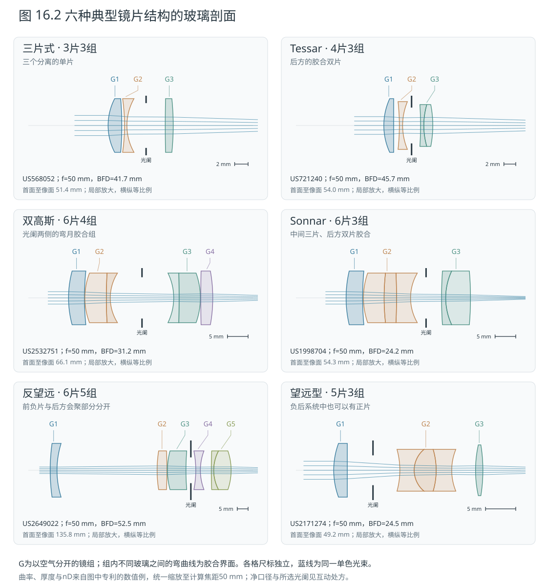
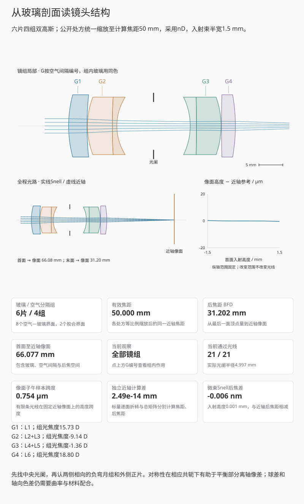
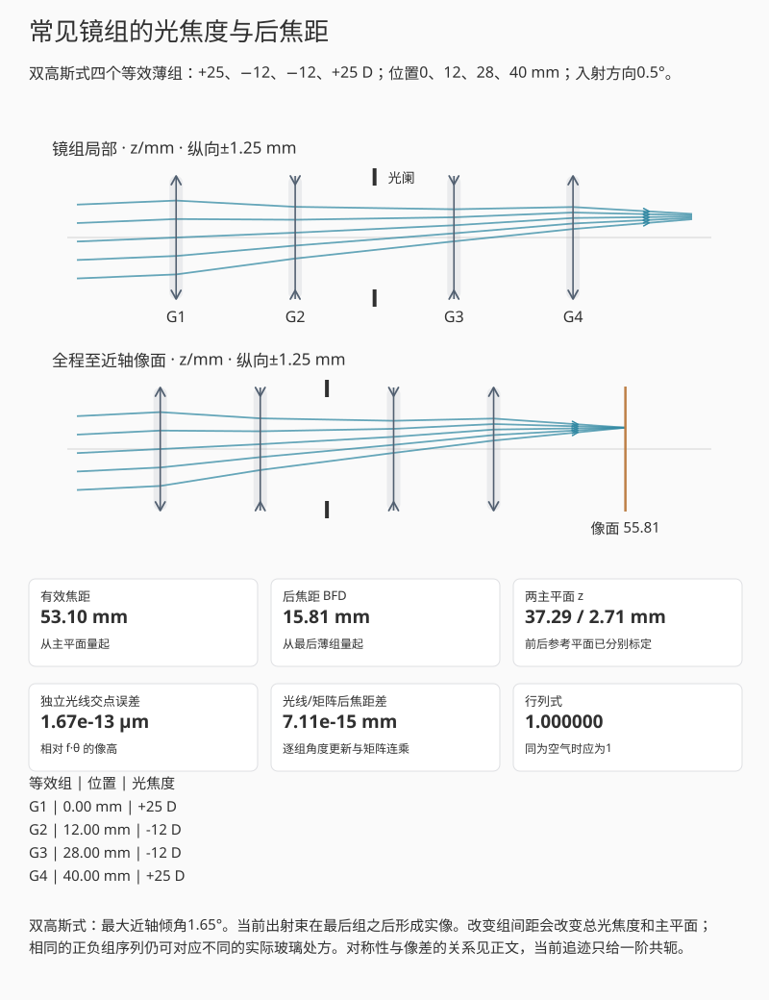
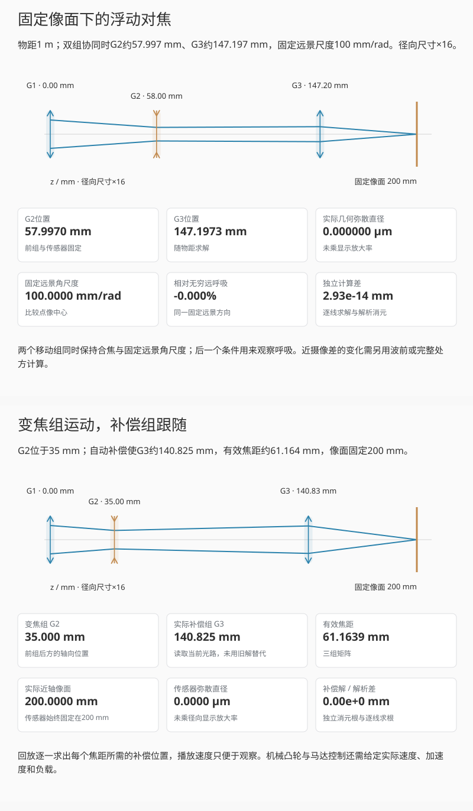
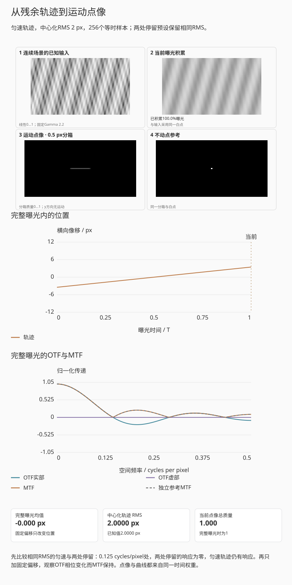
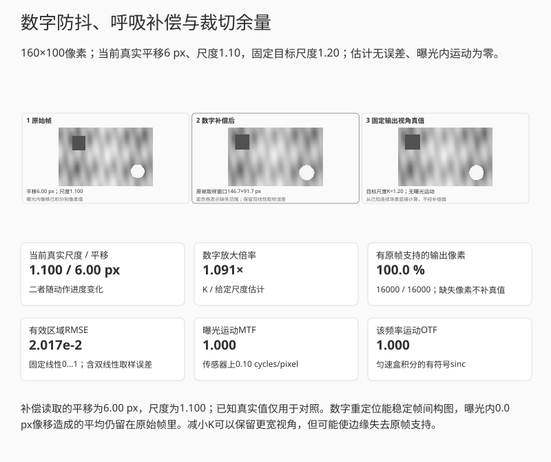

# 第十六章：镜头结构、对焦、变焦、防抖与远心性

转动变焦环时，镜头内部常有几个组同时移动：一部分改变总焦距，另一部分把清晰
像面维持在传感器附近。对焦和防抖也通过组运动改变光路，因此同一支镜头在不同
距离、焦段与光圈下会有不同表现。前几章分别讨论了材料和像差，现在把它们放回
可移动的镜组中，计算这些运动如何改变焦距、景深和像面位移。

### 依次固定像面、远景方向和模糊判据

先在§16.1辨认典型结构中的正负光焦度，再按下面的顺序比较镜组运动。

1. 在浮动对焦中改变近处物点距离，同时固定一个远景方向；分别观察物点是否合焦，
   以及该远景方向的像高是否改变。前者测对焦，后者测这里约定的呼吸，两项不能互代。
2. 在变焦中保持传感器位置，先关闭补偿，再恢复求解；比较第二组移动后，
   原定像面上的光束是否仍汇聚。补偿解不存在时应停止，而不是让镜组穿过机械边界。
3. 在景深中保持镜头和物距，只改变容许弥散圈；几何光束不变，判为“可接受”的
   距离区间会变。再用三维光锥检查焦前、焦后截面的大小。
4. 在防抖中先看未补偿位移，再单独启用镜组或传感器补偿，最后尝试两路重复补偿。
   一帧中某一时刻对齐，不保证整个曝光的残余RMS最小，延迟也不能靠加大幅度消除。
   随后看数字补偿，分清曝光内稳像、帧间重定位与裁切余量。
5. 在远心光路中改变物面或像面位置，分开读主光线倾角与横向尺度。轴上主光线
   倾角为零不足以把任意系统命名为远心，还需检查离轴物点和瞳共轭。

这些演示分别采用一阶几何、曝光内积分或容许模糊判据。浮动组
在真实镜头中怎样校正近摄像差，仍需处方追迹或明确的波前模型，不能从双约束求解
出的两条镜组轨迹直接推出。

## 16.1 几种典型光焦度分配

镜头剖面图中的“几片几组”，先区分了玻璃与空气间隔：一组可以只有一片，也可以
由多片胶合组成。计算一阶共轭时，还能把厚镜组换成一个等效薄组；这个等效组数
又不等于商品规格中的分组数。理解结构名称时，先找光阑，再看它两侧如何分配
正负光焦度。

| 常见结构 | 基本安排 | 设计时主要在处理什么 |
|---|---|---|
| 三片式（Cooke triplet） | 正、负、正三片分离，负片置于中间 | 用很少的片数分配光焦度、色差和场曲；口径与视场增大后，剩余像差更难同时控制 |
| Tessar式 | 典型形式为四片三组，后方使用胶合双片 | 保留正负正的总体布局，利用胶合界面与玻璃选择增加校正自由度 |
| 双高斯式（Double Gauss） | 光阑两侧近对称，常见六片四组，内侧含胶合组 | 适合标准与部分中短焦的大口径设计，在球差、色差及离轴像差之间平衡 |
| Sonnar式 | 以较少空气间隔和较多胶合片组织正负光焦度 | 历史上兼顾较大口径与紧凑结构；不同版本的片数和校正重点有差别 |
| 反望远式（retrofocus） | 前部负组、后部正组 | 在较短有效焦距下保留较长后焦空间，还要处理较强的离轴光束与畸变 |
| 望远式（telephoto） | 前部正组、后部负组 | 使第一组到像面的距离短于有效焦距，常用于长焦布局 |
| 近对称广角 | 光阑两侧配置相近的光学部分，后组可以靠近像面 | 平衡部分畸变和横向色差；需同时控制边缘主光线角与传感器响应 |
| 折反射式 | 反射镜折返光路，配合折射校正元件 | 缩短轴向尺寸；中心遮挡、固定或受限光圈及离焦形态也进入设计 |

三片式与Tessar的区别不只是多一片玻璃。胶合界面提供新的折射率组合和曲率，
可在总焦距不变时重新分配色差与场曲。双高斯的两侧近对称也不是外观装饰：
在对称结构、匹配的共轭及光阑条件下，部分离轴像差可以相互平衡；常见摄影镜头
面对无穷远与近摄等不同共轭，还会打破严格对称以改善具体工作点。
[Nikon的三片式/Tessar说明](https://imaging.nikon.com/imaging/information/story/0081/)
与[六片四组双高斯实例](https://imaging.nikon.com/imaging/information/story/0037/index.html)
给出了这些结构的实际剖面。Sonnar与双高斯的取舍可对照其
[相关设计记录](https://imaging.nikon.com/imaging/information/story/0089/)。

现代定焦常同时使用非球面、低色散材料、浮动对焦和数字校正；变焦镜头则有更多
移动组。名称帮助识别设计思路，具体像质仍由完整处方、光阑、物距与焦位决定。

先比较“望远型 · 课本例子”与“反望远型”，分别从主平面和后组量焦距、后焦距。
再回望远型，仅改变组间距，观察像面和主平面的位置。
下面的实际镜片剖面会补上玻璃界面，此处的两薄组先解释正负光焦度的长度效应。

*图 16.1　薄组符号的箭头向外表示正光焦度，向内表示负光焦度；黑色开口为光阑。
这些符号定位等效平面，镜片曲率和厚度由实际处方给出。反望远结构换取较长后焦，
望远结构换取较短物理长度；像差、光阑和主平面仍由完整组间关系决定。*

这里复用第十一章的两薄组近轴实验。望远型预设取前组 $+10$ D、后组 $-10$ D、
间距 50 mm；反望远型取前组 $-10$ D、后组 $+15$ D、间距 50 mm，分别对照
有效焦距 200 mm、后焦距 100 mm 与有效焦距 80 mm、后焦距 120 mm。五条光线
在同一物点或同一平行光束中追迹，像面上的高度跨度给出几何离焦量；衍射斑和
空间频率响应另见第十二章。先把正负组展开为玻璃，再回到可以改变间距的薄组模型。

*图 16.2　曲面、厚度和材料取自六份公开专利的数值例，各例等比例缩放至计算
焦距50 mm。G编号按空气间隔分组，同色区域内的曲线为胶合界面；蓝线为同一
单色光束。各格局部放大，横纵等比例，尺标独立；净口径和光阑位置见下方处方。
比较的轴向长度从第一面顶点量到近轴像面。*

### 三片式：让负片夹在两片正片之间

图中的三片式取自Taylor的三片数值例。G1先会聚，G2使光束重新张开，G3再将
光束收向像面。负片与两边的空气间隔共同提供校正自由度，并非只把前片的作用
抵消。放到同一50 mm焦距比例后，三组的光焦度约为+82.19、−90.37、+18.87 D；
它们相加约为10.69 D，完整系统却为20 D。组间传播已经改变了光线高度，因此
总光焦度要按顺序追迹或连乘矩阵，不能只相加。

三个分离单片结构简单，但每次改曲率通常会同时牵动球差、色差和离轴像差。
口径与视场扩大后，有限的片数会限制可同时调整的条件。

### Tessar：后胶合组内部仍在折射

Tessar例中的L1、L2分离，L3与L4胶合，共四片三组。后组内部的弯曲界面把
两种材料连在一起，它也有光焦度。设光从左向右，曲率中心在右时 $R>0$。
把表面两侧的折射率记为 $n_L,n_R>0$，光线高度为 $y$，两侧倾角为
$\theta_L,\theta_R$，用rad计。近轴时表面法线角约为 $-y/R$；线性化Snell关系给出

$$
n_R\theta_R=n_L\theta_L-\Phi_s y,\qquad
\Phi_s=\frac{n_R-n_L}{R}.
$$

$R,y$ 用mm时，$\Phi_s$ 用mm$^{-1}$。原表按标称100 mm比例取
$n_L=1.52110,n_R=1.61132,R=25.2$ mm，因而

$$
\Phi_s=\frac{1.61132-1.52110}{25.2}
\approx0.00358016\ \mathrm{mm}^{-1}=3.58016\ \mathrm D.
$$

这个胶合面的光焦度为正。若两侧折射率相同，该界面便不再参与单色折射。由此看三片式与
Tessar的差别，应该找后组里的材料与界面，而不只数多了一片玻璃。

### 双高斯：围绕光阑的两对弯月组

本例采用Baker的六片四组处方：G1与G4是外侧正片，G2与G3各为胶合双片，
总体为负，凹面相向，光阑位于中央空气间隔。先沿图中的光束看这四组如何先后
改变会聚，再比较两侧的形状，较容易认出双高斯的骨架。

相应共轭与光阑条件下的对称性有助于平衡部分离轴像差；常见摄影的物、像距离
并不对称，实际设计也会调整前后曲率、玻璃和厚度。本例虽接近对称，两侧数值
仍不同。球差和轴向色差也需要材料与表面配合，不能靠对称外形直接判定。

### Sonnar：中间的三片胶合组

这里选Bertele的六片三组版本：G1为单片，G2含三片胶合玻璃，G3为胶合双片。
它仍有正—负—正的总体安排，中间负组的两个内部界面却能分别选择曲率和材料。
与六片四组双高斯相比，本例的空气—玻璃界面从八个减至六个，胶合界面从两个
增至三个。

空气分组减少会改变反射路径和装配方式，胶合则把一部分校正自由度放入材料
界面。最终眩光与透射还受镀膜、口径和遮光影响；第十五章的杂散光分析仍要
沿完整路径进行。

### 反望远：后方会聚部分也可以含负片

Angénieux例中，前负弯月片G1先把平行光束张开，随后经过较长空气间隔，进入
G2—G5组成的净会聚部分。G4本身仍为负片：说“前负后正”时，后正指的是后方
整套系统。较大的前部光束与较长的间隔也能解释这类结构为何需要通光空间。

本例缩放后，焦距50 mm、后焦距约52.52 mm，首面到像面约135.83 mm。
后焦空间来自整体布局和主平面位置，代价包含较大的轴向尺度，以及大视场下
畸变、像差和截光的校正负担。反望远描述结构；具体是否属于广角，还取决于
配套画幅和视场。

### 望远型：末片为正，后系统仍可为负

Merté例中，前单片为正；中间三片胶合组与最后一片合起来构成负后系统。
最后这片L5单独为正，不能只看它的形状判断望远作用。互动会同时列出G3单片
与后四片的合成光焦度。

这份早期处方在50 mm比例下，首面到像面约49.24 mm，缩短幅度较小。前面
两薄组的例子则给出200 mm焦距、150 mm首面到像面的距离，望远比为0.75。
两例可以一起说明：望远布局的缩短程度要实际计算，不能从结构名称读出。

起始是双高斯剖面。
先选Tessar的G3，再选Sonnar的G2，对照高亮玻璃、组表和界面编号；
比较结构时保持1.5 mm入射束。
随后只加宽光束，看偏移图如何偏离近轴参考；
纵轴倍率只放大误差图，不改变光线。

*互动示意：点G编号时，镜片高亮、L编号、组光焦度和解释同步对应。实线逐面
求交并按Snell关系折射，虚线保留近轴参考。光路选画21条样本中的5条，像面偏移图
使用全部通过样本，并保留可选的固定纵轴。
处方表列出每个S界面的坐标、曲率、两侧折射率、净口径与原始来源。*

Tessar的G3由两片玻璃组成，S6是中间胶合面；Sonnar的G2则包含三片玻璃。
反望远的G4和望远型的G3还说明，单片的正负不等于整个功能部分的正负。把入射束半宽从1.5 mm增至3 mm，可以比较有限光束与近轴参考的差异；
改变偏移图纵轴只改变显示范围，截光后的光线不会继续画到像面。

剖面实验保持公开处方的曲率与组距。下面换回可调的教学薄组，单独观察改变
间距后总焦距、后焦距和主平面怎样变化；每组的输入数值在面板中列出。

先在“反望远式”和“望远式”间比较后焦距与有效焦距，再回“双高斯式”，只调组间距倍率。
光焦度列表、主平面和像面会一起变化；
薄组图用于判断一阶布局，不能由这里几条合焦光线判断真实结构的全视场像质。

*互动示意：初始为四个薄组的双高斯式布局，光焦度依次为+25、−12、−12、+25 D，
位置为0、12、28、40 mm。局部图保留组间关系，全程图延伸到近轴像面；同一束
单色光通过各组后的交点与矩阵焦距独立核对。*

切换到“反望远式”和“望远式”，可复核前面两组模型的80/120 mm与200/100 mm
焦距、后焦距。再返回“双高斯式”，改变组间距，观察总焦距与主平面一起变化。
当前薄组没有表面曲率、材料色散或高阶波像差，因此这一步解释共轭和长度，
后续像差比较仍回到第十三章的波前或实际处方。

## 16.2 对焦、浮动组与 breathing

整组伸长对焦遵循式 (11.5)，结构简单但长焦或微距所需移动量大。内对焦移动内部
镜组，可减小需移动的质量；组间距变化也会改变总系统矩阵，因而有效焦距、像差和
入瞳位置可能随对焦距离变化。

浮动镜组让两个或更多组按不同规律移动，以补偿近距离球差、场曲和像散。镜头近摄
MTF 不能由无穷远 MTF 图推出；厂商图若只标 infinity，必须另测目标工作距离。

对焦呼吸（focus breathing）是对焦时视角/放大率变化。若机位和被观察物体不动，
物体到机身的位置固定，但从移动的主平面量起的物距仍可能变化。像高比例取决于
有效焦距、主平面与像面位置；内对焦改变这些量，就可能出现明显 breathing。
电影镜头常通过组间补偿降低它，但不能从“内对焦”名称判断大小。

**例子 16.1（固定焦距下的对焦尺度变化）.** 取焦距固定为 50 mm 的薄透镜，光阑
在透镜平面，传感器宽 36 mm。无穷远合焦时像距为 50 mm；对焦到物距 2 m 时，
由第十一章算得像距为 51.282 mm。连接像面边界与透镜中心的光线给出角覆盖

$$
2\arctan\frac{36}{2\times50}\approx39.60^\circ,\qquad
2\arctan\frac{36}{2\times51.282}\approx38.68^\circ.
$$

同一远处方向的主光线像高按像距变化，比例约为 $51.282/50=1.0256$；近对焦时
远景虽然离焦，其点像中心的角尺度仍会改变。这个薄透镜模型通过改变镜头与像面的
间距对焦，说明呼吸也可发生在有效焦距不变时。真实内对焦系统还会改变焦距、瞳和
主平面，应测量实际画面，而非仅把新焦距代入无穷远视角公式。

还可以让第二个移动组承担另一个约束。取与后面变焦例相同的三个薄组，光焦度为
$+10,-20,+20$ D，前组和光阑固定在零，像面固定在 200 mm。组 2、3 分别位于
$v,c$。本段只计算一阶成像：真实浮动组常用第二自由度校正像差，而这里用它保持
固定远景的角尺度，便于直接比较对焦呼吸。两种目的不能由同一张近轴光线图互相替代。

令从前组之前传播到固定像面的矩阵为
$M_S=\left(\begin{smallmatrix}A&B\\C&D\end{smallmatrix}\right)$。
轴上物点距离前组 $s$，通过前组高度 $h$ 的光线入射倾角为 $h/s$，因此像面高度为
$h(A+B/s)$；合焦条件是 $A+B/s=0$。远景中倾角为 $\theta$、经过光阑中心的
主光线则取输入 $(0,\theta)$，点像中心高度为 $B\theta$。所以两组协同可解

$$
A+\frac Bs=0,\qquad B=K,\qquad K=100\ \mathrm{mm}.
$$

这里 $s=\infty$ 时把 $1/s$ 取为零。$K$ 是像高对入射方向的比例，并不等于所有
有限对焦状态下的有效焦距。远景在近对焦时会离焦，比较的是其点像中心尺度。

求解还可不用逐面光线。记各组光焦度为 $p_i$，单位 mm$^{-1}$；去掉前组后的
矩阵左上元为 $a_u=A+p_1B=K(p_1-1/s)$，令 $q=1-p_3(200-c)$。
把后两组之间的直线传播与两次折转展开，得到

$$
q=a_u(1-p_2v)+p_2K,\qquad
a_u=q-p_2\{q(c-v)+200-c\}.
$$

第一式使 $c=200+(q-1)/p_3$ 成为 $v$ 的一次式，代入第二式便是关于 $v$ 的
二次方程；无穷远参考状态退化为一次式，解为 $v=50,c=150$ mm。互动中的主求解
直接使用两条逐面光线的像面高度，消元方程只作独立真值对照。

保持1 m物距，先比较“仅后组对焦”与“两组协同”，确认二者都合焦，再读固定远景方向的角尺度。
随后改到0.5 m，看协同组如何继续移动；
超出行程的预设应显示无解，不会沿用上一位置的焦点。

*互动示意：对焦到前组左侧 1 m 时，仅移动后组与两组协同都能在固定像面合焦，
但固定远景的角尺度不同。光线是轴上近轴光束，标尺只比较点像中心，不表示近摄像差。*

对焦 $s=1$ m 时，仅移动后组得到 $c\approx142.116$ mm，角尺度约为
$78.835$ mm/rad；两组协同得到 $v\approx57.997,c\approx147.197$ mm，角尺度
保持 100 mm/rad，而有效焦距已约为 139.926 mm。两者都合焦，但呼吸不同。
组 2、3 的行程分别限制在 10--70 mm、90--190 mm；对焦到 0.4 m 时，给定行程
不能同时满足两个约束，演示停止自动运动并报告实际离焦，而不保留上一次合焦外观。

## 16.3 变焦为何需要补偿组

两薄透镜光焦度 $\Phi_1,\Phi_2$ 相距 $d$，空气中的合成光焦度为

$$
\Phi=\Phi_1+\Phi_2-d\Phi_1\Phi_2.                        \tag{16.1}
$$

将两片透镜矩阵与中间传播矩阵相乘，得到

$$
M=L_2T(d)L_1=
\begin{pmatrix}
1-d\Phi_1&d\\
-(\Phi_1+\Phi_2-d\Phi_1\Phi_2)&1-d\Phi_2
\end{pmatrix}.                                           \tag{16.1a}
$$

由 $-C$ 得到式 (16.1)，而平行入射的后焦距为
$\mathrm{BFD}=(1-d\Phi_1)/\Phi$。例如前组焦距 $+100$ mm、后组 $-100$ mm、
间隔 50 mm 时，总焦距为 200 mm，后焦距为 100 mm，两组到像面的总轴向距离为
150 mm。这给出望远结构短于有效焦距的一个近轴例子。若间隔改为 40 mm，总焦距
变成 250 mm，后焦距也变成 150 mm，原来的传感器位置便不再合焦。

变焦镜头用 variator 主要改变焦距，
compensator 同时移动以保持像面固定；现代多组设计由凸轮或电子控制多个轨迹。整个
变焦范围还需平衡像差、光圈、最近对焦和机械长度，因而一支恒定 $f/2.8$ 变焦比同
规格定焦复杂得多。

互动取三个薄组，光焦度依次为 $+10,-20,+20$ D。前组固定在 $z=0$，变倍组位于
$z=v$，补偿组位于 $z=c$，像面固定在 $S=200$ mm。两种移动各自可控：先锁住
第三组，只改变第二组位置；再启用自动补偿，观察第三组如何把交点带回原像面。
这些位置和光焦度构成一组近轴补偿算例；曲率、厚度与像差校正仍需进一步设计。

把光焦度换为 mm$^{-1}$，三组的系统矩阵与传播到像面的矩阵为

$$
M_3=L_3T(c-v)L_2T(v)L_1,\qquad
M_S=T(S-c)M_3.                                         \tag{16.1b}
$$

轴上平行入射时，初始角为零，合焦要求 $M_S$ 的左上元为零。这里使用 $A_S=0$，
因为输入是不同高度的平行光；有限物点成像才使用第十一章的 $B=0$ 条件。
也可以不用矩阵，取单位高度的入射光线，令
$a=1-\Phi_1v$、$b=-\Phi_1-\Phi_2a$、$k=a-bv$。到达补偿组时的高度为 $k+bc$，
所以像面高度为

$$
h_S=k+Sb-\Phi_3(S-c)(k+bc).                            \tag{16.1c}
$$

这对 $c$ 是二次方程；$b=0$ 时退化为一次方程。互动的自动模式从逐面追迹的
$h_S$ 求根，另保留式 (16.1c) 的解析根作对照，求解范围限定在 $90\le c\le190$ mm。
例如 $v=50$ mm 时有 $c=150$ mm、有效焦距 100 mm；$v=20$ mm 时需要
$c\approx137.555$ mm，有效焦距约 41.482 mm。$v=70$ mm 时，给定行程内没有
合焦解，页面停止自动补偿，显示手动位置及其离焦结果。

先用自动补偿，比较变倍组20、50、60 mm三个位置：焦距改变，传感器位置保持。
然后再点一次“自动补偿”关闭它，再移动变倍组，看交点离开像面；
恢复自动补偿后检查光线是否重新会聚。
70 mm无解是行程限制，不是让画面继续播放就能补偿。

*互动示意：变倍组位于 20、50、60 mm 时，补偿组的位置按式 (16.1c) 求得，像面
始终固定在 200 mm。色线只标薄组位置，不表示镜片口径或形状。*

“恒定光圈”表示标称 f 数在变焦中保持，要求入瞳直径大致随焦距增加。若长端实际
透射下降，T-stop 仍可能变化。视频曝光稳定应看 T-stop 与控制步进，不只看 f 数。

### 把两组运动放回镜筒中看

上面的求解给出了每一位置的光路。把镜组装到两条平行导轨上，更容易分清哪些
部件在动、哪些约束保持不变：对焦时前组和传感器固定，两个内部组可以分别移动；
变焦时负组改变总光焦度，后组同时调整会聚位置。

“浮动对焦”页先比较1 m下后组单动与两组协同，观察镜筒中谁在移动，再核对合焦与角尺度读数。
“变焦补偿”页则先锁住G3，再拖动G2，最后恢复补偿；
这两页分别改变物距和焦距，不能把所有镜组运动统称为变焦。

*互动示意：三个等效组仍为+10、−20、+20 D，传感器固定在200 mm。三维图与下方
子午截面使用同一组坐标，径向尺寸放大16倍；环形支架与正负号定位等效平面。
可旋转查看，再切换浮动对焦和变焦补偿；原有逐线与解析对照保留。*

在“浮动对焦”中，用同一1 m物距比较后组单动和双组协同；在“变焦补偿”中先
锁住后组，再恢复补偿。看光束是否在固定传感器处会聚，而不是只看滑块是否
跟着动。播放按位置逐一计算，实际运动用时和马达控制还需另行给定。

## 16.4 景深是允许模糊标准

取空气中正薄透镜，$f>0,N>0$，物距 $s_0>f$ 从透镜平面量起，传感器位于
$v_0=fs_0/(s_0-f)$。另一物距 $s$ 的理想像距
$v=fs/(s-f)$。直径 $D=f/N$ 的光锥在传感器面的弥散圈直径近似

$$
c(s)=D\left|1-\frac{v_0}{v}\right|.                       \tag{16.2}
$$

起始物体在1 m、对焦距离2 m、f/4，传感器截面有非零弥散圈。
先只收小光圈看截面缩小，再按“对焦到物体”看弥散圈归零；
此后改变容许直径只改变合格判据。
重置参数可回到这组起点，重置视角只恢复观看方向。

*图 16.3　景深边界来自选定的容许弥散圈，不是光学上突然从清晰变模糊的界面。
对固定的正透镜，较远物体的焦点更靠近透镜，较近物体的焦点更远；有色竖线标出
同一传感器面处的光锥直径。圆锥图不包含像差、衍射和口径蚀。*

**推导 16.2.** 光锥从透镜口径直径 $D$ 线性收缩，在 $z=v$ 处为零。距透镜 $v_0$
处的截面直径按相似三角形为
$D|v-v_0|/v$，即式 (16.2)。

给定容许弥散圈直径 $c_0>0$，令无穷远物体的光锥在传感器上恰好满足
$c(\infty)=c_0$。将 $v=f$ 与 $v_0=fs_0/(s_0-f)$ 代入式 (16.2)，得
$c(\infty)=f^2/[N(s_0-f)]$，因此超焦距为

$$
H=\frac{f^2}{Nc_0}+f.                                    \tag{16.3}
$$

再把一般物距 $s>f$ 的像距代入式 (16.2)，得到

$$
c(s)=\frac{f^2|s-s_0|}{Ns(s_0-f)}.                       \tag{16.2a}
$$

近界满足 $s<s_0$，将 $c(s)=c_0$ 解为
$s=s_0/[1+Nc_0(s_0-f)/f^2]$；远界把加号改为减号。利用 $H-f=f^2/(Nc_0)$，得

$$
s_N=\frac{(H-f)s_0}{H+s_0-2f},
\qquad
s_F=\frac{(H-f)s_0}{H-s_0}.                              \tag{16.4}
$$

远界公式用于 $s_0<H$；当 $s_0\ge H$，无穷远已在允许模糊范围内，远界记为无穷远。
近界公式还要求求出的物距大于 $f$；若容许模糊取到使模型越出实物实像区，应直接
回到该区间内的式 (16.2a) 判断。通常摄影用的 $c_0\ll f/N$ 满足此条件。

有些速算式先忽略超焦距中的 $+f$，再把 $f^2/(Nc_0)$ 也写成 $H$。若使用这种
约定，应全程使用同一个近似；不能把它与式 (16.3) 的 $H$ 混用。一个直接检查是令
$s_0=H$：远界应为无穷远，近界恰为 $H/2$。

**例子 16.3（景深判据的数值后果）.** 取 $f=35$ mm、$N=4$、
$c_0=0.020$ mm，得

$$
H=\frac{35^2}{4\times0.020}+35
=15\,347.5\ \mathrm{mm}.
$$

对焦 $s_0=5$ m 时，式 (16.4) 给出
$s_N\approx3.78$ m、$s_F\approx7.40$ m。若把输出标准收紧为
$c_0=0.010$ mm，超焦距近似翻倍，景深范围也明显缩窄；镜头和对焦距离未变，变化
来自“可接受”的判据。

从“35 mm 例子”开始，先用“探测近界”和“探测远界”核对弥散圈恰达容许值；
再只把容许直径收紧到10 μm，看边界向对焦平面收拢。
最后分别比较对焦超焦距和对焦无穷远，两者的近界并不相同。

*互动示意：35 mm、f/4、对焦 5 m 的弥散圈随物距连续变化。容许直径 20 µm 时，
近远界约为 3.776 m 与 7.399 m；把判据收紧为 10 µm 不改变光线，只收窄接受区间。*

二维演示从孔径两侧分别追迹，按像面上的间距二分求近界、远界和超焦距，再与
解析式比较。对焦到无穷远时直接采用平行入射，传感器位于 $f$，因此近界为
$f^2/(Nc_0)=H-f$；对焦到超焦距时，近界才是 $H/2$。把两种设置都称为
“从半个超焦距到无穷远”会混淆不同的传感器位置。上面的三维光锥也可调整容许
直径，并同时给出独立边缘追迹读数。

弥散圈不是传感器固有常数。它取决于输出尺寸、观看距离、视力、去马赛克和锐化；
高分辨率像素级审查需用更严格 $c_0$。景深范围内只是“低于选定模糊阈值”，不是每个
距离都与对焦平面同样清晰。

## 16.5 光学防抖与机身防抖

相机小角度旋转 $\theta$ 使无穷远像点移动

$$
\Delta x\approx f\theta.                                 \tag{16.5}
$$

保持起始角抖动，依次比较关闭补偿、仅镜组、仅传感器和两者各一半。
看残余位移曲线与当前像面位置，再选“两者都全量”检查过补偿。
延迟预设只在补偿开启后比较；
一个时刻恰好重合，不能代替整段残余轨迹。

*图 16.4　镜头防抖改变光束方向，机身防抖移动传感器；两者都试图减小曝光期间的
相对像移。图不表示控制回路带宽或可补偿的全部自由度。*

**例子 16.4（角抖动换算为像素位移）.** $f=100$ mm 时发生
$0.02^\circ=3.49\times10^{-4}$ rad 的小角转动，瞬时像移约

$$
\Delta x=100\times3.49\times10^{-4}
=0.0349\ \mathrm{mm}=34.9\ \mu\mathrm m.
$$

对 $4\ \mu\mathrm m$ 像素，这相当于 8.7 pixel。若要求瞬时位移不超过一像素，
残余角误差需低于 $p/f=4.0\times10^{-5}$ rad，即约 $0.00229^\circ$。实际模糊取决
于整段曝光中的角运动轨迹，不只取峰值。

焦距越长，同一角抖动造成的像面位移越大。镜头防抖移动补偿组改变出射光线角度；
机身防抖移动/旋转传感器追随像。两者可协同分配频率和轴向。

镜组位移与像面位移通常不相等。在薄组近轴模型中，光焦度为 $\Phi$ 的镜组横移
$\delta$，折射后的光线角变为

$$
\theta_\mathrm{out}=\theta_\mathrm{in}-\Phi(y-\delta),
\qquad \Delta x=B_s\Phi\delta,                         \tag{16.5a}
$$

$B_s$ 是从该组出射面到像面的后续传递矩阵右上元。互动沿用第十六章的望远型
尺度：前组 $+10$ D、后组 $-10$ D，相隔 50 mm，像面在后组之后 100 mm。此时
$f=200$ mm、$B_s\Phi=-1$。定义 $\theta$ 为相机坐标中的入射方向变化，传感器
参考中心的横移为 $y_s$，相对残余像移为

$$
e=200\theta-\delta-y_s,                                \tag{16.5b}
$$

其中长度均用 mm、角度用 rad。正的后组位移在这组处方中产生负的像移；换一个
防抖组，比例与符号都要重新计算。$0.5$ mrad 的入射方向变化产生 $0.1$ mm 像移，
按 $4\ \mu$m 像素间距为 25 pixel；可由镜组横移 $0.1$ mm 或传感器横移 $0.1$ mm
分别理想抵消，也可由二者各承担一半。若两套机构都执行全量修正，就会重复补偿。

时间轨迹采用 $\theta(t)=\theta_a\sin\omega t$，两机构共用延迟 $\tau$，补偿比例
分别为 $g_o,g_i$。在这一固定处方中，设 $g=g_o+g_i$，则完整一周期内的残余位移
均值为零，均方根解析值为

$$
e_\mathrm{RMS}=\frac{f|\theta_a|}{\sqrt2}
\sqrt{1+g^2-2g\cos(\omega\tau)}.                        \tag{16.5c}
$$

互动取 10 Hz、100 ms 整周期曝光，用逐面追迹的 512 个中点样本计算 RMS，再与
式 (16.5c) 对照。当前时刻、整段轨迹和 RMS 分别显示；RMS 只概括该位移轨迹，
完整运动模糊仍由下式的时间积分决定。这一理想延迟模型不包含真实控制器的启动、
频率分配、噪声与执行器行程，不能据此推算防抖档数。

以曝光轨迹表达会更清楚：假设静止场景仅受平移像移 $\boldsymbol x(t)$，归一化
运动 OTF 为

$$
H_\mathrm{motion}(\boldsymbol\nu)
=\frac1{T_e}\int_0^{T_e}
e^{-2\pi i\boldsymbol\nu\cdot\boldsymbol x(t)}\,dt.        \tag{16.6}
$$

它来自把沿轨迹平移的点像按时间平均后取 Fourier 变换。若一维匀速移动，总位移
为 $b$，积分得到幅值 $|\sin(\pi\nu b)/(\pi\nu b)|$。始终保持同一个偏移只改变
位置，相位变了而 MTF 不变；曝光中来回移动才会形成模糊。因此防抖需控制曝光期间
的残余轨迹，不能仅用某一时刻的位移判断。

### 相同RMS的轨迹，模糊是否相同

均方根位移只保留轨迹的二阶信息，式 (16.6) 却读取整段曝光中各位置的停留时间。
取去均值后RMS同为 $\sigma$ 的两条水平轨迹：一条在
$[-\sqrt3\sigma,+\sqrt3\sigma]$ 上匀速通过，另一条各用半段曝光停在 $\pm\sigma$，
中间转换时间取零的极限。逐段积分得到

$$
H_\mathrm{uniform}(\nu)=\operatorname{sinc}(2\pi\sqrt3\sigma\nu),
\qquad H_\mathrm{two}(\nu)=\cos(2\pi\sigma\nu).        \tag{16.6a}
$$

两条曲线的零点不同。例如 $\sigma=2$ px、$\nu=0.125$ cycles/pixel，双位置停留的
OTF为零，匀速轨迹仍约为0.150；同一RMS不足以决定纹理保留程度。

先比较两个“同样RMS”预设，RMS都为2 px，只有曝光内的停留分布改变。
看运动核、条纹与OTF零点，再只增加平均位置偏移，区分OTF相位变化与MTF模长变化。
播放未结束时图像尚未完成积分，频率曲线仍对应完整曝光。

*互动示意：曝光时间归一为1，水平位移以px计；同一连续周期图案按时间积分。
匀速、两端停留和正弦轨迹保留独立积分对照，点像直方图仅用于显示。*

先播放一条曝光轨迹，看累积图像怎样形成；再切换保持同一RMS的预设。增加固定
偏移会改变OTF相位和图像位置，模值仍相同。正弦轨迹在端点附近停留较久，也会
形成不同于匀速盒核的PSF。回放中尚未曝光的部分不补亮，完成后各运动核的权重和
均为一；频率曲线始终对应完整曝光，以便暂停时比较。

防抖不能冻结主体运动，也不能完全补偿平移视差、滚动快门和快门冲击。近摄中相机
平移与角抖动都重要，式 (16.5) 的无穷远模型不足。防抖宣称“若干档”是指定成功率
和测试条件下可用快门的统计改善，不是每张照片的保证。

### 数字防抖补偿的是帧间位置

电子防抖可以从陀螺仪、图像配准或二者融合得到运动估计，再将每帧重映射到较稳定
的输出坐标。平移与旋转可用二维变换描述；滚动快门有时需逐行变换，较强视差则
需要更局部的模型。它们都要保留足够的画幅余量，或缩小共同视角。

帧间重定位和曝光内稳像是两件事。若曝光期间点像已经沿一段轨迹积分，事后将整帧
平移只改变它的位置，轨迹的平均仍在。前面的运动OTF推导已经说明这一点；
光学/传感器稳像可在曝光期间改变残余轨迹，数字几何变换则通常处理已经记录的帧。
结合短曝光、较快读出和较准确的运动估计，才可能同时减少不同来源的模糊与变形。

### 数字呼吸补偿怎样固定视角

物理呼吸使固定远景在不同焦位下的像高尺度改变。数字补偿可按镜头标定或元数据
缩放、裁切每帧，使输出保持接近同一个视角。它不改变光学焦距，也不会重新分配
已捕获的光子。若焦位变化还带来瞳位置、视差、局部畸变或离焦形态变化，仅用一个
缩放因子不能把所有深度处的图像同时恢复成原样。
[Sony的呼吸补偿说明](https://helpguide.sony.net/ilc/2630/v1/en/contents/breathing.html)
明确采用电子裁切；其[后期补偿说明](https://helpguide.sony.net/di-app/cpv3/v1/en/contents/0403_lens_breathing.html)
也分别列出校正元数据、裁切限制和稳像共同使用时的条件。

把这两种补偿放入一个可计算的平面场景。所有坐标以像素节距计，原帧中心为原点。
真实尺度为 $a_t>0$、水平位移为 $d_t$，场景基准坐标为 $(X,Y)$。原始位置满足

$$
x=a_tX+d_t,\qquad y=a_tY.                               \tag{16.5d}
$$

希望输出坐标 $(u,v)$ 始终显示 $X=u/K,Y=v/K$，其中固定 $K>0$ 决定共同裁切。
给定正的尺度估计 $\widehat a_t>0$ 与位移估计 $\widehat d_t$ 后，补偿器应从原帧读取

$$
x_\mathrm{sample}=\frac{\widehat a_t}{K}u+\widehat d_t,
\qquad y_\mathrm{sample}=\frac{\widehat a_t}{K}v.          \tag{16.5e}
$$

代入式 (16.5d) 可验证：估计准确、曝光内静止且连续取样时，输出确实对应固定
场景坐标。实际离散像素还会带来插值误差。若只在 $W\times H$ 个原像素中心的
凸包内做双线性取样，完整画幅需要

$$
\frac{\widehat a_t}{K}\le1,\qquad
|\widehat d_t|\le\frac{W-1}{2}\left(1-\frac{\widehat a_t}{K}\right). \tag{16.5f}
$$

这是将输出左右端点代入式 (16.5e) 得到的；垂直方向在当前无竖直平移的模型中
只要求第一项。平移和呼吸在这里共同消耗裁切余量，不能各算完之后仍假定原画幅
完整可用。

先用“纯平移 · 理想估计”播放，再选“呼吸 · 固定输出视角”，分别看位置和尺度怎样被补偿。
回到纯平移后，选“补偿后仍有曝光拖影”，只增加曝光内模糊，检查条纹是否能恢复；
最后再看裁切不足的缺失区域。

*互动示意：同一160×100像素的已知多频纹理，初始真实平移6 px、尺度1.10，
目标尺度K=1.20。像素中心点采样，未加像素孔径积分；原始帧、双线性补偿结果和固定输出视角真值并列。紫色
格表示缺失画幅，误差只在有效支持区域计算。*

先用“纯平移”和“呼吸”预设播放，观察补偿后的图案是否稳定。再加入10 px曝光内
匀速像移：即使位移估计准确，传感器上0.10 cycles/pixel的条纹也达到盒积分的
零响应，几何重定位无法让它重新出现。最后选择“裁切余量不足”或加入估计偏差，
分别观察缺失区域与残余错位。无模糊真值只用于评价，补偿器读取的仍是原始离散帧。

## 16.6 远心性、主光线角与传感器

像方远心系统的出瞳位于无穷远，主光线近似垂直入射像面，放大率对像面小位移不敏感。

物方远心则要求入瞳位于无穷远，使物方主光线平行于光轴。在薄组示例中，把光阑放在
前组的后焦平面，可得到物方远心；放在后组的前焦平面，可得到像方远心；两焦平面
重合时可同时满足。远心性由光阑与前后光学组共同决定，不能只看一条轴上光线。

互动取 $f_1=50$ mm、$f_2=75$ mm，前组位于零、后组位于 $g$，中间光阑位于
$z_a$。把光阑分别经前后组作薄透镜成像，入瞳与出瞳的轴向坐标为

$$
\begin{aligned}
z_\mathrm{EP}&=\frac{f_1z_a}{f_1-z_a},\\
z_\mathrm{XP}&=g+\frac{f_2(g-z_a)}{g-z_a-f_2}.
\end{aligned}                                         \tag{16.7}
$$

对应分母为零时，该瞳位于无穷远。物点在前组左侧 $s>0$、高度为 $y_o$；要求
主光线经过光阑中心，就有

$$
\theta_o=-\frac{(1-z_a/f_1)y_o}{s+z_a(1-s/f_1)}.        \tag{16.8}
$$

光阑在 $z_a=f_1$ 时，物方主光线角为零。设前后组之间的主光线倾角为
$\theta_m$，由于它经过光阑中心，到达后组的高度为 $(g-z_a)\theta_m$，出射角为

$$
\theta_i=\left(1-\frac{g-z_a}{f_2}\right)\theta_m.       \tag{16.9}
$$

因此 $g-z_a=f_2$ 给出像方远心。两条件同时成立时，$g=f_1+f_2=125$ mm、
$z_a=50$ mm；取物距 $s=f_1$、后组到像面的距离 $f_2$，合焦倍率为
$-f_2/f_1=-1.5$。把组间距改为 145 mm，光阑在 50 mm 或 70 mm 时，便分别得到
仅物方或仅像方远心的示例。

起始为双侧远心，先只选“物面远移10 mm”，看主光线角、光束中心高度和边缘跨度；
再复位两平面，只移动像面。
比较“仅物方远心”与“仅像方远心”时，重点辨认哪一侧主光线平行，不能只用轴上物点判断远心性。

*互动示意：蓝线通过光阑中心，金线通过半径 0.5 mm 的光阑边缘。双侧远心预设中，
主光线在物方和像方均平行于光轴；像面上的边缘光线跨度仍会随轴向离焦改变。*

页面分别移动物面与像面，保留光束中心高度比、物方/像方主光线角和边缘光线跨度。
中心高度描述几何尺度，跨度描述聚散；移动后即使中心位置保持，仍需检查离焦。
图中主光线由物面到光阑的矩阵选出，再逐面追迹；式 (16.8)--(16.9) 另作独立几何
对照。物点移到轴上时，普通系统的主光线也沿轴传播，所以仍按光阑与焦点位置分类。

摄影镜头通常不完全远心，但数字传感器希望边缘主光线角不过大：滤色片、微透镜和硅
对斜入射的响应会下降或串扰。短后焦无反系统给广角设计更多自由，也可能要求偏置
微透镜和传感器专用校正。

卡口直径和法兰距只是约束集合的一部分。大卡口、短法兰可允许更大后组或更直的边缘
光线，但不能单独保证更大光圈或更高 MTF；前玉、入瞳、机械遮挡和镜头设计仍决定
实际能力。

## 16.7 怎样读一张镜头剖面图

读剖面图时，可以先沿光路查清各组的作用：

1. 找光阑并估计入瞳由前组怎样成像；
2. 标出主要正、负光焦度组，判断 retrofocus、telephoto 或近对称布局；
3. 查哪些组用于变焦、对焦和防抖；
4. 看后组尺寸和边缘主光线角，而不是只看卡口；
5. 再看非球面、低色散和衍射元件被放在哪个高光线高度位置；
6. 用 MTF、畸变、暗角、呼吸和近摄数据验证猜测。

剖面图给出结构线索，进一步计算还需每个表面的曲率、材料、位置和有效口径。
得到实际样品后，再用测量检查加工与装调误差的影响。

## 练习

**练习 16.1.** 两薄透镜焦距分别 $100$ mm 和 $-200$ mm，相距 20 mm。用式
(16.1) 求合成光焦度与等效焦距。

**练习 16.2.** 50 mm $f/8$ 镜头，容许弥散圈 0.03 mm，计算超焦距。对焦 10 m
时求近、远界。

**练习 16.3.** 200 mm 镜头发生 $0.01^\circ$ 角抖动，按式 (16.5) 计算像面位移，
并换算成 $4\ \mu$m 像素数。

**练习 16.4.** 原Tessar表中一个胶合面的两侧折射率为1.52110、1.61132，
半径为+25.2 mm。求该面的近轴光焦度；保持曲率，交换两种材料后符号怎样变？
再分别数出图16.2中Tessar、双高斯和Sonnar的空气—玻璃界面及胶合界面数量。

**练习 16.5.** 对去均值RMS均为2 px的匀速轨迹与两端各停留半段曝光的轨迹，
计算0.125 cycles/pixel处的有符号OTF。再共同加上+3 px偏移，MTF和OTF各怎样改变？
