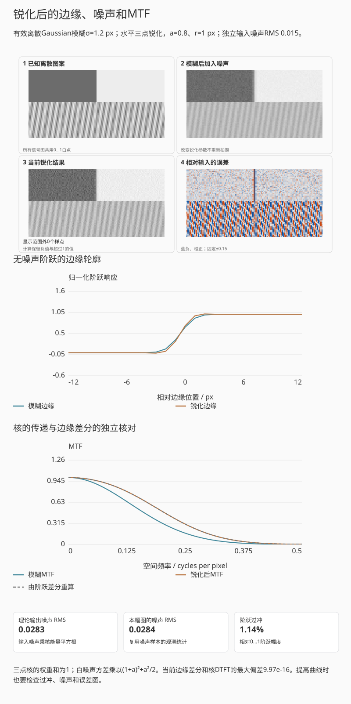
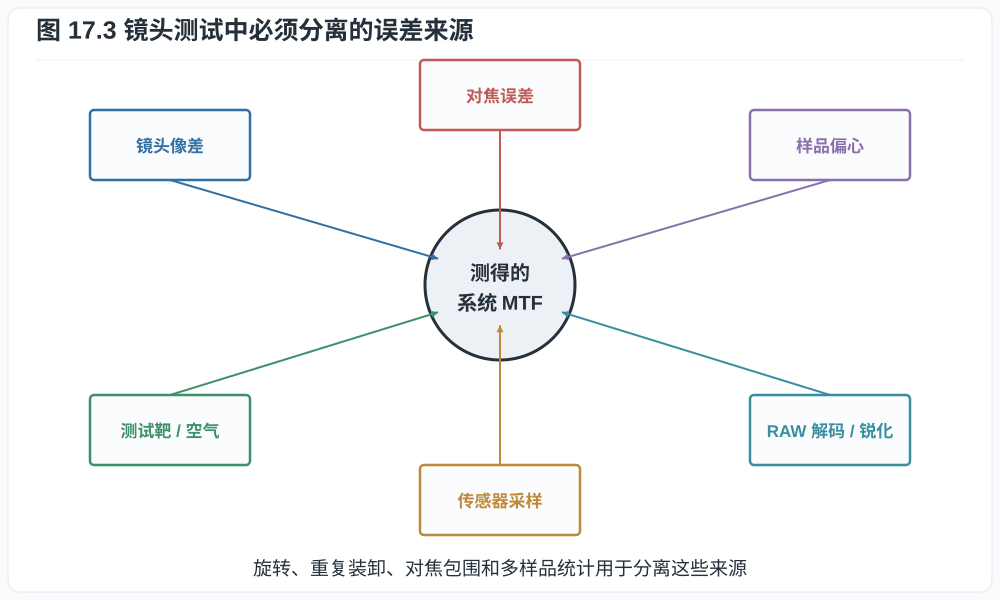
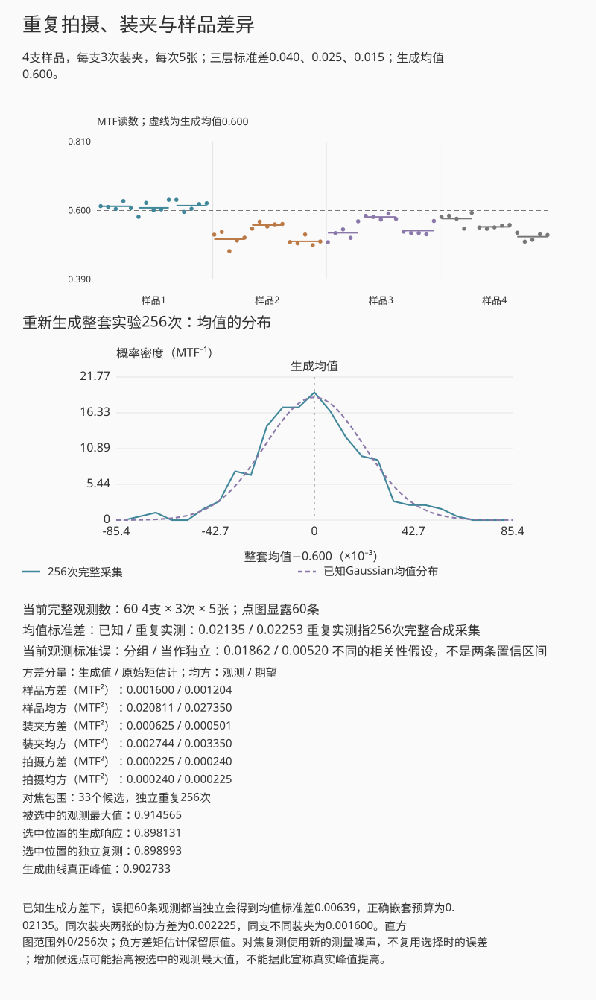

# 第十七章：怎样读 MTF、测试镜头并分析整套成像系统

拍摄同一张测试靶，改变一次对焦或锐化设置，就能得到不同的 MTF50。曲线变化确实
发生了，但还需判断它来自镜头、像面位置还是数字处理。测试的第一步是明确想测
镜头的局部光学性能，还是某套相机与显影流程的输出。下面从斜边图像如何形成一条
曲线开始，再讨论如何安排对焦、样品和重复拍摄，使结果具有可解释的误差范围。

## 17.1 一张 MTF 图至少要读八项

读取厂商或实验室曲线时，依次确认：

1. 横轴是像高、空间频率还是离焦量；
2. 频率单位是 lp/mm、cycles/pixel 还是 picture height；
3. 光圈与焦距；
4. 物距；
5. 波长、单色还是白光加权；
6. sagittal 与 tangential 的定义；
7. 设计计算、衍射 MTF、单个样品实测还是多样品统计；
8. 是否包含传感器、低通滤镜和锐化。

[图 12.4](12_diffraction_psf_otf_mtf_and_sampling.md#126-sm-曲线与方向) 把条纹朝向与频率方向
分开画出。先按图例确认方向，再读 S/T 或 S/M 字母，能避免将两条曲线对调。

典型厂商图把横轴设为从中心到角落的像高，分别画 10、30 或 40 lp/mm 的 S/T 曲线。
10 lp/mm 曲线高说明大结构反差好；高频曲线较能反映细节。不同厂商使用不同频率和
计算条件，曲线不能只按高低直接跨品牌排名。

本章先把空间频率固定在30 lp/mm，只拖动像高，沿曲线读取中心到角落的MTF；
再选“在当前位置重新对焦”。
看固定像面读数与重新对焦读数的差别，并对照焦面位置图；
不要把像高曲线的0.5交点读成MTF50。

*图 17.1　横轴为像高时，每条曲线只代表一个已声明频率、方向、光圈、物距与计算
条件。图中示意曲线取居中、旋转对称系统，因此同频率的 S/T 在轴上重合，离轴后
才分离。曲线高低不是跨厂商通用总分，S/T 分离也不能单独等同于散景好坏。*

### 像高曲线与频率曲线

第十二章的演示固定成像位置和条件，比较不同空间频率的 MTF；本章的像高图
则固定频率，比较中心到角落的 MTF。像高图上一条曲线降到 $0.5$ 的位置是一个
像高，不能把它叫作 MTF50；MTF50 是在固定成像位置与条件下，响应降到 $0.5$ 的
空间频率。若频率曲线不单调或存在多次交叉，还要声明取哪个交点。

例如某像高处，10 lp/mm 的 MTF 为 $0.90$，30 lp/mm 为 $0.45$。同为 $0.80$
调制度的输入正弦，在线性模型下分别变为 $0.72$ 与 $0.36$；这只说明两个频率的
传递，不能凭两个点确定整条频率响应，更不能把 $0.45$ 解释为“45% 的像素清楚”。
30 lp/mm 表示每毫米 30 个明暗周期，周期为 $1/30$ mm；不是单根黑线的宽度。

上面的演示沿用第十三章的高斯教学模型，曲线不代表厂商数据。比较 10 与
30 lp/mm 的曲线，并改变像面位置，可以观察边缘的 MTF 是否随重新对焦而恢复。
若恢复明显，说明场曲对固定平面的测试结果有较大影响。加入像散后，还需比较
两个方向的最佳焦面位置。实际测试中，靶倾斜、相机姿态和样品差异也会影响这些
结果，需要分别排查。

### MTF 与其他光学测试

MTF 只是光学分析的一部分。在相同的像高、焦面和拍摄条件下，PSF 描述点像的
能量分布，OTF 保留频率响应的幅值和相位，MTF 则只保留 OTF 的模。分析场曲时
需要扫描焦面；分析畸变时要测量位置映射；分析眩光时还需观察散射形成的背景。
这些结果与 MTF 相互补充，有助于区分曲线变化的原因。

厂商示例可对照 [Nikon 的 MTF 图例](https://imaging.nikon.com/imaging/lineup/lens/mtf_chart/)，
先确认其像高横轴、所用频率和 S/M 方向示意，再与本书模型比较；
[Edmund Optics 的 MTF 说明](https://www.edmundoptics.com/knowledge-center/application-notes/imaging/modulation-transfer-function-mtf-and-mtf-curves/)
给出了频率曲线的示例。比较这些图时，仍需分别核对所用的频率、方向和计算条件。

**例子 17.1（同一数字的歧义）.** “MTF 0.7”若指 10 lp/mm 可能只是一般低频
反差；若指全开角落 50 lp/mm 则非常强；若指锐化 JPEG 的 MTF50 附近，又已包含
数字处理。缺少频率和处理状态时，0.7 没有可比较意义。

## 17.2 斜边法怎样得到 MTF

ISO 12233 类斜边测试的核心步骤是：

1. 拍摄略微倾斜、反差已知且两侧均未剪切的边缘；
2. 利用每一行不同的亚像素交点超采样边缘扩展函数 ESF；
3. 对 ESF 求导得到线扩散函数 LSF；
4. 对 LSF 作 Fourier 变换并归一化，得到一维 MTF。

以一个简单的几何例子说明第二步：若边缘与各行的交点每向下一行就向右移动
$1/8$ 个像素节距，连续八行的水平交点便覆盖 $0,1/8,\ldots,7/8$ 的亚像素相位。
只要沿边方向的响应相同，就能按到拟合边缘的距离，将这些行的样本合到同一条
边缘曲线上。斜边提供的是这条边缘剖面的细密取样；任意二维图像的重建还需要
第八章讨论的额外条件。

取边缘法向为 $x$、沿边方向为 $y$。对局部空间不变的二维 PSF $h(x,y)$，先沿
边缘方向积分，得到线扩散函数

$$
\ell(x)=\int_{-\infty}^{\infty}h(x,y)\,dy.
$$

理想边缘沿 $y$ 不变，所以把二维卷积的 $y$ 积分先完成，边缘响应便化为一维卷积

$$
\mathrm{ESF}=u*\ell.
$$

分布意义下 $u'=\delta$，所以

$$
\frac d{dx}\mathrm{ESF}
=\delta*\ell=\ell=\mathrm{LSF}.                           \tag{17.1}
$$

再作一维 Fourier 变换，
$\widehat\ell(\nu)=\iint h(x,y)e^{-2\pi i\nu x}\,dx\,dy=H(\nu,0)$，得到二维
OTF 沿边缘法向的截面。LSF 因此是 PSF 的线积分，不能把一条 PSF 中心切线直接
当成它。测试靶自身若有有限过渡宽度，测得结果还会包含该过渡响应。

求导会放大噪声，因此实际算法需窗口、拟合、采样相位校正和有限差分修正。相机
输出若经过内容自适应处理，边缘反差不同可能得到不同曲线，此时更适合称作该条件
下的边缘空间频率响应（e-SFR），而非全局线性光学 MTF。

先用“书中 σ = 0.85 px”，按步骤依次查看拟合线、法向投影、ESF分箱、LSF与MTF。
再选“竖直边缘与缺箱”，看空箱而不只看最后曲线；
恢复起点后加入噪声，比较估计边缘与真值边缘下的结果。
选择某一行只用于查看投影。

*图 17.2　斜边让不同像素行取得不同亚像素相位，由此超采样一维 ESF。流程测得的是
靶、镜头、传感器采样和指定 RAW 解码共同形成的系统响应。图中 ESF、LSF、MTF
取同一归一化 $\sigma=1$ Gaussian 模型，分别满足求导和 Fourier 变换关系。*

演示从一个已知有效模糊量的合成斜边开始，由图像样本估计逐行边缘质心，再拟合
直线。生成时给定的角度、中心位置与解析 MTF 保留为独立对照。按步骤切换，
可以跟随边缘拟合、像素中心的法向投影、ESF 分箱、LSF 求导和离散 Fourier 幅值。每个箱的样本数
单独显示；把斜边调成竖直时，许多亚像素箱没有观测，后续插值曲线只作示意，不再报告
MTF50。加入噪声与加窗后，可分别比较拟合几何、已知几何和生成系统的响应。

这里先在原图的列、行坐标 $(u,v)$ 中拟合
$u=a(v-v_c)+b$，其中 $v_c$ 为 ROI 中间行，$a,b$ 分别为斜率及该行的边缘交点。
像素到拟合直线的有向法向距离为
$d=[u-a(v-v_c)-b]/\sqrt{1+a^2}$；分母保证距离仍以像素为单位，而不是仅取横向
坐标差。拟合使用从左右平台估计的对比与噪声、逐行差分质心及普通最小二乘，
不读取生成时的几何参数。平台对比不足、可用行太少或直线残差太大时，测量停止。
两种几何路径使用相同观测及平台归一化，因此可分辨几何估计对后续 MTF 的影响；
行质心残差 RMS 只描述拟合残差，不能直接当作角度或 MTF50 的置信区间。

一套明确的数值流程如下。

1. 选择线性化、黑电平校正的单色数据，或按固定流程生成的线性 RGB 中一个通道，
   拟合边缘直线。直接测 CFA 时，只使用同类滤色样本，并保留它们在原传感器上的
   坐标；红、蓝样本沿行列相隔 $2p$，不能压紧成连续 $p$ 网格再套用尺度。若单位法向量为
   $\boldsymbol n=(\cos\theta,\sin\theta)$，像素中心
   $\boldsymbol r_i$ 到边缘参考点 $\boldsymbol r_0$ 的有向距离为

   $$
   d_i=(\boldsymbol r_i-\boldsymbol r_0)\cdot\boldsymbol n.               \tag{17.1a}
   $$

2. 按 $d_i$ 把像素值放入宽度例如 $p/4$ 的箱中，分别估计每箱均值与样本数；剔除
   饱和、坏点和明显非均匀照明后，归一化暗、亮平台得到 ESF。箱宽、空箱插值和
   边缘角都必须记录。
3. 用中心差分求
   $\mathrm{LSF}_j=(E_{j+1}-E_{j-1})/(2h)$，去除 LSF 基线并乘声明的窗口。中心
   差分相对于连续导数的频率响应比为

   $$
   D_h(\nu)=\frac{\sin(2\pi\nu h)}{2\pi\nu h}.             \tag{17.1b}
   $$

   因而可在 $|D_h|$ 远离零且噪声可控的频带内除以 $D_h$ 作有限差分修正；靠近零点
   强行反卷积会无限放大噪声。
4. 对加窗 LSF 作离散 Fourier 变换，以非零的零频幅值归一化并取模。若共有 $N_b$
   个箱、箱宽 $h$ 用 mm 表示，第 $k$ 个频点为 $\nu_k=k/(N_bh)$ cycles/mm。
   若 $h$ 用原像素节距为一的坐标表示，则先得到 cycles/pixel，再除以 $p$ 换算
   lp/mm。$p/4$ 分箱只是 ESF 的估计网格，不代表传感器的 Nyquist 提高了四倍；
   混叠、边缘角和 CFA 几何仍限制可解释频带。

**例子 17.2（解析 ESF 检验数值尺度）.** 假设线性系统的超采样 ESF 拟合为

$$
E(x)=\frac12\left[1+\operatorname{erf}
\left(\frac{x}{\sqrt2\sigma}\right)\right].
$$

其 LSF 是标准差 $\sigma$ 的 Gaussian，归一化 MTF 为
$\exp(-2\pi^2\sigma^2\nu^2)$，所以

$$
\nu_{50}=\frac{\sqrt{\ln2}}{\sqrt2\pi\sigma}.
$$

若 $\sigma=0.85$ pixel，则
$\nu_{50}=0.2205$ cycles/pixel。像素节距为 0.004 mm 时，这等于
$55.1$ lp/mm。该值是生成此 ESF 的整个线性系统 MTF50；除非靶、像素孔径与解码器
的 OTF 已知且反卷积稳定，不能把它直接改名为“镜头 MTF50”。

相机锐化会在 ESF 上产生过冲/欠冲，使某些频率 MTF 被抬高甚至超过 $1$。测光学链时
应使用线性 RAW、关闭或记录锐化和降噪，并对 CFA 去马赛克影响保持一致。

### 将锐化带来的响应增益单独列出

用一条简单的水平锐化核就能同时观察锐度、光晕与噪声。对已采集的离散图像 $X$，
取整数半径 $r\ge1$、强度 $a\ge0$，定义

$$
Y(x)=(1+a)X(x)-\frac a2[X(x-r)+X(x+r)].                 \tag{17.1c}
$$

代入 $X(x)=e^{2\pi i\nu x}$，得到频率增益
$G(\nu)=1+a[1-\cos(2\pi\nu r)]$。核权重和为一，所以均匀区域的均值保持不变；
边缘附近的负权重会产生过冲。若核输入的样点噪声独立、方差均为 $\sigma_n^2$，
则输出方差为 $\sigma_n^2[(1+a)^2+a^2/2]$。输入若已相关，应改用完整协方差，
不能继续只加权重平方。

先比较“保持原观测”和“中等锐化”，原始噪声实现不变，看边缘过冲、通道误差图与输出噪声一起变化。
再只改变锐化半径，观察光晕宽度；
“MTF抬到1以上”还换了较小模糊量，要研究锐化强度时应固定模糊量单独调节。

*互动示意：有效离散Gaussian模糊σ=1.2 px，在模糊之后加入独立噪声；锐化半径1 px、
强度0.8。核的DTFT与无噪声阶跃差分所得响应并列，图像共用固定白点。*

保持同一张含噪观测，逐渐增加锐化强度，再比较边缘、纹理和误差图。面板中的
“有效模糊”是输入锐化器之前的离散线性核；原系统与锐化后的响应分别标注。
统计保留负值和超过白点的浮点值，显示才裁切到0—1。若在计算MTF之前先裁切，
处理就不再线性，单个传递函数也不能解释所有输入。实拍中还需记录局部锐化、
降噪、色调曲线等自适应处理，才能解释为什么JPEG测得的响应高于RAW。

## 17.3 对焦误差与样品差异

大光圈高频 MTF 对离焦非常敏感。可靠测试应对每个焦距、光圈和像场位置做对焦包围，
报告最佳焦平面和同一焦平面两种结果。只让相机 AF 一次，会把 AF 偏差当作镜头像差。

偏心或倾斜样品常表现为四角不对称：一角最佳焦点与对角不同，S/T 响应也可能异常。
先旋转整套相机与镜头相对于测试靶的方向，观察异常是随靶位置还是随成像系统旋转。
这一步能帮助排查靶，但镜头和机身若始终相连，仍无法分离镜头偏心与传感器/卡口
倾斜。进一步归因需要换机身、换镜头交叉测试，或使用能独立旋转被测件的光学台。
多样品报告还应给中位数与离散度，而不只选择最好的一支。

### 用已知焦面检查整个对焦流程

第六章从曲面匹配出发，下面改从测量流程阅读同一实验：先固定一个整体对焦位置，
报告中心和四角；再逐点扫描，另报各点各方向的最佳值。两份报告回答的问题不同，
必须保存哪一种对焦规则被用作比较条件。

先在无噪声、无倾斜的起点比较平面与曲面传感器，核对真值焦面与观测扫描峰的位置。
随后按“加入倾斜”→“重新装夹”→“加入观测噪声”比较，每次只多一项条件；
看四角跨度和峰值误差，不把一次装夹结果直接当成镜头个体差异。

*互动示意：与第六章共用明确的Gaussian场模型；观测包围每5 μm一帧，固定种子的
测量误差另加在MTF读数上。生成焦点只用于对照，不参与观测最大值搜索。*

无观测噪声时，足够宽的扫描范围使单峰Gaussian的格点最大值落在真实最佳位置
半个步长以内。加入测量噪声后，最大观测点会偏移，不能继续沿用这个确定误差界，
也不能把拟合残差当成焦点置信区间。本例保留正负小观测值，不先裁切到 $[0,1]$，
以免在统计前引入截断偏差。

“重新装夹”按声明的输入改变一个倾斜项。原本来自装夹的四角差异，若只看一次
测量也可能被误判为样品偏心；真实实验还需控制靶面倾斜、机身法兰、照明和对焦
重复性。这个合成场景只用来检查报告流程，不提供自动诊断镜头故障的结论。

## 17.4 从镜头 MTF 到系统 MTF

设 45 MP 全画幅横向 8256 像素，像素节距约

$$
p=36/8256\approx0.00436\ \mathrm{mm},
$$

Nyquist 频率约 $114.7$ lp/mm。假设镜头在这个 Nyquist 频率处 MTF 为 $0.40$，满填充矩形像素
在 Nyquist 为 $0.637$，无 OLPF，则线性预采样近似

$$
\mathrm{MTF}_\mathrm{pre}\approx0.40\times0.637=0.255.
$$

这仍未加入 CFA、去马赛克、混叠和锐化。镜头在 Nyquist 仍有响应不是坏事，但高于
Nyquist 的能量可折叠为伪纹理。高像素传感器一方面要求更高 lp/mm，另一方面也用
更密采样减少混叠并更完整记录镜头低频信息。

**命题 17.3（系统不优于乘积中的任一无增益低通环节）.** 若各环节在某频率的
MTF 均位于 $[0,1]$，且满足乘积模型，则系统 MTF 不大于任一环节 MTF。

**证明.** 对任意 $j$，
$\prod_i m_i=m_j\prod_{i\ne j} m_i\le m_j$，因为其余因子均不超过 $1$。$\square$

数字反卷积和锐化可以给某些频率增益大于 $1$，但同时放大噪声、振铃和模型误差，
因此不违反命题的“无增益低通环节”假设。

## 17.5 分辨率测试的尺度换算

若测得传感器平面 MTF50 为 $\nu_{50}$ lp/mm，画面高度为 $h$ mm，则可换算为

$$
\mathrm{LW/PH}=2\nu_{50}h,                               \tag{17.2}
$$

因为一线对含一黑一白两条 line width。报告 lp/ph 或 LW/PH 时经常混用两倍关系，
必须看定义。

不同画幅比较应同时给传感器平面 lp/mm 和整幅 picture height 指标。前者考验镜头的
局部空间频率，后者更接近同构图输出细节。小画幅镜头可能有更高 lp/mm，却因画幅小
而总 picture height 分辨率不一定更高。

## 17.6 一套可执行的镜头测试协议

室内平面靶测试可按以下流程：

1. 使用足够大、边缘过渡已知的斜边靶，确认其自身响应在待测频带内足够接近1，
   或将靶的有限响应计入结果；
2. 相机与靶平行，用水平仪和四角距离/对焦一致性校正；
3. 固定均匀无频闪照明，避免反光和快门振动；
4. 记录 RAW、固定白平衡和曝光，使各通道不剪切；
5. 每个光圈做对焦包围，中心与四角分别求最佳和共同焦面；
6. 用同一 RAW 解码参数，禁止内容自适应锐化或记录其参数；
7. 报告 MTF50、若干固定频率、畸变、暗角和倍率色差；
8. 重复装卸、旋转和多次拍摄，估计重复性；条件允许时测多个样品。

*图 17.3　靶、几何、对焦、样品和处理都能改变最终曲线。保持其他条件一致，再
改变其中一项，才能判断曲线差异主要来自哪一步。*

无穷远景观测试能暴露远焦场曲、热空气扰动和真实纹理，却难以得到已知输入 MTF。
近距离平面靶可量化，却可能不代表无穷远和立体场景。两类测试互补。

### 17.6.1 重复性、样品差异与不确定度

对每个工作点至少分开三层变异：同一对焦与装夹下的重复拍摄、重新对焦/重新装夹、
不同镜头样品。可用随机效应记号

$$
y_{\ell,a,r}=\mu+\alpha_\ell+\beta_{\ell,a}+\varepsilon_{\ell,a,r},
$$

$\alpha_\ell$ 表示第 $\ell$ 支镜头的样品效应，$\beta_{\ell,a}$ 表示该样品第
$a$ 次装夹或对焦效应，$\varepsilon_{\ell,a,r}$ 表示重复拍摄与估计噪声。即使不做
完整方差分量拟合，也应分别报告各层的样本标准差，而不能把几十次同一装夹连拍当成
几十支样品。

对焦包围后挑最大 MTF 会产生“取最大值”偏差：噪声越大、候选焦点越多，最大值的
期望越高。可先按声明的曲线模型估计峰值，再用独立复测或重复包围检查稳定性；
若需置信区间，还应说明统计模型与区间的构造方法。平滑拟合本身不能保证消除选择
偏差，共同焦面的结果也应保存。若报告多像高、多频率，预先规定主要指标，
避免只展示偶然最好的一个角和一个频率。

### 同一装夹多拍，为什么不能代替多支样品

把上面的模型具体化为平衡实验：抽取 $L\ge2$ 支样品，每支独立装夹 $A\ge2$ 次，
每次拍摄 $R\ge2$ 张。假设三层随机项各自独立同分布、相互独立且均值为零，方差
依次为 $\sigma_\alpha^2,\sigma_\beta^2,\sigma_\varepsilon^2$。整套均值可展开为

$$
\bar y=\mu+\frac1L\sum_\ell\alpha_\ell
+\frac1{LA}\sum_{\ell,a}\beta_{\ell,a}
+\frac1{LAR}\sum_{\ell,a,r}\varepsilon_{\ell,a,r}.
$$

独立性使各和式之间的协方差为零，每个项的方差再乘其权重平方，得到

$$
\operatorname{Var}(\bar y)=
\frac{\sigma_\alpha^2}{L}+\frac{\sigma_\beta^2}{LA}
+\frac{\sigma_\varepsilon^2}{LAR}.                         \tag{17.3}
$$

同次装夹的两张观测共享 $\alpha_\ell$ 与 $\beta_{\ell,a}$，协方差是
$\sigma_\alpha^2+\sigma_\beta^2$；同支不同装夹只共享 $\alpha_\ell$，协方差是
$\sigma_\alpha^2$。因此增加 $R$ 只降低式 (17.3) 的最后一项，不能把前两项也按
连拍张数除掉。演示的三层项均取Gaussian分布，只用于检验测量设计；带噪MTF读数
不先截断到 $[0,1]$，以免截断再改变这个加性模型。

起始含样品、装夹和拍摄三层误差。
先选“主要是拍摄误差”，增加每次装夹张数；
再选“装夹项保留下来”重复同样操作，比较总体均值不确定度。
下方对焦候选数是独立实验：只切换9、17、33点，看最大观测与独立复测的差。

*互动示意：4支样品、每支3次装夹、每次5张，三层标准差依次为0.040、0.025、0.015。
点图按组逐条显露，统计始终使用完整数据；直方图另来自256次完整合成采集。*

这个面板包含两项模拟。样品、装夹与连拍张数改变上方的分组观测；“对焦候选点数”
只选择下方对焦包围的9、17或33点网格。专图把观测最大值、选中位置真值和独立
复测都减去生成峰值，便于看出较高读数来自哪里。拍摄噪声为零时，三种网格都
包含真实峰值，结果相同。

观测估计采用平衡嵌套方差分析（ANOVA）。令 $\bar y_{\ell,a}$ 为单次装夹均值，
$\bar y_\ell$ 为单支样品均值，$\bar y$ 为总体样本均值。三个均方定义为

$$
\begin{aligned}
M_\varepsilon&=\frac{\sum_{\ell,a,r}(y_{\ell,a,r}-\bar y_{\ell,a})^2}{LA(R-1)},\\
M_\beta&=\frac{R\sum_{\ell,a}(\bar y_{\ell,a}-\bar y_\ell)^2}{L(A-1)},\\
M_\alpha&=\frac{AR\sum_\ell(\bar y_\ell-\bar y)^2}{L-1}.
\end{aligned}                                             \tag{17.4}
$$

组内减去均值后只剩独立拍摄误差，故 $E[M_\varepsilon]=\sigma_\varepsilon^2$。
同支样品各次装夹均值在给定 $\alpha_\ell$ 后独立，方差为
$\sigma_\beta^2+\sigma_\varepsilon^2/R$；无偏样本方差的期望再乘 $R$，得到
$E[M_\beta]=R\sigma_\beta^2+\sigma_\varepsilon^2$。各支均值独立，方差为
$\sigma_\alpha^2+\sigma_\beta^2/A+\sigma_\varepsilon^2/(AR)$；对应样本方差乘 $AR$ 后得到
$E[M_\alpha]=AR\sigma_\alpha^2+R\sigma_\beta^2+\sigma_\varepsilon^2$。
解这三式便得到原始矩估计

$$
\widehat\sigma_\varepsilon^2=M_\varepsilon,\qquad
\widehat\sigma_\beta^2=\frac{M_\beta-M_\varepsilon}{R},\qquad
\widehat\sigma_\alpha^2=\frac{M_\alpha-M_\beta}{AR}.           \tag{17.5}
$$

有限样本中，两个均方的差可能为负，因此后两项保留原始负矩估计，而不解释为负的物理方差。
模型与平方和分解可对照[NIST的嵌套ANOVA说明](https://itl.nist.gov/div898/handbook/ppc/section2/ppc233.htm)，
负矩估计及受约束替代方法见[NIST的方差分量说明](https://itl.nist.gov/div898/handbook/prc/section4/prc44.htm)。
本例只展示原始矩估计，不计算REML或置信区间。

默认取 $L=4,A=3,R=5$，三层标准差为 $0.040,0.025,0.015$。式 (17.3) 给出
整套60条观测的均值标准差

$$
\sqrt{\frac{0.040^2}{4}+\frac{0.025^2}{12}+\frac{0.015^2}{60}}
\approx0.02135.
$$

若忽略共享的样品与装夹项，将三项方差之和直接除以60再开方，便会低估为
$\sqrt{(0.040^2+0.025^2+0.015^2)/60}\approx0.00639$。当前观测另给分组标准误
$\sqrt{M_\alpha/(LAR)}$，它等于各支样品均值的样本标准差除以 $\sqrt L$，可由式
(17.4)直接消去 $AR$ 验证。它和已知生成方差的预算不是同一个数，也不是自动得到的
置信区间。

下方的对焦支路在 $-80\ldots80\ \mu\mathrm m$ 取9、17或33个嵌套网格点，均包含
真实最佳焦位。每次仅从带噪扫描选择最大值，再在选中的位置独立复测；该位置的生成
响应和整条曲线的真实峰值另列。网格加密时保留已有位置的同一份噪声，所以被选中的
观测最大值逐次不减，但生成峰值完全未动。独立复测不会继承选择时恰好偏高的噪声。

## 17.7 MTF 之外还必须测什么

一支镜头的系统评价至少还包括：

- 透射率与色彩透射；
- 暗角与出瞳形状；
- 畸变及校正后的有效视角；
- 轴向/倍率色差；
- 逆光鬼影与 veiling glare；
- 对焦速度、重复性、呼吸和近摄像质；
- 防抖成功率分布；
- 散景 PSF、光阑形状和机械品质。

例如，复制平面文档重视全场一致性与几何精度，夜景星空还要关注离轴点像，手持
人物拍摄则同时依赖自动对焦与防抖成功率。把测试条件与这些任务对应，才能判断
某项性能差异是否会影响实际拍摄。

## 17.8 把测试记录写成可复核的结论

一份结论应保留以下信息，便于其他人重做计算或判断差异来自何处：

1. **对象**：说的是镜头、传感器 RAW、相机 JPEG 还是显示？
2. **控制变量**：视角、曝光、景深、输出尺寸和处理是否一致？
3. **单位**：electron、DN、bit、stop、dB、lp/mm 是否混用？
4. **统计**：单像素还是整图，单样品还是型号分布？
5. **因果**：结构名称是否真的推出所声称性能？
6. **边界**：运动、饱和、混叠、温度和软件校正是否被隐藏？
7. **复现**：给出的数据是否足以重复计算或拍摄？

例如，可以记录为：“在 2 m 物距、$f/4$、相同中心焦平面和固定线性显影条件下，
该样品四角 MTF50 的中位数为某值，重复对焦的标准差为某值。”附上 RAW、ROI 与
处理参数后，下一次测量就能分辨是样品改变了，还是测量条件改变了。

### 贯穿算例：把各层结果写进同一份报告

现在可以把[序章虚拟相机](00_preface_scope_and_measurement.md)的结果连起来。
以下是一份合成模型的报告，数值来自前面各章计算，没有器材实测或斜边估计：

> 550 nm 窄带像面曝光量为 $10^{-4}\ \mathrm{J/m^2}$，4 μm 满填充单色像素，
> QE 0.70。单像素平均入射光子约 4430.02、信号电子约 3101.02；暗电流与 PRNU
> 取零、读噪 4 e⁻ rms 时，量化前时间 SNR 约 55.54。32,000 e⁻ 满阱、增益一、
> 黑电平零、14 bit 白点 16,383 的均值流程码为 1588 DN。解码后监看增益可使
> 预览剪切，应与 ADC 前增益导致的记录剪切分别报告。
>
> 空间部分使用远焦、空气中无像差圆瞳 $f/8$，无运动、无 OLPF。局部线性预采样
> MTF 在 40 lp/mm 约为 0.7448，125 lp/mm 约为 0.2144；后者也是该像素节距的
> Nyquist 频率。结果包含衍射与像素面积积分，不包含 CFA、去马赛克、混叠回折
> 或锐化。SNR 来自均匀区域的重复曝光模型，MTF 来自小信号空间响应，两者共同
> 描述系统，不能仅凭其中一个数推断所有纹理的可辨识程度。

用于实测报告时，需用采集记录替换上述合成输入，并附上 RAW 处理、频率方向、
像高、焦位及重复装夹结果，使计算能追溯到具体观测。

## 练习

**练习 17.1.** 36 mm 宽图像中横向 6000 像素，求 Nyquist lp/mm。某镜头在该频率
MTF 为 0.3，像素孔径 MTF 为 0.637，求乘积模型的预采样系统 MTF。

**练习 17.2.** 测得 MTF50 为 45 lp/mm，画面高度 24 mm。分别换算 lp/ph 与
LW/PH，并解释二者的两倍关系。

**练习 17.3.** 某评测只展示一张相机内锐化 JPEG 的中心斜边 MTF，并宣称镜头
“解析 100 MP”。列出至少五项缺失条件。

**练习 17.4.** 一条线性斜边的 Gaussian LSF 标准差为 $0.70$ pixel，像素节距
$3.76\ \mu\mathrm m$。按例 17.2 计算 MTF50 的 cycles/pixel 与 lp/mm，并说明
为何它仍是系统而非镜头单体数值。

**练习 17.5.** 为贯穿算例写一段带单位和条件的结果记录。至少给出电子均值、
量化前 SNR、增益一时的均值流程码、40 lp/mm 的预采样 MTF，以及输入调制度
0.20 对应的输出调制度。然后预测：若实际曝光减半、解码后只把线性信号乘二，
预览均值可以接近原值，但 SNR 是否相同？最后指出把这份合成结果改称“某镜头
实测”还缺哪些观测与处理记录。

**练习 17.6.** 三点锐化取a=0.8、r=1 px，输入独立噪声RMS 0.015。
计算0.25 cycles/pixel处的增益与输出噪声RMS。说明图像显示裁切后，为什么仍应
用未裁切数值核对线性模型的MTF与噪声。
