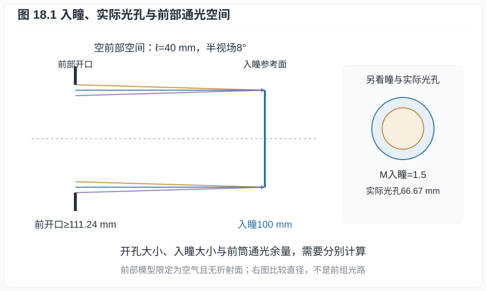
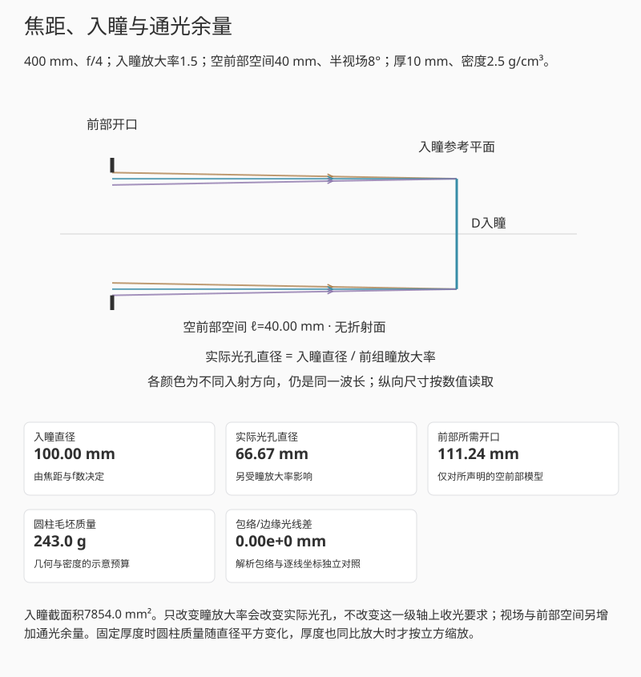
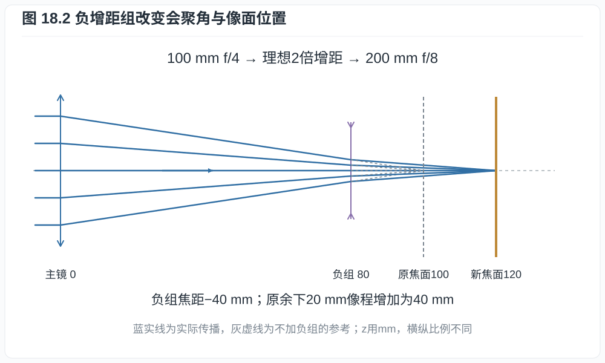
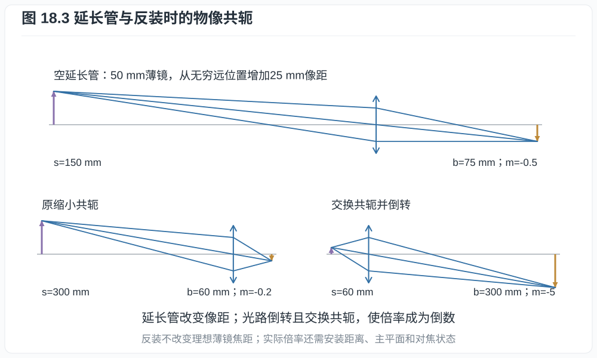
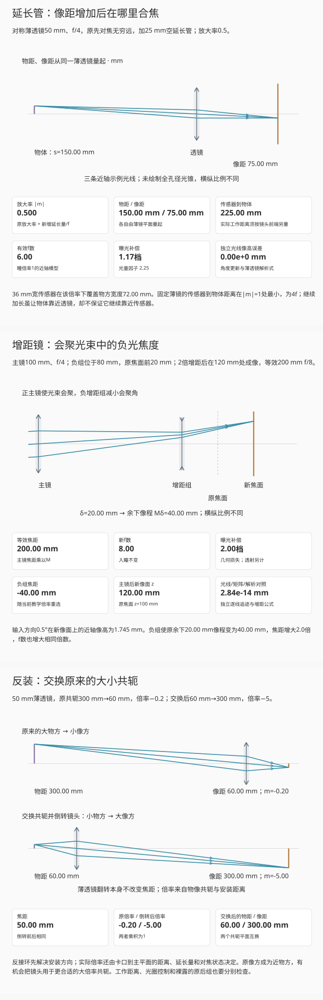
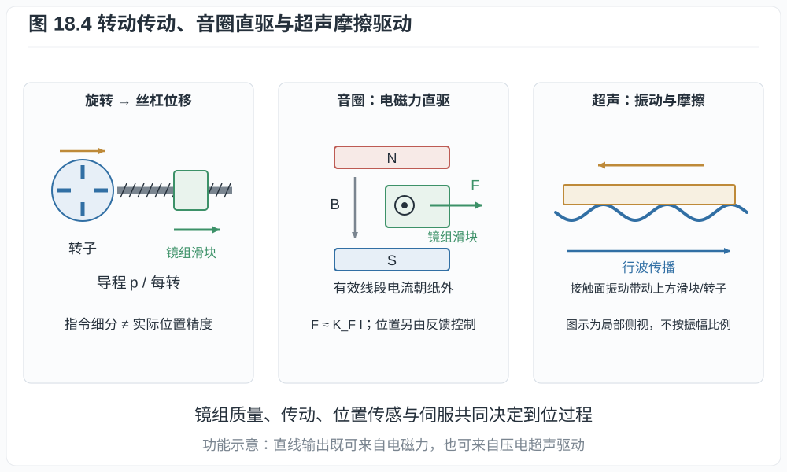
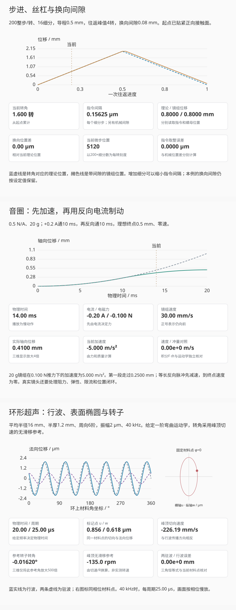
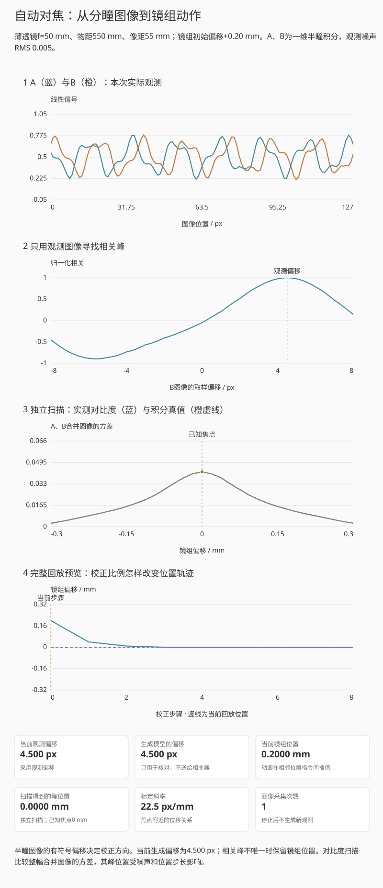

# 第十八章：镜头尺寸、近摄附件与对焦驱动

400 mm f/4镜头为什么很难做成一支细小的镜筒，400 mm f/8却容易小得多？给50 mm
镜头加一节空管，为什么能拍近物，却再也对不上无穷远？镜头上的USM、STM、VCM
又分别在移动什么？这些问题都要把光学共轭放回实际尺寸和机械行程中考虑。
第十一章给出了主平面、瞳和焦距，第十六章计算了移动镜组后的成像；这里继续看
通光口径、附件与驱动机构各自带来的变化。

## 18.1 焦距、f数与实际光孔

取空气中的正焦距成像镜头，$f>0,N>0$。无穷远标称f数由焦距和入瞳直径决定。
记孔径光阑的实际直径为 $D_a$，前组把它
向物方成像的横向放大率绝对值为 $M_\mathrm{EP}>0$，则

$$
D_\mathrm{EP}=\frac fN,
\qquad D_a=\frac{D_\mathrm{EP}}{M_\mathrm{EP}}.            \tag{18.1}
$$

例如50 mm f/2的入瞳直径为25 mm。前组若把光阑放大1.5倍，实际开孔只需约
16.67 mm；若放大率为0.8，实际开孔则为31.25 mm。这两种布局的入瞳相同。
透过镜头看到的光孔、拆开后量到的光阑、滤镜螺纹直径，是三个不同的尺寸。

400 mm f/4的入瞳要100 mm，400 mm f/2.8要约142.86 mm，800 mm f/4要200 mm。
这些是入瞳要求。镜片、镜筒与遮光罩还要容纳离轴光束、安装边缘和机械结构，
所以不能直接用 $f/N$ 算成品镜头的外径。

### 视场为什么还需要通光余量

先看一个可以直接算的前部空间：前开口到入瞳参考面相距 $\ell\ge0$，其间只有
空气、没有折射面。入瞳直径为 $D_\mathrm{EP}$，入射方向覆盖 $-\alpha$ 到
$+\alpha$，其中 $0\le\alpha<\pi/2$。在这个截面上，光束中心的横移为
$\ell\tan\alpha$，圆形前开口的直径至少为

$$
D_\mathrm{clear}\ge D_\mathrm{EP}+2\ell\tan\alpha.       \tag{18.2}
$$

**推导.** 最外侧边缘光线在前开口处的高度为
$D_\mathrm{EP}/2+\ell\tan\alpha$，相反方向的边缘光线高度为其负值，二者之差
便得到式 (18.2)。这一步只追踪空前部空间；真实前组会折射光线并改变瞳的位置和
形状，应像第十一章的截光实验那样逐孔面检查。

*图 18.1　400 mm f/4的入瞳直径为100 mm。空前部空间长40 mm、半视场8°时，
边缘光束要求的前开口约111.24 mm；前组瞳放大率1.5对应实际光阑约66.67 mm。
右侧圆形尺寸只比较直径，未画出完成瞳成像的前组处方。*

*互动示意：先将半视场归零，核对400 mm f/4的100 mm入瞳；再加入8°视场。
解析通光包络与六条边缘光线分别计算，实际光孔另按给定瞳放大率换算。*

像方也要留出空间。取一个孔面到像面之间无折射面的子午截面，距离为 $z>0$，
该视场的像高为 $h$。用斜率描述光束：主光线斜率为 $u_c$，两条边缘线斜率为
$u_c\pm u_a$，其中 $u_a>0$。向前回溯到孔面，光束中心高度为 $h-zu_c$、
半宽为 $zu_a$，该截面所需半口径满足

$$
R_\mathrm{rear}\ge |h-zu_c|+zu_a.                        \tag{18.2a}
$$

这是由两条边缘线的高度直接得到的斜率模型。在近轴、像方远心的例子中，
$u_c=0$、$u_a\approx1/(2N_\mathrm{eff})$；像高21.6 mm、孔面到像面20 mm、
有效f/4，需要的半径约24.1 mm。更短的像面前空间可以减小这部分余量；若改变
主光线倾角，还要同时检查传感器的入射角响应。第十六章所说的大卡口和短法兰距
提供的是这些布局自由度，不能单凭卡口外径给镜头的最大光圈下结论。

同一幅面上，长焦镜头的视场变窄，所需入瞳却随焦距增长。要比较镜头为何变大，
需同时看焦距、最大f数、覆盖画幅、像质要求和允许的暗角。只看滤镜口径或镜筒
长度，会漏掉这些条件。

## 18.2 镜头怎样减重，又受什么限制

先估计材料尺寸的量级。密度为 $\rho_g$、直径为 $D_b$、厚度为 $t_b$ 的实心
圆柱玻璃毛坯，质量为

$$
M_b=\rho_g\frac{\pi D_b^2t_b}{4}.                        \tag{18.3}
$$

三个长度使用相同单位，密度与之匹配。直径100 mm、厚10 mm、密度2.5 g/cm³的
毛坯约196.35 g。直径加倍而厚度不变，质量变为四倍；各长度都按同一倍率放大，
体积和质量才按倍率的立方增长。曲面切去的材料、其他镜片、镜筒和驱动部件还需
另算，圆柱估计不能当作整镜重量。

现代镜头通常从几处一起减重：

| 手段 | 主要改变什么 | 比较时还要看什么 |
|---|---|---|
| 非球面与更合适的光焦度分配 | 用面形自由度减少部分校正片，或减小某些镜片的曲率与厚度 | 有效口径、面形加工、偏心容差及全视场像差 |
| 低色散、异常部分色散或萤石 | 调整正负组的校色分工，可能减少所需玻璃体积 | 折射率、密度、热性质与实际处方；标有“ED”不表示材料密度低 |
| PF/DO衍射元件 | 以相反色散承担一部分校色，减少长焦系统中的厚重折射元件 | 波长范围、效率、杂散级次和逆光表现，见第十五章 |
| 内对焦与较小的浮动组 | 降低需要快速往返移动的质量 | 静态总重量与移动质量分别统计，还需导向和位置反馈 |
| 工程树脂、轻合金及复合材料结构 | 减小镜筒、支撑和部分光学件的质量 | 刚度、温漂、吸湿、磨损和装配稳定性 |
| 将部分畸变、暗角或呼吸留给数字校正 | 放宽部分光学设计约束 | 裁切、边缘取样密度、增亮噪声和重采样损失 |
| 较小最大光圈或较小覆盖画幅 | 直接减少收光束或视场要求 | 应重新比较曝光、景深和输出尺度 |

前五项改变设计与制造，第六项重新分配光学和处理任务，最后一项改变输入要求。
例如600 mm f/11的入瞳约54.55 mm，600 mm f/4为150 mm，面积比约7.56；两者的
尺寸和重量差，不能全部归因于新材料。对一支已固定焦距、画幅、f数和透射条件的
镜头，仍需让相应光束通过，并给镜片边缘与机构留出空间。

光学布局缩短和材料减重也应分开。望远型能让第一组到像面的距离短于有效焦距，
却不消除前端收光口径；反望远型留出较长后焦空间，常需处理更大的离轴光束。
折反射系统通过折返光路缩短轴向尺寸，但中心遮挡会改变PSF和离焦光斑。
这些变化适合结合第十二、十三章的点像一起判断。

## 18.3 增距镜为何同时增加焦距与f数

后置增距镜装在主镜与机身之间，用一组光学元件扩大主镜形成的像。理想增距倍率
为 $M\ge1$、主镜焦距为 $f$ 时，组合焦距约为 $F=Mf$。若主镜入瞳直径保持
不变，组合f数与几何曝光损失为

$$
F=Mf,
\qquad N_\mathrm{new}=MN,
\qquad \Delta_\mathrm{stop}=2\log_2M.                    \tag{18.4}
$$

2倍增距使100 mm f/4变为200 mm f/8，曝光量在相同快门下为原来的四分之一，损失
2档；1.4倍的几何损失约0.97档，通常按1档标记。吸收、反射与机械截光可能再增加
损失。[Nikon的增距镜说明](https://www.nikonusa.com/learn-and-explore/c/tips-and-techniques/using-teleconverters)
给出这些倍率与f数变化；实际可用组合仍按机身、主镜与附件的兼容说明核对。

### 一组负光焦度怎样把像推远

把主镜简化为焦距 $f>0$ 的薄镜。原来平行光在 $z=f$ 会聚，在原焦面前
$\delta\in(0,f)$ 处加入负薄组，它的位置为 $d=f-\delta$。选择负组焦距

$$
f_c=-\frac{M\delta}{M-1},\qquad
q=M\delta,                                             \tag{18.5}
$$

其中 $M>1$，$q$ 是负组到新像面的距离。$M=1$ 按负组光焦度为零处理。

**推导.** 两薄组的总光焦度为
$1/F=1/f+1/f_c-d/(ff_c)=(1+\delta/f_c)/f$。
代入 $f_c$ 得 $F=Mf$。第二组处的轴上边缘光线高度为初始高度的
$\delta/f$，负组减小会聚角后，该光线再走 $M\delta$ 达到光轴。
这也可由总矩阵的后焦距 $-A/C$ 独立求得。

*图 18.2　主薄镜100 mm，负组位于80 mm、焦距−40 mm；原剩余像程20 mm变为
40 mm，新像面位于120 mm。蓝线为实际传播，灰虚线为未加负组时的参考会聚；
一组示例光线不代表全部孔径。*

增距镜会放大主镜已有的像差和模糊，也引入自己的像差。它能否让同一目标记录
更多细节，要结合主镜MTF、传感器取样、曝光噪声和对焦误差，与直接裁切在相同
输出尺寸下比较。增距倍率不能直接当作细节增益。许多增距镜还有凸出的前组，
需要主镜后部留出相应空间。

## 18.4 空延长管、近摄镜与反装

### 延长像距，改变可合焦的物距

空延长管不含光学元件，只增加镜头与传感器的距离。设固定焦距薄镜原有放大率
绝对值为 $m_0\ge0$，再增加延长量 $e\ge0$。对实物实像，新的放大率绝对值
$m>0$、像距 $b$、物距 $s$ 满足

$$
m=m_0+\frac ef,
\qquad b=f(1+m),
\qquad s=f\left(1+\frac1m\right).                        \tag{18.6}
$$

**推导.** 薄透镜公式与 $m=b/s$ 联立，先得 $b=f(1+m)$。增加 $e$ 使 $b$ 增加
相同长度，于是 $m$ 增加 $e/f$，再回代得 $s$。$m_0=e=0$ 时，物距为无穷远，
不能将零直接代入 $1/m$。

**例子 18.1（50 mm镜头加25 mm空管）.** 原来对焦无穷远，$m_0=0$。新倍率为
$25/50=0.5$，像距75 mm，物距150 mm，薄镜模型的传感器到物体距离为225 mm。
36 mm宽传感器覆盖物方约72 mm。这里150 mm从薄镜平面量起，不能直接报告成
相机标注的最近对焦距离。

对光阑位于薄镜平面、入瞳与出瞳同大的对称模型，像方光锥的近轴f数为

$$
N_\mathrm{eff}\approx\frac bD=N(1+m),
\qquad \text{光量补偿因子}=(1+m)^2.                     \tag{18.7}
$$

这是由同一开孔直径和增大的像距直接得到的。上例标称f/4，对应有效f数约6，
光量补偿因子2.25，约1.17档。实际厚系统应读取出瞳直径与它到像面的距离，
由像方锥角计算；内对焦还可能改变焦距与瞳倍率。相机是否显示有效光圈也随系统而异。

### 近摄镜增加的是光焦度

前置近摄镜是一片或一组正光焦度附件，单位常写为屈光度D，即m⁻¹。主镜对焦
无穷远时，理想近摄镜可把约 $1/P_c$ m处的物体变成供主镜接收的平行光。
例如 $+4$ D对应从近摄镜量起约0.25 m；与50 mm主镜组合时，近轴倍率约为
$0.050\times4=0.20$。镜间距、主镜对焦状态、附件色差与边缘像质需进一步计算。
它与空延长管分别改变光焦度和像距，不能只按“都能拍近”归为同一种原理。

### 反装为什么适合某些大倍率共轭

普通摄影镜头常为较大的物方与较小的像方优化。反接环把原像方朝向近处小物体，
让原物方朝向传感器；再用安装距离或皮腔建立大倍率共轭。对有限非零的原横向倍率，依据光路可逆性，若把
原来的两个共轭平面交换，并倒转镜头，横向倍率成为倒数：

$$
|m_\mathrm{rev}|=\frac1{|m_\mathrm{original}|}.           \tag{18.8}
$$

**推导.** 原来的高度映射 $y'=my$ 在反向传播时成为 $y=y'/m$。这个结论要求
交换原物像平面，而非保持相机和物体不动、只将镜头翻面。理想薄透镜翻转后焦距
和原位置的共轭关系不变；真实非对称镜头的主平面、瞳和安装参考则随方向互换。

*图 18.3　上方为50 mm薄镜加25 mm延长量后的150/75 mm共轭；下方另取同焦距
的300/60 mm缩小共轭，再交换为60/300 mm放大共轭。两组分别说明像距延长与
光路倒转，不能把下方倍率直接当作任意反接环的规格。*

反装后是否改善像差，取决于原设计的共轭与新的工作条件。实际反接环的倍率还
受主平面到卡口的距离和对焦位置影响。还应分别考虑光圈控制、电子连接、前后组
的安装空间和照明工作距离；[Nikon BR-2A/BR-5说明书](https://cdn-1.nikon-cdn.com/kdb/lensacc/BR2ABR5UM.pdf)
也将反接方向与对焦方法分开说明。

*互动示意：三个页签分别保持自己的输入。延长管从50 mm加25 mm开始；增距镜
从100 mm主镜配2倍负组开始；反装页比较300/60 mm与60/300 mm两对共轭。
逐线追迹与解析关系分别核对，光量采用声明的近轴瞳模型。*

## 18.5 最近对焦距离由什么限制

最近对焦距离通常从机身的传感器/胶片平面标记量到物体；工作距离从镜头前端
量到物体，两者应分别报告。遮光罩、附件和镜头伸长会改变可用照明空间，单靠
标称焦距算不出实际工作距离。

固定薄镜的物距与像距相加，可写成

$$
L_\mathrm{object-sensor}
=f\left(2+m+\frac1m\right)\ge4f,\qquad m>0.             \tag{18.9}
$$

不等式来自 $m+1/m-2=(m-1)^2/m\ge0$，等号在1∶1处取得。50 mm薄镜在倍率0.5
和2时，传感器到物体都为225 mm；在1∶1时为200 mm。继续延长，物体逐渐靠近
透镜焦点，传感器却离透镜更远，所以两者总距离不再持续缩短。

实际内对焦系统的主平面间距和有效焦距会变，式 (18.9) 的固定薄镜下界不能用来
否定它的近摄规格。最近对焦还受下列条件共同限制：

- 镜组行程、组间碰撞与导向空间；
- 近摄时的球差、像散、场曲和色差；浮动组用额外运动自由度改善这些变化；
- 像面锥角、有效光圈、衍射和允许的离焦；
- 对焦传感、位置反馈和控制器能否在该距离可靠收敛；
- 镜头前端与物体之间的照明、遮挡及工作空间。

所以“对焦马达能再走一点”不保证镜头可以继续保持近摄像质。阅读微距规格时，
至少一起看最大放大率、最近对焦距离、工作距离与该倍率下的有效光圈。

## 18.6 对焦马达怎样把电信号变成镜组位移

相机先估计需要的焦位变化，再由执行器移动镜组，位置或图像反馈检查结果。
马达负责其中的力与运动转换，不能独自决定整套AF的速度和准确度。

| 驱动方式 | 运动怎样产生 | 主要需要核对的条件 |
|---|---|---|
| 机身螺丝刀与镜内直流马达 | 电磁转矩经联轴器、齿轮或凸轮变为轴向运动 | 传动间隙、摩擦、镜组质量、位置检测和机身兼容性 |
| 步进马达（STM类） | 按电相位逐步改变转子平衡位置；再经丝杠或齿轮移动镜组 | 步距、细分、负载、失步、间隙与是否有反馈 |
| 环形超声马达 | 压电定子的超声振动，经接触摩擦带动转子，再由机构转换位移 | 预压力、摩擦副、驱动频率、低速控制与机械结构 |
| 直线超声马达 | 压电振子的接触运动直接推动滑块 | 行程、接触状态与控制策略；直线输出不等于电磁驱动 |
| 音圈马达（VCM） | 线圈电流与磁场相互作用，直接对镜组或滑块施加直线力 | 力常数、移动质量、电流与发热、导向及位置反馈 |
| 多极直线电磁马达 | 沿行程分布的线圈与磁极产生可控推力 | 磁路、换相、位置传感与伺服带宽；名称不等同于一种固定VCM结构 |

*图 18.4　丝杠将转角换成位移；音圈在磁场中直接受力；环形行波超声马达通过
接触面的振动与摩擦带动转子。图为功能示意，未按元件尺寸比例绘制；品牌名称
还可能包含不同传动和反馈实现。*

Canon的[驱动技术说明](https://files.canon-europe.com/files/webcontent/rf-lens-world/features/technology/index.html?pop=pop05)
区分环形USM、直线Nano USM、丝杠/齿轮STM与VCM；
[双Nano USM浮动对焦实例](https://global.canon/en/technology/canon-tech/tech/rf/)
展示两个组分别驱动。应按机构和反馈来读这些名称，不将缩写排成跨镜头通用的
快慢或噪声等级。

### 步距不等于对焦精度

理想丝杠导程为 $p_s$，转子每转有 $n_s$ 个整步，每步细分 $n_\mu$ 次。
指令中的一个细分步对应

$$
\Delta x_\mathrm{command}=\frac{p_s}{n_sn_\mu}.           \tag{18.10}
$$

导程0.5 mm、每转200步、16细分，指令间隔为0.15625 μm。它只给离散指令的
刻度；齿隙、弹性、摩擦和负载会改变实际位移。若机械回差为8 μm，增加细分数
不会自动把回差变成0.15625 μm。位置闭环与相机的图像反馈承担不同层次的校正。TI的
[步进驱动说明](https://www.ti.com/lit/an/sloa293a/sloa293a.pdf) §2.2.3也区分细分水平、
停止精度与足以克服负载的增量转矩。

### 音圈的电流先决定力

在小行程、磁路近似不变的模型中，音圈推力约为 $F=K_FI$。把移动镜组质量记为
$m_g$，线性阻尼为 $c_g$、等效弹性为 $k_g$，轴向运动方程为

$$
m_g\ddot x+c_g\dot x+k_gx=K_FI+F_\mathrm{ext}.           \tag{18.11}
$$

这是Newton第二定律加上线性阻尼、弹性近似。没有恢复弹性时 $k_g=0$，恒定电流
也不对应唯一的静止焦位；需要位置或图像反馈决定何时加速、减速与停止。

**例子 18.2（移动质量与初始加速度）.** 取力常数0.5 N/A、电流0.2 A，初始推力
为0.1 N。20 g镜组在初始阻力可忽略时加速度为5 m/s²；质量减半，初始加速度
加倍。若在这个理想初始阶段维持10 ms，位移为
$\tfrac12\times5\times0.010^2=0.00025$ m，即0.25 mm。实际到位还要减速、
抑制振动并重新测焦，这个计算不能直接当作AF用时。

镜头设计因此会同时考虑镜片质量、导向、驱动力、反馈和光学灵敏度。近轴薄镜中，
$s=f+f^2/(b-f)$ 给出 $ds/db=-f^2/(b-f)^2$：同样的轴向位置误差，在不同对焦
距离上对应不同的物距变化。只比较马达的理论步距，解释不了近摄精度或远景追焦。

### 从转角、电流和振动追到位移

丝杠的指令位置与螺母位置在换向时可能分开。取一次往返：命令转数 $r_c$ 从零
增至给定峰值，再回到零；起点已贴紧正向接触面。记 $N_c=n_sn_\mu$，将指令
四舍五入到最近微步后，理论轴向位置为 $q$，其峰值为 $q_\mathrm{max}>0$。
若单次换向间隙为 $0\le b_h\le q_\mathrm{max}$，一个刚性间隙模型为

$$
\begin{aligned}
q&=p_s\frac{\operatorname{round}(N_cr_c)}{N_c},\\
x&=\begin{cases}
q,&\text{正程},\\
\min(q_\mathrm{max},q+b_h),&\text{反程}.
\end{cases}
\end{aligned}                                           \tag{18.12}
$$

反程开始时，$q+b_h$ 仍大于峰值，螺母暂时留在原处；理论位置退够 $b_h$ 后，
它才贴住另一侧接触面跟随返回。回到起始转角时，螺母仍差 $b_h$。改变细分数
只改变 $q$ 的刻度，不能自动消除这个间隙。三维演示将这段空行程标红。

音圈则可以直接从电流积分出运动。设 $I_0,K_F,m_g,T>0$，镜组初始静止，忽略
阻力、弹性与电流建立时间。先通 $+I_0$ 持续 $T$，再通 $-I_0$ 持续 $T$。
令 $a=K_FI_0/m_g$，第二段用 $\tau=t-T$，则

$$
\begin{aligned}
x(t)&=\begin{cases}
\tfrac12at^2,&0\le t\le T,\\
a(\tfrac12T^2+T\tau-\tfrac12\tau^2),&T<t\le2T,
\end{cases}\\
v(t)&=\begin{cases}
at,&0\le t\le T,\\
a(T-\tau),&T<t\le2T.
\end{cases}
\end{aligned}                                           \tag{18.13}
$$

这是对两段恒加速度分别积分，并在换向时接续位置和速度的结果。若质量用kg、
时间用s，式中的 $x,v,a$ 分别用m、m/s、m/s²。例18.2的20 g镜组在第一段
10 ms走过0.25 mm；等长反向脉冲又走0.25 mm，才把速度降到零。电流反向的
瞬间，力已反向，运动方向却尚未改变。真实位置闭环还需测量误差与实际阻力。

环形行波超声驱动需要区分波形和材料。令环的平均半径为 $R>0$、厚度为 $h>0$，
沿环角坐标为 $\phi$，正切向沿 $\phi$ 增大。取法向振幅 $A>0$、周向阶数
$n\in\mathbb N_{>0}$、角频率 $\omega>0$ 与方向 $\sigma=\pm1$，给定行波

$$
\begin{aligned}
w(\phi,t)&=A\cos(n\phi-\sigma\omega t)\\
&=A[\cos(n\phi)\cos(\omega t)
+\sigma\sin(n\phi)\sin(\omega t)].
\end{aligned}                                           \tag{18.14}
$$

后一行把行波写成空间和时间各差四分之一周期的两驻波。固定 $\phi$ 的材料点
不会随波峰绕环跑，它在原位置附近振动。在小斜率、横截面近似保持垂直于中面的
弯曲运动学中，上表面的切向位移为

$$
\begin{aligned}
u&=-\frac{h}{2R}\frac{\partial w}{\partial\phi}
=\gamma A\sin(n\phi-\sigma\omega t),\\
\gamma&=\frac{hn}{2R},\qquad
\left(\frac{u}{\gamma A}\right)^2+\left(\frac{w}{A}\right)^2=1.
\end{aligned}                                           \tag{18.15}
$$

相位相差四分之一周期，因此材料点走局部椭圆。波峰处法向位移为 $A$，该处
材料的瞬时切向速度为 $-\sigma\gamma A\omega$，与波峰传播方向相反。转子被
压在接触面上，摩擦把这段切向运动传给转子。定子的压电层、弹性环、两相驱动
与接触问题可对照[Bolborici等的模型与实验](https://www.math.utoronto.ca/mpugh/Prints/piezo_stator.pdf)
§§1—2；这里给定波形，只计算运动学。

演示取 $R=16$ mm、$h=2.4$ mm、$n=6$、$A=2$ μm，故 $\gamma=0.45$。
驱动频率 $f_d=40$ kHz时，周期只有25 μs。为便于观察，振动与转角均按标注的
倍数放大，并将相位慢放。转子转角用“始终跟随峰顶切速”的无滑移参考计算；
真实转速还取决于预压、接触分布、滑移和负载。

*互动示意：三个页签分别查看丝杠换向、音圈正负脉冲、环形行波。机构运动、
下方曲线和读数共用相同输入；音圈位移放大4倍，超声表面位移与参考转角放大
500倍。画面播放速度不表示实际对焦或超声时间。*

把丝杠停在刚换向处，螺母仍留在峰值位置；音圈反向通电时，镜组则继续前进，
速度逐渐减小。再查看超声页的红点：它在原位置附近往复，蓝色波峰持续沿环
推进，接触环沿相反方向转动。用这些位置和方向对照下方曲线，区分转角、
电流和振动各自怎样产生位移。

## 18.7 自动对焦怎样判断移动方向

执行器接收的位置指令来自测焦。相位差对焦（phase-detection AF, PDAF）让两个
分瞳通道分别接收不同区域的光束，比较两幅图像的相对偏移；偏移的符号提供调整
方向。对比度对焦（contrast AF）则在不同焦位采图，寻找某个清晰度指标的峰。
[Canon的双像素技术说明](https://global.canon/en/news/2013/jul02e.html)给出双光电二极管
实现，并分别解释两种测焦方式。具体相机还会加入目标识别、预测和镜头标定。

先用薄透镜说明分瞳偏移从哪里来。设物距 $u>f$，理想像距 $v_f=fu/(u-f)$，传感器
实际距镜组 $v$。同一物点经瞳高 $h$ 的近轴光线，在传感器上的离焦分量为
$h(1-v/v_f)$。若两个一维均匀半瞳分别占 $[-b,0]$ 与 $[0,b]$，两束的中心高度相差
$b$，像素间距为 $p$，便有有符号偏移

$$
d=\frac bp\left(1-\frac v{v_f}\right).                \tag{18.16}
$$

演示固定物体与传感器，两者相距605 mm，焦距50 mm；镜组从焦点向像方移动 $g$，
于是 $u=550+g$、$v=55-g$，长度同用mm。取 $b=5$ mm、$p=0.004$ mm，在 $g=0$
处 $d=0$，导数 $d'(0)=22.5$ px/mm。每个半瞳还会对纹理作一段均匀模糊，面板直接
积分这两段光束；局部纹理尺度固定，便于单独检验偏移估计。

*互动示意：初始镜组偏移+0.20 mm；相关器只读取A、B观测，薄透镜给出的偏移和
焦点单独显示。三维机构将轴向位移放大40倍，曲线和读数仍用实际mm与px。*

在多频纹理预设中播放，按观测相关峰 $\widehat d_k$ 更新指令：
$g_{k+1}=g_k-\gamma\widehat d_k/(22.5\ \mathrm{px/mm})$。
每步重新采图；相关峰太弱、重复峰接近或搜索达到边界时停止。均匀目标没有可用
位移信息，重复条纹则可能给出多个同样好的峰。真实PDAF还受瞳形、方向、遮挡、
光圈与像差影响，一维条带只用于解释当前的有符号关系。

下方独立扫描33个镜组位置，以A、B合并图像的方差作为清晰度指标，比较观测峰与
无噪声积分曲线。这里只对声明的多频纹理讨论中央最佳焦点；任意图案和噪声下，
某个清晰度指标并不保证只有一个峰。执行器先按位置指令移动，图像反馈再决定下一步；
第18.6节的质量、回差和振动收敛还会影响真正到位的过程。

## 练习

**练习 18.1.** 400 mm f/4的入瞳多大？前组瞳放大率为1.5时，实际光阑直径多大？
若空前部空间长40 mm、半视场8°，式 (18.2) 的前开口下界是多少？将其视为厚
10 mm、密度2.5 g/cm³的圆柱毛坯，估计质量，并说明这个质量包括什么。

**练习 18.2.** 100 mm f/4主镜配理想2倍增距镜，入瞳不变。求组合焦距、f数和
曝光损失。若原焦面前20 mm处放负组，求它的焦距及新像面位置。

**练习 18.3.** 固定50 mm对称薄镜原先对焦无穷远，分别加25、50、100 mm空
延长量。求每种情况下的放大率、物距、像距、传感器到物体距离及标称f/4时的
有效f数。在哪个位置，传感器到物体的距离最小？

**练习 18.4.** 50 mm薄镜原来的物距300 mm、像距60 mm。交换共轭并倒转镜头后，
倍率和焦距分别如何变化？若保持物体、镜头和传感器位置不变，只将理想薄镜翻面，
能否由此得到5倍放大？

**练习 18.5.** 丝杠导程0.5 mm、每转200步、16细分，求一个细分步的指令位移。
若传动回差8 μm，能否据此宣称绝对位置精度0.15625 μm？另对力常数0.5 N/A、
电流0.2 A的音圈，比较20 g与10 g镜组的初始加速度，并指出还缺哪些到位条件。

**练习 18.6.** 用式 (18.14)—(18.15) 的 $R=16$ mm、$h=2.4$ mm、$n=6$、
$A=2$ μm、$f_d=40$ kHz、$\sigma=+1$，求周期、切向振幅、峰顶切向速度和
峰顶无滑移参考转速。材料点经过一个周期后是否回到原位置？这是否意味着转子
也应回到原角度？说明三维演示中500倍放大的作用。

**练习 18.7.** 按式 (18.16) 的示例，镜组偏移+0.20 mm时，求分瞳偏移。
若观测估计为+4.50 px、校正比例0.8，第一次位置指令是多少？均匀目标和周期条纹
为什么应分别检查纹理强度与竞争相关峰，而不能直接采用最大值？
