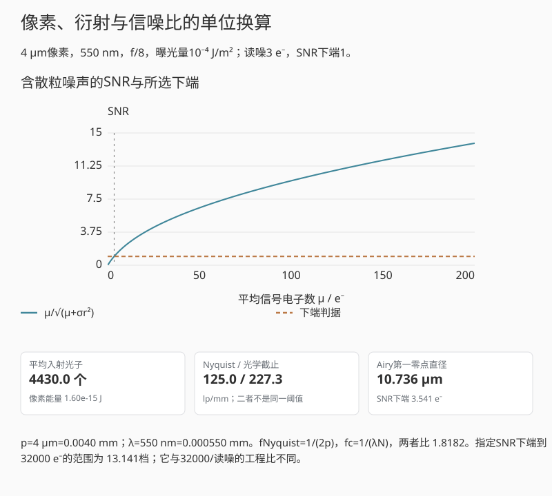

# 附录 B：常用计算表与换算

## B.1 物理常数

| 常数 | 数值 |
|---|---:|
| $h$ | $6.62607015\times10^{-34}\ \mathrm{J\,s}$（精确） |
| $c$ | $299792458\ \mathrm{m/s}$（精确） |
| $q$ | $1.602176634\times10^{-19}\ \mathrm C$（精确） |
| $k_{\mathrm B}$ | $1.380649\times10^{-23}\ \mathrm{J/K}$（精确） |
| $hc$ | $1.98644586\times10^{-25}\ \mathrm{J\,m}$ |

单个光子能量可速算为

$$
\varepsilon_\gamma[\mathrm{eV}]
\approx\frac{1240}{\lambda[\mathrm{nm}]}.
$$

## B.2 档、比例与分贝

| 档数 $n$ | 曝光比例 $2^n$ | 强度比 dB，$10\log_{10}$ | 电子计数比按行业 DR 写法，$20\log_{10}$ |
|---:|---:|---:|---:|
| 1 | 2 | 3.010 | 6.021 |
| 2 | 4 | 6.021 | 12.041 |
| 3 | 8 | 9.031 | 18.062 |
| 4 | 16 | 12.041 | 24.082 |
| 10 | 1024 | 30.103 | 60.206 |

传感器行业常把电子容量与读噪的比按幅度比写 $20\log_{10}$，同时又用
$\log_2$ 报 stop。换算为

$$
1\ \mathrm{stop}=20\log_{10}2\approx6.0206\ \mathrm{dB}.
$$

## B.3 标准整档 f 数

理想整档序列满足 $N_{k+1}=\sqrt2N_k$，常用标值经过取整：

```text
1.0  1.4  2.0  2.8  4.0  5.6  8  11  16  22  32
```

在透射率、场景和曝光时间不变的远焦近轴模型中，把 f 数从 $N_1$ 改为 $N_2$，
像面曝光量的变化为

$$
\Delta n=\log_2\frac{H_2}{H_1}=-2\log_2\frac{N_2}{N_1}.
$$

这里正值表示曝光增加。例如从 $f/4$ 收到 $f/8$，$\Delta n=-2$，曝光减少两档。
近摄时还需考虑有效 f 数及瞳放大率，见第十八章。

## B.4 传感器采样

像素节距 $p$ 以微米给出时，Nyquist 频率

$$
\nu_N[\mathrm{lp/mm}]=\frac{500}{p[\mu\mathrm m]}.
$$

画幅宽 $w$ mm、横向像素 $M$ 时

$$
p[\mu\mathrm m]=1000\frac wM,
\qquad
\nu_N=\frac{M}{2w}.
$$

## B.5 衍射速算

对空气中远焦、近轴、无像差的圆瞳，取 $\lambda=0.55\ \mu$m：

$$
d_\mathrm{Airy}[\mu\mathrm m]
\approx2.44\lambda N\approx1.342N,
$$

$$
\nu_c[\mathrm{lp/mm}]
=\frac{1000}{\lambda[\mu\mathrm m]N}
\approx\frac{1818}{N}.
$$

Airy 直径等于像素节距 $p$ 时的 f 数约为
$N\approx p/(1.342\ \mu\mathrm m)$；这不是“衍射开始”的硬阈值，只是一种尺度比较。

## B.6 视频码率

未压缩单 photosite 码率为

$$
R=W\times H\times b\times F,
$$

$W,H$ 为样本尺寸，$b$ 为每样本 bit，$F$ 为帧率。十进制
$1\ \mathrm{MB/s}=8\ \mathrm{Mbit/s}$。还需另计行填充、打包、音频和元数据；
压缩 RAW 的实际码率由编码器和画面内容决定。

## B.7 常用分析顺序

传感器问题按下列顺序计算最不容易跨层：

$$
H_{e,\lambda}
\rightarrow N_\gamma
\rightarrow N_e
\rightarrow \mathrm{SNR}_e
\rightarrow \mathrm{DN}
\rightarrow \text{编码值}.
$$

镜头与系统问题按下列顺序：

$$
\text{物距/视角/光圈}
\rightarrow\text{瞳与波前}
\rightarrow\mathrm{PSF/MTF}
\rightarrow\text{像素积分}
\rightarrow\text{采样与处理}.
$$

## B.8 带单位的换算器

下方把像素节距从μm换成mm、波长从nm换成mm后，再计算像面频率。
入射光子预算仍用SI面积和光子能量。输出分别给出Nyquist频率、理想光学截止、
Airy第一零点直径和指定SNR下端，不将它们合并为一个“分辨率分数”。

先用“第1章光子预算”，只改变曝光量，看光子数变化；
给定噪声与SNR判据的下端信号不动；
再切到“第12章6 μm像素”，比较Nyquist与衍射截止的相对位置。
最低SNR控件只改变下端判据，不改变像素节距、光学截止或已经给定的曝光。

<div data-mb-component="unit-calculator">



*互动示意：4 μm像素、550 nm、f/8，曝光量10⁻⁴ J/m²。光学尺度使用理想圆瞳，
SNR模型另固定32000 e⁻满阱和3 e⁻读噪；没有把入射光子直接当成实测电子数。*

</div>
