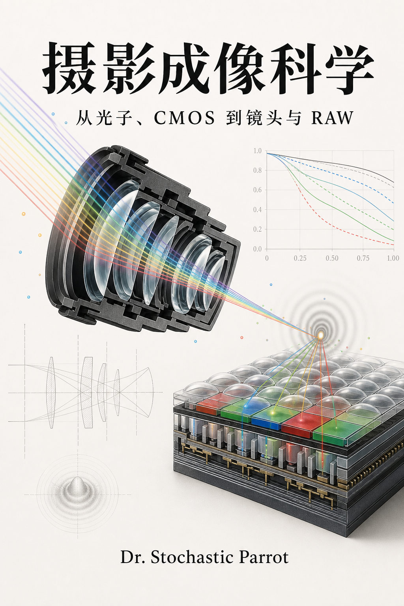

# 摄影成像科学：从光子、CMOS 到镜头与 RAW

<p align="center">
  
</p>

作者与维护：glenzli；与 AI 合作撰写、校核和修订。

许可：[CC BY-NC-ND 4.0](../../LICENSE)。

状态：修订稿。全书含序章及 18 章正文、55 幅可复现技术图、75 道练习及逐题答案。
本轮修订重写叙述、补充技术推导，并核对关键公式与一手资料；尚无真实器材数据集的
实验验证。具体审校范围见 [修订与核验记录](CONTENT_CLOSURE_AUDIT.md)。

这本书不从品牌和器材型号出发，而从一次曝光怎样形成一幅图像出发。主线是

$$
\text{场景辐亮度}
\longrightarrow \text{镜头像面曝光}
\longrightarrow \text{光电子}
\longrightarrow \text{读出码值}
\longrightarrow \text{RAW/Log/RGB}
\longrightarrow \text{显示或印刷图像}.
$$

沿着这条链，书中计算曝光怎样改变信噪比、增益怎样影响阴影与高光、RAW 保存了
哪些样本，以及镜头形成的细节怎样被传感器采样。全书默认读者会高中数学；微积分、
复数、Fourier 变换和概率论在使用处给出必要推导，较系统的工具集中在附录 A。

写作约束见 [SKILL.md](SKILL.md)，符号见 [NOTATION.md](NOTATION.md)，资料源见
[SOURCES.md](SOURCES.md)，逐章来源用途见 [CHAPTER_SOURCE_NOTES.md](CHAPTER_SOURCE_NOTES.md)。
习题答案见 [SOLUTIONS.md](SOLUTIONS.md)，术语检索见 [TERM_INDEX.md](TERM_INDEX.md)。
55 幅编号技术图由 [generate_figures.py](figures/generate_figures.py) 生成，SVG 源文件位于
[figures](figures/)；图版按模型参数生成，器材测量数据另行注明。

## 第一部分：光、曝光与传感器

0. [序章：从一次曝光开始](00_preface_scope_and_measurement.md)
1. [第一章：辐射度学、光圈与曝光量](01_radiometry_aperture_and_exposure.md)
2. [第二章：从光子到电子：硅光电转换与像素](02_photons_silicon_and_pixels.md)
3. [第三章：CMOS 像素、读出链与模数转换](03_cmos_pixels_readout_and_adc.md)
4. [第四章：噪声、信噪比、满阱与动态范围](04_noise_snr_full_well_and_dynamic_range.md)
5. [第五章：ISO、曝光指数、增益与“双原生”](05_iso_exposure_index_and_gain.md)
6. [第六章：滚动/全局快门、背照、堆栈与曲面传感器](06_shutters_bsi_stacking_and_curved_sensors.md)
7. [第七章：色彩滤阵、采样、去马赛克与色彩矩阵](07_color_filter_sampling_and_demosaicing.md)

## 第二部分：计算曝光、编码与文件

8. [第八章：包围曝光、多帧降噪与现代 HDR 合成](08_computational_exposure_and_hdr.md)
9. [第九章：Gamma、Log、曝光指数与显示变换](09_gamma_log_exposure_index_and_display.md)
10. [第十章：静态 RAW、视频 RAW、压缩与元数据](10_still_raw_video_raw_and_compression.md)

## 第三部分：镜头的物理与工程

11. [第十一章：几何光学、近轴矩阵与镜头基本量](11_geometrical_optics_and_paraxial_systems.md)
12. [第十二章：衍射、PSF、OTF、MTF 与采样](12_diffraction_psf_otf_mtf_and_sampling.md)
13. [第十三章：球差、彗差、像散、场曲、畸变与色差](13_aberrations_and_field_behavior.md)
14. [第十四章：玻璃、树脂、萤石与低色散材料](14_optical_materials_glass_resin_and_fluorite.md)
15. [第十五章：非球面、Fresnel、PF/DO 与镀膜](15_aspheres_fresnel_diffractive_optics_and_coatings.md)
16. [第十六章：镜头结构、对焦、变焦、防抖与远心性](16_lens_architectures_focus_zoom_and_stabilization.md)
17. [第十七章：怎样读 MTF、测试镜头并分析整套成像系统](17_lens_testing_and_system_analysis.md)
18. [第十八章：镜头尺寸、近摄附件与对焦驱动](18_lens_size_accessories_and_focus_drives.md)

## 附录

- [附录 A：概率、Fourier 变换与单位](A_probability_fourier_and_units.md)
- [附录 B：常用计算表与换算](B_calculation_reference.md)
- [答案手册](SOLUTIONS.md)
- [术语索引](TERM_INDEX.md)
- [逐章来源注释](CHAPTER_SOURCE_NOTES.md)

阅读顺序见[序章的分层指引](00_preface_scope_and_measurement.md)。同一组虚拟相机参数
贯穿光子、噪声、增益、编码、RAW 与预采样响应；八道实验任务配有可手算输入和
[逐题答案](SOLUTIONS.md)，分别练习校准漂移、曲率匹配、插值协方差、HDR有效位置、
轴上比、热补偿、非球面斜率和系统报告。静态图与已知真值均保留。

## 图版与校验

全书已接入 [Markdown Book](https://github.com/glenzli/markdown-book) 格式 v1。
[book.json](book.json) 按阅读顺序列出序章、18 章正文、两篇附录、符号表、答案、术语
与资料页，共 26 个阅读页面。Markdown、55 幅 SVG 和互动模型仍是仓库中的源文件，
阅读器从同一套源文件生成本地预览和静态网站。当前有 70 个组件、78 处章节插入，
18 章正文均有演示；另外保留49张组件自带的无编号静态回退。
从光子计数与 QE、单斜坡 ADC、双增益共享噪声，到曝光积累、4T/CDS、平场校准、采样与配准，以及
浮动对焦、呼吸、景深和其他光学演示。演示按内容采用条件比较、可暂停回放或三维光路。模型与测试位于
[interactives](interactives/)；逐章选择理由及后续安排见
[逐章展示安排与模型复核](INTERACTIVE_REVIEW.md)。
三维组件按需使用工具内置的 Three.js，不依赖在线 CDN；不支持 WebGL 2 时保留静态图。
本地将工具仓库克隆在 Curio 旁边并安装其依赖后，从 Curio 根目录运行：

```bash
node ../markdown-book/bin/markdown-book.js check books/photographic-imaging-science
node ../markdown-book/bin/markdown-book.js serve books/photographic-imaging-science
node ../markdown-book/bin/markdown-book.js build books/photographic-imaging-science --out /tmp/imaging-book --base /books/photographic-imaging-science/
```

最后一条生成可挂载到对应网址的完整静态目录，包含本地字体、公式、图版和互动代码。
网站可在 CI 中固定工具版本，构建后将这个目录挂到对应路径；生成的网页不回写为
书籍源码。源码以 Markdown 为准，构建目录无需提交。

安装 Markdown Book 的 Codex 插件后，可从侧栏进入书籍阅读器，也可在会话中调用
`open_reader`，传入本书目录的绝对路径。侧栏和会话面板复用同一阅读器，支持章节
导航、公式、静态图和各组互动；修改源文件后会更新预览。

重新生成55幅编号图：

```bash
python3 books/photographic-imaging-science/figures/generate_figures.py
```

互动静态图和教学DNG可统一重新生成：

```bash
node books/photographic-imaging-science/interactives/generate-all.mjs
```

[统一入口](interactives/generate-all.mjs)调用各模型的生成器：23组教学页、
[浮动对焦、变焦和远心图](interactives/generate-optics.mjs)，以及各目录中的专用
生成器。光路图直接复用互动绘图函数，静态输入写在生成器中；RAW位流与景深页
保留固定数值图。独立真值计算继续与主算法分开。

执行教材闭环检查：

```bash
python3 books/photographic-imaging-science/validate.py
python3 books/audit_oet_rigor.py photographic-imaging-science --strict
python3 books/audit_textbook_narrative.py photographic-imaging-science --strict
```

校验器检查章节数、练习--答案双射、方程编号、局部链接、图版 XML、图注、控制字符
与来源章节覆盖。它不能替代数学审稿，但能阻止排版和清单层面的回归。

## 范围边界

本书讨论摄影和电影摄影所需的成像物理、电子学、计算成像与镜头分析。完整半导体
器件工艺、镜头优化软件、感知色貌模型、压缩编码器实现和摄影艺术史属于外部学科，
只在主线需要处建立接口。本书不替某一品牌评定器材，也不把实验室单一指标等同于
照片价值。


## 展示与互动

- 第一章 `exposure`：同步回放均匀背景的光子积累与独立的点目标运动轨迹；数值圆锥积分对照解析值，精确等曝光预设仍保留不同运动区间。

- 第一章 `offaxis`：依次展开cos⁴θ的投影与距离因子，有限圆瞳面积分另对照圆周解析式；把积分误差与小瞳近似偏差分开报告。
- 第二章 `counting`：Poisson到达与QE筛选的事件回放，比较固定入射数、完整曝光直方图、精确PMF和全方差。
- 第二章 `pixel`：PPD 积分、FD 复位、两次采样与电荷转移的共同时间轴；比较共同复位偏移的消除和独立采样噪声的保留。
- 第三章 `ramp-adc`：共同斜坡、局部时钟、比较器交叉与锁存码；逐电压区间搜索对照最终码，量程外输入另标截顶。
- 第三章 `adc-errors`：固定列电压偏置与单调弯曲斜坡，比较暗场码相减的残差、码宽DNL和阈值INL；时钟阈值搜索另核连续交叉根。
- 第三章 `readout`：同一电荷在 ADC 前增益与 ADC 后数字乘法中的量化、输入端读噪及高光上限。
- 第四章 `noise`：曝光、散粒噪声、读噪与满阱；使用固定随机种子比较同一组像素。
- 第四章 `flatfield`：独立成对平场的均值—方差、增益及暗场读噪估计；并列比较固定 PRNU、照明漂移和饱和段对拟合的影响，保留生成参数及未饱和预测。
- 第四章 `flatfield` 的“相关噪声与暗场”页签：电子域 Gaussian 近似，分别估计独立、行共享、列共享分量，比较 ROI 均值、单像素和有限暗场的共享校准下限。切页保留各自观测，重拍目标与重拍暗场可独立操作。
- 第五章 `dual-readout`：同次电荷和两次独立曝光的共享协方差，保留固定权重融合、成对观测、独立真值和截顶切换。
- 第五章 `iso`：固定曝光与少收光后补亮分开比较，模拟/转换增益分别调整；电压传播、电子域真值及只读样本统计互核，裁切另行报告。
- 第六章 `sensor-stack`：分层展开FSI、BSI与逻辑堆栈，回放入光与电子路径，独立核对层序和功能晶圆归属。
- 第六章 `shutter`：逐行曝光的慢速回放、匀速物体的行内模糊与行间倾斜，以及静止场景的正弦照明条带。
- 第六章 `shutter-timing`：滚动与全局快门共用毫秒时间轴，联动当前时刻、代表行和曝光状态；与 `shutter` 共用物理时序及播放生命周期。
- 第七章 `metamerism`：四波段反射率、相机响应与积分回放，比较换照明和换响应；点积、波长积分及独立零方向互核，读数采用相机通道差，感知色差另需人眼配色函数。
- 第七章 `white-balance`：同批三通道观测的均值、标准差和相关性；白平衡后接教学矩阵，协方差乘积与潜在噪声源展开独立对照。
- 第七章 `sampling`：连续正弦、像素盒积分、采样相位与基带折返；0.50 cycles/pixel 的边界相位单独展示。
- 第七章 `bayer`：RGGB 的方形/菱形频率单元、方向和格点相位；双线性插值只读 CFA 观测，输入真值和每通道等效基带正弦独立保留。
- 第八章 `registration2d`：固定共同支持的横纵位移搜索、二维相关面及观测叠加；保留生成真值、误差、遮挡、单向/周期图案与失败状态。
- 第八章 `hdr`：从观测的条带梯度相关曲线估计水平位移，比较未配准、估计配准与真值配准；保留曝光预算、方差权重、去鬼影及估计失败条件。
- 第八章 `subpixel`：逐帧加入不同采样相位，比较Fourier重建、原始真值和观测残差；保留同相位秩亏、矩形孔径零点及已知位移支路。
- 第五、九章共用 `ei-monitor`：固定曝光、按EI少曝与编码前增益分开，逐级跟踪电子/RAW/Log/监看；物理档位真值、有限码区间和三处白点另列。
- 第九章 `encoding`：线性、Gamma 与带线性 toe 的教学 Log，比较码值跨度、量化后反解的暗部渐变及编码前高光剪切。
- 第十章 `raw`：字节打包与解码的分步回放，比较丢低位和错误位序；保留独立位串对照、有符号归一化及样本载荷。
- 第十一、十六章共用 `paraxial`：两薄镜组的光焦度、间距、有限共轭、主平面与实虚交点；总矩阵、逐面追迹与解析光焦度独立对照，无焦及平行出射分别处理。
- 第十一章 `pupils`：光阑两侧的实/虚瞳像、带符号放大率、无穷远与构图回放；矩阵和逐面求交互核。
- 第十一章 `apertures`：三个真实圆孔逐面截光，入口平面三圆交集另用ABCD与圆弧积分核对；光阑随半径改变，面积比与照度分开。
- 第十二章 `spectrum`：同一像面尺度上的双波长强度与复OTF合成；Airy、连续瞳积分、直接瞳相关与错误取模顺序对照。
- 第十二章 `pupil`：复瞳、复振幅相量、PSF 和复 OTF 的分步回放；Airy、圆盘重叠、直接瞳相关、连续积分和归一化检验分别列出。
- 第十三章 `wavefront`：四个归一化 Zernike 模式和离焦扫描，保留轴上强度、OTF 实虚部与相位、固定方向 MTF 和纯离焦精确对照。
- 第十三章 `defocus`：等面积圆、六边形、五边形与方形光阑，固定像面和亮度标尺扫描焦点两侧；FFT、直接相量和、连续积分及共轭反转互核。
- 第十二章 `mtf`：无像差圆瞳与矩形像素的预采样 MTF、Nyquist、Airy 尺度及线性调制度条纹。
- 第十三、十七章共用 `field`：明确声明的局部椭圆 Gaussian PSF 模型，联动像高 MTF、两个方向最佳焦面和固定平面/局部重对焦。
- 第十四章 `achromat`：SCHOTT N-BK7/N-F2 目录色散与接触薄片光焦度分配，显示 F/C 同焦、残余谱线焦移、相同材料退化及像面上的几何离焦斑。
- 第十五章 `pf`：等宽相位量化、非设计波长与深度误差；逐段 Fourier 积分、中点积分及设计效率真值对照，图外级次余量单列。
- 第十五章 `coating`：单层相消与多层膜两个页签。保留精确单层复振幅，新增两/四/六层次序及厚度误差；特征矩阵、界面递推、理想四分之一波导纳相互核对。
- 第十五章 `oblique-coating`：回放入射角扫描，按Snell重新计算s/p导纳和相位；矩阵与完整电场Fresnel递推比较复振幅和能流，保留Brewster、零膜厚与正入射匹配。
- 第十五章 `ghost`：S1–S2与S3–S4分别围成两片玻璃，预设、①②反射标号和步骤框直接对应；蓝色的去程、返程、再次向右行程与灰色主光路并列，保留孔径截断、s/p功率和独立近轴对照。
- 第十六章 `focus`：近轴薄透镜、光束与弥散圈的三维对焦；容许直径、景深近远界和独立边缘追迹读数。
- 第十六章 `floating`：有限对焦下的两组协同与固定远景方向，比较只移动后组与同时约束角尺度；独立二次消元、矩阵和逐面求解对照，行程不足时停止自动运动。
- 第十六章 `dof`：近远界、超焦距、无穷远和输出判据；边缘光线二分求解与解析式独立核对，收紧判据不改变光束。
- 第十六章 `zoom`：固定像面三组变焦，比较锁住第三组与自动补偿；逐面求根、二次方程及行程内无解分别报告。
- 第十六章 `stabilization`：镜组横移与传感器位移的分配、重复补偿和延迟；逐面追迹与解析残余轨迹、整周期 RMS 对照。
- 第十六章 `telecentric`：光阑位置、入瞳/出瞳、两侧主光线与物/像面轴向偏移；独立几何和矩阵追迹互核，离焦跨度单列。
- 第十七章 `edge`：逐行差分质心与直边拟合，再做法向投影、ESF、LSF、DFT 及差分修正；拟合几何、已知几何与解析 MTF 分别对照，无效拟合与空箱停止报告。

- 第十五章 veiling-flare：固定电子刻度下的面纱眩光、Michelson对比与理想扣均值后的散粒噪声。
- 第十六章 lens-layouts：三片式、Tessar、双高斯、反望远和望远型的等效组；局部/完整光路与矩阵、逐线对照。
- 第十六章 digital-framing：帧间平移、呼吸尺度、共同裁切及曝光内拖影；缺失画幅和给定估计误差单列。
- 第十八章 pupil-size：入瞳、实际光孔、空前部通光包络与圆柱毛坯质量。
- 第十八章 optical-accessories：空延长管、负组增距镜与交换共轭的反装；各页签保留自己的参数和静态对照。

以上模型均属于本书；`interactives/common/` 只共用展示、控件、会话适配、页签与有限回放生命周期。各组件保留 SVG 回退，正常阅读无需脚本。全书另有55幅编号技术图和49张组件自带的无编号静态示意。图中的教学模型与厂商数据分开，不能用来评价某支真实镜头。`make check` 包含解析模型的边界、单位及数值积分检验。

静态实验示意采用 `互动示意：` 开头的替代文本与相邻图注，放在对应的
`data-mb-component` 容器中，图源为组件入口旁的 `fallback.svg`。书稿检查单独核对
其归属、标题、SVG 与引用完整性；同一组件可跨章复用同一回退图，每处仍需图注。不将它们混入原有技术图编号。

第3章的列ADC误差、第7章的白平衡噪声传播，以及第5、9章共用的EI监看链均已纳入当前展示。支持会话接口的阅读器会恢复控件、种子、预设与播放步骤；恢复后暂停。讨论草稿可附上打开时的实验参数、读数和模型条件。


按章节组织的展示：

- 序章与附录B：成像链分步展示、带单位的光子/采样/衍射/SNR换算。
- 第2、4、7、8章：吸收与收集深度、旧校准漂移、插值空间协方差、局部运动与观测权重。
- 第9、10章：连续色调肩部与有限显示码、可下载微型DNG及逐码检查。
- 第6、11—15、17章：厚玻璃、曲面焦面与包围对焦、三谱线轴向色差及对焦目标、
  径向畸变、材料/镜筒温漂和非球面矢高差/斜率。
- 第1、3、5、16章补条件比较与阅读步骤，复用已充分覆盖的演示。完整逐章取舍见
  [展示分析](INTERACTIVE_REVIEW.md)，没有为凑数量重复已有模型。

跨章共用的三组展示：

- 第十二、十三章 `psf-image`：已知二维点阵与细线、有限PSF线性卷积、像素面积采样，探针的空间求和另核FFT结果；截取能量与画面裁剪分开。
- 第五、九、十章 `capture-scene`：窗边静物的满阱、RAW、Log与监看；288×192已知EV场景包含亮窗、织物和杯沿高光，六幅图分组对照，保留每层码值、单位与剪切位置。
- 第十七章 `repeatability`：平衡嵌套采集、原始矩估计与256次完整重复的均值分布；对焦包围另比选择读数、独立复测及生成峰值。

三组都保留静态图、真值和可暂停回放；恢复时保持暂停。具体定义及复核入口见[展示分析](INTERACTIVE_REVIEW.md)。

观测与估计的三组展示，沿用原模型的ADC、平场采集与RGGB格点：

- 第三章 `column-stripes`：二维列条带、均匀校准帧与固定尺度残差；逐行核对，零偏置参考列和无偏置真值分开。
- 第四章 `ptc-repeat`：24套完整PTC的增益和读噪估计散布；同一观测比较成对差分与空间方差，保留真值、有效次数及样本标准差。
- 第七章 `bayer-texture`：三组方向不同的已知正弦、像素积分、光学低通与双线性插值；逐项构造等价RGB反例，完整CFA样点另核一致性。

三组均有默认SVG与可暂停回放，参数、播放位置和讨论读数沿用阅读器的会话接口。
